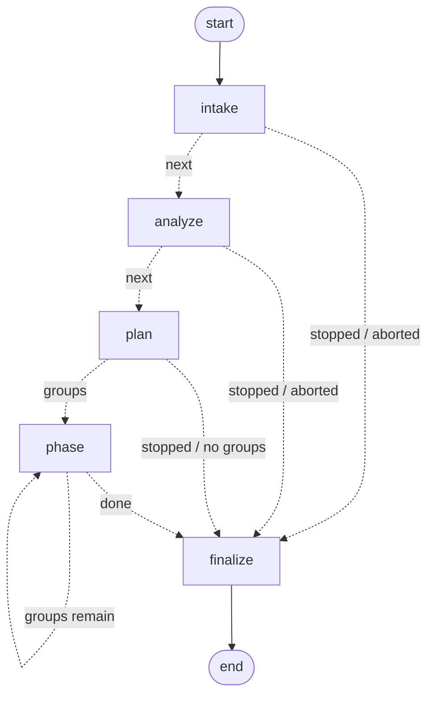

# sbmig Architecture

Goal: take an as-is Maven project (zip/dir), produce a **building** JDK 21 + Spring Boot 4.1.0 project in the
company layout, using OpenRewrite first and an LLM only for what recipes cannot do — and never declare success
without `mvn` saying `BUILD SUCCESS`. Runtime behaviour is explicitly out of scope (as-is owners).

## 1. Pipeline

```
intake ─► analyze ─► advisories ─► plan ─► JDK21 phase ─► SPRING phase ─► RESTRUCTURE phase ─► verify
                                            │               │                 │                    │
                                            └ rewrite+loop  └ rewrite+loop    └ transform+loop     ▼
                                                                             finalize: verify advisories ─► handover ─► report + KB harvest
```

| Phase | What runs | Exit gate |
|---|---|---|
| intake | unzip/copy into `out/<run>/project`, `git init`, as-is commit | – |
| analyze | pom graph + source scan → `ProjectProfile` (case type, versions, libs, optional artifacts in use) | profile.json |
| advisories | `knowledge/libraries/advisories.yml` (+ `advisories.extra_files`, `policy_overrides`) matched against the profile's libraries / declared artifacts → `AdvisoryFinding`s (effective policy `guide` \| `recipe`); never an exit gate — there is no block policy | findings in profile/plan |
| plan | rules (no LLM by default) → `MigrationPlan` (ordered `PlanStep`s); `recipe`-policy advisory recipes are **prepended to `spring.rewrite`** (`recipe_source=advisory`), recipes already inside the Boot 4 umbrella chain (sleuth, Spring Cloud train) are only attributed (`recipe_source=plan`) | plan.json |
| jdk21 | OpenRewrite `UpgradeToJava21` → build-fix loop (`compile`) | BUILD SUCCESS or budget exhausted |
| spring | case-dependent recipes (jakarta / Boot 4.0 umbrella + 4.1 props + version pin / Framework 7 / Security 7 / JUnit5) + KB active recipes → build-fix loop (`test-compile`) | BUILD SUCCESS |
| restructure | non-MSA: parent swap + mandatory deps + optional bumps + `module/{comp-jar,boot-jar}` split + Application class. MSA: pom-only parent/mandatory/optional on each service root → build-fix loop (`package`) | BUILD SUCCESS |
| verify | `mvn clean package` (always) | success flag of the run |
| finalize | advisories verified on the **final tree** (`outcome`: `replaced` \| `still-present` \| `unknown`); `HandoverSummary` built from the as-is poms + as-is effective dependencyManagement vs the final poms (version changes, added/removed, ⚠ carried-over pins, "from here on" list) | – (advisories never change success or the exit code) |
| report | report.md/json (Handover first), changes.patch, result.zip, journal; KB harvest of successful LLM fixes; ledger lines (incl. `resolution=advisory`) | – |

**Externalized configuration (round 8).** `sbmig.analyze.properties.scan_properties` makes a regex inventory of every setting the as-is code reads: `${…}` in `@Value` and other annotations, `@ConfigurationProperties` prefixes, `Environment.getProperty`, `System.getProperty` / `getenv`, `${…}` in Spring XML / web.xml / context.xml, web.xml `<context-param>`, JNDI names (Java literals and lookups, `jee:jndi-lookup`, `jndiName`, Tomcat `<Resource>/<Environment>`, `<resource-ref>/<env-entry>`), `@PropertySource` and placeholder-configurer locations, and `${…}` inside packaged property values. It compares them, using relaxed binding, against the packaged definitions: `application*.properties|yml` at the resources root, `config/` and `META-INF/`, files named by `classpath:` locations, YAML profile documents, plus test resources and inline test properties for test-only keys. Each key becomes a `PropertyFinding`: `defined`, `defaulted` (every ref has a code default) or `external`. Mapping rules from `knowledge/config/externalized.yml` turn container-only keys into the Boot keys restructure writes as `__SET_ME__` placeholders (JNDI DataSource → `spring.datasource.*`, context-param → `server.servlet.context-parameters.<name>`, Boot defaults and container system properties skipped). Maven-filtered resource dirs are recorded, and `${x}` that Maven resolves there are ignored. The result lands in `ProjectProfile.properties`. Broken, oversized or unreadable files become `PropertyInventory.notes`; the scan never raises, and `externalized.enabled: false` turns it off.

Why recipes run **before** restructure: OpenRewrite needs type attribution against the *as-is* classpath
(javax types, Boot 2/3 classes) to match. Swapping the parent first would resolve a Boot 4.1 classpath and leave
old types unattributed, so many `ChangeType`-style recipes would silently no-op.

## 2. Case → recipe matrix

| Case | jdk21 | spring phase | restructure |
|---|---|---|---|
| pure_java | UpgradeToJava21 | jakarta (`JavaxMigrationToJakarta` + `RemovalsServletJakarta10`, only if `javax.*` EE imports found; with it the Hibernate library recipe when hibernate is detected, round 10); JUnit4→5 if junit4 | split into `{name}-boot` / `{name}-back` (+ `{name}-front`) + `spring-boot-starter`, generated `Application` |
| servlet_tomcat | UpgradeToJava21 | `ServletToJakartaAndBoot` (jakarta + Servlet 6 removals + servlet-api swap) + library recipes (Hibernate) | split (`-boot` / `-back` / `-front`) + `spring-boot-starter-webmvc`, `@ServletComponentScan`, web.xml → generated `WebXmlRegistrations` (W1, `layout.web_xml_registrations`) |
| spring_legacy (Spring 4/5, no Boot) | UpgradeToJava21 | jakarta + UpgradeSpringFramework_7_0 + Spring7RemovedApis + Jackson3SpringConverters (+ the Security 6.0 … 6.5 → 7.0 chain if present) + library recipes (Batch 5→6, Hibernate 7.1, Thymeleaf; `knowledge/recipes/library_recipes.yml`, round 10) | split (`-boot` / `-back` / `-front`) + webmvc starter, `@ImportResource` for XML bean files |
| spring_boot (2.x/3.x) | UpgradeToJava21 | UpgradeSpringBoot_4_0 (chains 2.x→3.5 internally) + SpringBootProperties_4_1 + SpringBoot41Version + Boot4JacksonTwins (`@JsonComponent`→`@JacksonComponent`, `JsonObjectSerializer`→`ObjectValueSerializer` …; the umbrella already migrates bodies to Jackson 3) + Boot4TypeRelocations + Spring7RemovedApis + Jackson3SpringConverters (round 10, docs/RECIPES.md) | `boot_pom` in place (default `layout.boot_as_is: in-place`): directories kept, poms only; `layout` → split like the others |
| msa | per service | per service by its own sub-case | `msa_pom` only, directory structure untouched (`boot_modules` passed) |

Restructure routing (round 9c, the company rule): **Boot as-is** (`spring_boot`, and MSA) keeps its directories —
`restructure.boot_pom` (mode `boot_pom`): root → `artifacts.parent`, modules in `profile.boot_modules` (basename matches
`layout.boot_module_pattern`, default `*-boot`, AND the pom is a boot app: spring-boot-maven-plugin or a
`@SpringBootApplication` under its `src/main/java`) → `boot_parent`, every other module → `comp_parent`; a single-module
Boot app is wrapped into `{name}-boot`. **Non-Boot** (pure_java / servlet_tomcat / spring_legacy) → `restructure.apply`
(mode `layout`): `{name}-boot` / `{name}-back` / `{name}-front` — front only when `source.web_static_count` or
`source.jsp_paths` is non-empty; JSPs make the boot module a WAR (`layout.jsp_boot_packaging`). Analyzer warnings: a boot
app not named like the pattern; a pattern-named module whose pom is not a boot app.

Pre-emptive handlers from the profile (run before the first build of a phase): lombok ≥ 1.18.30 for JDK 21,
mapstruct ≥ 1.6, querydsl jakarta classifier, maven-compiler-plugin ≥ 3.13, surefire ≥ 3.2, etc.
(`sbmig/triage/handlers/`).
Reactive handlers (triggered by build errors): `dependency-relocation` (javax→jakarta artifacts, Boot 4 starter renames),
`add-known-dependency` (error references a package whose artifact is known: hamcrest, modular `*-test` starters,
`spring-boot-jackson2`, jakarta APIs, jsr305 …; version omitted when a Boot/in-house parent manages it),
`missing-dependency-version`, `jaxb-runtime-add`, plus `recipe_rules.yml` mapping error patterns to builtin recipes.

## 3. Build-fix loop (the heart)

```
for iteration in 1..max_iterations:
    result = build(goal)                      # ALWAYS a real mvn run, log captured
    if result.ok: break  ✔
    errors   = parse(log)                     # structured BuildError with L1/L2 signatures
    stall    = signature multiset == previous → stall_level += 1
    clusters = triage.cluster(errors)         # dependency/plugin/parent first, then compile by file (reactor order), then test-compile
    for cluster in clusters[:max_clusters_per_iteration]:
        match    = kb.match(cluster)          # active recipes, replayable patches, hints
        decision = triage.decide(cluster, match, ctx)   # HANDLER > KB_RECIPE > KB_PATCH > LLM_FIX > ESCALATE
        apply(decision) ; commit               # one git commit per attempt
    (KB_RECIPE decisions are batched into ONE OpenRewrite run per iteration)
    rebuild happens at the top of the next iteration; attempts are scored by whether their cluster's
    errors disappeared (improved / partial / no_change / regressed, or inconclusive when the build could not show
    them — round 10). Regression ⇒ revert that commit.
    stall_level ≥ stall_limit ⇒ widen context + escalation model; still stalled ⇒ ESCALATE cluster to report.
```

Hard rules:
* The orchestrator owns the loop. The LLM never decides whether to build; a phase is done only on `BUILD SUCCESS`.
* Every attempt is a git commit → revertable, diffable, attributable in the report.
* Budgets: `max_iterations` per phase, `max_llm_calls` per run, `max_total_minutes` per run.
* Test-compile fallback (`-Dmaven.test.skip=true`) only as a last resort and always surfaced as a flag.
* Tests-skipped fallback (round 8, `build.allow_skip_tests_fallback`): when only runtime `TEST_FAILURE` errors
  remain after the fix rounds and the goal runs tests, the phase is rebuilt with `-DskipTests`; on success flag
  `tests-skipped`, every failing test becomes a follow-up and an unresolved error, and the final verify also packages
  with `-DskipTests` (`-Dmaven.test.skip=true` wins when the test-compile fallback fired too).

## 4. Triage

Clusters are keyed by `(kind, file)` for compile errors and by `(kind, artifact)` for resolution errors.
Priority: PARENT_RESOLUTION < POM_INVALID < DEPENDENCY_RESOLUTION < PLUGIN_RESOLUTION < ENFORCER < COMPILE
(by reactor module order, then by error count desc) < TEST_COMPILE < PLUGIN_EXECUTION.
Resolution-type clusters mask compile clusters of the same module in the same iteration (SKIP) because
they usually disappear once the pom is fixed.

Decision order per cluster: run-wide blocked registry → a case action a person pinned (`CaseHit.pinned`: block |
handler | recipe, round 10) → deterministic handler → KB active recipe → KB patch replay → LLM → escalate. The
per-cluster limits count only scored failures of the same cluster (same id, or same file with an overlapping
signature); attempts on other files with the same signature are prompt hints, not failures (round 10).
A cluster that already went through an LLM attempt without improvement gets the previous attempt in its
prompt (so the model does not repeat itself) and, after `stall_limit`, the escalation model.

## 5. Signatures

* **L1 (specific)** `kind|normalized message|symbol|location-type` — e.g.
  `compile|cannot find symbol|class WebSecurityConfigurerAdapter|package org.springframework.security.config.annotation.web.configuration`
* **L2 (generic)** `kind|message-class|symbol-name` — e.g. `compile|cannot_find_symbol|WebSecurityConfigurerAdapter`.
  L2 is the case-catalog key, so since round 10 it keeps what tells problems apart: the whole package of
  `package … does not exist` (`javax.xml.bind` ≠ `javax.xml.ws`), the method / class of `method_does_not_override` /
  `static_import_only` (read from the source line), the javac phrase of `illegal_start`, and plugin goal + normalized
  cause for `plugin_execution` (`plugin_execution|war:war|error assembling war: webxml attribute is required`).
* Paths, line numbers, module names and project-specific identifiers in messages are stripped (L1 also masks project
  FQCNs inside the symbol).
  Dependency errors: `dependency_resolution|g:a` (version stripped) / `…|g:a:v` as L1.

## 6. LLM fix protocol

Request = system prompt (role, hard constraints, output protocol) + user content:
profile summary, phase, the cluster's errors, the file (whole if ≤ 400 lines, else windows ±60 lines around each
error with exact text), pom excerpt when relevant, selected migration notes (`knowledge/notes/*.md` chosen by
keyword index), KB hints, previous failed attempts on this cluster, summary of other clusters.

Response protocol (parsed by `sbmig.fix.protocol`):
```
<analysis>…why…</analysis>
<patches>
=== MODIFY path/to/File.java
<<<<<<< SEARCH
exact text
=======
replacement
>>>>>>> REPLACE
=== CREATE path/to/New.java
…full content…
=== DELETE path/to/Old.java
</patches>
```
or `<need_files>a.java, b.xml</need_files>` / `<need_grep>pattern</need_grep>` (≤ `max_context_rounds` rounds).
SEARCH must match exactly once (fallback: whitespace-normalized unique match); otherwise the block is rejected
and the model gets the rejection as feedback in the same cluster's next round.

## 7. Knowledge base (file-based, git-friendly)

```
kb/
  cases/YYYY-MM/<case-id>.json        one resolved case per file (signatures, sanitized errors, changes, outcome)
  index.json                          signature → case ids / recipe ids   (rebuild: `sbmig kb reindex`)
  recipes/active/*.yml                promoted declarative OpenRewrite recipes (composed into every run)
  recipes/candidates/*.yml            harvested, awaiting review (`sbmig kb list|promote|reject`)
  patterns/*.yml                      deterministic non-OpenRewrite fixes (pom relocations, property renames)
  ledger.jsonl                        one ResolutionRecord per resolved/blocked cluster across ALL projects (fleet memory)
  symbols.json                        error-case symbol → fix labels / "old → new" / projects / recipe id
```
Harvest (end of each phase, only for attempts whose cluster was resolved and which survived to BUILD SUCCESS):
1. Create `KBCase` (sanitized paths, no secrets).
2. If `generate_recipe_candidates`: ask the LLM whether the fix is mechanical and expressible with a
   whitelisted recipe set (ChangeType, ChangePackage, ChangeMethodName, ChangeDependencyGroupIdAndArtifactId,
   UpgradeDependencyVersion, AddDependency, RemoveDependency, ChangePropertyKey, ChangeSpringPropertyKey,
   ReplaceConstant, …); validate YAML; store as candidate with the triggering signatures.
3. Next projects: `kb.match` surfaces active recipes (run before LLM), replayable patches (same L1 signature and
   the SEARCH text still present) and hints (summaries of similar cases).
4. Candidate → active automatically after success in `auto_promote_after_projects` distinct projects, or manually.
5. **Where candidates run.** OpenRewrite needs type attribution, which only exists while the as-is classpath is intact,
   and `rewrite:run` forks `compile` first (so it cannot run on a broken project at all). Therefore candidates are
   composed into the plan's `spring.rewrite` step next to the migration recipes (`kb.try_candidates_in_plan`), and the
   runner records per-recipe attribution from the plugin's `… by:` blocks (`RewriteResult.recipes_applied`). After the
   phase, every KB recipe that actually changed files is credited with the phase's build outcome
   (`Orchestrator._credit_plan_recipes`). Reactive KB recipe batches inside the build-fix loop use `rewrite:runNoFork`,
   and a forked plan-level run that fails in `compile` is retried with `runNoFork` automatically.

6. **Labels and the ledger (round 3).** Every harvested case is labeled deterministically from its diff
   (`sbmig.kb.labels`: `import-rename`, `type-rename`, `annotation-replace`, `method-rename`, `dependency-add`,
   `dependency-version`, `spring-property-rename`, … `generic-rewrite`) and keyed by the error-case **symbol** (javac
   symbol, `g:a`, owner class). Mechanical labels compile straight into whitelisted recipe candidates (no LLM; since
   round 5 also `method-rename → ChangeMethodName`, owner FQCN from `KBCase.symbol_owner`); the others go to the
   recipe model. Each resolution (handler / plan recipe / KB recipe / KB patch / LLM patch / blocked)
   is appended to `kb/ledger.jsonl`, and `kb/symbols.json` feeds "symbol X was fixed in N projects by Y: old → new"
   hints into the next prompt. `sbmig kb learning` turns the ledger into the to-do list for humans (symbols the LLM
   keeps fixing → write a recipe/handler; artifacts blocking many projects → library owners).

7. **Integrity (round 10).** Every KB write runs under the cross-process lock `kb/.lock` (`sbmig/kb/lock.py`), so the
   web server, a fleet and `sbmig kb …` can share one KB (index reloaded when it changed on disk); the append-only
   jsonl files repair a torn last line before appending (`<file>.corrupt`) and fsync per batch; unreadable lines go
   to `kb/quarantine.jsonl`; secret VALUES are masked by context before anything is stored (`sbmig/kb/redact.py`,
   company rules in `knowledge/kb/redact.yml`); records carry `schema_version` / `agent_version`; human edits and
   automatic case transitions are logged in `kb/audit.jsonl`.

## 7.5 Fleet mode (one agent, sequential)
`sbmig fleet run <manifest>` (`sbmig/fleet`): projects are migrated strictly one after another with a shared KB, so
project N+1 plans with the recipes learned from 1..N. State (`fleet/state.json`) is rewritten after every project and
makes the run resumable; `summary.{md,csv,json}` + `learning.md` are regenerated each time. The per-project pipeline
is unchanged (`Orchestrator`); the fleet only sequences, budgets (`fleet.max_llm_calls_total`) and aggregates — and,
since round 10, guards the infrastructure (preflight, a breaker that defers projects ending with `infra:<kind>` and
pauses / stops the fleet, disk check and `fleet.cleanup`; docs/FLEET.md).

## 7.6 Adapter seams (in-house gateway / agent platform)
`LLMClientLike` (chat completion) and `FixerLike` (whole fixer) are the two replaceable units. `llm.provider: plugin`
+ `llm.plugin: "pkg.module:attr"` loads an `LLMAdapterLike` (`complete(LLMRequest) -> LLMResponse`, with the call's
`role` and metadata) and wraps it so recording and budgets still apply; `fix.plugin` replaces `LLMFixer` with an
in-house coding agent that receives the workspace, the error cluster and the packed context. See `docs/ADAPTERS.md`.

## 7.7 Graph engine (LangGraph)
The company only deploys agents built on LangGraph / LangChain, so a LangGraph `StateGraph` **drives** the pipeline
(`sbmig/graph/engine.py`, `loop.engine: graph`, the default). It does not re-implement it: every node calls one shared
`Orchestrator.step_*` method, and `loop.engine: inline` runs the same steps from `Orchestrator._run` without LangGraph.



| Node | Step | Notes |
|---|---|---|
| `intake` | `step_intake` | git snapshot, preflight (`mvn-not-found` / `jdk-not-21` → abort), as-is effective depMgmt |
| `analyze` | `step_analyze` | profile + advisories; not Maven / no pom → abort |
| `plan` | `step_plan` | plan, `BuildFixLoop`, phase groups (`None` = stopped after plan) |
| `phase` | `step_phase` | one invocation per phase group (MSA: jdk21/spring repeat per service); `phase_skipped` after `stop_after`; credit + harvest; raises `_RunAborted` when the loop aborted |
| `finalize` | `step_finish` | the trailing `stop_after` record (only when the plan ran, as inline) |

- **State vs orchestrator.** `MigrationState` holds only small JSON-able values: `run_id`, `stop_after`, `dry_run`,
  `phases` (remaining group names), `phase`, `aborted`, `stopped`, `summary` (case type, per-phase outcome, LLM
  calls, blocked, unresolved). The `RunReport`, the phase groups with their `PlanStep`s and the `BuildFixLoop` stay on
  the `Orchestrator` / a per-run holder closed over by the node functions.
- **Errors and finalization.** Nodes never catch: `_RunAborted`, `MissingComponentError` and any other exception
  leave the graph and are handled by the orchestrator's run guard (`_run_guard`), which also runs `_finalize`
  (report, ledger, outputs) for both engines. `run()` opens the guard and dispatches on `loop.engine`;
  `run_graph(orch)` / `stream_graph(orch)` open it themselves when called directly (the web app consumes
  `stream_graph` → `(node, state_update)`; the report is `orch.report` afterwards, also when the stream is closed early).
- **Journal.** Each node start adds `{"event": "graph_node", "node", "phase"}`; everything else is unchanged.
- **Identical by test.** `tests/graph/test_engine.py` runs both engines on the same fake projects (boot, MSA,
  failing build, `stop_after` intake/analyze/plan/jdk21, `mvn-not-found`, parent-not-found abort, internal error)
  and asserts equal reports (minus timestamps / SHAs), flags, exit codes and journal event sequences.
- `recursion_limit` is 1000 (one graph step per node invocation; MSA plans add phase groups per service).
- **Invariant 1 on the abort paths.** An exception inside a node (missing component, bug) is caught by the guard,
  the run is flagged `aborted`, and `_final_build_after_abort` still runs every planned verify step that has no
  result yet (not for dry runs or `_RunAborted`, i.e. no Maven / Maven on another JDK / unresolvable parent); an
  aborted run or a missing final build is never `success` (round 10). The web UI's stop finalizes without the final
  build and says so; a stop observed after the verify phase group finishes the run normally.

## 8. Restructure (company layout)

The company rule (stated 2026-10-21, round 9c). `{name}` = `layout.project_name` or the root pom's artifactId; every
module path is `layout.module_path(which, name)` (`module_dir` + `boot_module` / `comp_module` / `front_module`), so
the modules sit directly under the root by default.

```
root/pom.xml          packaging=pom, parent=artifacts.parent (base-parent), modules=[{name}-back, ({name}-front,) {name}-boot],
                      dependencies=[mandatory×2] (artifacts.mandatory_target: root), aggregator only (role parents)
root/{name}-boot      ONLY the Boot configuration: the generated / moved @SpringBootApplication class (+ a
                      SpringBootServletInitializer subclass), application*.properties|yml, logging config, banner,
                      @SpringBootTest tests, legacy-config/ (imported XML), asis-webinf/ (non-JSP WEB-INF files);
                      parent boot_parent; spring-boot-maven-plugin repackage; deps: -back (+ -front) + starter by case
root/{name}-back      every as-is source incl. controllers, services, repositories and their resources (the minimal
                      split; multi-module projects are merged into it); parent comp_parent; as-is dependencies
root/{name}-front     only when the as-is project has web resources; parent comp_parent; packaging jar:
                      src/main/webapp/** (minus WEB-INF, META-INF) → <front_static_dir>/** (default src/main/resources/static),
                      src/main/resources/{static,public,templates}/** → same path, JSPs → <front_jsp_dir>/**
                      (default src/main/resources/META-INF/resources/WEB-INF/jsp, Servlet 3 jar resources)
```
Artifact ids: `<root artifactId>` + `layout.boot_artifact_suffix` / `comp_artifact_suffix` / `-front`; the boot
module depends on `${project.groupId}:<root>-<suffix>:${project.version}` of back and front.
`RestructureResult.boot_module / comp_module / front_module` (the module dirs that exist), `boot_packaging`
(`jar` | `war`) and `front_files` (files moved into the front module) report what was produced.

**Front module** (`layout.front_module`, None = off). After the as-is sources are in `{name}-back` (single module or
merge), the web files move on: static files keep their relative path; a JSP (`*.jsp|jspf|jspx`) under
`WEB-INF/jsp/` keeps its path below the jsp dir, any other JSP under `WEB-INF/` keeps its path below `WEB-INF/`
(`WEB-INF/views/a.jsp` → `jsp/views/a.jsp`; a JSP directly under `WEB-INF/` lands in the jsp dir root, follow-up
"update include / forward paths"); a JSP outside WEB-INF goes to the jar's `META-INF/resources/` root (same URL);
`WEB-INF/tags/**` and `*.tld` → `META-INF/resources/WEB-INF/…`. `web.xml` and the other non-JSP `WEB-INF/*` files
go to `{name}-boot/src/main/resources/asis-webinf/` (never read by Boot, not the WAR's `WEB-INF`; its servlets /
filters / listeners → generated `WebXmlRegistrations`, see below, annotated ones via `@ServletComponentScan`; XML bean configs are still imported from `legacy-config/`);
`WEB-INF/lib`, `WEB-INF/classes` and webapp `META-INF` stay in `{name}-back/src/main/webapp` (follow-up). A target
path taken twice keeps the first file (follow-up). No static file and no JSP → no front module, `<modules>` = back + boot.
Wrap (`multi_module_policy: wrap`) and kept as-is boot modules' own resources are not split.

**JSP → WAR** (JSPs moved and `layout.jsp_boot_packaging: war`, the default): `{name}-boot` is packaged `war` for an
external Tomcat — `spring-boot-starter-tomcat` and `org.apache.tomcat.embed:tomcat-embed-jasper` `provided`
(+ `spring-boot-web-server` compile scope when the Application carries `@ServletComponentScan`: Boot 4.1 brings it
only through the Tomcat starter, so `provided` would drop it from `WEB-INF/lib` — verified with a WAR build), the
generated Application `extends SpringBootServletInitializer` (`configure(SpringApplicationBuilder)`; a moved / kept
main class that does not gets a follow-up), spring-boot-maven-plugin repackage kept, no maven-war-plugin settings
(war-plugin ≥ 3.0 defaults `failOnMissingWebXml=false`; Boot 4.1 pins 3.5.1). A JSP declaring a JSTL taglib
(`java.sun.com/jsp/jstl/*`, `xmlns.jcp.org/jsp/jstl/*`, `jakarta.tags.*`) adds
`jakarta.servlet.jsp.jstl:jakarta.servlet.jsp.jstl-api` + `org.glassfish.web:jakarta.servlet.jsp.jstl` without
versions (managed by `spring-boot-dependencies` 4.1.0: 3.0.2 / 3.0.1). `spring.mvc.view.prefix` / `suffix` are written
to the boot `application.properties` only when the as-is XML / Java names an `InternalResourceViewResolver` prefix /
suffix (bean properties, `p:` attributes, `<mvc:jsp>`, `setPrefix/setSuffix`, the two-arg constructor,
`registry.jsp(…)`), the prefix mapped to the moved location (`/WEB-INF/views/` → `/WEB-INF/jsp/views/`, with a
follow-up to update the as-is resolver bean, which takes precedence); else a follow-up asks the owners to set them.
Follow-up: "boot module packaged as WAR for external Tomcat; JSPs are served from the front jar (META-INF/resources)".

**web.xml → `WebXmlRegistrations`** (2026-10-23, `layout.web_xml_registrations: generate`, the default; catalog W1).
Neither embedded Tomcat nor the Boot WAR reads web.xml, and pre-Servlet-3 projects (2.2 / 2.3 / 2.4) have no
`@WebServlet`, so `@ServletComponentScan` alone loses every mapping. After the Application is generated (layout
mode, `_write_boot`), the restructure re-reads the first web.xml from its new location
(`sbmig.analyze.webxml.parse_web_xml`: namespace-agnostic, DTD never fetched, lenient re-parse with warnings, never
raises; `SourceStats.web_xml_spec / web_xml_servlets / web_xml_filters / web_xml_listeners` come from the same
parser) and `sbmig.restructure.webxml_registrations.plan_registrations` renders
`templates/WebXmlRegistrations.java.j2` into `{name}-boot/src/main/java/<pkg>/WebXmlRegistrations.java` (`<pkg>` =
the Application's package; `SbmigWebXmlRegistrations` when the name is taken): one
`ServletRegistrationBean<jakarta.servlet.http.HttpServlet | jakarta.servlet.Servlet>` per servlet class (patterns,
`setName`, `setLoadOnStartup`, init params, async, `MultipartConfigElement`; no mapping → `alwaysMapUrl=false`),
one `FilterRegistrationBean<jakarta.servlet.Filter>` per mapped filter (url patterns / servlet names,
`setDispatcherTypes(jakarta.servlet.DispatcherType…)`, `setOrder(n)` = position of its first `<filter-mapping>`;
an unmapped filter is not registered), one `ServletListenerRegistrationBean<java.util.EventListener>` per listener,
one `ErrorPageRegistrar` (`ErrorPage(HttpStatus.valueOf(code) | <Exception>.class | default, location)`, javax
servlet exceptions renamed, unknown status codes → follow-up). FQCNs throughout (`new com.x.FrontServlet()`), ASCII
only (`\uXXXX` in literals). Skip table `knowledge/config/web_xml_rules.yml` (DispatcherServlet, ContextLoaderListener,
CharacterEncodingFilter, DelegatingFilterProxy, Jasper / Default servlet, …): one follow-up each with the Boot
property hint (a DispatcherServlet mapped to something other than `/` → `spring.mvc.servlet.path` follow-up).
Classes the project annotates `@WebServlet` / `@WebFilter` / `@WebListener` stay with `@ServletComponentScan` (no
double registration). A class the project does not contain (library servlet such as Struts' `ActionServlet`) is still
generated with a note. `<session-timeout>` → `server.servlet.session.timeout=<N>m` in the boot
`application.properties` (embedded only — a WAR gets a follow-up); jsp-file servlets, welcome files, MIME mappings,
security constraints / login-config → follow-ups; `<context-param>` stays with the properties inventory. Output:
`RestructureResult.flags` += `web-xml-registered` (the orchestrator adds restructure flags to the report), journal
`web_xml_registrations` (`path`, `spec`, `servlets`, `filters`, `listeners`, `error_pages`, `skipped`,
`jsp_file_servlets`, `class`), Handover follow-up "web.xml (<spec>) → WebXmlRegistrations: N servlet(s), M filter(s),
K listener(s), E error page(s); skipped: …". Nothing to register (only skipped / annotated entries) → no class, the
skip follow-ups only; `followup` = the pre-2026-10-23 behaviour (web.xml follow-up only).
`jsp_boot_packaging: jar` keeps an executable jar (jasper compile scope + follow-up: Boot does not serve JSPs from an
executable jar). Without JSPs the boot module is an executable jar (an as-is WAR is converted as before).

**Spring Boot as-is in place** (mode `boot_pom`, planned for `spring_boot` with `layout.boot_as_is: in-place`):
directories are kept. Root with `<modules>`: root → `artifacts.parent` (packaging pom, explicit coordinates); module
poms whose dir is in `profile.boot_modules` (fallback when empty: spring-boot-maven-plugin in `<build><plugins>` or a
`@SpringBootApplication` class under the module) → `boot_parent`, every other module → `comp_parent`, both with
`<relativePath/>` and explicit groupId / version. A module that stops inheriting in-repo poms gets their
`<dependencies>`, `<build><plugins>` (spring-boot-maven-plugin only for boot modules, `<inherited>false</inherited>`
skipped), dependencyManagement, pluginManagement, repositories and referenced properties; a module inheriting an
in-repo intermediate pom keeps it (the intermediate is re-pointed). The root then keeps only the mandatory
dependencies (`mandatory_target: root`), loses dependencyManagement / pluginManagement / build plugins and every
property it no longer references; an as-is module declaration of a mandatory artifact gets the configured version.
Sibling dependencies are untouched; optional bumps, `remove_when_present`, java level, boot plugin version and
`drop_managed_versions` run on every pom; placeholders go to each boot module's `src/main/resources` (by reference
location when there are several). Root without modules but with sources: `src/**` (+ custom source roots, `lib/`) move
to `{name}-boot/`, whose pom is the as-is root pom (dependencies, build, profiles; artifactId `<root>-boot`, explicit
coordinates, packaging kept); the root becomes the aggregator (`<modules>` = [`{name}-boot`]) and the pass above runs.
Without role parents the modules keep inheriting the root (root → `artifacts.parent` + mandatory + BOM + java level);
a module on an external parent is treated as its own root. A second run changes nothing (note "already in place").
`RestructureResult.boot_module` = the first boot module, `comp_module` = the single other module (else None).

**`artifacts.mandatory_target`** (round 9c): `root` (default, the company rule) = the 2 mandatory dependencies are
declared in every root pom — the project root even when it is an aggregator the modules do not inherit; in MSA with
role parents each service root and the top aggregator; `modules` = round 9b (every role module pom, incl. front; the
root none). Without role parents both mean "the root pom the modules inherit" (unchanged).

**MSA** (`msa_pom`, service detection unchanged): with role parents a service root → `boot_parent`, a library root →
`comp_parent`, the top aggregator → `artifacts.parent` (also under `msa_parent_policy: per-service-root`); a service /
library root that inherited the aggregator stops there (its role parent, explicit coordinates, what it inherited).

*Pre-9c layout* (`config/artifacts.local-e2e.yml` pins it for the older fixtures): `module_dir: module`,
`boot_module: boot-jar`, `comp_module: comp-jar`, `front_module: null`, `boot_as_is: layout` — `module/comp-jar` +
`module/boot-jar`, Boot projects split like the others, web resources stay in comp-jar, JSPs only add
`tomcat-embed-jasper` + a follow-up; byte-identical to round 9b (snapshot test `test_pre9c_layout_is_unchanged`). The
paragraphs below were written for it: read `module/comp-jar` / `module/boot-jar` as the configured back / boot module.

Multi-module as-is (non-MSA), `layout.multi_module_policy` (default **`merge`**, round 7b): every as-is module and
the root `src/` are folded into `module/comp-jar` (one pom: root + module dependencies minus the module-to-module ones).
An as-is module whose directory basename is `layout.boot_module` (`boot-jar`, `apps/boot-jar`, …) is the **kept boot
module**: moved to `module/boot-jar` (parent `relativePath` recomputed), its dependencies on merged modules replaced by
one `<root artifactId>-comp` dependency, spring-boot-maven-plugin ensured, its sources untouched and no Application
generated (first match in `<modules>` order wins; without one, boot-jar is generated as for a single module).
Collisions (same comp-jar path from two sources), `layout.merge_collision`: `first-wins` (default) keeps the copy of
the first source in `<modules>` order (`<root>` first), drops identical copies with one note and saves differing ones
as `<run dir>/merge-conflicts/<module>/src/…` (`RestructureResult.merge_conflicts`, Handover "Merge conflicts", one
manual follow-up); `fail` aborts before anything moves. Nested aggregators abort the merge. "Already restructured"
under `merge` = root packaging `pom` with both `module/comp-jar` and `module/boot-jar` among its modules. `wrap`
(opt-in) moves the existing modules under `module/` unchanged and adds a boot-jar depending on the jar modules.

Merge edge cases (round 9). **Line-list registries** (`META-INF/services/*`, `META-INF/spring.factories`,
`META-INF/spring/*.imports` / `*.factories`, in any resource dir, main or test) are never first-wins and never a
`fail` collision: the kept file is the union of every copy's lines (first copy verbatim, then new lines of the others;
`*.factories` merged per key with deduped comma values), `MergeConflict(union=True)`, every original saved under
`merge-conflicts/<module>/…`, one note, no follow-up (identical copies stay an ordinary identical drop).
`src/test/**` collisions follow the main rules. **`<packaging>pom</packaging>` sub-modules** (BOM, nested aggregator)
move nothing: their `<modules>` children are merged like any other module (depth-first, declaration order), their
`<properties>` and every merged module's `<dependencyManagement>` entries are folded into the root pom (first wins per
key / g:a, with the `${props}` the versions reference); root management entries for merged modules (an internal BOM
import) are removed; a `src/` in a pom module (never compiled by Maven) is saved under `merge-conflicts/`, not merged
(follow-up). A kept boot module whose parent was a merged pom module is re-pointed to the root pom. **Modules outside
the project root** (`<module>../sibling</module>`, root or nested) are skipped under `merge` (note + follow-up; nothing
outside the workspace is read or written); `wrap` still aborts before anything moves. **WAR modules** folded into
comp-jar behave like a single-module WAR: `src/main/webapp` lands in `module/comp-jar/src/main/webapp` (not packaged by
the jar — web.xml / JSP follow-ups name the new location, "WAR packaging converted" follow-up). **Kept boot module
resources** stay in boot-jar; the merged modules' same-named copies go to comp-jar (first-wins only applies within
comp-jar) and a follow-up says the boot-jar copy shadows them at runtime. **Custom resource directories**
(`<build><resources>` of the root or a module, e.g. `src/main/config`): the files move with the same relative path
(also top-level dirs outside `src/`) and comp-jar's `<resources>` / `<testResources>` is the union of every module's
directories (deduped by directory + targetPath), plus the Maven default directory when some module relied on it.

**Role parents** (round 9b, `artifacts.boot_parent` + `artifacts.comp_parent`, both set = `role_parents`; the
company layout: root on `base-parent`, boot module on the in-house `boot-jar` parent, comp module on `comp-jar`, all
on one version line, e.g. 4.0.0). The root pom (`artifacts.parent`, packaging `pom`, `<modules>` = the two modules)
is then a pure **aggregator the modules do not inherit**: `module/boot-jar/pom.xml` inherits `boot_parent` and
`module/comp-jar/pom.xml` `comp_parent`, both with `<relativePath/>` (external, resolved from the repository) and an
explicit `<groupId>` / `<version>` (the project's), so the boot → comp dependency
`${project.groupId}:<root>-comp:${project.version}` resolves. What used to flow through inheritance moves into the
module poms: the 2 `mandatory` dependencies go into **both** module poms (none in the root; round 9c: only with
`mandatory_target: modules`, the default `root` declares them in the root pom), the Spring Boot BOM
(`parent_manages_spring_boot: false`) and `maven.compiler.release` (`parent_manages_java_version: false`) into both,
`remove_when_present` applies to them; the root's own `<dependencyManagement>` (minus merged-module entries),
`<pluginManagement>` and `<repositories>` / `<pluginRepositories>` are copied into both, the root's `<properties>`
into the comp pom (all) and into the boot pom (the ones it references plus `project.*` / `maven.*`); the
dependencyManagement / properties folded from merged modules go into the comp pom. The root then loses its
dependencies, dependencyManagement, pluginManagement and every property it no longer references itself. A kept as-is
boot module gets `boot_parent` whatever its parent was (an older `boot-jar` / `comp-jar` role parent, the root, a
starter parent), explicit coordinates (its own, else the root's), and the root content above only when it inherited
the root before. `wrap` keeps the wrapped modules on the root (which keeps the mandatory dependencies); only the
generated boot-jar gets `boot_parent`. **Old role parents**: any project pom (root excluded) whose `<parent>` has the
groupId:artifactId of `boot_parent` / `comp_parent` (any version, e.g. the 1.0.0 of an earlier migration) moves to
the configured GAV with `<relativePath/>` (missing groupId / version made explicit from the old effective ones; when
both role parents share one key the module location decides) — in `layout` (kept boot module, wrapped modules), in
`msa_pom` and in the already-restructured pass, which also moves the root to the configured `artifacts.parent`
version; a module pom on another parent is noted and left. A second run changes nothing; changing the configured
versions moves all three parents. **MSA** with role parents: service roots → `boot_parent` (mandatory dependencies
as before), library roots (`kind: library` / `library_roots`) → `comp_parent`, the top aggregator (policy
`top-aggregator`) → `artifacts.parent`. Every parent set or replaced is listed in `RestructureResult.parents_set`
(`"<pom>: <old g:a:v or '-'> → <new g:a:v>"`, also without role parents) plus one note. Without role parents
everything is as before (modules inherit the root).

**Managed-version cleanup** (round 9, `layout.drop_managed_versions`, `layout` and `msa_pom`). After the parent /
mandatory / optional edits the restructurer calls `params["effective_pom"]` (zero-arg; the orchestrator passes
`sbmig.build.effective.effective_pom_provider(ws, cfg)`, which captures `help:effective-pom` of the restructured tree
into `<run dir>/effective/depmgmt-after-restructure.json` and returns the dict, None without Maven). For every
explicit `<dependencies>` version in every project pom (literal or `${prop}` resolvable from the pom chain) whose
artifact the declaring module's chain manages (`by_module`, else the merged `managed` map): `gte` drops the
`<version>` when managed ≥ explicit (unknown comparison → keep; newer pins are noted), `any` always, `off` never.
Never touched: parent / mandatory / optional / remove_when_present artifacts, the project's own modules, system scope,
non-jar types / classifiers, dependencyManagement, plugins, properties. Recorded in
`RestructureResult.managed_versions_dropped` + one note; without the callable / capture: note "managed-version
cleanup skipped: no effective pom". MSA placeholders (round 9): with a per-service inventory
(`PropertyFinding.service`) each service file gets that service's findings plus the shared (`service: null`) ones;
a project-wide inventory keeps the location-based selection.

**Externalized configuration placeholders** (round 8, `externalized.*`). Settings the as-is code reads but no packaged
resource defines (`ProjectProfile.properties`, status `external`: they came from the container — JNDI, web.xml
`context-param`, `-D`, `catalina.properties`) get one `key=__SET_ME__` line per `boot_key` (JNDI DataSource →
`spring.datasource.*`, context-param → `server.servlet.context-parameters.*`; a context-param with an as-is value
writes that value; `boot_keys=[]` writes nothing; test-only refs follow `include_test_refs`), each preceded by a
`# from <source> <file:line>` comment, sorted and deduped. Layout mode writes `module/boot-jar/src/main/resources/
<placeholder_file>` (single, merge with a generated or kept boot module, wrap, and already-restructured projects);
`msa_pom` writes each service root's `src/main/resources/<placeholder_file>` (created only when the service has
`src/main/java`) with the keys referenced inside that service plus keys only shared code outside every service reads;
`optional_bump` writes nothing. The file is created when absent (also next to an `application.yml`: Boot loads both,
a note in the block says so). The block sits between `# --- sbmig externalized-config` and `# --- end sbmig
externalized-config`; a rerun replaces the block in place and keeps every other byte and the file's line endings, so
it is idempotent. The step records `RestructureResult.placeholder_files / placeholders_written`, one note and one
follow-up; the orchestrator merges them into `RunReport.properties` (journal event `placeholders`) for the Handover.

## 9. Outputs

`out/<run_id>/{project/, logs/, journal.jsonl, profile.json, plan.json, report.json, report.md, changes.patch, result.zip}`

* `report.json` — a serialized `RunReport` (`sbmig/core/models.py`), including `advisories: [AdvisoryFinding]`
  (`advisory_id`, `library`, `status`, `title`, `policy`, `policy_reason`, `detected_version`, `recipes`,
  `recipe_source` `plan|advisory|none`, `outcome`, `replacement`, `followup`, …) and `handover: HandoverSummary`
  (`parent_before/after`, `java_before/after`, `spring_boot_before/after`, `changes: [VersionChange]`, `added`,
  `removed`, `carried_over`, `from_here`, `notes`).
* `report.md` — first section `## Handover — what we replaced, what is yours` with `### Versions replaced`
  (⚠ = carried over), `### Libraries needing your attention`, `### From here on, your team`; then summary, blocked,
  unresolved, phases, manual follow-ups (`docs/RUNBOOK.md` §2.5).
* `kb/ledger.jsonl` — one line per resolved / blocked cluster and, with `advisories.ledger`, one
  `resolution=advisory` line per finding (advisory id, outcome, policy).
* Fleet (`out/fleet/fleet/`): `summary.csv` gains `advisories` (`id:outcome` list) and `carried_over` (count);
  `learning.md` gains "Libraries needing owner action" (advisories by number of projects still affected).
