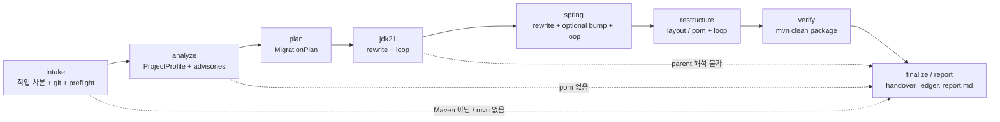
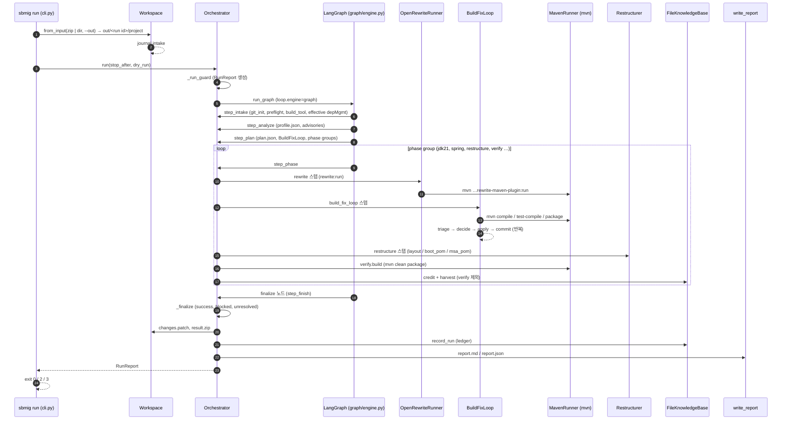
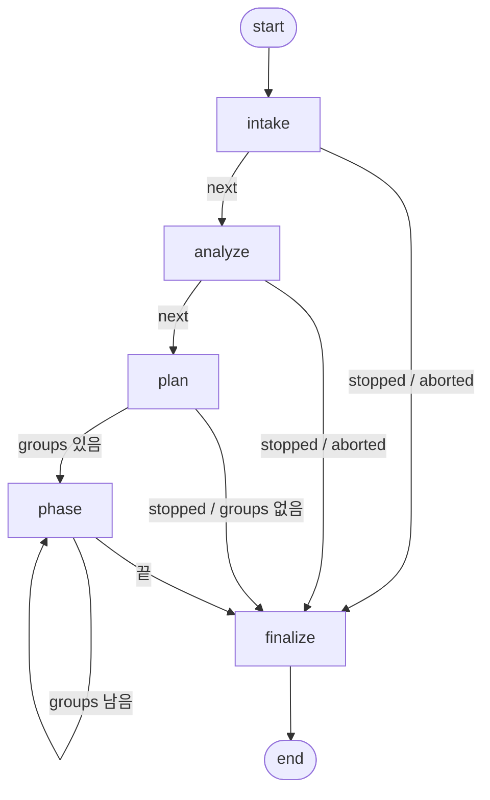

# 01. 파이프라인 상세

`sbmig run` 한 번은 정해진 순서의 단계(phase)를 지납니다. intake(작업 사본 만들기) → analyze(프로젝트 진단) → plan(규칙 기반 계획) → jdk21(Java 21 리라이트 + 빌드 수정 루프) → spring(jakarta / Spring Boot 4.1 리라이트 + 루프) → restructure(사내 parent / 모듈 구조 + 루프) → verify(최종 `mvn clean package`) → report(보고서, 지식 축적) 순서입니다. 이 문서는 단계마다 무엇을 입력으로 받는지, 무엇을 하는지, 어떤 파일을 남기는지, 어디서 갈라지는지, 실패하면 중단(abort)하는지 플래그만 남기고 계속하는지를 코드 기준으로 설명합니다. 마지막에는 실제 e2e 실행 하나(`run-20261018-013116-58b72e`)를 시간 순서대로 따라갑니다. 단계 사이에 LLM이 끼어들 자리는 처음부터 좁게 잡혀 있습니다. 이전 사내 에이전트는 수정 LLM이 빌드를 돌리지 않고 "끝났다"고 선언했고, 작은 LLM이 레시피를 골라서 품질이 낮았습니다. sbmig는 그래서 **계획은 결정론적 규칙으로 세우고, 모든 단계의 완료는 실제 Maven 빌드 결과로만 판정합니다**(build gate).

## 이 문서를 읽고 나면

- 실행 한 번이 어떤 단계와 스텝(`jdk21.rewrite`, `spring.loop`, `restructure.boot_pom`, `verify.build` …)으로 이루어지는지, 그 순서를 무엇이 정하는지 설명할 수 있습니다.
- 단계마다 실행 디렉터리(`out/<run id>/`)에 어떤 파일이 생기고 `journal.jsonl`에 어떤 이벤트가 찍히는지 압니다.
- "중단(exit 3)", "미완료(exit 2)", "성공(exit 0)"이 각각 어떤 조건에서 나오는지, 중단된 실행에서도 최종 빌드가 왜 시도되는지 압니다.
- `--stop-after`, `--dry-run`, 웹 UI의 중단 버튼이 정확히 어디서 멈추는지 압니다.
- `plan.parent_phase`, `plan.optional_bump_phase`, `plan.intermediate_builds`, `loop.engine`이 파이프라인 모양을 어떻게 바꾸는지 압니다.

## 관련 코드

- `sbmig/loop/orchestrator.py` — 실행 전체(단계 순서, 실행 가드, 최종 빌드, finalize, 보고서 호출)
- `sbmig/graph/engine.py` — LangGraph 엔진(노드 intake / analyze / plan / phase / finalize)
- `sbmig/plan/planner.py` — 규칙 기반 계획(스텝 id, 순서, MSA 접미사)
- `sbmig/loop/fixloop.py` — 빌드 수정 루프(빌드 → 분류 → 결정 → 적용 → 재빌드)
- `sbmig/rewrite/runner.py` — OpenRewrite 실행(`rewrite-maven-plugin`)
- `sbmig/build/runner.py`, `sbmig/build/mvn.py` — Maven 실행, 로그, heartbeat
- `sbmig/core/workspace.py` — 작업 사본, git, 로그 파일 이름, journal, `changes.patch`, `result.zip`
- `sbmig/restructure/restructurer.py` — 사내 레이아웃 / parent 적용
- `sbmig/report/markdown.py`, `sbmig/report/writer.py`, `sbmig/report/handover.py` — 보고서
- `sbmig/cli.py` — `sbmig run`, 종료 코드(`run_exit_code`)

---

## 1. 왜 이런 모양인가

### 1.1 이전 에이전트가 실패한 두 가지

| 이전 에이전트의 문제 | sbmig의 대응 | 코드에서 보이는 곳 |
|---|---|---|
| 수정 LLM이 빌드를 돌리지 않고 "완료"를 선언 | LLM은 빌드 여부를 결정하지 않습니다. 오케스트레이터가 루프를 소유하고, 패치를 적용할 때마다 다음 라운드 시작에서 실제 `mvn`을 돌립니다. 단계는 `BUILD SUCCESS`일 때만 성공입니다. | `sbmig/loop/fixloop.py` 모듈 docstring("every applied change is followed by a real build") |
| 작은 LLM이 레시피를 고름 → 선택 품질 저하 | 레시피 선택은 규칙(케이스 → 레시피 매트릭스)과 설정(`openrewrite.recipes`)이 합니다. LLM 플랜 조언은 기본값이 꺼져 있고(`plan.advisor: none`), 켜도 화이트리스트 안에서 **추가만** 할 수 있습니다. | `sbmig/plan/planner.py` 첫 줄 "Rule-based migration planner (no LLM)" |

### 1.2 불변식 1 — build gate

`CLAUDE.md`의 불변식 1은 이렇습니다. "단계는 BUILD SUCCESS일 때만 완료이고, 실행은 마지막 `mvn clean package` 시도와 미해결 오류 목록이 담긴 보고서 없이 끝나지 않는다." 오케스트레이터는 이것을 세 겹으로 지킵니다.

1. 계획에 `verify.build`(StepKind `build`, 목표 `clean package`)가 항상 들어갑니다. 플래너가 넣고, 혹시 빠졌으면 `loop.always_final_verify`가 켜져 있을 때 오케스트레이터가 직접 추가합니다(`step_plan`).
2. 앞 단계가 실패하거나, blocked 클러스터가 남거나, LLM 예산이 떨어져도 verify 단계는 실행됩니다. 실패한 단계는 `_phase_failed`만 표시하고 다음 단계로 넘어갑니다.
3. 실행 도중 예외(코드 버그, 컴포넌트 누락)로 죽어도 실행 가드(`_run_guard`)가 잡아서 `_final_build_after_abort`로 계획의 verify 스텝을 돌립니다. 그래서 보고서의 "Unresolved errors"에는 남겨진 트리의 실제 오류가 들어갑니다(§9).

예외는 **의도된 중단**입니다. Maven이 없거나, Maven 프로젝트가 아니거나, 설정한 사내 parent를 해석할 수 없으면 빌드해 봐야 같은 이유로 실패하므로 최종 빌드를 하지 않습니다(§9.2).

---

## 2. 전체 그림

### 2.1 단계 흐름



점선은 의도된 중단 경로입니다. 이 경로에서는 verify가 돌지 않지만 보고서는 항상 써집니다.

### 2.2 한 번의 실행 — 시퀀스



### 2.3 단계 요약표

| 단계 | 입력 | 하는 일 | 남기는 것 | 실패 시 |
|---|---|---|---|---|
| intake | zip 또는 디렉터리 | 복사 / 압축 해제, git 초기화, as-is 커밋, preflight, 빌드 도구 판별, as-is effective dependencyManagement 캡처 | `project/`, `journal.jsonl`, `effective/depmgmt.json` | Maven 아님 / mvn 실행 불가 → 중단(exit 3) |
| analyze | 작업 사본 | pom 그래프 + 소스 스캔 → `ProjectProfile`, 라이브러리 어드바이저리 판정, 외부화 설정 인벤토리 | `profile.json` | pom 없음 / Maven 아님 → 중단 |
| plan | profile + 설정 + KB | 규칙으로 `MigrationPlan` 생성, pre-emptive 핸들러 목록, 노트 / 후속 조치 | `<run dir>/plan.json` | 실패 경로 없음(빈 계획이면 위에서 이미 중단) |
| jdk21 | 계획 스텝 | pre-emptive 핸들러 → `UpgradeToJava21` → `mvn compile` 수정 루프 | `logs/NNN-rewrite-jdk21.rewrite.log`, `logs/NNN-build-jdk21-N.log`, git 커밋 | 루프 실패 → 표시만 하고 계속. parent 해석 불가 → 중단 |
| spring | 계획 스텝 | 케이스별 레시피(+ KB / 어드바이저리 레시피) → optional bump → (`parent_phase: spring`이면 parent / 레이아웃) → `mvn test-compile` 루프 | rewrite / build 로그, 커밋 | 레시피 id 없음 → 단계 내 나머지 스텝 건너뜀. 그 외 → 계속 |
| restructure | 계획 스텝 | 사내 parent, mandatory / optional, 모듈 분리(layout) 또는 pom만(boot_pom / msa_pom) → `mvn package` 루프 | 커밋, `effective/depmgmt-after-restructure.json`, `merge-conflicts/` | 스텝 실패 → 단계 나머지 건너뜀, 플래그 `restructure-failed`, verify는 실행 |
| verify | 계획 스텝 | `mvn clean package` (한 번, 수정 없음) | `logs/NNN-build-verify.log` | 성공 여부가 그대로 실행 성공 여부 |
| report | 실행 결과 전체 | 어드바이저리 검증, Handover, ledger, patch / zip, 보고서 | `changes.patch`, `result.zip`, `<run dir>/report.md`, `<run dir>/report.json` | 보고서 작성 실패도 플래그(`report-failed: …`)로 남김 |

---

## 3. 실행 디렉터리와 파일

`sbmig run <input> --out out/`은 `out/<run id>/`를 만듭니다. run id는 `run-YYYYMMDD-HHMMSS-<6자리 hex>` 형식(`new_run_id`)이고, 웹 UI 실행은 `web-…` 접두사를 씁니다. 저장소 전체의 디렉터리 이야기는 [05. 디렉터리와 저장소](05-directories-and-storage.md)에 있고, 여기서는 파이프라인이 만드는 순서대로 정리합니다.

| 파일 / 디렉터리 | 만드는 시점 | 만드는 코드 | 내용 |
|---|---|---|---|
| `project/` | intake | `Workspace.from_input` | 작업 사본. 입력 원본은 절대 수정하지 않습니다. 복사할 때 `.git`, `target`, `.idea`, `*.iml`, `.DS_Store`, `__MACOSX`는 제외합니다. git 브랜치는 `sbmig/<run id>`입니다. |
| `journal.jsonl` | intake부터 끝까지 | `Workspace.journal` | 한 줄에 이벤트 하나(JSON). 모든 줄에 `ts`(UTC ISO 8601), `run_id`, `event`가 있습니다. |
| `sbmig.log` | `sbmig run` 시작 | `attach_file_log` | DEBUG 레벨 전체 로그(결정, 빌드, LLM 호출). 키는 절대 기록하지 않습니다. |
| `effective/depmgmt.json` | intake | `sbmig/build/effective.py` | as-is effective dependencyManagement. 나중에 Handover의 "carried over" 판정과 버전 이월에 씁니다. |
| `profile.json` | analyze | `save_model` | `ProjectProfile`(케이스, pom 목록, 소스 통계, 라이브러리, 버전, 서비스, 경고, fingerprint 등) |
| `<run dir>/plan.json` | plan | `save_model` | `MigrationPlan`(스텝, 노트, case_type, profile_fingerprint) |
| `rewrite/rewrite-N.yml` | rewrite 스텝마다 | `OpenRewriteRunner.compose` | 그 실행에 합성된 레시피 YAML(합성 레시피 `com.company.migrate.Run` + base 레시피 + KB 레시피) |
| `rewrite/artifact-versions.json` | 첫 rewrite | `resolve_recipe_artifact_versions` | recipe BOM(3.37.0)에서 읽은 레시피 jar 버전 캐시 |
| `logs/NNN-<label>.log` | Maven을 부를 때마다 | `Workspace.new_log_path` | 번호(001부터)는 실행 안에서 1씩 증가. 첫 두 줄이 `# cwd:`, `# cmd:` |
| `effective/depmgmt-after-restructure.json` | restructure | `_effective_pom_after` | 사내 parent를 붙인 뒤의 effective dependencyManagement(관리되는 버전 정리용) |
| `merge-conflicts/` | restructure(멀티 모듈 병합) | Restructurer | 병합 중 버려진 사본(first-wins) |
| `changes.patch` | finalize | `Workspace.write_patch` | as-is 스냅샷 커밋부터 현재 트리까지의 `git diff` 원본 바이트 |
| `result.zip` | finalize(dry-run 제외) | `Workspace.zip_result` | `project/` 아래 파일 전부. `.git`과 `target`은 제외 |
| `<run dir>/report.json` / `<run dir>/report.md` | finalize 마지막 | `write_report` | `RunReport` 직렬화 / 사람용 보고서(Handover가 맨 앞) |
| `threads-<timestamp>.txt` | 루프가 5분 이상 조용할 때 | `sbmig/core/diag.py` | 스레드 덤프 |

로그 파일 레이블 규칙은 다음과 같습니다(`new_log_path(label)`에 넘기는 문자열).

| 레이블 | 예 | 누가 |
|---|---|---|
| `rewrite-<step id>` | `001-rewrite-jdk21.rewrite.log` | 계획 rewrite 스텝 |
| `build-<phase>-<빌드 번호>` | `002-build-jdk21-1.log`, `005-build-restructure-1.log` | 빌드 수정 루프 |
| `build-verify` / `build-verify-<service>` | `006-build-verify.log` | verify 스텝 |
| `effective-pom-<stem>` | `001-effective-pom-root.log`(intake), `006-effective-pom-depmgmt-after-restructure-root.log`(restructure) | effective pom 캡처 |
| `classpath-<name>` | | blocked 클러스터 원인 추적(`dependency:build-classpath`) |

> **확인 포인트** — 로그 번호가 건너뛰지 않고 이어지므로 `logs/` 목록만 봐도 실행 순서를 알 수 있습니다. 각 로그의 `# cmd:` 줄이 실제로 실행된 Maven 명령입니다. 예를 들어 `build.skip_tests: true`(기본값)이면 모든 빌드 명령 끝에 `-DskipTests`가 붙습니다.

---

## 4. 단계별 상세

### 4.1 intake — 작업 사본과 사전 점검

**입력**: `sbmig run`의 위치 인자(디렉터리 또는 zip), `--out`, 선택적으로 `--run-id`.

**수행 순서** (`Workspace.from_input` → `Orchestrator.step_intake`)

1. 디렉터리는 `shutil.copytree`로 복사하고, zip은 안전 압축 해제(`_safe_extract`) 뒤 프로젝트 루트를 찾아(`_detect_project_root`) 복사합니다. 이미 `out/<run id>/project`가 있으면 `FileExistsError`가 납니다(같은 `--run-id` 재사용 금지). 여기서 journal `intake` 이벤트(`source`, `project_dir`)가 찍힙니다.
2. `git_init`이 `project/`를 git 저장소로 만들고 `sbmig/<run id>` 브랜치로 체크아웃합니다. `.gitignore`에 `target/`, `.sbmig/`, `*.class`를 더한 뒤 첫 커밋 `sbmig: as-is snapshot`을 만듭니다. 이 커밋이 `changes.patch`의 기준점입니다.
3. 인코딩 후보(`build.encoding_candidates`, 기본 `utf-8`, `cp949`, `euc-kr`, `shift_jis`, `latin-1`)를 작업 공간에 등록합니다. 파일은 항상 자기 인코딩으로 읽고 씁니다.
4. preflight(`_preflight`): Maven 실행 가능 여부(`mvn -v`), `artifacts.parent` 설정 여부(그룹 id에 `CHANGE`가 들어 있으면 미설정으로 봅니다), `artifacts.boot_parent` / `artifacts.comp_parent`, `build.java_home`을 점검하고 journal `preflight`에 기록합니다. parent가 미설정이면 후속 조치 "artifacts.parent is not configured: pass the company artifacts yml with --config"가 들어갑니다.
5. Maven을 실행할 수 없으면(플래그 `mvn-not-found`) 중단합니다.
6. 빌드 도구 판별(`_check_build_tool` → `sbmig.analyze.detect_build_tool`): Gradle / Ant / 빌드 파일 없음이면 플래그 `unsupported-build-tool:<gradle|ant|none>`을 남기고 중단(exit 3)합니다. Maven을 한 번도 부르기 전입니다. journal `build_tool`(`tool`, `ok`, `reason`).
7. 루트 pom 점검(`_intake_layout`, `sbmig/analyze/aggregator.py`, 2026-10-23):
   - **EAR만 들어온 경우**: 루트 `pom.xml`이 `<packaging>ear</packaging>`이고 그 EAR이 묶는 war / ejb / 같은 groupId 모듈이 트리에 없으면(예: `APP/EAR`만 넣음) 플래그 `ear-without-modules`를 남기고 중단(exit 3)합니다. EAR에는 코드가 없고, 그대로 진행하면 EAR의 war 의존성이 back 모듈로 들어가 빌드가 깨지기 때문입니다. 후속 조치 첫 줄이 "모든 모듈이 들어 있는 상위 디렉터리로 다시 실행"을 안내합니다.
   - **루트 pom이 없고 형제 pom들이 서로 의존하는 경우**(예: `APP/BATCH`, `APP/WEB`, `APP/EAR`가 각자 pom만 있고 하나씩 install해 빌드하던 구조): `layout.generate_aggregator`(기본 true)이면 루트 집합 `pom.xml`을 만들어 커밋합니다(`<packaging>pom</packaging>`, 의존 순서의 `<modules>`, groupId / version / 이름은 EAR에서, 없으면 WAR에서, 속성 `sbmig.project-name`). artifactId는 이름과 같은 모듈이 이미 있으면 `<이름>-aggregator`이고, 재구성이 EAR을 병합한 뒤 이름으로 되돌립니다. 서로 연결되지 않은 pom은 빼고(후속 조치에 표시), 연결 묶음이 둘 이상이면(독립 애플리케이션) 만들지 않습니다. 플래그 `aggregator-generated`, journal `aggregator_generated`(`path`, `artifact_id`, `name`, `modules`, `excluded`).
8. as-is effective dependencyManagement를 캡처합니다(`_capture_effective`, journal `effective_depmgmt`). 실패해도 경고만 남기고 계속합니다.
9. `--stop-after intake`이면 여기서 멈춥니다(플래그 `stopped-after-intake`, journal `stop_after`).

> **주의 (코드 기준: `sbmig/loop/orchestrator.py` `_preflight`)** — preflight는 `maven_available(cfg)`의 반환값을 `bool(ok)`로 판정합니다. 그런데 현재 `sbmig/build/mvn.py`의 `maven_available`은 `(ok, 메시지)` 튜플을 돌려주므로, 실제 Maven 러너로 실행할 때 이 검사가 `mvn-not-found`를 올리지 못할 수 있습니다(튜플은 항상 참). 이때 Maven이 없으면 이후 빌드가 하나씩 실패하는 모습으로 나타납니다. 통합 담당자가 확인할 항목입니다.

**journal 이벤트**: `intake`, `preflight`, `build_tool`, `ear_without_modules` / `aggregator_generated`, `effective_depmgmt`(그리고 graph 엔진이면 그 앞에 `graph_node`).

> **확인 포인트** — `journal.jsonl`의 `preflight` 줄에서 `artifacts.parent` 값이 회사 좌표(예: `com.company.platform:base-parent:4.0.0`, 실제 값은 `config/artifacts.example.yml`을 복사해 채운 파일 기준)인지 확인합니다. 여기에 `not configured`가 보이면 `--config`를 빠뜨린 것입니다. `java_home`이 `(inherited)`면 `build.java_home`이 비어 있어서 셸의 JDK를 그대로 쓰고 있다는 뜻입니다.

### 4.2 analyze — 프로젝트 진단

**입력**: `project/`, 설정.

**수행** (`step_analyze`)

1. `sbmig.analyze.analyze_project`가 pom 그래프와 소스를 읽어 `ProjectProfile`을 만듭니다. 케이스 판별(`pure_java` / `spring_legacy` / `spring_boot` / `servlet_tomcat` / `msa` / `unknown`)과 신뢰도, 근거(`reasons`), Java / Spring / Boot 버전, 라이브러리, MSA 서비스, 이미 쓰는 optional 사내 아티팩트, 경고가 들어갑니다. 외부화 설정 인벤토리(`ProjectProfile.properties`, [02 §9](02-workflows.md))도 이때 만듭니다.
2. `profile.json`을 저장하고 journal `analyze`(`case_type`, `poms`, `build_tool`, `java`, `spring_boot`, `properties_external`)를 남깁니다.
3. 라이브러리 어드바이저리(`knowledge/libraries/advisories.yml`)를 판정해 `RunReport.advisories`에 넣고 journal `advisories`를 남깁니다. 어드바이저리 패키지가 고장 나도 실행은 멈추지 않습니다(빈 목록).
4. `profile.build_tool != "maven"`이거나 pom이 하나도 없으면 중단합니다(intake 판별의 안전망).
5. `--stop-after analyze`면 멈춥니다.

**분기 포인트**: 케이스 판별 결과가 이후 레시피(§5.2)와 restructure 모드(§4.6)를 결정합니다. 이 결정은 결정론적입니다. 같은 프로젝트와 같은 설정이면 같은 계획이 나옵니다.

> **확인 포인트** — `profile.json`의 `case_type`, `confidence`, `reasons`, `warnings`를 봅니다. `sbmig analyze <프로젝트> --config config/artifacts.yml`로 실행 없이 같은 결과를 볼 수 있습니다([02 §4](02-workflows.md)).

### 4.3 plan — 규칙 기반 계획

**입력**: profile, 설정, KB(활성 레시피, 후보 레시피), 어드바이저리 판정.

**수행** (`step_plan`)

1. `build_plan(profile, cfg, kb, advisories=…)`로 계획을 만듭니다. policy가 `recipe`인 어드바이저리 레시피는 `spring.rewrite` 맨 앞에 붙고(journal `advisories_planned`), Boot 4 umbrella 체인에 이미 들어 있는 레시피는 귀속만 표시합니다.
2. `plan.advisor: llm`일 때만 recipe 모델이 계획을 검토해 화이트리스트 레시피를 **추가**합니다(journal `plan_advice`). 기본값은 `none`이고, dry-run에서는 돌지 않습니다.
3. pom 안에 선언된 `<repositories>`에 대한 노트를 붙입니다(X9: settings 미러가 없으면 `followup:` 노트).
4. `<run dir>/plan.json`을 저장하고, pre-emptive 핸들러 id 목록을 구해 journal `plan`(`steps`, `pre_handlers`, `notes`)을 남깁니다. `followup:`으로 시작하는 노트는 보고서의 "Manual follow-ups"로 옮겨집니다.
5. `--stop-after plan`이면 여기서 멈춥니다.
6. 실행 전체에서 공유하는 `BuildFixLoop`을 만듭니다. blocked 레지스트리, 예산(`LoopBudget`), 어드바이저리 목록이 이 객체에 묶입니다.
7. 계획에 BUILD 스텝이 없고 `loop.always_final_verify`가 켜져 있으면 `verify.build`를 직접 덧붙입니다.
8. 연속된 같은 phase의 스텝을 묶어 **phase group**을 만듭니다. 일반 프로젝트는 `jdk21`, `spring`, `restructure`, `verify` 네 묶음이고, MSA는 서비스마다 `jdk21` / `spring` 묶음이 반복됩니다.

스텝 id 체계와 설정이 계획 모양을 바꾸는 방식은 §5에서 자세히 다룹니다.

> **확인 포인트** — `sbmig plan <프로젝트> --config …`가 실행 없이 스텝 표와 노트를 출력합니다. 노트에 `restructure: rule non-boot (pure_java) → layout split into …`처럼 **왜 그 모드를 골랐는지**가 적혀 있습니다.

### 4.4 jdk21 단계

**스텝**: `jdk21.rewrite`(OpenRewrite) → `jdk21.loop`(빌드 수정 루프, 목표 `compile`, 최대 3라운드).

1. **pre-emptive 핸들러**: 실행에서 처음 만나는 rewrite / loop 스텝 앞에서 한 번 실행됩니다(`_maybe_pre_handlers`). 프로필이 근거인 핸들러(예: `maven-compiler-plugin-floor`, `jaxb-runtime-add`, lombok floor)와 항상 실행하는 `strip-utf8-bom`, `source-encoding`(`ALWAYS_PREEMPTIVE`)이 대상입니다. JDK 21에서는 `unmappable character`가 경고일 뿐이라 빌드가 통과하면서 한글 리터럴이 U+FFFD로 깨질 수 있습니다. 그래서 인코딩 핸들러는 첫 빌드 전에 항상 돕니다. jakarta 의존 핸들러(`preemptive_phase == spring`)는 spring 레시피가 끝난 뒤 첫 spring 루프 직전에 돕니다. 바뀐 파일이 있으면 커밋 `handlers: <id들>`과 journal `handlers_preemptive`(`why`, `requested`, `changed`, `files`, `commit`)가 남습니다.
2. **rewrite 스텝** (`_step_rewrite`):
   - 실행 시간 예산(`loop.max_total_minutes`)을 넘겼으면 건너뛰고 플래그 `time-budget-exhausted`를 남깁니다.
   - 레시피 YAML을 합성해 `mvn … rewrite-maven-plugin:6.46.1:run`을 부릅니다(`-Drewrite.activeRecipes=com.company.migrate.Run`). JSP / HTML은 `openrewrite.exclusions`로 파싱에서 제외합니다.
   - OOM이면 `openrewrite.oom_retry_jvm_args`로 한 번 재시도하고(journal `rewrite_oom_retry`), 다운로드 실패(HTTP 429 등)면 `openrewrite.download_retry`번 기다렸다 재시도합니다(journal `rewrite_download_retry`). 포크된 `run`이 `compile`에서 실패하면 `runNoFork`로 다시 시도합니다.
   - 레시피가 메타데이터를 못 받아 `4.0.x` 같은 리터럴 버전을 남기면(X8) 되돌린 뒤 한 번 다시 돌립니다. 그래도 남으면 플래그 `rewrite-unresolved-versions`와 후속 조치를 남깁니다(journal `rewrite_unresolved_versions`).
   - 바뀐 파일이 있으면 커밋 `rewrite: <step id>`를 만듭니다. journal에는 `rewrite` 이벤트가 **두 번** 찍힙니다. 러너가 남기는 줄(`module`, `changed_files_count`, `duration_s`)과 오케스트레이터가 남기는 줄(`step`, `changed_files`, `commit`)입니다.
   - 실패 시: 오류 문구가 "recipe not found" 계열이면 설정 / 프로그래밍 오류로 보고 그 phase의 나머지 스텝을 건너뜁니다(`step … skipped: phase aborted`). 사내 parent를 해석하지 못한 실패면 루프와 똑같이 실행을 중단합니다. 그 밖의 실패는 노트와 `rewrite` 종류 오류로 남기고 계속합니다. 실제 문제는 다음 빌드가 보여 줍니다.
3. **loop 스텝** (`_step_loop` → `BuildFixLoop.run`): §6에서 요약하고 [04. 분류와 루프](04-triage-and-loop.md)에서 자세히 다룹니다.

왜 리라이트가 parent 교체보다 먼저인가: OpenRewrite는 **as-is 클래스패스**로 타입을 붙여야(type attribution) `javax.*`나 Boot 2/3 클래스를 매칭할 수 있습니다. parent를 먼저 바꾸면 Boot 4.1 클래스패스로 해석되어 옛 타입이 붙지 않고, `ChangeType` 계열 레시피가 조용히 아무것도 하지 않게 됩니다(`docs/ARCHITECTURE.md` §1).

> **확인 포인트** — `logs/001-rewrite-jdk21.rewrite.log`의 `# cmd:` 줄에서 `-Drewrite.recipeArtifactCoordinates=…`(예: `rewrite-migrate-java:3.42.0`)를 확인합니다. journal `rewrite`의 `changed_files`가 0이면 레시피가 바꿀 것이 없었다는 뜻입니다(이미 Java 21이거나 매칭 실패).

### 4.5 spring 단계

**스텝**: `spring.rewrite` → `spring.optional_bump` → (`plan.parent_phase: spring`이면 `restructure.apply` / `restructure.boot_pom` / `restructure.msa_pom`) → `spring.loop`(목표 `test-compile`, 최대 6라운드).

1. **`spring.rewrite`**: 케이스별 레시피(§5.2) + KB 활성 레시피 + (`kb.try_candidates_in_plan`이면) KB 후보 레시피 + 어드바이저리 레시피(맨 앞). KB 후보를 여기서 돌리는 이유는 as-is 클래스패스가 살아 있어 타입 정보가 붙기 때문입니다. 단계가 끝나면 실제로 파일을 바꾼 KB 레시피에 그 단계의 빌드 결과를 점수로 줍니다(journal `kb_credit`).
2. **`spring.optional_bump`**(`plan.optional_bump_phase: spring`, 기본값): 이미 쓰고 있는 사내 optional 아티팩트(8개)의 버전을 올리고 `artifacts.remove_when_present`를 지웁니다. 파일 이동이나 parent 변경은 없습니다. 사내 라이브러리의 jakarta 빌드가 첫 spring 빌드 전에 클래스패스에 있어야 해서 이 위치에 있습니다. 이 스텝은 실패해도 치명적이지 않습니다(`NON_FATAL_RESTRUCTURE_MODES`). 노트와 후속 조치만 남기고 단계를 계속합니다.
3. **`plan.parent_phase: spring`**(회사 설정 `config/artifacts.example.yml`의 값): restructure 스텝이 spring 단계로 옮겨져 `spring.loop` **직전**에 실행됩니다. restructure 단계의 루프는 계획에서 빠지고 verify만 남습니다. 효과는 두 가지입니다. spring 루프가 처음부터 사내 parent 체인(base-parent / boot-jar / comp-jar) 위에서 오류를 고치게 되고, parent를 해석할 수 없으면 spring 루프를 다 돌기 전에 바로 중단됩니다. jakarta 의존 pre-emptive 핸들러는 restructure 스텝이 spring 단계 안에 있을 때도 첫 spring 루프 직전에 돕니다.
4. **`spring.loop`**: 테스트 소스까지 컴파일(`test-compile`)되어야 통과입니다.

> **확인 포인트** — 회사 설정으로 돌린 실행의 journal `plan` 줄에서 `steps`가 `["jdk21.rewrite", "jdk21.loop", "spring.rewrite", "spring.optional_bump", "restructure.apply", "spring.loop", "verify.build"]` 순서인지 봅니다. 이 순서면 `parent_phase: spring`이 적용된 것입니다. `phase_start` 이벤트는 `jdk21`, `spring`, `verify` 세 번만 나옵니다.

### 4.6 restructure 단계

**스텝**: 모드에 따라 `restructure.apply`(layout), `restructure.boot_pom`(Boot as-is, pom만), `restructure.msa_pom`(MSA), `restructure.pom_only`(Java 소스 없음) 중 하나 → `restructure.loop`(목표 `package`, 최대 6라운드).

| 케이스 | 스텝 | 모드 | 디렉터리 |
|---|---|---|---|
| `pure_java`, `servlet_tomcat`, `spring_legacy` | `restructure.apply` | `layout` | `{name}-boot` / `{name}-back` / (웹 리소스가 있으면) `{name}-front`로 분리 |
| `spring_boot` + `layout.boot_as_is: in-place`(기본) | `restructure.boot_pom` | `boot_pom` | 그대로, pom만 변경(단일 모듈이면 `{name}-boot`로 감쌈) |
| `spring_boot` + `layout.boot_as_is: layout` | `restructure.apply` | `layout` | 다른 케이스처럼 분리 |
| `msa`(서비스 발견) | `restructure.msa_pom` | `msa_pom` | 그대로, 서비스 루트 pom만 |
| Java 소스 0개 | `restructure.pom_only` | `msa_pom`(+`pom_only`) | pom만 |

레이아웃의 상세 규칙은 [06. 재구성과 레이아웃](06-restructure-and-layouts.md)에 있습니다. 파이프라인 관점에서 중요한 동작은 다음과 같습니다(`_step_restructure`).

- dry-run이면 아무것도 적용하지 않고 노트만 남깁니다.
- `layout` / `msa_pom` / `boot_pom` 모드에 `layout.drop_managed_versions`가 `off`가 아니면, 재구성 뒤의 effective pom을 캡처하는 콜백(`effective_pom`)을 넘깁니다. 그 결과가 `effective/depmgmt-after-restructure.json`이고 journal `effective_depmgmt_after`가 남습니다.
- Restructurer는 내부에서 여러 커밋을 만들 수 있습니다(e2e 예: `restructure: move as-is sources to comp-jar`, `restructure: comp-jar / boot-jar layout`, `restructure: optional artifact versions / cleanup`).
- 결과의 후속 조치, 노트, 병합 충돌, 플레이스홀더(`__SET_ME__`)가 보고서로 합쳐집니다. 플레이스홀더를 썼으면 journal `placeholders`(`files`, `keys`)가 남습니다.
- journal `restructure`(`mode`, `ok`, `commit`, `changed_files`, `moved`, `generated`, `mandatory_added`, `optional_bumped`, `merged_modules`, `kept_boot_module`, `merge_conflicts`, `error`).
- **실패 / 예외**: 커밋되지 않은 변경을 버리고 그 단계의 나머지 스텝을 건너뜁니다. 플래그 `restructure-failed`, 후속 조치 "restructure step … failed … BUILD SUCCESS here does not mean the migration is complete", journal `restructure_failed`가 남습니다. verify는 그대로 돌고, 그 빌드가 as-is 트리에서 통과해도 `success`는 `False`(exit 2)입니다(round 9c). 실패한 재구성을 성공으로 보고하지 않기 위해서입니다.

> **확인 포인트** — 보고서 "What we changed"의 `restructure.apply (layout): 13 file(s) changed, 9 moved, 3 generated; mandatory added: …; optional bumped: …` 줄이 journal `restructure` 이벤트를 요약한 것입니다. 회사 레이아웃이면 `generated`에 `<name>-boot/pom.xml` 같은 모듈 pom이 보여야 합니다.

### 4.7 verify 단계

**스텝**: `verify.build`(MSA에 루트 aggregator가 없으면 `verify.build@<service>`가 서비스마다).

1. dry-run이면 건너뜁니다(노트 `dry-run → final build skipped`).
2. `loop.always_final_verify: false`이고 앞 단계가 실패했으면 건너뜁니다. 기본값 `true`에서는 일어나지 않습니다.
3. 앞 루프에서 test-compile 대체(`-Dmaven.test.skip=true`, 플래그 `test-compile-skipped`)가 발동했으면 verify도 같은 옵션으로, 런타임 테스트 실패만 남아 `tests-skipped`가 발동했으면 `-DskipTests`로 빌드합니다.
4. `mvn clean package`를 돌립니다. 성공하면 끝입니다. 결과는 `RunReport.final_build`가 되고 journal `verify`(`ok`, `errors`, `log`, `skip_test_compile`, `skip_tests`)가 남습니다.
5. **실패하면 마지막 수정 루프**(2026-10-22)가 한 번 돕니다. `loop.phases.verify`(goal `package`, 기본 3라운드)로 build-fix 루프를 돌린 뒤 `mvn clean package`를 다시 실행합니다(노트 `final build repeated after the fix loop`, journal `verify_loop_start` / `verify_loop_end`). 회사 설정(`plan.parent_phase: spring`)에서는 restructure 루프가 없어서 이 최종 빌드가 실행 중 첫 `package` 빌드이기 때문에 필요합니다. 앞 단계에서 `repeated_failure` / `oscillation`으로 blocked된 클러스터는 여기서 풀려(journal `blocked_released`) `loop.verify_extra_llm_attempts`(2)회 더 LLM 시도를 받고, escalation 모델이 있으면 그 모델로 묻습니다. 정책 blocked(javax API, 아티팩트 없음 …)와 예산 blocked만 남았으면 루프를 돌지 않습니다. `loop.phases.verify.max_iterations: 0`이면 끕니다.
6. verify 단계는 KB 레시피 점수는 주지 않지만, 마지막 루프가 무언가 고쳤으면 그 시도는 다른 단계처럼 harvest됩니다.

**실행 성공의 정의** (`_finalize`): `RunReport.success = (verify 빌드가 하나 이상 있었고 모두 성공) and "restructure-failed" 플래그 없음`. blocked 항목이 있어도 `success`는 참일 수 있지만, 종료 코드는 0이 아니라 2입니다(§9.1).

### 4.8 finalize / report

`_run_guard`의 `finally`에서 **항상** `_finalize`가 돕니다. 순서는 다음과 같습니다.

1. LLM 사용량 합산(시도별 사용량 + 예산 카운터 + 플랜 조언 호출), 루프 플래그와 후속 조치 병합, `loop.max_llm_calls`에 닿았으면 플래그 `llm-budget-exhausted`.
2. `success` 계산(§4.7).
3. unresolved 계산: 실패한 verify 빌드의 오류. verify가 없었으면(중단, stop-after) 마지막 단계의 남은 오류. 대체 빌드(`test-compile-skipped` / `tests-skipped`)가 감춘 오류도 포함합니다.
4. javax API 인벤토리(`_finalize_javax_inventory`, `report.javax_api_inventory`, spring 단계가 돌았고 dry-run이 아닐 때): 모듈마다 `mvn dependency:tree -Dincludes=<javax API 패턴>`(journal `deptree`)으로 클래스패스에 남은 javax API jar를 찾아 `report.json`의 `javax_api_jars`에 넣고, X1 / X2 blocked 항목에 `via`를 채워 제안을 다시 씁니다. 하나라도 있으면 플래그 `javax-api-on-classpath` + 후속 조치, journal `javax_api_inventory`(`jars`, `via`).
5. blocked 정리(`_finalize_blocked`): 최종 빌드가 초록이면 더 이상 나타나지 않는 blocked 항목을 지우고 journal `blocked_resolved`를 남깁니다.
6. 출력 경로 기록, `changes.patch`(`report.include_diff`), `result.zip`(`report.zip_result`, dry-run 제외).
7. 어드바이저리 검증(최종 트리에서 다시 찾아 `replaced` / `still-present` / `unknown`, journal `advisories_verified`) → Handover 작성(journal `handover`: `changes`, `carried_over`, `from_here`).
8. 실행 단위 ledger 기록(`record_run`: unresolved / registry에만 있는 blocked 줄, 늦은 자동 승격).
9. `<run dir>/report.json` / `<run dir>/report.md` 작성 → journal `report`(`success`, `flags`, `unresolved`, `blocked`, `llm_calls`, `outputs`).

`result.zip`과 `changes.patch`는 보고서보다 **먼저** 만들어지므로 보고서 파일은 zip에 들어가지 않습니다. zip에는 마이그레이션된 프로젝트만 들어 있습니다.

> **확인 포인트** — journal의 마지막 줄은 항상 `report` 이벤트입니다. 이 줄이 없으면 프로세스가 강제 종료된 것입니다(전원, kill, 작업 관리자). `<run dir>/report.md` 맨 위 표의 **Result**가 `✅ BUILD SUCCESS` 또는 `❌ NOT BUILDING`이고, 바로 아래가 `## Handover — what we replaced, what is yours`입니다.

---

## 5. 계획(plan) 스텝 체계

### 5.1 스텝 id와 종류

| 스텝 id | StepKind | phase | 하는 일 | 언제 생기나 |
|---|---|---|---|---|
| `jdk21.rewrite` | `openrewrite` | jdk21 | `UpgradeToJava21` | `openrewrite.recipes.jdk21`가 비어 있지 않으면 |
| `jdk21.loop` | `build_fix_loop` | jdk21 | `mvn compile` 수정 루프(3라운드) | `plan.intermediate_builds: true` + jdk21 루프 enabled |
| `spring.rewrite` | `openrewrite` | spring | 케이스별 레시피 + KB + 어드바이저리 | 적용할 레시피가 하나라도 있으면(없으면 노트 `spring.rewrite omitted`) |
| `spring.optional_bump` | `restructure`(mode `optional_bump`) | spring | optional 사내 아티팩트 버전 올림 | `plan.optional_bump_phase: spring` + optional 또는 `remove_when_present` 설정 |
| `spring.loop` | `build_fix_loop` | spring | `mvn test-compile` 수정 루프(6라운드) | spring 루프 enabled |
| `restructure.apply` | `restructure`(mode `layout`) | restructure 또는 spring | 레이아웃 분리 + parent + mandatory / optional | non-Boot 케이스, 또는 `boot_as_is: layout` |
| `restructure.boot_pom` | `msa_pom`(mode `boot_pom`) | restructure 또는 spring | Boot as-is: pom만 | `spring_boot` + `boot_as_is: in-place` |
| `restructure.msa_pom` | `msa_pom` | restructure 또는 spring | 서비스 루트 pom만 | MSA |
| `restructure.pom_only` | `msa_pom`(`pom_only`) | restructure | 소스 없는 pom 프로젝트 | Java 파일 0개 |
| `restructure.loop` | `build_fix_loop` | restructure | `mvn package` 수정 루프(6라운드) | restructure 루프 enabled, `parent_phase: restructure` |
| `verify.build` | `build` | verify | `mvn clean package`; 실패 시 `mvn package` 수정 루프(3라운드) 후 `clean package` 재실행 | 항상 |

괄호 안 라운드 수는 `config/default.yml`의 `loop.phases` 기본값입니다(jdk21 3 / spring 6 / restructure 6 / verify 3 — verify 루프는 최종 빌드가 실패했을 때만 돕니다). `loop.phases.<phase>.enabled: false`로 그 루프 스텝을 빼면 노트 `… build-fix loop omitted`가 남습니다. 이때 그 단계는 빌드를 하지 않으므로 KB 레시피 점수도 주지 않습니다.

### 5.2 케이스 → spring 레시피

`sbmig/plan/planner.py` `spring_recipes` 기준입니다(id 목록 자체는 `config/default.yml`의 `openrewrite.recipes.*`).

| 케이스 | spring.rewrite에 들어가는 것 |
|---|---|
| `pure_java` | Java EE `javax.*` import가 있을 때만 jakarta 레시피. junit4가 있으면 JUnit 4→5 |
| `servlet_tomcat` | `com.company.migrate.ServletToJakartaAndBoot`(jakarta + servlet-api 교체) |
| `spring_legacy` | jakarta + Spring Framework 7(+ spring-security가 있으면 Security 7) |
| `spring_boot` | Boot 4.0 umbrella + 4.1 properties + 4.1 버전 고정 + Jackson 3 쌍 레시피 |
| 공통 | `openrewrite.recipes.extra.<case>` / `extra.all`, KB 레시피, 어드바이저리 레시피(맨 앞) |

### 5.3 MSA 접미사 `@<service>`

MSA는 서비스(그리고 공유 라이브러리 루트)마다 jdk21 / spring 체인을 따로 만듭니다. 스텝 id 뒤에 `@<서비스 이름>`이 붙고, `target`이 그 서비스 디렉터리가 됩니다. 공유 **라이브러리 루트가 먼저**(의존 순서), 그다음 서비스 순서입니다. 그 뒤에 `restructure.msa_pom`, `restructure.loop`, `verify.build`가 한 번씩 옵니다. 루트 aggregator가 없으면 verify가 `verify.build@<service>`로 서비스마다 생깁니다. `layout.msa_parent_policy: top-aggregator`이고 루트 aggregator가 모든 대상을 포함하면 접미사 없는 단일 체인(서비스 레시피의 합집합)을 루트에서 한 번 돌립니다.

`fixtures/projects/msa`를 `config/artifacts.local-e2e.yml`로 계획하면 다음과 같습니다(`sbmig plan` 출력).

```
 1. jdk21.rewrite@order-service   openrewrite   @order-service
 2. jdk21.loop@order-service      build_fix_loop mvn compile @order-service
 3. spring.rewrite@order-service  openrewrite   @order-service [UpgradeSpringBoot_4_0, SpringBootProperties_4_1, SpringBoot41Version, Boot4JacksonTwins]
 4. spring.optional_bump@order-service restructure @order-service
 5. spring.loop@order-service     build_fix_loop mvn test-compile @order-service
 6. jdk21.rewrite@user-service    …
10. spring.loop@user-service      …
11. restructure.msa_pom           msa_pom
12. restructure.loop              build_fix_loop mvn package
13. verify.build                  build          mvn clean package
```

phase group은 `jdk21, spring, jdk21, spring, restructure, verify`로 여섯 묶음입니다. graph 엔진은 `phase` 노드를 여섯 번 실행합니다.

### 5.4 설정이 계획 모양을 바꾸는 방식

| 설정 | 기본값 | 바뀌는 것 |
|---|---|---|
| `plan.parent_phase` | `restructure` | `spring`이면 restructure 스텝이 `spring.loop` 앞으로 이동하고 `restructure.loop`가 빠집니다(§4.5). 회사 설정 파일은 `spring`입니다. pom-only 프로젝트에는 spring 스텝이 없으므로 무시됩니다(노트). |
| `plan.optional_bump_phase` | `spring` | `restructure`면 `spring.optional_bump` 스텝이 없고, 버전 올림은 restructure 스텝 안에서 합니다. |
| `plan.intermediate_builds` | `true` | `false`면 `jdk21.loop`가 빠집니다. JDK 21 오류는 spring 루프에서 같이 고칩니다. |
| `loop.phases.<phase>.enabled` | `true` | `false`면 그 단계의 루프 스텝이 빠집니다. |
| `layout.boot_as_is` | `in-place` | `layout`이면 Boot도 `restructure.apply`로 분리합니다. |
| `plan.advisor` | `none` | `llm`이면 recipe 모델이 화이트리스트 레시피를 추가할 수 있습니다(추가만 가능). |

같은 `fixtures/projects/pure-java`를 두 설정으로 계획해 보면 차이가 그대로 보입니다.

| `config/artifacts.local-e2e.yml` (`parent_phase` 기본값) | `config/artifacts.example.yml` (`parent_phase: spring`) |
|---|---|
| `jdk21.rewrite` → `jdk21.loop` → `spring.rewrite` → `spring.optional_bump` → `spring.loop` → `restructure.apply` → `restructure.loop` → `verify.build` | `jdk21.rewrite` → `jdk21.loop` → `spring.rewrite` → `spring.optional_bump` → `restructure.apply` → `spring.loop` → `verify.build` |
| phase group: jdk21, spring, restructure, verify | phase group: jdk21, spring, verify |
| 레이아웃: `module/comp-jar` + `module/boot-jar`(pre-9c, 로컬 e2e 고정) | 레이아웃: `inventory-core-back` + `inventory-core-boot`(9c 회사 레이아웃) |

---

## 6. phase group 안에서 스텝이 도는 방식

`step_phase`는 한 묶음을 받아 다음을 합니다.

1. `stop_after`보다 뒤의 phase면 실행하지 않고 journal `phase_skipped`를 남깁니다. MSA처럼 phase가 반복될 때 `stop_after` 뒤의 것만 건너뛰려고 phase 순서표(`_PHASE_ORDER`)로 비교합니다.
2. journal `phase_start`(`phase`, `steps`).
3. `_run_phase`: 스텝마다 `step_start`(`step`, `kind`, `phase`, `target`) → 종류별 실행 → `step_end`(`step`, `ok`).

| StepKind | 실행 | 실패하면 |
|---|---|---|
| `openrewrite` | pre-emptive 핸들러(처음 한 번) → `_step_rewrite` | 레시피 id 없음 → 그 phase의 나머지 스텝 건너뜀. 그 밖 → 계속 |
| `handler` | `_step_handlers`(계획에 명시된 핸들러) | 핸들러별 실패는 `handler_failed` 이벤트, 변경 폐기 |
| `build_fix_loop` | pre-emptive 핸들러 → `_step_loop` | phase `ok=False`, 다음 phase는 계속 |
| `restructure` / `msa_pom` | `_step_restructure` | `optional_bump`는 계속, 그 외는 phase 나머지 건너뜀 + `restructure-failed` |
| `build` | `_step_verify` | verify 결과 = 실행 결과 |

4. 루프가 실행 중단을 선언했으면(`BuildFixLoop.aborted`, 예: parent 해석 불가) 남은 스텝을 멈춥니다.
5. journal `phase_end`(`ok`, `build_ok`, `iterations`, `attempts`, `remaining_errors`, `blocked`).
6. 루프가 중단했으면 journal `run_aborted` 후 `_RunAborted`로 실행 전체를 끝냅니다(verify 없음, §9.2).
7. verify가 아닌 phase에서 빌드가 있었으면 KB 레시피 점수(`kb_credit`, 의존성 해석 실패만 남았으면 `kb_credit_skipped`)를 매기고 harvest(journal `harvest`: `cases`, `candidates`, `promoted`, `ledger`)를 합니다.

### 6.1 빌드 수정 루프 요약

자세한 알고리즘은 [04. 분류와 루프](04-triage-and-loop.md)에 있습니다. 파이프라인 관점에서 알아 둘 것만 정리합니다.

```
loop_start
반복:
  build (실제 mvn) → 이전 라운드 시도 점수 매기기(개선 / 변화 없음 / 악화 → revert)
  BUILD SUCCESS → 종료
  parent 해석 불가 → abort (실행 중단)
  stall / oscillation 감지
  triage(클러스터링) → 라운드 한도 / 시간 예산 / blocked만 남음 → 종료
  클러스터마다 decide: HANDLER > KB_RECIPE > KB_PATCH > LLM_FIX > ESCALATE (+ BLOCKED / SKIP)
  적용 + git commit (시도 하나 = 커밋 하나)
  (KB_RECIPE는 라운드마다 한 번의 OpenRewrite 실행으로 묶음)
loop_end
```

- 루프는 **빌드 뒤에만** 끝납니다. 마지막 라운드에서 적용한 변경도 다음 빌드로 확인하고 점수를 매긴 다음 종료합니다.
- 라운드 한도에 걸리면 노트 `max iterations (N) reached with M error(s) left`를 남기고 phase가 실패로 끝납니다. 남은 오류는 다음 phase와 최종 빌드로 넘어갑니다.
- 루프 안 journal 이벤트: `build`(phase 포함), `triage`, `decision`, `attempt`, `attempt_scored`, `revert`, `stall`, `oscillation`, `reround`, `blocked`, `only_blocked`, `recipe_batch`, `llm_call`, `llm_fix`, `llm_cooldown`, `llm_unavailable`, `merge_conflict_hints`, `budget_exhausted`, `test_compile_fallback`, `tests_fallback`, `abort`, `loop_end`.

---

## 7. 엔진: graph와 inline

### 7.1 왜 LangGraph인가

회사는 LangGraph로 만든 에이전트만 배포합니다(회사 관례, 2026-10-20). 그래서 기본 엔진은 `loop.engine: graph`이고, LangGraph `StateGraph`가 파이프라인을 **구동**합니다. 다만 로직을 다시 구현하지 않습니다. 각 노드는 오케스트레이터의 `step_*` 메서드 하나를 부릅니다. `loop.engine: inline`은 같은 메서드를 파이썬 루프(`Orchestrator._run`)로 부르고, 두 엔진의 보고서, 플래그, 종료 코드, journal 순서는 테스트(`tests/graph/test_engine.py`)로 같음을 확인합니다. 차이는 graph 엔진이 노드 시작마다 남기는 `graph_node` 이벤트 하나입니다.



| 노드 | 부르는 메서드 | 상태에 남기는 것 |
|---|---|---|
| `intake` | `step_intake` | `stopped` / `aborted`, `phase="intake"`, `summary` |
| `analyze` | `step_analyze` | 동일 |
| `plan` | `step_plan` | `phases`(남은 phase group 이름 목록), `stopped` |
| `phase` | `step_phase`(group 하나) | `phases`(남은 것), `phase`(방금 실행한 것) |
| `finalize` | `step_finish`(plan이 돈 경우만) | `phase=None`, `summary` |

- **상태(`MigrationState`)에는 작은 JSON 값만** 둡니다: `run_id`, `stop_after`, `dry_run`, `phases`, `phase`, `aborted`, `stopped`, `summary`(케이스, phase별 결과, LLM 호출 수, blocked 수, unresolved 수). `RunReport`, `PlanStep`, `BuildFixLoop` 같은 무거운 객체는 오케스트레이터에 남습니다.
- **노드는 예외를 잡지 않습니다.** `_RunAborted`, `MissingComponentError`, 그 밖의 예외는 그래프 밖으로 나가 오케스트레이터의 `_run_guard`가 처리합니다. 그래서 두 엔진의 오류 처리가 같습니다.
- `recursion_limit`은 1000입니다. MSA는 서비스 수만큼 `phase` 노드가 늘어나기 때문입니다(LangGraph 기본값은 25).
- 웹 UI는 `stream_graph`로 노드가 끝날 때마다 `(node, state_update)`를 받아 SSE `node` 이벤트로 내보냅니다([02 §2](02-workflows.md)).

> **확인 포인트** — graph 엔진 실행의 journal에는 `{"event": "graph_node", "node": "intake", "phase": "intake"}`가 `intake` 이벤트 **뒤**에 나옵니다. `intake` 이벤트는 `Workspace.from_input`이 오케스트레이터보다 먼저 남기기 때문입니다. 이 문서 §11의 e2e 실행(2026-10-18)은 graph 엔진이 들어오기 전(2026-10-20) 실행이라 `graph_node` 이벤트가 없습니다.

---

## 8. 실행을 일찍 멈추는 방법

### 8.1 `--stop-after <phase>`

허용 값은 `intake`, `analyze`, `plan`, `jdk21`, `spring`, `restructure`, `verify`입니다(`parse_stop_after`, 대소문자 무시, 빈 값은 끝까지). CLI, 웹 UI, `sbmig.api.migrate`가 같은 함수를 씁니다. 틀린 값이면 허용 값을 나열한 오류로 바로 끝납니다.

| 값 | 어디서 멈추나 | 최종 빌드 | 보고서 |
|---|---|---|---|
| `intake` | git 스냅샷 + preflight 직후 | 없음 | 있음(플래그 `stopped-after-intake`) |
| `analyze` | `profile.json` 직후 | 없음 | 있음 |
| `plan` | `<run dir>/plan.json` 직후. `BuildFixLoop`도 만들지 않음 | 없음 | 있음 |
| `jdk21` / `spring` / `restructure` | 그 phase group까지 실행. 뒤의 group은 `phase_skipped` | **없음**(verify도 뒤의 phase) | 있음, unresolved = 마지막 phase의 남은 오류 |
| `verify` | 끝까지(= 지정 안 함과 같음) | 있음 | 있음 |

- 멈춘 실행의 `success`는 verify가 없었으므로 `False`이고, 종료 코드는 2입니다(중단 플래그가 없으므로 3이 아닙니다).
- MSA에서 `--stop-after jdk21`이면 첫 서비스의 jdk21만이 아니라 **모든 서비스의 jdk21 group**이 돕니다. spring group은 모두 `phase_skipped`입니다.
- 언제 쓰나: 새 어드바이저리 레시피를 시험할 때 `--stop-after spring`으로 돌리고 `changes.patch`를 읽습니다(`docs/RUNBOOK.md` §3.7).

### 8.2 `--dry-run`

| 단계 | dry-run에서 |
|---|---|
| intake / analyze / plan | 정상 실행(`profile.json`, `<run dir>/plan.json` 생성). 플랜 조언 LLM은 돌지 않음 |
| pre-emptive 핸들러 | 적용하지 않고 "적용했을 것" 목록만 기록(`dry_run: true`) |
| rewrite | `rewrite-maven-plugin:dryRun`(또는 `dryRunNoFork`). 파일은 바뀌지 않음 |
| 빌드 수정 루프 | **Maven 빌드는 실제로 한 번 돕니다.** 결정(decision)은 계산해 journal에 남기지만 적용, 커밋, LLM 호출은 없음(노트 `dry-run: decisions computed and journaled, nothing applied`) |
| restructure | 적용하지 않음(노트 `dry-run → restructure (…) not applied`) |
| verify | 건너뜀 |
| harvest / ledger / `result.zip` | 하지 않음(`changes.patch`는 만들지만 적용된 변경이 없어 사실상 비어 있음) |

dry-run 실행에는 플래그 `dry-run`이 붙고, verify가 없으므로 종료 코드는 2입니다. Maven과 JDK 21은 여전히 필요합니다.

### 8.3 웹 UI의 "중단" 버튼

웹의 중단은 **graph 노드 사이에서만** 효과가 있습니다(`sbmig/web/runs.py`). 진행 중인 Maven 빌드, OpenRewrite 실행, LLM 호출은 끊지 않습니다. LangGraph는 실행 중인 동기 노드를 취소할 수 없기 때문입니다. 현재 노드가 끝나면 다음 순서로 처리합니다.

1. 끝난 노드가 `finalize`이거나 verify phase였으면 이미 최종 빌드가 끝난 것이므로 무시하고 정상 종료합니다(경고 로그 `stop requested after the final build — finishing normally`).
2. 그 밖이면 보고서에 중단을 표시하고(`aborted`, 후속 조치 "stopped by user (web UI) — the final `mvn clean package` did not run") finalize합니다. **최종 빌드 없이** exit 3입니다.

이 경로는 불변식 1의 의도된 예외입니다. 운영자가 멈춘 것이므로 보고서가 최종 빌드를 하지 않았다고 명시합니다. graph를 쓸 수 없어 inline으로 떨어진 웹 실행은 중간 업데이트가 없어 중단 플래그가 효과가 없습니다. CLI에는 중단 버튼이 없습니다. Ctrl+C(`KeyboardInterrupt`)는 실행 가드가 잡는 `Exception`이 아니므로 `aborted` 플래그도, 중단 뒤 최종 빌드도 없이 `finally`의 finalize만 시도됩니다(코드 기준: `sbmig/loop/orchestrator.py` `_run_guard`). 두 번 누르면 그것도 끊길 수 있으니, 보고서가 필요하면 끝까지 기다리거나 `--stop-after`를 쓰십시오.

---

## 9. 실패, 중단, 종료 코드

### 9.1 종료 코드

`sbmig/cli.py` `run_exit_code` 기준입니다.

| 코드 | 상수 | 조건 |
|---|---|---|
| 0 | `EXIT_SUCCESS` | `RunReport.success` 참 **그리고** blocked 항목 없음 |
| 2 | `EXIT_INCOMPLETE` | 중단은 아니지만 위 조건을 못 채움: 최종 빌드 실패, blocked 존재, `restructure-failed`, stop-after / dry-run(verify 없음) |
| 3 | `EXIT_ABORTED` | 플래그 `aborted` 또는 `aborted:*` 또는 `mvn-not-found` |

라이브러리 어드바이저리(springfox, hystrix …)는 종료 코드를 절대 바꾸지 않습니다. block 정책이 없기 때문입니다(회사 결정: 500개 프로젝트가 모두 완벽할 수 없으니 빌드할 수 있는 만큼 가고 나머지는 Handover로 넘깁니다). 설정 오류(`--config` 누락 → `config error … artifacts: Field required`)는 실행 전에 종료 코드 2로 끝납니다.

### 9.2 중단 경로 전체

| 원인 | 어디서 | 플래그 | 최종 빌드 | journal |
|---|---|---|---|---|
| Maven 실행 불가 | intake | `mvn-not-found`, `aborted` | 없음 | `abort` |
| Gradle / Ant / 빌드 파일 없음 | intake | `unsupported-build-tool:<tool>`, `aborted` | 없음(Maven 호출 0회) | `build_tool`(`ok: false`), `abort` |
| EAR pom만 들어옴(모듈이 트리에 없음) | intake | `ear-without-modules`, `aborted` | 없음(Maven 호출 0회) | `ear_without_modules`, `abort` |
| Maven 아님 / pom 없음(analyze 안전망) | analyze | `aborted` | 없음 | `abort` |
| 설정한 사내 parent 해석 불가 | 빌드 수정 루프 또는 rewrite 실패 | `aborted:parent-not-found` | 없음(`_RunAborted`) | `blocked`(`parent_not_found`), `abort`, `run_aborted` |
| 컴포넌트 누락(`MissingComponentError`) | 어느 단계든 | `aborted` | **있음**(plan이 끝났다면) | `abort`, `phase_start`(`after_abort: true`) |
| 내부 오류(버그, 예외) | 어느 단계든 | `aborted` | **있음**(plan이 끝났다면) | `abort`, `phase_start`(`after_abort: true`) |
| 웹 중단 버튼 | graph 노드 사이 | `aborted` | 없음 | `abort` |

내부 오류 뒤의 최종 빌드(`_final_build_after_abort`)는 dry-run이 아니고, 아직 verify가 돌지 않았고, 계획이 있고, `loop.always_final_verify`가 켜져 있을 때 계획의 verify 스텝을 그대로 돌립니다. 결과 phase에는 노트 "final build after the run aborted (best effort: earlier phases are incomplete)"가 붙습니다. 빌드 러너 자체가 실패해도 중단 보고서는 유지합니다.

### 9.3 "중단"이 아니라 "계속"인 것들

| 상황 | 동작 |
|---|---|
| 한 phase의 루프가 라운드 한도로 실패 | 다음 phase로 진행, 오류는 최종 빌드까지 이월 |
| 클러스터가 blocked(외부 라이브러리의 javax API, Nexus에 없는 아티팩트 등) | 실행 전체에서 기억해 다시 시도하지 않음, 나머지는 계속, 보고서 "Blocked" 절 |
| LLM 예산 / 시간 예산 소진 | 남은 클러스터를 `budget_exhausted`로 blocked 처리, verify와 보고서는 진행 |
| LLM 게이트웨이 장애 | 한 번 cool-down(`llm.cooldown_seconds`, journal `llm_cooldown`) 후 재시도, 두 번째 연속 장애면 이번 실행에서 LLM 사용 불가(`llm_unavailable`) |
| OpenRewrite 실패(레시피 id 문제 제외) | 노트 + 오류로 기록 후 계속 |
| restructure 실패 | 그 phase의 나머지 건너뜀, verify 진행, `restructure-failed` → exit 2 |
| test-compile만 남음 / 런타임 테스트 실패만 남음 | `-Dmaven.test.skip=true` / `-DskipTests` 대체 빌드, 플래그 `test-compile-skipped` / `tests-skipped` |

### 9.4 주요 플래그

| 플래그 | 의미 |
|---|---|
| `dry-run` | dry-run 실행 |
| `stopped-after-<phase>` | `--stop-after`로 멈춤 |
| `aborted`, `aborted:parent-not-found`, `mvn-not-found`, `unsupported-build-tool:<tool>` | 중단(exit 3) |
| `restructure-failed` | 재구성 스텝 실패(exit 2) |
| `web-xml-registered` | web.xml의 서블릿 / 필터 / 리스너 / 오류 페이지를 boot 모듈의 생성 클래스 `WebXmlRegistrations`로 옮김(W1, `layout.web_xml_registrations`) — 인수인계에서 매핑 확인 |
| `rewrite-unresolved-versions` | 레시피가 `4.0.x` 같은 리터럴 버전을 남김(프록시 / rate limit) |
| `rewrite-parse-problems` | rewrite 플러그인이 일부 소스를 파싱하지 못함(레시피가 건너뜀) |
| `jakarta-leftovers-renamed` / `spring-data-crud-restored` | 소스 핸들러가 레시피의 빈틈을 메움(E13 / E14) |
| `time-budget-exhausted` / `llm-budget-exhausted` | 예산 소진 |
| `test-compile-skipped` / `tests-skipped` | 테스트 대체 빌드 발동 |
| `llm-cooldown` | LLM 연속 장애로 한 번 쉼 |

---

## 10. journal 이벤트 목록

실제 이벤트 이름은 코드의 `journal({"event": …})` 호출에서 가져왔습니다. 필드는 주요한 것만 적었습니다.

| 이벤트 | 남기는 곳 | 시점 / 주요 필드 |
|---|---|---|
| `intake` | `Workspace.from_input` | 작업 사본 생성. `source`, `project_dir` |
| `graph_node` | `sbmig/graph/engine.py` | graph 노드 시작. `node`, `phase` |
| `preflight` | 오케스트레이터 | `mvn`, `artifacts.parent`, `java_home` |
| `build_tool` | 오케스트레이터 | `tool`, `ok`, `reason` |
| `effective_depmgmt` / `effective_depmgmt_after` | 오케스트레이터 | as-is / 재구성 후 effective depMgmt 캡처. `ok`, `path`, `skipped` |
| `effective_pom` | `sbmig/build/effective.py` | `help:effective-pom` 결과. `ok`, `module`, `file` |
| `analyze` | 오케스트레이터 | `case_type`, `poms`, `build_tool`, `java`, `spring_boot`, `properties_external` |
| `advisories` / `advisories_planned` / `advisories_verified` | 오케스트레이터 | 어드바이저리 판정 / 계획 반영 / 최종 트리 검증(`outcome`) |
| `plan` / `plan_advice` | 오케스트레이터 | `steps`, `pre_handlers`, `notes` / LLM 플랜 조언 |
| `phase_start` / `phase_end` / `phase_skipped` | 오케스트레이터 | phase group 시작 / 끝(`ok`, `build_ok`, `iterations`, `attempts`, `remaining_errors`, `blocked`) / stop-after로 건너뜀 |
| `step_start` / `step_end` | 오케스트레이터 | `step`, `kind`, `target` / `ok` |
| `handlers_preemptive` / `handler_failed` | 오케스트레이터 | pre-emptive 핸들러 실행 결과 |
| `rewrite` | 러너 + 오케스트레이터(두 줄) | `recipes`, `ok`, `changed_files(_count)`, `commit`, `log` |
| `rewrite_download_retry(_result)` / `rewrite_oom_retry(_result)` / `rewrite_unresolved_versions` | 러너 / 오케스트레이터 | OpenRewrite 재시도 |
| `rewrite_parse_problems` | 오케스트레이터 | `step`, `files`: 파싱하지 못한 파일 |
| `loop_start` / `loop_end` | 루프 | `goal`, `max_iterations`, `target` / `ok`, `iterations`, `llm_calls_used`, `aborted` |
| `build` | 빌드 러너 + 루프(두 줄) | `goal`, `ok`, `exit_code`, `errors`(또는 `error_count`), `duration_s`, `log` |
| `triage` / `decision` / `attempt` / `attempt_scored` / `revert` | 루프 | 클러스터 목록 / 결정 / 시도(`decision`, `applied`, `commit`, `outcome`) / 점수 / 되돌림 |
| `stall` / `oscillation` / `reround` / `only_blocked` / `blocked` / `budget_exhausted` | 루프 | 루프 안전장치 |
| `recipe_batch` | 루프 | KB 레시피 묶음 실행 |
| `llm_call` / `llm_fix` / `llm_cooldown` / `llm_unavailable` / `merge_conflict_hints` | LLM 클라이언트 / fixer / 루프 | LLM 호출 기록 / 수정 제안 / 장애 처리 / 병합 참고본 |
| `test_compile_fallback` / `tests_fallback` | 루프 | 테스트 대체 빌드 |
| `classpath` | `sbmig/build/classpath.py` | blocked 원인 추적용 클래스패스 |
| `fixer` | 오케스트레이터 | `fix.plugin` 로드 결과 |
| `restructure` / `restructure_failed` / `placeholders` | 오케스트레이터 | 재구성 결과 / 실패 / `__SET_ME__` 기록 |
| `web_xml_registrations` | 재구성기(`sbmig/restructure/restructurer.py`) | web.xml → `WebXmlRegistrations` 생성(`path`, `spec`, `servlets`, `filters`, `listeners`, `error_pages`, `skipped`, `jsp_file_servlets`, `class`) |
| `verify` | 오케스트레이터 | 최종 빌드 결과 |
| `kb_credit` / `kb_credit_skipped` / `harvest` | 오케스트레이터 | KB 점수 / 해석 실패로 점수 생략 / harvest 결과 |
| `abort` / `run_aborted` / `stop_after` / `warning` | 오케스트레이터 / 루프 | 중단 / 루프 중단으로 실행 종료 / stop-after 도달 / KB 없음 등 |
| `blocked_resolved` / `handover` / `report` | 오케스트레이터 finalize | 초록 빌드에서 사라진 blocked / Handover 요약 / 마지막 줄 |
| `verify_loop_start` / `verify_loop_end` / `blocked_released` | 오케스트레이터 verify / 수정 루프 | 최종 빌드 실패 → 마지막 수정 루프의 시작(`errors`, `releasable`)·끝(`build_ok`, `attempts`, `released`) / 그 루프의 빌드 N에서 풀어 준 blocked 항목(`id`, `reason`, `blocked_in`, `extra_llm_attempts`) |

journal을 빠르게 훑는 명령입니다(POSIX).

```bash
# 이벤트 이름만 순서대로
python -c "import json,sys; [print(json.loads(l)['event']) for l in open(sys.argv[1])]" out/<run id>/journal.jsonl
# 빌드만: 어느 phase에서 몇 번째 빌드가 몇 개 오류로 끝났나
grep '"event": "build", "phase"' out/<run id>/journal.jsonl
```

Windows PowerShell에서는 다음과 같이 봅니다.

```powershell
Get-Content out\<run id>\journal.jsonl | ForEach-Object { ($_ | ConvertFrom-Json).event }
Select-String -Path out\<run id>\journal.jsonl -Pattern '"event": "phase_end"'
```

---

## 11. 실제 실행 따라가기 — `run-20261018-013116-58b72e`

`out/e2e/run-20261018-013116-58b72e`는 `fixtures/projects/pure-java`(artifactId `inventory-core`, Java 1.8, junit 4, `javax.xml.bind` 사용)를 `config/artifacts.local-e2e.yml`로 돌린 2026-10-18 실행입니다. 세 가지를 먼저 밝혀 둡니다.

- **pre-9c 레이아웃**입니다. 로컬 e2e 설정은 옛 픽스처를 위해 `module/comp-jar` + `module/boot-jar`를 고정합니다. 지금의 회사 레이아웃(`inventory-core-back` / `inventory-core-boot`)과 다릅니다.
- **parent와 mandatory는 공개 대체물**입니다. 로컬 e2e는 사내 좌표 대신 `org.springframework.boot:spring-boot-starter-parent:4.1.0`과 `spring-boot-starter-validation` / `spring-boot-starter-actuator`를 씁니다. 회사에서는 `xxx-parent`, `xxx-boot-jar`, `xxx-comp-jar`(4.0.0)와 실제 mandatory 2개가 들어갑니다.
- graph 엔진(2026-10-20), `build_tool` / `effective_depmgmt` / `advisories` 이벤트, `spring.optional_bump` 스텝, Handover 절이 생기기 **전** 실행입니다. 지금 같은 픽스처를 돌리면 이 이벤트들과 Handover가 추가됩니다(지금의 계획은 §5.4 왼쪽 열).

### 11.1 시간표

시각은 journal의 UTC(`2026-10-17T16:31:…`)이고 한국 시간으로는 01:31입니다. 전체 34.5초, LLM 호출 0회였습니다.

| 시각(초) | 이벤트 | 내용 | 산출물 |
|---|---|---|---|
| 16.50 | `intake` | `fixtures/projects/pure-java` → `out/e2e/run-…/project` 복사 | `project/` |
| 17.34 | `preflight` | `mvn: true`, parent `spring-boot-starter-parent:4.1.0`, `java_home` = Corretto 21 | git 커밋 `6a76bf2 sbmig: as-is snapshot` |
| 17.39 | `analyze` | `case_type: pure_java`, `poms: 1`, `java: 1.8` | `profile.json` |
| 17.40 | `plan` | 7개 스텝, pre-handlers `maven-compiler-plugin-floor`, `jaxb-runtime-add` | `<run dir>/plan.json` |
| 17.41 | `phase_start` jdk21 → `step_start jdk21.rewrite` | | |
| 17.52 | `handlers_preemptive` | 두 핸들러가 `pom.xml` 변경(compiler plugin 3.8.1 < 3.13.0, JAXB 런타임 추가) | 커밋 `faa967a handlers: …` |
| 28.66 | `rewrite`(러너) | `UpgradeToJava21`, 11.0초, 1개 파일 변경 | `logs/001-rewrite-jdk21.rewrite.log`, `rewrite/rewrite-1.yml` |
| 28.75 | `rewrite`(스텝), `step_end` | 커밋 `6d547d9 rewrite: jdk21.rewrite` | |
| 28.75 | `loop_start` jdk21 | `goal: compile`, `max_iterations: 3` | |
| 30.48 | `build` ×2, `loop_end`, `phase_end`, `harvest` | 첫 빌드 성공(1.7초), 시도 0 | `logs/002-build-jdk21-1.log` |
| 30.51 | `phase_start` spring → `spring.rewrite` | | |
| 42.31 | `rewrite`(러너) | `JavaxMigrationToJakarta` + `JUnit4to5Migration`, 11.7초, 5개 파일 | `logs/003-rewrite-spring.rewrite.log`, `rewrite/rewrite-2.yml` |
| 42.41 | `rewrite`(스텝) | 커밋 `9c29d90 rewrite: spring.rewrite`(pom, `XmlExporter`, `StockItem`, 테스트 2개) | |
| 42.41 | `loop_start` spring | `goal: test-compile`, `max_iterations: 6` | |
| 45.06 | `build`, `loop_end`, `phase_end`, `harvest` | 첫 빌드 성공(2.7초) | `logs/004-build-spring-1.log` |
| 45.07 | `phase_start` restructure → `restructure.apply` | | |
| 45.36 | `restructure` | `mode: layout`, 13개 변경, 9개 이동, 3개 생성(`module/comp-jar/pom.xml`, `module/boot-jar/pom.xml`, `module/boot-jar/…/Application.java`), mandatory 2개, optional 2개 bump | 커밋 `8352911`, `a3bbc91`, `a8e166e` |
| 45.37 | `loop_start` restructure | `goal: package`, `max_iterations: 6` | |
| 48.57 | `build`, `loop_end`, `phase_end`, `harvest` | 첫 빌드 성공(3.2초) | `logs/005-build-restructure-1.log` |
| 48.57 | `phase_start` verify → `verify.build` | | |
| 51.04 | `build`, `verify` | `mvn clean package -DskipTests` 성공(2.5초). Reactor: `inventory-core` → `inventory-core-comp` → `inventory-core-boot` | `logs/006-build-verify.log` |
| 51.10 | `report` | `success: true`, `flags: []`, `unresolved: 0`, `llm_calls: 0` | `changes.patch`(341줄), `result.zip`(16개 파일), `<run dir>/report.md`, `<run dir>/report.json` |

### 11.2 이 실행에서 읽어 낼 수 있는 것

- **build gate가 매 phase에 있습니다.** 세 루프 모두 첫 빌드에서 통과했고(`iterations: 1`, `attempts: 0`), 그래서 LLM이 한 번도 불리지 않았습니다. 레시피와 pre-emptive 핸들러가 기계적인 일을 다 했다는 뜻입니다. sbmig가 목표로 하는 이상적인 모습입니다.
- **커밋 사슬이 곧 감사 기록입니다.** `git -C out/e2e/run-20261018-013116-58b72e/project log --oneline`의 출력은 아래와 같습니다. 단계마다 무엇이 바뀌었는지 `git show <sha>`로 따로 볼 수 있습니다.

  ```
  a8e166e restructure: optional artifact versions / cleanup
  a3bbc91 restructure: comp-jar / boot-jar layout
  8352911 restructure: move as-is sources to comp-jar
  9c29d90 rewrite: spring.rewrite
  6d547d9 rewrite: jdk21.rewrite
  faa967a handlers: maven-compiler-plugin-floor, jaxb-runtime-add
  6a76bf2 sbmig: as-is snapshot
  ```

- **보고서의 후속 조치가 실제로 할 일을 알려 줍니다.** "existing main class(es) com.example.inventory.InventoryCli kept in comp-jar; they are not invoked by the generated Spring Boot Application" — 원래 CLI 진입점은 생성된 Boot `Application`이 부르지 않으므로 소유 팀이 판단해야 합니다.
- **`-DskipTests`**: `build.skip_tests: true`(기본값)라 verify 로그의 명령에 `-DskipTests`가 붙어 있습니다. 테스트는 컴파일되지만 실행되지 않습니다. 회사 설정(`build.skip_test_compile: true`)에서는 대신 모든 빌드 명령에 `-Dmaven.test.skip=true`가 붙어 테스트 소스를 컴파일조차 하지 않습니다(플래그 `tests-not-compiled`).

### 11.3 비교: 최근 실행 `run-20261021-124945-831312`

같은 e2e 디렉터리에 있는 2026-10-21 실행(`fixtures/projects/company-spring5-web`, `spring_legacy`, Java 11, Spring 5.3.31)은 지금의 파이프라인 모습을 보여 줍니다. 이 픽스처는 자기 `sbmig.e2e.yml`로 9c 회사 레이아웃을 씁니다. 차이만 적습니다.

| 항목 | 2026-10-18 실행 | 2026-10-21 실행 |
|---|---|---|
| journal 줄 수 | 50 | 69 |
| 엔진 | inline 시절(`graph_node` 없음) | graph: `graph_node`가 intake, analyze, plan, phase(jdk21), phase(spring), phase(restructure), phase(verify), finalize 순서로 8번 |
| intake 추가 이벤트 | 없음 | `build_tool`, `effective_pom`, `effective_depmgmt`(로그 `001-effective-pom-root.log`) |
| analyze 추가 이벤트 | 없음 | `advisories` |
| 계획 | 7 스텝 | 8 스텝(`spring.optional_bump` 추가). optional bump도 journal에는 `restructure` 이벤트(`mode: optional_bump`)로 남습니다 |
| pre-emptive 핸들러 | 프로필 근거 2개 | `source-encoding`, `strip-utf8-bom`(항상) + `maven-compiler-plugin-floor`. spring 루프 직전에 jakarta 의존 핸들러 `javax-servlet-api-to-jakarta`를 한 번 더 요청(바뀐 것 없음) |
| restructure | `module/comp-jar`, `module/boot-jar` | `shop-back`, `shop-boot`, `shop-front`(JSP / 정적 파일이 있어 front 생성), `shop-boot/src/main/resources/legacy-config/*.xml`(XML 빈 설정 → `@ImportResource`) |
| restructure 중 Maven | 없음 | `effective_pom` + `effective_depmgmt_after`(관리되는 버전 정리, 로그 `006-effective-pom-depmgmt-after-restructure-root.log`) |
| finalize | `report` | `handover`(`changes: 3`, `from_here: 3`) → `report` |
| report.md | Handover 절 없음 | 요약 표 바로 아래 `## Handover — what we replaced, what is yours`(parent `- → …`, java `11 → 21`, spring-context `5.3.31 → 7.0.9` …) |

재구성 커밋 메시지가 9c 레이아웃에서도 `restructure: move as-is sources to comp-jar`, `restructure: comp-jar / boot-jar layout`인 것은 restructurer 내부의 고정 문구입니다. 실제 모듈 이름은 journal `restructure`의 `generated`에서 확인하십시오.

### 11.4 같은 프로젝트를 지금 회사 설정으로 돌리면

`sbmig plan fixtures/projects/pure-java --config config/artifacts.example.yml`의 결과는 `jdk21.rewrite`, `jdk21.loop`, `spring.rewrite`, `spring.optional_bump`, `restructure.apply`(spring phase), `spring.loop`, `verify.build`입니다. 노트에 `layout split into inventory-core-back, inventory-core-boot`가 나옵니다. JSP나 정적 파일이 없으므로 `-front` 모듈은 만들지 않습니다. 실제 실행이라면 루트 pom이 `xxx-parent:4.0.0`의 aggregator가 되고, `inventory-core-boot`는 `xxx-boot-jar`, `inventory-core-back`는 `xxx-comp-jar`를 parent로 갖습니다. spring 루프가 이 parent 체인 위에서 빌드합니다. 레이아웃 상세는 [06. 재구성과 레이아웃](06-restructure-and-layouts.md)을 보십시오.

---

## 12. 운영자 체크리스트

| 질문 | 볼 곳 |
|---|---|
| 지금 어느 단계인가? | `sbmig.log` 끝부분(`[spring] build 2: …`), journal의 마지막 `phase_start` / `step_start`, 웹 UI의 그래프 줄 |
| 이 단계는 왜 이 스텝을 골랐나? | `<run dir>/plan.json`의 `notes`, `sbmig plan` 출력 |
| 빌드가 왜 실패했나? | journal `build`의 `log` 경로 → 그 로그. `sbmig parse-log <로그>`로 서명 확인 |
| LLM이 몇 번 불렸나? | `<run dir>/report.md` 맨 위 표의 LLM 줄, journal `loop_end`의 `llm_calls_used` |
| 실행이 성공인가? | journal 마지막 `report` 줄의 `success`와 `flags`, CLI 종료 코드 |
| 중단됐다면 최종 빌드는 돌았나? | `phase_start`에 `after_abort: true`인 verify가 있는지, 보고서 후속 조치의 "run aborted: …" |
| 멈춘 것 같다 | [09. 운영](09-operations.md)의 "멈춘 건가?" 절(watchdog 줄, `/api/threads`, `threads-*.txt`) |

다음 문서: 기능별 사용법은 [02. 기능별 워크플로우](02-workflows.md), 루프 내부는 [04. 분류와 루프](04-triage-and-loop.md), 용어는 [00. 개요·용어집](README.md)에 있습니다.
