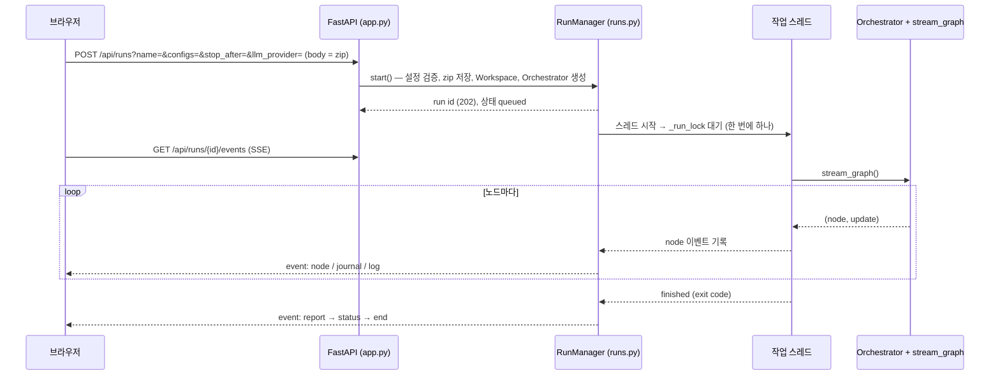
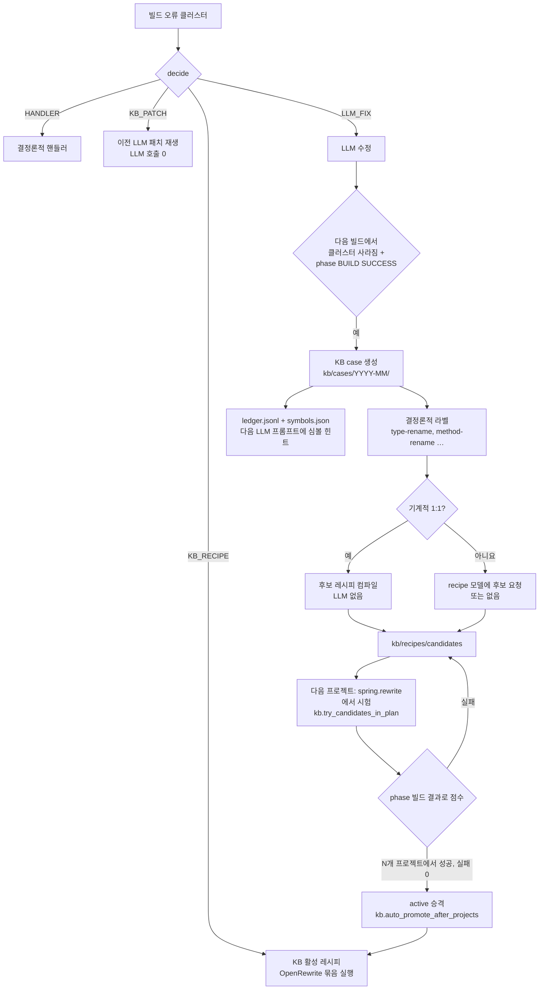
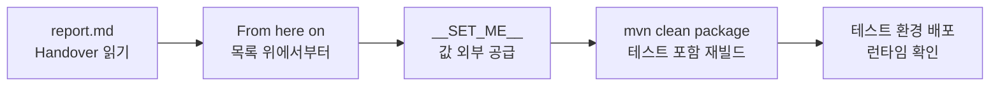

# 02. 기능별 워크플로우

sbmig는 명령 하나(`sbmig run`)로 끝까지 가는 도구이지만, 운영자는 그 앞뒤로 여러 기능을 씁니다. LLM 게이트웨이를 점검하고, 계획만 미리 보고, 웹 화면으로 실행을 지켜보고, 500개 프로젝트를 플릿으로 순서대로 돌리고, 쌓인 지식(KB)을 검토해 승격하고, 결과를 소유 팀에 넘깁니다. 이 문서는 기능 하나를 절 하나로 묶어 **목적 → 명령 / 화면 → 내부에서 벌어지는 일 → 산출물 → 확인 포인트 → 자주 하는 실수** 순서로 설명합니다. 각 기능이 파이프라인의 어느 단계에 걸리는지는 [01. 파이프라인 상세](01-pipeline.md)를, 설정 키 하나하나의 의미는 [08. 설정 레퍼런스](08-config-reference.md)를 함께 보십시오. 이 문서에서 회사 설정 파일은 RUNBOOK처럼 config/artifacts.yml이라고 부릅니다. `config/artifacts.example.yml`을 복사해 parent / mandatory 2개 / optional 8개를 채운 파일입니다(실제 사내 좌표는 여기서 알 수 없으므로 예시는 `xxx-parent`, `xxx-boot-jar`, `xxx-comp-jar` 4.0.0 같은 자리표시자로 씁니다).

## 이 문서를 읽고 나면

- CLI와 웹 UI 중 상황에 맞는 것을 골라 실행하고, 실행 중 / 실행 후 어디를 봐야 하는지 압니다.
- 새 환경에서 LLM 게이트웨이, 레시피 카탈로그, 어드바이저리를 실행 전에 점검할 수 있습니다.
- 플릿 실행을 시작, 재개, 재시도하고 `summary.md` / `learning.md`로 진행과 학습 결과를 읽을 수 있습니다.
- KB 후보 레시피를 검토해 승격 / 거절하고, 그 결과가 다음 프로젝트에서 어떻게 LLM 호출을 줄이는지 압니다.
- 결과물(`result.zip`, `changes.patch`, Handover)을 소유 팀에 넘기고 그 팀이 다음에 할 일을 안내할 수 있습니다.

## 관련 코드

- `sbmig/cli.py` — 모든 최상위 명령(`run`, `serve`, `llm-probe`, `analyze`, `plan`, `build`, `parse-log`, `rewrite`, `version`)과 하위 명령 등록
- `sbmig/web/app.py`, `sbmig/web/runs.py`, `sbmig/web/static/index.html` — 웹 UI
- `sbmig/fix/company.py`, `sbmig/fix/client.py` — 사내 게이트웨이 클라이언트, 응답 추출
- `sbmig/fleet/cli.py`, `sbmig/fleet/runner.py`, `sbmig/fleet/manifest.py`, `sbmig/fleet/summary.py` — 플릿
- `sbmig/kb/cli.py`, `sbmig/kb/store.py`, `sbmig/kb/harvest.py`, `sbmig/kb/labels.py`, `sbmig/kb/ledger.py` — 지식 베이스
- `sbmig/plan/catalog.py`, `sbmig/plan/catalog_cli.py`, `sbmig/plan/jarcheck.py` — 레시피 카탈로그
- `sbmig/advisory/` — 라이브러리 어드바이저리
- `sbmig/analyze/properties.py`, `knowledge/config/externalized.yml` — 외부화 설정 인벤토리
- `scripts/e2e.sh`, `scripts/e2e.py`, `scripts/fleet-demo.sh`, `scripts/demo-kb/run.sh` — 회귀 / 시연 스크립트
- `sbmig/core/diag.py` — 스레드 덤프

---

## 0. 명령 한눈에 보기

| 명령 | 하는 일 | `--config` 필요 | Maven 필요 | 프로젝트를 바꾸나 |
|---|---|---|---|---|
| `sbmig run <입력>` | 마이그레이션 전체 | 예 | 예 | 사본만(`out/<run id>/project`) |
| `sbmig serve` | 웹 UI | 화면에서 선택 | 예(실행 시) | 사본만 |
| `sbmig llm-probe` | LLM 게이트웨이 한 번 호출 | 아니요(`.env`만) | 아니요 | 아니요 |
| `sbmig analyze <입력>` | 프로필 출력 | 예 | 아니요 | 아니요 |
| `sbmig plan <입력>` | 프로필 + 계획 출력 | 예 | 아니요 | 아니요 |
| `sbmig inventory <입력>` | pom 없는 웹앱 인벤토리(inventory.md / .json) | 아니요 | 아니요 | 아니요 |
| `sbmig build <디렉터리>` | Maven 실행 + 오류 파싱 | 예 | 예 | **그 디렉터리에서 직접 빌드**(`target/` 생성) |
| `sbmig rewrite <디렉터리> -r <id>` | OpenRewrite 실행 | 예 | 예 | **`--dry-run`이 아니면 그 디렉터리를 직접 수정** |
| `sbmig parse-log <로그>` | Maven 로그 → 구조화 오류 + 서명 | 아니요 | 아니요 | 아니요 |
| `sbmig fleet run / resume / status` | 여러 프로젝트 순차 실행 | 예 | 예 | 사본만 |
| `sbmig kb …` | 지식 베이스 조회 / 승격 / 거절 / 내보내기 | 예(그룹 옵션) | 아니요 | KB 파일 |
| `sbmig recipes list / show / check / sets` | 레시피 카탈로그 | 예 | `check --jars`만 | 아니요 |
| `sbmig advisories list / show / check` | 라이브러리 어드바이저리 | 예 | 아니요 | 아니요 |
| `sbmig version` | 버전 출력 | 아니요 | 아니요 | 아니요 |

`--config`가 필요한 명령에서 이를 빠뜨리면 `config error: … artifacts: Field required`와 힌트("pass the company config: --config config/artifacts.yml …")를 출력하고 종료 코드 2로 끝납니다. 회사 artifacts 절에는 기본값이 없기 때문입니다.

---

## 1. 단일 프로젝트 실행 (CLI)

### 1.1 목적

프로젝트 하나(zip 또는 디렉터리)를 JDK 21 + Spring Boot 4.1 + 회사 레이아웃으로 바꾸고, 최종 `mvn clean package` 결과와 Handover가 담긴 보고서를 얻습니다. 가장 기본이 되는 사용법이고, 웹 UI와 플릿도 내부적으로 같은 오케스트레이터를 씁니다.

### 1.2 명령

```bash
sbmig run path/to/project.zip --config config/artifacts.yml --out out/
```

| 옵션 | 의미 |
|---|---|
| `--config` / `-c` (반복 가능) | 추가 설정 yml. **나중 것이 우선**합니다. |
| `--out` / `-o` | 출력 디렉터리(기본 `out`). 실행마다 `<out>/<run id>/`가 생깁니다. |
| `--run-id` | run id 직접 지정. 같은 id의 `project/`가 이미 있으면 실패합니다. |
| `--stop-after` | `intake`, `analyze`, `plan`, `jdk21`, `spring`, `restructure`, `verify` 중 하나에서 멈춤([01 §8.1](01-pipeline.md)) |
| `--dry-run` | 결정만 계산하고 아무것도 적용하지 않음([01 §8.2](01-pipeline.md)) |
| `--no-kb` | KB를 쓰지도 채우지도 않음(harvest, 활성 레시피, patch replay, 힌트, 후보 생성 모두 끔) |
| `--llm-provider` | `llm.provider` 덮어쓰기(예: `fake`로 LLM 없이) |
| `--llm-plugin` / `--fix-plugin` | 사내 어댑터 `pkg.module:attr`([03. 아키텍처](03-architecture.md), `docs/ADAPTERS.md`) |
| `--java-home` | `build.java_home` 덮어쓰기(JDK 21 경로) |
| `--settings` | `build.settings_file` 덮어쓰기(Maven settings.xml) |
| `--repo-root` | sbmig 저장소 루트(`kb/`, `knowledge/`) 지정 |
| `--verbose` / `-v` | 콘솔에 DEBUG 출력 |
| `--log-file` (최상위 옵션) | 추가 로그 파일. `sbmig --log-file x.log run …`처럼 **명령 앞**에 씁니다. 실행 로그는 이 옵션이 없어도 항상 `<run dir>/sbmig.log`에 남습니다. |

### 1.3 설정 겹치기 순서

`load_config`가 합치는 순서는 다음과 같습니다(`sbmig/core/config.py`). 뒤의 것이 앞의 것을 덮어씁니다.

1. `.env` 파일을 환경 변수로 읽기: `SBMIG_ENV_FILE`, sbmig 저장소 루트의 `.env`, 현재 디렉터리의 `.env`. **이미 셸에 있는 변수는 덮어쓰지 않습니다.**
2. `config/default.yml`
3. `--config`로 준 파일들, 준 순서대로
4. CLI 옵션이 만든 덮어쓰기(`--java-home`, `--settings`, `--llm-provider`, `--no-kb` …)
5. `SBMIG_` 환경 변수: `SBMIG_LLM__MODEL=foo` → `llm.model = foo`(밑줄 두 개가 중첩)
6. `${VAR}` / `${VAR:-기본값}` 치환(예: `llm.base_url: "${LLM_BASE_URL}"`)

```bash
# 회사 설정 + 사이트별 덮어쓰기 + Anthropic 검증용 LLM 프로필
sbmig run proj.zip -c config/artifacts.yml -c site-overrides.yml -c config/llm-anthropic.yml
```

### 1.4 내부에서 벌어지는 일

`Workspace.from_input`이 입력을 `<out>/<run id>/project`로 복사하고, `attach_file_log`가 `<run dir>/sbmig.log`를 엽니다. `Orchestrator(cfg, ws).run(stop_after, dry_run)`이 `loop.engine`(기본 `graph`)에 따라 단계를 돌립니다. 끝나면 `console_summary`가 결과 표를 출력하고, 종료 코드는 `run_exit_code`가 정합니다(0 성공 / 2 미완료 / 3 중단). 단계별 상세는 [01. 파이프라인](01-pipeline.md)에 있습니다.

### 1.5 산출물

`<run dir>/project/`(git 브랜치 `sbmig/<run id>`), `journal.jsonl`, `sbmig.log`, `logs/`, `profile.json`, `<run dir>/plan.json`, `rewrite/`, `effective/`, `changes.patch`, `result.zip`, `<run dir>/report.md`, `<run dir>/report.json`.

### 1.6 확인 포인트

- 콘솔 마지막: `<프로젝트> (<case>) — <결과>   run <run id>`, phase 표, `LLM: N call(s) …   flags: …`, blocked / unresolved 표, 그리고 `log: <run dir>/sbmig.log   (share this file + report.md when asking for help)`.
- 종료 코드: PowerShell `$LASTEXITCODE`, bash `echo $?`.
- 보고서 맨 위 표의 Result와 Flags, 바로 아래 Handover.
- 보고서(`report.md`) 언어는 `report.language`로 정합니다(`en` 기본, `ko`면 제목·표 머리글·안내 문장이 한국어). 한국어 보고서에서는 Result가 `결과`, Handover가 `인수인계` 절로 보입니다. 플래그 이름·레시피 id·경로·오류 메시지는 영어 그대로이고, `report.json`은 언어와 상관없이 같습니다.
- `report.javax_api_inventory`(기본 `true`): 최종 빌드 뒤 `mvn dependency:tree`로 클래스패스에 남은 javax API jar와 그것을 끌어오는 직접 의존성을 찾아 보고서 절 "javax API jars still on the classpath"(한국어: "클래스패스에 남은 javax API jar")와 Blocked 행의 "`API jar` ← `라이브러리`"에 보여 줍니다. 모듈마다 Maven을 한 번씩 더 부르므로, 시간이 아주 빠듯한 함대 실행에서만 `false`로 끕니다.
- 보고서의 "LLM 사용량과 비용" 절(2026-10-22)은 모델별(수정 모델·escalation 모델·레시피 모델) 호출 수와 입출력 토큰에 `llm.pricing`의 1M 토큰당 단가를 곱해 프로젝트 한 건의 API 비용을 계산합니다(요약 표의 `LLM 비용` 줄, `report.json`의 `llm_cost`, 콘솔 요약의 `LLM cost:` 줄). 기본 단가는 OpenAI 공시가(gpt-5.6-terra 입력 $2 / 출력 $12, gpt-6-luna 입력 $0.10 / 출력 $0.50)이며, 게이트웨이가 토큰 수(`usage`)를 돌려주지 않으면 비용이 0으로 나오고 그 사실이 표 아래에 적힙니다. 단가가 없는 모델은 합계에서 빠지고 이름만 표시됩니다.

### 1.7 Windows

- Maven은 `mvn.cmd`입니다. sbmig는 `build.mvn`(기본 `mvn`)을 `shutil.which`로 PATH, `MAVEN_HOME`, `M2_HOME`에서 찾습니다. PowerShell에서 `where.exe mvn`이 찾으면 그대로 됩니다. 못 찾으면 `build.mvn: C:/apache-maven-3.9.x/bin/mvn.cmd`처럼 전체 경로를 설정하십시오.
- 빌드가 `build.timeout_minutes`를 넘으면 sbmig가 `taskkill /T /F`로 `mvn.cmd` 아래 `java.exe`까지 프로세스 트리 전체를 종료합니다. 그냥 terminate하면 `java.exe`가 살아남아 `target/`과 소스 파일을 잠그기 때문입니다.
- 셸 프로필이 없으면 변수는 저장소 루트의 `.env`에 넣습니다(`.env.example` 복사, git 제외). `JAVA21_HOME` 같은 경로는 `C:/Program Files/Java/jdk-21`처럼 슬래시로 써도 됩니다.
- 콘솔 코드 페이지가 cp949여도 sbmig는 git / Maven 출력을 UTF-8로 직접 디코딩합니다. `UnicodeDecodeError: 'cp949' codec …` 뒤에 `could not write changes.patch`가 나오면 2026-10-21 이전 체크아웃이니 최신으로 받으십시오(`docs/RUNBOOK.md` §0).

```powershell
# PowerShell 예
cd C:\work\migration-agent
.\.venv\Scripts\Activate.ps1
sbmig run C:\work\inbox\order-api.zip --config config\artifacts.yml --out out
$LASTEXITCODE
Get-Content out\<run id>\sbmig.log -Wait -Tail 30      # tail -f에 해당
```

### 1.8 자주 하는 실수

| 실수 | 증상 | 바로잡기 |
|---|---|---|
| `--config` 누락 | `config error … artifacts: Field required`, 종료 코드 2 | 회사 artifacts 설정을 `--config`로 넘기십시오. |
| `--config` 경로 오타 | **오류 없이 무시됩니다.** `load_config`는 존재하지 않는 파일을 건너뜁니다. 그 파일이 유일한 artifacts 출처였다면 위의 오류가 나고, 아니면 설정이 조용히 빠진 채 실행됩니다. | journal `preflight`의 `artifacts.parent` 값과 보고서 Notes를 확인하십시오. |
| 설정 순서를 거꾸로 | 회사 값이 기본값에 덮임 | 나중에 준 `--config`가 이깁니다. 덮어쓰기 파일을 마지막에 두십시오. |
| JDK 8/11로 실행 | OpenRewrite / 빌드가 이상하게 실패 | `build.java_home`(또는 `--java-home`)을 JDK 21로 지정하십시오. as-is 프로젝트도 옛 JDK로 빌드하지 않습니다. |
| 같은 `--run-id` 재사용 | `FileExistsError` | run id를 비우면 자동 생성됩니다. |
| `--log-file`을 `run` 뒤에 둠 | 알 수 없는 옵션 오류 | 최상위 옵션입니다: `sbmig --log-file x.log run …` |
| Ctrl+C로 중단 | 보고서가 중단 표시 없이 남거나 아예 안 남을 수 있음 | 짧게 보고 싶으면 `--stop-after`를 쓰십시오. |

---

## 2. 웹 UI 실행

### 2.1 목적

zip을 올리고 실행 과정을 브라우저로 실시간으로 봅니다. 그래프 노드, journal, 로그가 함께 흐르므로 CLI보다 상황 파악이 쉽습니다. 회사 관례(LangGraph 에이전트를 uvicorn으로 호스팅)에도 맞춘 형태입니다.

### 2.2 띄우기

```bash
sbmig serve --host 0.0.0.0 --port 8765 --out out/web
# 회사 uvicorn 호스팅(같은 앱):
SBMIG_WEB_OUT=out/web SBMIG_WEB_REPO_ROOT=/path/to/migration-agent uvicorn sbmig.web.app:app --host 0.0.0.0 --port 8765
```

| 옵션 / 변수 | 기본값 | 의미 |
|---|---|---|
| `--host` | `127.0.0.1` | 기본은 이 PC에서만 접속. LAN에 공유하려면 `0.0.0.0` |
| `--port` | `8765` | |
| `--out` / `SBMIG_WEB_OUT` | `out/web` | 업로드(`<out>/_uploads/`)와 실행 디렉터리(`<out>/web-…/`) |
| `--repo-root` / `SBMIG_WEB_REPO_ROOT` | sbmig 패키지 루트 | 화면에 나오는 설정 파일 목록(`<repo root>/config/*.yml`)과 KB 위치 |

서버 전체 로그는 `<out>/sbmig-web.log`(`sbmig serve`일 때), 실행별 로그는 `<out>/<run id>/sbmig.log`입니다. 서버도 CLI와 같은 환경(JDK 21, `.env`의 LLM 변수)이 필요합니다.

### 2.3 화면

| 영역 | 내용 |
|---|---|
| 새 실행 | "프로젝트 zip" 파일 선택, "설정 파일 (config/*.yml, 나중 것이 우선)" 체크박스, "LLM" 선택(설정대로 = 사내 게이트웨이 / `fake` = LLM 없이), "여기까지만 실행"(끝까지 / analyze / plan / jdk21 / spring / restructure), "실행" / "중단" 버튼 |
| 실행 목록 | run id + 상태 배지: `실행 중`, `대기열 (다른 실행이 끝나면 시작)`, `BUILD SUCCESS`, `미완료 (blocked N, unresolved M)`, `중단됨`(exit 3). 10초마다 새로 고침 |
| 그래프 (LangGraph 노드) | intake → analyze → plan → phase × N → finalize. plan이 끝나면 phase가 `phase: jdk21` 같은 칩으로 펼쳐지고, 끝난 노드는 완료 / 실패로 표시 |
| 진행 (journal) | journal 이벤트 한 줄씩(시각, 아이콘, 이벤트 이름, 필드 요약). "현재 단계: spring" 같은 표시 |
| 로그 (sbmig.log) | 실행 로그. "DEBUG 표시", "자동 스크롤" 체크박스 |
| 결과 | report.md 본문과 파일 링크 |

주소 끝에 `#<run id>`를 붙이면 그 실행을 바로 엽니다(공유용 링크).

### 2.4 내부에서 벌어지는 일



1. **요청 검증**(동기): 본문이 비었거나 zip이 아니거나(`PK` 서명) 512 MB를 넘으면 400 / 413. 설정 이름은 `<repo root>/config/` 안의 파일만 허용합니다. `stop_after`는 CLI와 같은 `parse_stop_after`로 검사합니다. 설정이 잘못되면(예: artifacts 누락) 이 단계에서 400으로 돌아옵니다.
2. **저장과 준비**: zip을 `<out>/_uploads/<run id>-<파일명>`에 저장하고, `Workspace.from_input`으로 `<out>/web-YYYYMMDD-HHMMSS-<hex>/project`에 풉니다. 웹 실행은 항상 KB를 씁니다(`--no-kb`에 해당하는 옵션이 없습니다).
3. **직렬 실행**: KB가 파일 기반이고 모든 실행이 공유하므로 `RunManager._run_lock`으로 **한 번에 한 마이그레이션만** 돌립니다. 기다리는 실행은 `queued`입니다.
4. **스트리밍**: 작업 스레드가 `sbmig.graph.stream_graph`로 노드 업데이트를 받아 기록합니다. SSE 생성기는 그 기록과 `journal.jsonl`, `sbmig.log`의 새 줄을 0.5초마다 읽어 **시각 순으로 섞어** 보냅니다(journal과 로그가 순서가 뒤바뀌어 보이던 문제, round 9).
5. LangGraph를 가져올 수 없으면 `Orchestrator.run()`(inline)으로 대신 돌립니다. 보고서와 종료 코드는 같지만 `node` 이벤트가 없고 그래프 줄이 어둡게 남습니다.

SSE 이벤트 종류는 다음과 같습니다.

| 이벤트 | 데이터 |
|---|---|
| `status` | 상태 사전(`state`, `exit_code`, `node`, `success`, `blocked`, `unresolved`, `llm_calls`, `files` …). 처음과 마지막에 |
| `node` | `{"node": …, "update": …}`. graph 노드 하나가 끝날 때마다. 20,000자가 넘는 업데이트는 키 목록으로 줄임 |
| `error` | `{"message": …}`. 작업 스레드 자체가 예외로 죽음(exit 3) |
| `journal` | `journal.jsonl` 한 줄(파싱된 JSON) |
| `log` | `sbmig.log` 한 줄(DEBUG 포함) |
| `report` | 실행이 끝난 뒤 `<run dir>/report.md` 본문 |
| `ping` | 15초 동안 아무것도 없을 때 연결 유지 |
| `end` | 마지막 |

### 2.5 API

| 메서드와 경로 | 용도 |
|---|---|
| `GET /` | 화면 |
| `GET /api/configs` | 고를 수 있는 설정 파일(`default.yml` 제외), `repo_root`, `out_dir` |
| `GET /api/runs` | 실행 목록(최신순) |
| `POST /api/runs?name=&configs=a.yml,b.yml&stop_after=&llm_provider=` | 실행 시작(본문 = zip 바이트) → 202 `{"run_id", "status"}` |
| `GET /api/runs/{id}` | 상태 |
| `GET /api/runs/{id}/events` | SSE |
| `POST /api/runs/{id}/stop` | 현재 노드가 끝나면 중단 |
| `GET /api/runs/{id}/files/{name}` | 실행 디렉터리의 report.md, report.json, result.zip, sbmig.log, journal.jsonl, changes.patch, plan.json, profile.json만 허용(`SERVED_FILES`). `?download`를 붙이면 첨부 파일로 받음(zip은 항상 첨부) |
| `GET /api/threads` | 서버 프로세스의 모든 스레드 스택(텍스트). 동시에 `<out>/threads-<timestamp>.txt`로 저장 |

### 2.6 중단 버튼의 의미

"중단"을 누르면 화면에 "[중단 요청 — 지금 실행 중인 노드(빌드/LLM 호출)가 끝나면 멈춥니다]"가 나옵니다. 실제 동작은 [01 §8.3](01-pipeline.md)과 같습니다.

- **진행 중인 Maven 빌드, OpenRewrite, LLM 호출은 끊기지 않습니다.** graph 노드 하나(phase group 전체일 수도 있음)가 끝날 때까지 기다립니다. spring phase 전체가 노드 하나이므로 수 분이 걸릴 수 있습니다.
- verify 전에 멈추면 보고서에 "stopped by user (web UI) — the final `mvn clean package` did not run"이 남고 exit 3(`중단됨`)입니다.
- verify phase가 끝난 뒤라면 무시하고 정상 종료합니다.
- `queued` 상태에서 누르면 차례가 와서 첫 노드(intake)가 끝난 직후 멈춥니다(코드 기준: `sbmig/web/runs.py` `_run_thread_body`는 노드 업데이트마다 중단 플래그를 확인합니다).

### 2.7 결과 받기와 목록 정리

실행이 끝나면 결과 영역에 파일 링크가 생깁니다. `result.zip`은 바로 다운로드되고, 나머지는 새 탭에서 열립니다. 서버는 끝난 실행을 메모리에 최대 200개(`DEFAULT_MAX_FINISHED_RUNS`)까지만 들고, 넘치면 오래된 것부터 메모리에서 뺍니다. 디렉터리는 그대로 남아 있고, 그 실행은 디렉터리의 `<run dir>/report.json`과 `web-status.json`(작업 스레드가 끝날 때 쓰는 종료 코드 / 오류 / 중단 여부)으로 계속 조회됩니다. 서버를 다시 띄워도 `<out>/` 아래 디렉터리가 목록에 나옵니다(`_`로 시작하는 디렉터리 제외).

### 2.8 확인 포인트

- 그래프 줄에서 현재 강조된 노드 = 지금 실행 중인 노드입니다. `phase: spring`이 오래 강조되어 있으면 로그 영역에서 `[spring] build N: …`, `llm call still in flight …`, `mvn still running …`을 봅니다.
- 상태 배지가 `대기열`이면 다른 실행이 끝나기를 기다리는 중입니다. 고장이 아닙니다.
- 실행 중에 "연결 끊김" 문구가 보이면 서버가 내려갔거나 네트워크 문제입니다. 목록에서 다시 누르면 재연결됩니다. 실행 자체는 서버 프로세스 안에서 계속 돕니다.

### 2.9 자주 하는 실수

| 실수 | 증상 | 바로잡기 |
|---|---|---|
| 기본 체크된 `config/artifacts.local-e2e.yml`로 회사 프로젝트 실행 | parent가 `spring-boot-starter-parent`(공개 대체물), pre-9c 레이아웃(`module/comp-jar`) | 화면은 `config/artifacts.local-e2e.yml`을 기본으로 체크합니다. 회사 실행이면 이 체크를 풀고 회사 artifacts 파일을 체크하십시오. |
| 회사 설정 파일을 서버의 `config/` 밖에 둠 | 목록에 안 보임 | 웹은 `<repo root>/config/*.yml`만 보여 줍니다. |
| 중단을 눌렀는데 바로 안 멈춤 | 수 분 동안 계속 진행 | 노드 사이에서만 멈춥니다(§2.6). |
| 여러 개를 동시에 올림 | 두 번째부터 `대기열` | 정상입니다. 한 번에 하나만 돕니다. |
| 서버를 `127.0.0.1`로 띄우고 다른 PC에서 접속 | 연결 안 됨 | `--host 0.0.0.0` |
| "여기까지만 실행"에 intake / verify가 없다고 당황 | | 화면은 analyze ~ restructure만 제공합니다. 끝까지 = verify 포함입니다. |

---

## 3. LLM 연결 점검 (`sbmig llm-probe`)

### 3.1 목적

새 환경에서 사내 게이트웨이에 **실제로 무엇이 오가는지** 확인합니다. 실행 도중 LLM 오류로 시간을 버리기 전에, 요청 모양, 프록시, 응답 JSON, 응답 텍스트 추출이 되는지를 한 번에 봅니다. 이 명령만 `--config` 없이 `.env`만으로 동작합니다.

### 3.2 명령

```bash
sbmig llm-probe --prompt "안녕"
sbmig llm-probe --prompt "안녕" --bare                    # sbmig 클라이언트를 거치지 않는 맨 requests.post
sbmig llm-probe --prompt "안녕" --payload-extra '{}' --no-system --model <Postman에서 쓰는 모델>
```

| 옵션 | 의미 |
|---|---|
| `--prompt` | 보낼 문장(기본 "Reply with the single word: pong") |
| `--model` | 이번 점검에만 `llm.model` / `LLM_MODEL` 덮어쓰기 |
| `--payload-extra` | `llm.payload_extra`를 **통째로 대체**하는 JSON 객체. `'{}'`면 `model`과 `messages`만 보냄. `'{"need_origin": false}'`처럼 키 값을 바꿀 때도 사용 |
| `--no-system` | system 메시지 없이 user 메시지만 |
| `--bare` | 회사 예제 코드 그대로: `requests.post(url, headers={Authorization}, json=payload, timeout=)`. 같은 payload를 sbmig 클라이언트 없이 보내 클라이언트 문제와 게이트웨이 문제를 구분 |
| `--llm-provider` | 다른 provider로 점검(`fake`면 게이트웨이 없이) |
| `--config` | 선택. 주면 그 설정의 `llm` 절도 반영 |

### 3.3 provider `company`의 요청 모양

`config/default.yml`의 기본 provider는 `company`이고, 값은 모두 `.env` / 환경 변수에서 옵니다.

| `.env` 변수 | 설정 키 | 의미 |
|---|---|---|
| `LLM_BASE_URL` | `llm.base_url` | **전체 엔드포인트 URL**. 그대로 씁니다(스킴 변경이나 경로 덧붙임 없음). |
| `LLM_API_KEY` | `llm.api_key_env`가 가리키는 변수 | Bearer 토큰. yml에는 절대 쓰지 않습니다. |
| `LLM_MODEL` | `llm.model` | 수정용 모델(기본 `gpt-6-luna`) |
| `LLM_RECIPE_MODEL` | `llm.recipe_model` | 레시피 후보 / 플랜 조언용 저렴한 모델(비면 `LLM_MODEL`) |
| `LLM_ESCALATION_MODEL` | `llm.escalation_model` | 정체된 클러스터용 강한 모델(비면 `LLM_MODEL`) |
| `LLM_RESPONSE_PATH` | `llm.response_path` | 응답 텍스트 위치(점 경로). 비면 자동 탐지 |
| `LLM_RECORD_DIR` | `llm.record_dir` | 요청 / 응답을 `llm-NNNN.json`으로 저장(키 제외) |

```
POST $LLM_BASE_URL
headers: {"Authorization": "Bearer <LLM_API_KEY>"}   (+ llm.extra_headers)
json:    {"model": "<LLM_MODEL>", "messages": [{"role": "system", …}, {"role": "user", …}], "need_origin": true}
timeout: llm.timeout_seconds (기본 180)
```

- `need_origin: true`는 `llm.payload_extra`의 기본값입니다(첫 회사 실행 피드백, round 9b). max_tokens / temperature / stop 같은 생성 파라미터는 보내지 않습니다. 게이트웨이가 정합니다.
- 응답 텍스트는 다음 경로를 순서대로 찾습니다: `choices.0.message.content`, `choices.0.text`, `message.content`, `data.choices.0.message.content`, `data.content`, `data.answer`, `data.text`, `content`, `answer`, `response`, `output`, `output_text`, `result`, `text`, `reply`, `completion`. 못 찾으면 `PROBLEM: cannot find the reply text …`와 시도한 경로 목록을 출력하고, 위 JSON을 보고 `LLM_RESPONSE_PATH`(예: `data.result.content`)를 정하라고 안내합니다.
- **content filter 응답은 장애가 아니라 그 요청의 거절입니다.** HTTP 200인데 `finish_reason=content_filter`이고 내용이 비었거나, Azure 형식 `content_filter_result` / `prompt_filter_results`에 `filtered: true`가 있으면 "content filtered by the gateway (…); this request only, not an outage"로 처리합니다. 루프는 이것을 "LLM 사용 불가" 연속 장애 횟수에 넣지 않습니다. HTTP 400 / 413 / 422도 마찬가지로 요청의 잘못으로 봅니다.
- 재시도하는 상태 코드: 408, 409, 425, 429, 500, 502, 503, 504, 520, 522, 524, 529. `Retry-After`를 따르되 최대 120초, 없으면 지수 백오프(최대 30초), `llm.max_retries`번(기본 3)까지 재시도합니다.
- 호출 하나에는 벽시계 기준 **hard deadline**이 있습니다(`timeout + 30`초). `requests`의 timeout은 바이트 사이 침묵만 세므로, 연결을 붙잡고 조금씩 흘리는 게이트웨이가 실행을 몇 시간씩 붙잡지 못하게 하려는 장치입니다.

### 3.4 출력 읽기

일반 점검(`--bare` 없음)은 다음 순서로 출력합니다.

```
provider=company model=… url=… key_env=LLM_API_KEY payload_extra={'need_origin': True} response_path=(auto)
request payload: {"model": …, "messages": […], "need_origin": true}
sent: POST http://…
sent headers: {"Authorization": "Bearer xxxx…(NN chars)", …}     ← 토큰은 앞 10자만
sent body: …
proxies in effect for this url: {…}  (NO_PROXY=…)
response headers: {…}
timeout: 180.0s
HTTP 200
{ … 응답 JSON … }
extracted reply: '…'
```

| 출력 | 뜻과 조치 |
|---|---|
| `CONFIG ERROR: …` | URL / 키 / 모델 변수 누락. `.env`를 확인하십시오. |
| `TRANSPORT ERROR: ConnectionError …` | 프록시 / DNS / 연결 거부. `proxies in effect`에 사내 프록시가 잡혀 있으면 `.env`에 `NO_PROXY=<게이트웨이 호스트>`를 넣으십시오. |
| `HTTP 401` / `403` | 토큰 문제 |
| `HTTP 200` + `PROBLEM: cannot find the reply text` | 응답 모양이 특이함 → `LLM_RESPONSE_PATH` |
| `--bare`는 되는데 일반 점검은 안 됨 | sbmig 클라이언트 쪽 차이(헤더, payload). 두 출력의 `sent body`를 비교하십시오. |
| Postman은 되는데 둘 다 안 됨 | `--payload-extra '{}' --no-system --model <Postman 모델>`로 Postman과 같은 요청을 만들어 차이를 좁히십시오. |

### 3.5 자주 하는 실수

- URL에 경로를 빼고 호스트만 넣음: sbmig는 경로를 붙이지 않습니다. 동작하는 사내 에이전트가 부르는 **전체 URL**을 그대로 넣으십시오.
- 키를 yml에 씀: 금지입니다. 키는 환경 변수(`.env`)로만 넘깁니다.
- `--payload-extra`가 병합이라고 생각함: **대체**입니다. `need_origin`을 빼고 보내려면 `'{}'`를 주십시오.
- 실행 중 LLM이 느린 것을 멈춘 것으로 오해: 로그에 30초마다 `llm call still in flight: Ns elapsed (timeout 180s) — role=fix model=…`이 찍히면 기다리는 중입니다.

---

## 4. 분석만 / 계획만, 보조 명령

### 4.1 `sbmig analyze` — 진단만

```bash
sbmig analyze path/to/project.zip --config config/artifacts.yml          # 사람용 요약
sbmig analyze path/to/project --config config/artifacts.yml --json       # ProjectProfile 전체 JSON
```

- 디렉터리를 주면 **복사하지 않고** 그 자리에서 읽기만 합니다. zip이면 임시 디렉터리에 풉니다. 아무것도 바꾸지 않고, Maven도 부르지 않습니다.
- 출력: `<이름>: case <케이스> (confidence 0.80)`, java / boot / spring 버전, pom 수, 빌드 도구, 판정 근거(`- …`), 라이브러리, MSA 서비스, 경고, 그리고 해당하는 어드바이저리(`advisory [guide] springfox@2.9.2 — … → springdoc`).
- 용도: 실행 전 스모크 테스트, 케이스 오판 확인, 플릿 순서(`simple-first`) 감 잡기.

### 4.2 `sbmig plan` — 계획만

```bash
sbmig plan path/to/project --config config/artifacts.yml
sbmig plan path/to/project --config config/artifacts.yml --json
```

analyze를 하고 KB(있으면)를 읽어 계획을 출력합니다. 스텝 번호, id, 종류, Maven 목표, 대상, 레시피 목록, pre-emptive 핸들러, 노트가 나옵니다. 출력 예는 [01 §5](01-pipeline.md)에 있습니다. 설정(`plan.parent_phase`, `layout.boot_as_is` …)을 바꿨을 때 계획이 기대대로 바뀌는지 실행 없이 확인하는 데 씁니다. 어드바이저리 레시피는 이 명령의 계획에는 붙지 않습니다(코드 기준: `sbmig/cli.py` `plan`은 `build_plan`을 `advisories=` 없이 부릅니다). 어드바이저리 반영은 `sbmig run`의 `<run dir>/plan.json`에서 확인하십시오.

### 4.3 `sbmig build` — Maven 한 번 + 오류 파싱

```bash
sbmig build out/<run id>/project --goal "clean package" --config config/artifacts.yml --out out/debug
```

지정한 디렉터리에서 **그 자리에** Maven을 돌리고 결과(`BUILD SUCCESS` / `BUILD FAILURE`, 시간, 로그 경로)와 파싱된 오류 표(kind, 위치, 메시지, L1 서명)를 보여 줍니다. 기본 목표는 `compile`, 종료 코드는 성공 0 / 실패 2입니다. 마이그레이션이 끝난 사본에서 소유 팀이 받을 빌드를 재현하거나, 수동으로 고친 뒤 확인할 때 씁니다. `--out`이 없으면 로그는 임시 디렉터리에 갑니다.

### 4.4 `sbmig rewrite` — 레시피 한두 개 시험

```bash
sbmig rewrite out/<run id>/project -r org.openrewrite.java.migrate.UpgradeToJava21 --dry-run --config config/artifacts.yml
```

`--recipe` / `-r`(반복 가능)로 레시피 id를 줍니다. **`--dry-run`이 없으면 그 디렉터리를 직접 수정합니다.** 원본 저장소에 대고 돌리지 마십시오. 출력은 바뀐 파일 목록과 로그 경로이고, 종료 코드는 성공 0 / 실패 2입니다. 카탈로그에 없는 id도 실행은 시도하지만, 계획에 넣으려면 카탈로그에 등록해야 합니다(§7).

### 4.5 `sbmig parse-log` — 로그 다시 읽기

```bash
sbmig parse-log out/<run id>/logs/005-build-spring-2.log --root out/<run id>/project
sbmig parse-log <로그> --json
```

Maven 로그를 sbmig의 파서로 다시 읽어 구조화 오류와 서명(L1 / L2)을 보여 줍니다. `--root`는 경로를 상대 경로로 바꿀 기준입니다. KB 패턴(`kb/patterns/`)을 쓰거나 "이 오류가 왜 이 클러스터로 묶였나"를 확인할 때 씁니다. 서명 체계는 [04. 분류와 루프](04-triage-and-loop.md)에 있습니다.

### 4.6 `sbmig inventory` — pom 없는 Tomcat 웹앱 조사 (2026-10-23)

```bash
sbmig inventory path/to/webapps-root --out out/inventory/<이름>                       # 콘솔 요약 + inventory.md / .json
sbmig inventory path/to/webapps.zip --out out/inventory/<이름> --config config/artifacts.yml   # report.language: ko 이면 한국어 md
```

- 대상: pom 이 없는 "프레임워크 없는" 옛 웹앱 — JSP, 어딘가의 Java 소스(`WEB-INF/src` 등), `WEB-INF/lib` 의 jar(+ `*.jar.old` 백업), `WEB-INF/classes`. 한 루트 아래 웹앱 디렉터리가 둘 이상이어도 됩니다. pom 이 있는 모듈은 경고로 알려 주며 그 모듈은 `sbmig run` 대상입니다.
- 무엇을 보나: `WEB-INF` 를 가진 디렉터리마다 web.xml 스펙(2.3 DTD … 6.0)·서블릿/필터/리스너/taglib 수·프레임워크(spring-mvc, struts1/2, jsf, egov, plain-servlet)·JNDI 이름(`META-INF/context.xml`, `resource-ref`)·JSP / 정적 파일 수·Spring XML, jar 마다 크기·sha1·파일 이름에서 읽은 버전·추정 좌표(`knowledge/libraries/jar_names.yml`), 클래스 파일의 major 버전(→ Java 레벨)과 소스 없는 클래스, 소스 루트(`package` 선언과 경로가 맞는 위치)별 인코딩·javax import·프레임워크 import·`sun.*` 사용, 여러 소스 루트에 같은 FQCN 이 있는 중복 클래스.
- 결과: 웹앱 루트마다 Maven 모듈 제안 하나(`war`, Java 레벨은 그 웹앱의 클래스 파일, 없으면 1.8)와 노트(좌표 없는 jar → `lib/` + system scope 또는 Nexus 설치, 2.3 DTD, 소스 없는 클래스, MS949 소스, JSP 의 javax import, 공유 소스 → common jar). 웹앱 없이 소스만 있으면 `jar` 제안 하나.
- 운영자 할 일: (1) "좌표 미확인" jar 를 확인해 사내 jar 는 `knowledge/libraries/jar_names.yml` 에 추가하고 다시 실행, (2) 모듈 분할 확인, (3) pom 생성은 2차 작업(아직 없음)입니다. 이번 차수는 조사만 하며 원본을 바꾸지 않습니다.

### 4.7 자주 하는 실수

- `sbmig rewrite` / `sbmig build`를 원본 디렉터리에 실행: 두 명령은 사본을 만들지 않습니다. `out/<run id>/project`나 별도 복사본에 쓰십시오.
- `sbmig plan` 결과와 실제 `<run dir>/plan.json`이 다르다고 혼동: 실제 실행은 어드바이저리 레시피와 `plan.advisor: llm` 조언, pom 저장소 노트(X9)를 더합니다.

---

## 5. 플릿 실행 (`sbmig fleet`)

### 5.1 목적

**에이전트 하나가 약 500개 프로젝트를 엄격히 순서대로** 마이그레이션하는 회사 운영 모델 그대로입니다. 병렬은 없습니다. 각 프로젝트의 수정이 KB에 harvest된 뒤에 다음 프로젝트가 시작하므로, k+1번째 프로젝트는 1~k번째에서 배운 레시피로 계획을 세웁니다. 프로젝트별 파이프라인은 단일 실행과 같고, 플릿은 순서, 예산, 집계만 맡습니다.

### 5.2 명령

```bash
sbmig fleet run projects.yml --config config/artifacts.yml --out out/fleet      # 시작(같은 명령으로 재개)
sbmig fleet status out/fleet                                                    # 진행 표(실행 중에도 다른 셸에서)
sbmig fleet resume out/fleet                                                    # 지난번 manifest + 설정으로 이어서
sbmig fleet resume out/fleet --retry-failed                                     # 미완료 / 중단도 다시
sbmig fleet run projects.yml --config config/artifacts.yml --out out/fleet --dry-run   # 순서와 재개 판단만 출력
```

`fleet run` 옵션: `--order manifest|simple-first`, `--max-projects N`, `--retry-failed/--no-retry-failed`, `--stop-on-abort/--no-stop-on-abort`, `--max-llm-calls-total N`, `--llm-provider`, `--dry-run`, `--config`(반복), `--out`. `fleet resume`은 `--config`(생략하면 지난번 것), `--max-projects`, `--retry-failed`, `--stop-on-abort`를 받습니다. `fleet status`는 `--json`을 받습니다.

### 5.3 manifest

| 형식 | 내용 |
|---|---|
| 디렉터리 | 안의 모든 `*.zip`과 `pom.xml`이 있는 하위 디렉터리(이름순) |
| `.txt` | 한 줄에 경로 하나, `#` 주석 |
| `.yml` | `projects: [{name, input, configs: [...], overrides: {...}, tags: [...]}]` |
| `.csv` | 헤더 `name,input,tags` |

경로는 manifest 파일 기준 상대 경로입니다. 예시는 `fixtures/fleet/manifest.example.yml`입니다. 프로젝트별 `configs` / `overrides`는 플릿 설정 위에 합쳐지지만 `kb.dir`만은 예외입니다. KB는 항상 플릿 전체에 하나입니다.

```yaml
projects:
  - name: order-api
    input: inbox/order-api.zip
    tags: [boot2]
  - name: legacy-batch
    input: inbox/legacy-batch
    overrides:
      loop: {max_llm_calls: 20}      # 이 프로젝트만 LLM 예산 축소
```

### 5.4 내부에서 벌어지는 일

1. `<out>/fleet/state.json`이 있으면 이어서, 없으면 새 플릿 id(`fleet-YYYYMMDD-HHMMSS`)로 시작합니다. manifest, 설정 경로, 덮어쓰기는 `<out>/fleet/fleet-config.json`에 저장합니다(`resume`이 사용).
2. `fleet.order: simple-first`면 각 프로젝트를 가볍게 분석해 pure_java → servlet → spring_legacy → boot → msa 순으로 정렬합니다(결과는 state에 캐시).
3. 프로젝트마다 재개 판단을 합니다. `success`는 다시 돌리지 않습니다. `incomplete` / `aborted`는 `--retry-failed`일 때만 다시 돌립니다. 지난번에 `running`으로 남은 것(플릿 프로세스가 죽음)은 다시 돌립니다. 입력이 없는 것은 `skipped`입니다(나중에 생기면 재개 때 실행).
4. 실행 디렉터리는 `<out>/<fleet id>-<NNN>-<name>/`이고, 재시도는 `-r2`, `-r3` 접미사가 붙습니다. 프로젝트마다 LLM 예산은 `min(loop.max_llm_calls, 플릿 남은 예산)`입니다(`fleet.max_llm_calls_total`, 0 = 무제한).
5. 종료 코드로 상태를 정합니다: 0 → `success`, 3 → `aborted`, 그 외 → `incomplete`. Gradle / Ant / 빌드 없음으로 intake에서 거부된 프로젝트는 `skipped`(사유는 행의 `error`)이고, `--retry-failed`로도 다시 돌지 않으며 `--stop-on-abort`도 이것으로는 플릿을 멈추지 않습니다.
6. 프로젝트가 끝날 때마다 `state.json`을 원자적으로 다시 쓰고, `summary.md` / `summary.csv` / `summary.json`과 `learning.md`를 다시 만듭니다. 표의 `llm_cost` 열과 머리글의 `cost`가 프로젝트별·플릿 전체 API 비용입니다(`llm.pricing` 단가). `fleet.reindex_every`(기본 10)마다 KB 인덱스를 다시 만듭니다.
7. Ctrl+C로 끊으면 진행 중이던 프로젝트는 `pending`(`interrupted`)으로 돌아가므로 재개하면 다시 돕니다.

### 5.5 산출물

| 경로 | 내용 |
|---|---|
| `<out>/fleet/state.json` | 프로젝트별 결과(상태, 종료 코드, run id, LLM 호출, blocked 사유, KB 사례 / 후보 / 승격 / 사용, 어드바이저리, carried over) |
| `<out>/fleet/summary.md` / `.csv` / `.json` | 진행 표 + 합계 + "Libraries flagged across the fleet" |
| `<out>/fleet/learning.md` | 이번 플릿에서 KB가 배운 것(§6.6) |
| `<out>/fleet/fleet-config.json` | 재개용 manifest / 설정 |
| `<out>/fleet/sbmig.log` | 플릿 전체 로그(모든 프로젝트) |
| `<out>/<fleet id>-<NNN>-<name>/` | 프로젝트별 실행 디렉터리(보고서, journal, logs …) |

현재 코드에서 플릿의 프로젝트별 실행은 `Orchestrator`를 직접 부르므로 프로젝트 디렉터리에 `sbmig.log`가 따로 생기지 않습니다. 로그는 `<out>/fleet/sbmig.log` 하나에 모입니다(코드 기준: `sbmig/fleet/runner.py` `_default_run_project`, `sbmig/fleet/cli.py`). 프로젝트별 Maven 로그는 각 디렉터리의 `logs/`에 있습니다.

`fleet run` 종료 코드: 0 = 모든 프로젝트 성공, 2 = 일부 미완료 / skipped / 아직 안 돔, 3 = `--stop-on-abort`로 중단된 프로젝트에서 멈춤.

### 5.6 확인 포인트

- 콘솔(과 `fleet/sbmig.log`)에 `[3/120] order-api: running (fleet-20261021-090000-003-order-api)` 같은 줄이 프로젝트마다 나옵니다.
- `sbmig fleet status out/fleet`로 언제든 표를 봅니다.
- `summary.md`의 `llm calls` 열이 뒤로 갈수록 줄어드는지 봅니다. 줄지 않는다면 같은 증상을 LLM이 계속 고치고 있다는 뜻이므로 `learning.md`의 "Write a recipe / handler for these"를 보십시오.
- 오프라인 시연: `scripts/fleet-demo.sh`(pure-java, boot2, boot3, spring5-xml, boot3-again을 새 KB와 재생 LLM으로 실행). boot3는 LLM이 한 번 고치고, 라벨에서 후보 레시피가 컴파일되며, boot3-again은 LLM 없이 통과하면서 후보를 승격시킵니다.

### 5.7 자주 하는 실수

| 실수 | 결과 | 바로잡기 |
|---|---|---|
| 같은 KB로 플릿 두 개를 동시에 돌림 | 파일 KB 경합, 학습 순서 깨짐 | 운영 모델은 순차입니다. 동시에 하나만 돌리십시오. |
| 미완료 프로젝트가 재개 때 안 돈다고 오해 | 그대로 `incomplete` | 기본값은 다시 돌리지 않습니다. `--retry-failed`를 쓰십시오. |
| `--out`을 바꿔서 재개 | 처음부터 다시 | 재개는 같은 `--out`의 `fleet/state.json`을 읽습니다. |
| 프로젝트별 `overrides`로 `kb.dir`을 바꿈 | 무시됨 | KB는 플릿 공용입니다. |
| 로컬 시연 설정(`config/artifacts.local-e2e.yml`)으로 회사 플릿 | 공개 대체 parent, `out/e2e/kb`에 학습 | 회사 artifacts 설정을 쓰십시오. |

---

## 6. 지식 축적 루프 (KB)

### 6.1 목적

한 프로젝트에서 LLM이 고친 것을 **다음 프로젝트에서는 LLM 없이** 고치게 만듭니다. 500개를 순서대로 돌리는 모델에서는 같은 증상(예: `@JsonComponent` → `@JacksonComponent`)이 수십 번 나옵니다. 처음 한 번만 LLM 비용을 내고, 그다음은 결정론적 레시피나 patch replay로 처리하는 것이 목표입니다. KB는 DB 없이 파일로만 저장합니다(불변식 3).

### 6.2 흐름



### 6.3 각 단계

1. **결정 순서**: 클러스터마다 `HANDLER` > `KB_RECIPE` > `KB_PATCH` > `LLM_FIX` > `ESCALATE`(+ `BLOCKED`, `SKIP`). KB가 앞에 있으므로 맞는 레시피나 재생 가능한 패치가 있으면 LLM까지 가지 않습니다.
2. **KB 매치**(`FileKnowledgeBase.match`): 클러스터의 L1 서명, 그다음 L2 서명으로 사례를 찾습니다(재사용 횟수가 많은 순, 같으면 최신 순). 
   - **patch replay**(`kb.use_patch_replay`): LLM 패치였던 사례 중 **모든 SEARCH 텍스트가 지금 파일에 정확히 한 번씩 있는** 것만 재생 가능합니다(생성할 파일은 아직 없어야 하고, 이름 바꿀 대상은 있어야 함). 재생은 LLM 호출 없이 패치를 그대로 적용하고 빌드로 확인합니다.
   - **레시피**(`kb.use_active_recipes`): 서명이 맞는 active 레시피는 결정 후보가 되고, candidate는 따로 표시됩니다.
   - **힌트**(`kb.use_hints`, 최대 `kb.max_hints`개): 비슷한 사례 요약과 심볼 힌트가 LLM 프롬프트에 들어갑니다.
3. **harvest**(phase 끝, verify 제외, dry-run 제외): 그 phase에서 클러스터가 해결되고 BUILD SUCCESS까지 살아남은 LLM 수정만 사례(`KBCase`)가 됩니다. 경로는 정리하고 `password` / `secret` / `token` / `api_key` 같은 값은 지웁니다.
4. **라벨**(`sbmig/kb/labels.py`): diff에서 결정론적으로 계산합니다. `import-rename`, `type-rename`, `package-rename`, `annotation-replace`, `method-rename`, `method-signature-adapt`, `override-signature`, `dependency-add` / `-remove` / `-replace` / `-version`, `plugin-version`, `pom-property`, `spring-property-rename`, `config-value`, `remove-code`, `add-code`, `generic-rewrite`.
5. **후보 레시피**: 확실한 1:1 변경이면 라벨에서 화이트리스트 선언형 레시피(`ChangeType`, `ChangePackage`, `ChangeMethodName`, `AddDependency`, `ChangeDependency`, `UpgradeDependencyVersion`, `UpgradePluginVersion`, `ChangePropertyValue`, `ChangeSpringPropertyKey`)를 **LLM 없이** 만듭니다(`kb.deterministic_candidates`). 아니면 `kb.generate_recipe_candidates`가 켜져 있을 때 recipe 모델에 묻습니다. 이 호출도 실행의 LLM 예산에서 차감됩니다. 프로젝트 고유 타입은 레시피가 되지 않습니다.
6. **점수와 승격**: 다음 프로젝트의 `spring.rewrite`에서 후보가 실제로 파일을 바꿨으면 그 phase의 빌드 결과로 점수를 받습니다. 의존성 해석 실패(프록시, rate limit)로 phase가 실패한 경우는 레시피 탓이 아니므로 점수를 주지 않습니다(journal `kb_credit_skipped`). 서로 다른 `kb.auto_promote_after_projects`개(기본 2) 프로젝트에서 실패 없이 성공하면 active가 됩니다. 0이면 자동 승격을 끄고 수동 검토만 합니다.
7. **ledger와 심볼 색인**: 해결 / blocked / unresolved / 어드바이저리마다 `<kb.dir>/ledger.jsonl`에 한 줄을 붙입니다(`resolution`: `handler`, `kb_recipe`, `kb_patch`, `llm_patch`, `plan_recipe`, `blocked`, `unresolved`, `advisory`). `<kb.dir>/symbols.json`은 "심볼 X는 N개 프로젝트에서 Y로 고쳐짐: old → new" 힌트를 만들어 다음 LLM 프롬프트 맨 앞에 넣습니다.

### 6.4 사람이 하는 검토

```bash
sbmig kb --config config/artifacts.yml list --status candidate     # 후보 목록
sbmig kb --config config/artifacts.yml show <id>                   # 레시피 YAML, 서명, 점수
sbmig kb --config config/artifacts.yml promote <id>                # 수동 승격
sbmig kb --config config/artifacts.yml reject <id> --reason "프로젝트 고유 타입"
sbmig kb --config config/artifacts.yml reindex                     # 손으로 고친 뒤 index.json / symbols.json 재생성
sbmig kb --config config/artifacts.yml ledger --symbol JsonComponent
sbmig kb --config config/artifacts.yml ledger --resolution blocked --json
sbmig kb --config config/artifacts.yml symbols
sbmig kb --config config/artifacts.yml learning --md
sbmig kb --config config/artifacts.yml export kb-20261021.zip      # 다른 PC로 옮기기
sbmig kb --config config/artifacts.yml import kb-20261021.zip      # 병합(--replace = 대체)
sbmig kb --config config/artifacts.yml stats
sbmig kb validate some-recipe.yml                                  # 레시피 YAML 화이트리스트 검사
```

`--config`와 `--kb-dir`은 `kb` **그룹 옵션**이라 하위 명령 앞에 씁니다. 그 밖에 `sbmig kb match <서명> --project <디렉터리>`로 서명 하나가 KB에서 무엇과 맞는지 볼 수 있습니다.

검토 기준은 다음과 같습니다.

| 볼 것 | 승격 | 거절 |
|---|---|---|
| 레시피 종류 | `ChangeType` / `ChangePackage` / 의존성 / 속성 키 변경처럼 범용 | 특정 프로젝트 클래스에 묶인 것 |
| 서명 | 라이브러리 / 프레임워크 심볼(예: `JsonComponent`) | 프로젝트 고유 이름 |
| 점수 | 여러 프로젝트에서 성공, 실패 없음 | 실패가 섞임 |

### 6.5 KB를 끄거나 따로 쓰기

- `sbmig run --no-kb`: 이번 실행은 KB를 읽지도 쓰지도 않습니다.
- `kb.dir`: 저장소 루트 기준 상대 경로(기본 `kb`). 로컬 e2e / 시연은 `out/e2e/kb`처럼 `out/` 아래를 씁니다(불변식 6: 시험 실행은 저장소의 `kb/`에 쓰지 않음).
- 오프라인 시연: `scripts/demo-kb/run.sh`(같은 오류를 두 번 마이그레이션). 1회차는 재생 LLM이 `@JsonComponent`를 고쳐 사례와 후보를 남기고, 2회차는 후보 레시피로 LLM 없이 고치면서 승격시킵니다.

### 6.6 `learning.md` 읽기

`sbmig kb learning --md`(플릿은 `<out>/fleet/learning.md`)는 다음 질문에 답합니다.

1. **Write a recipe / handler for these**: LLM이 2번 이상 고쳤는데 아직 KB 레시피가 없는 심볼. 프로젝트마다 LLM 호출을 계속 내고 있으니, OpenRewrite 레시피(`knowledge/recipes/base/` + 카탈로그)나 핸들러(`sbmig/triage/handlers/`)를 쓰거나 후보를 손으로 승격하십시오.
2. **Still resolved by the LLM**: 전체 목록(라벨, 치환, 레시피 유무).
3. **Blocking most projects**: 가장 많은 프로젝트를 막는 아티팩트 / 소유 클래스. 라이브러리 소유 팀에 넘길 표입니다(예: "jakarta 빌드를 배포해 주세요").
4. **Libraries needing owner action**: 어드바이저리(springfox, hystrix …)별 프로젝트 수, 교체된 수, 남은 수.
5. **KB recipes / patches that paid off**: 배운 레시피가 몇 개 프로젝트에서 효과를 냈는지.

### 6.7 확인 포인트

- 실행 보고서의 "Knowledge base" 절: cases created, recipe candidates created, recipes credited.
- journal `harvest`(`cases`, `candidates`, `promoted`, `ledger`), `kb_credit`(`recipes`, `success`).
- 다음 실행의 `<run dir>/plan.json` 노트: `kb: N active KB recipe(s) appended to the spring phase: …`, `kb: N candidate KB recipe(s) tried in the spring phase …`.
- 루프에서 `decision`의 `kind`가 `kb_recipe` / `kb_patch`이면 LLM 없이 처리된 것입니다.

### 6.8 자주 하는 실수

- 후보를 무조건 승격: 거짓 양성 레시피는 **모든** 다음 프로젝트의 OpenRewrite 실행에 들어갑니다. 서명과 레시피 범위를 보고 승격하십시오.
- 손으로 KB 파일을 고치고 `reindex`를 안 함: 매칭 색인이 옛 상태로 남습니다.
- 시험 실행으로 운영 KB를 오염: 시험은 `kb.dir`을 `out/` 아래로 두거나 `--no-kb`를 쓰십시오.

---

## 7. 레시피 카탈로그 점검 (`sbmig recipes`)

### 7.1 목적

`knowledge/recipes/catalog.yml`은 **레시피 id의 유일한 출처**입니다(불변식 5). 설정의 레시피 묶음(`openrewrite.recipes.*`), 반응형 규칙(`sbmig/triage/recipe_rules.yml`), 프로젝트 레시피(`knowledge/recipes/base/`)가 쓰는 모든 id는 카탈로그에 있어야 합니다. 존재하지 않는 id가 계획에 들어가면 OpenRewrite가 실패하고(`-Drewrite.failOnInvalidActiveRecipes=true`) 그 phase가 중단됩니다. 이 점검이 그런 drift를 실행 전에 잡습니다. 레시피 BOM은 3.37.0으로 고정입니다(3.38.0은 Maven Central에서 일관성이 깨져 있음).

### 7.2 명령

```bash
sbmig recipes check --config config/artifacts.yml                          # 오프라인: "recipe catalog OK"
sbmig recipes check --jars --work-dir out/recipes-check --config config/artifacts.yml   # 실제 jar 확인: "recipe jars OK"
sbmig recipes list --kb --config config/artifacts.yml                      # 카탈로그 + 살아 있는 KB 레시피
sbmig recipes show org.openrewrite.java.spring.boot4.UpgradeSpringBoot_4_0 --config config/artifacts.yml
sbmig recipes sets --config config/artifacts.yml                           # 설정의 레시피 묶음
```

### 7.3 내부에서 벌어지는 일

- `check`(오프라인)는 설정 묶음 / 반응형 규칙 / base yml(선언된 이름과 `recipeList` id)에 쓰인 id가 카탈로그에 있는지, 카탈로그의 `sets` / `rules` 필드가 실제 설정과 맞는지, 프로젝트 레시피의 `file`이 존재하고 그 id를 선언하는지, gate 이름과 `covers` id가 유효한지, artifact가 `openrewrite.recipe_artifacts`에 있는지 검사합니다. 어드바이저리 레시피와 카탈로그 `advisories:`도 교차 검사합니다.
- `check --jars`는 오프라인 검사를 먼저 하고, 통과하면 레시피 jar를 BOM 버전으로 실제로 해석해(`maven-dependency-plugin:3.8.1:build-classpath`) jar 안의 선언형 레시피 이름(`META-INF/rewrite/*.yml`)과 클래스를 스캔해 `origin: openrewrite` 항목을 하나하나 확인합니다. Maven과 네트워크가 필요합니다.
- `scripts/e2e.sh`는 픽스처를 돌리기 전에 `recipes check --jars`와 `advisories check`를 먼저 실행합니다.

### 7.4 새 레시피를 넣는 순서

`docs/RECIPES.md`의 "Adding a new recipe"를 따릅니다. id와 jar 확인 → 카탈로그 항목 → 설정 묶음 / 규칙 / base yml에서 참조 → `sbmig recipes check` → `sbmig recipes check --jars` → `tests/plan` 테스트. KB 레시피는 카탈로그에 넣지 않습니다(프로젝트마다 바뀌므로 `list --kb`가 실시간으로 읽습니다). 쓸모가 증명된 KB active 레시피를 영구화하려면 `knowledge/recipes/base/`로 옮기고 카탈로그 항목을 만듭니다.

### 7.5 자주 하는 실수

- 회사 설정에서 `openrewrite.recipes.extra`에 레시피를 추가하고 카탈로그를 안 고침 → `check` 실패. 카탈로그부터 고치십시오.
- `newVersion`이 있는 `ChangeDependency`를 base 레시피에 씀 → 메타데이터 다운로드가 실패하면(HTTP 429) 레시피가 조용히 아무것도 안 하거나 `4.0.x` 리터럴을 남깁니다. `docs/RECIPES.md` §Lifecycle 4의 대안(버전 없이 좌표만 교체, `ChangeTagValue`, `RemoveRedundantDependencyVersions`)을 쓰십시오.

---

## 8. 라이브러리 어드바이저리와 Handover

### 8.1 목적

빌드는 되지만 EOL이거나 새 parent / Boot BOM이 더 이상 버전을 관리하지 않는 라이브러리(springfox, sleuth, hystrix, ribbon, zuul, netflix feign, 옛 Spring Cloud train, spring-security-oauth2, log4j 1, commons-lang 2, httpclient 4, ibatis2, 그리고 2026-10-22 추가된 그 시절 라이브러리 49개 — Tiles, Velocity, HibernateTemplate, Ehcache 2, Jackson 1, POI 3/4, JJWT 0.9, eGovFrame, Struts … §8.7)를 찾아 **소유 팀에 넘길 내용**으로 만듭니다. 빌드만 보면 초록이라 놓치기 쉬운 것들입니다. 회사 정책상 **`block` 정책은 없습니다**(500개가 모두 완벽할 수는 없으니 빌드할 수 있는 만큼 가고 나머지는 Handover로 넘김). 어드바이저리는 실행 실패나 종료 코드에 절대 영향을 주지 않습니다.

### 8.2 정책

| policy | 동작 |
|---|---|
| `guide`(기본) | 빌드는 평소대로. Handover, 후속 조치, ledger(`resolution=advisory`)에 안내만 |
| `recipe` | guide + 항목에 적힌 검증된 OpenRewrite 레시피를 `spring.rewrite` **맨 앞**에 추가. 레시피를 쓸 수 없으면 `guide`로 떨어짐 |
| `off`(덮어쓰기에서만) | 보고하지 않음 |

sleuth와 Spring Cloud train은 Boot 4 umbrella 체인에 이미 들어 있어 `recipe_source=plan`으로 귀속만 표시합니다. hystrix는 round 6부터 `recipe`이고, 레시피가 못 바꾸는 프로그래밍 방식 서브클래스는 어드바이저리 힌트가 들어간 LLM 수정이 맡습니다(Handover가 그 파일들을 적음).

### 8.3 명령

```bash
sbmig advisories list --config config/artifacts.yml         # id, status, 실제 적용 policy, 대체재
sbmig advisories show springfox --config config/artifacts.yml
sbmig advisories check --config config/artifacts.yml        # 스키마 + 레시피가 카탈로그에 있는지 (문제 있으면 exit 1)
sbmig analyze <프로젝트> --config config/artifacts.yml       # 그 프로젝트에 해당하는 어드바이저리 출력
```

설정(`advisories.*`): `advisories.enabled`, `advisories.file`, `advisories.extra_files`(회사 추가 / 덮어쓰기, id로 병합, 나중 파일 우선), `advisories.allow_recipes`, `advisories.policy_overrides`(예: `{springfox: guide, hystrix: off}`), `advisories.report_carried_over`, `advisories.ledger`, `advisories.max_from_here`(기본 40).

### 8.4 파이프라인 안에서

| 시점 | 하는 일 | journal |
|---|---|---|
| analyze | 프로필의 라이브러리 / 선언 아티팩트와 매칭 → `AdvisoryFinding` | `advisories` |
| plan | `recipe` 정책 레시피를 `spring.rewrite` 앞에 추가 | `advisories_planned` |
| 빌드 수정 루프 | 관련 클러스터의 LLM 프롬프트에 어드바이저리 힌트(`knowledge/notes/` 안에 `## fix-loop: <id>` 절이 있는 항목만. 지금은 hystrix, ibatis2, jdk-removed-apis, jdk-generified-apis, hibernate-commons-annotations, externalized-config, 그리고 `knowledge/notes/era-libraries.md`의 hibernate-template, commons-fileupload, jackson1, tiles, velocity, ehcache2, commons-collections3, json-lib, jjwt, poi, commons-httpclient3, axis1, dbcp1, slf4j-1-pin) | `attempt`의 `advisory_ids`, `llm_fix`의 `advisory_hints` |
| finalize | 최종 트리에서 다시 검사 → `outcome`: `replaced` / `still-present` / `unknown` | `advisories_verified` |
| report | Handover 작성 | `handover` |

### 8.5 보고서에서 보이는 곳

`<run dir>/report.md`의 첫 절이 `## Handover — what we replaced, what is yours`입니다(성공이든 아니든).

| 하위 절 | 내용 |
|---|---|
| `### Versions replaced` | parent / Java / Spring Boot 전후, 버전이 바뀐 의존성 / BOM / 플러그인 / 속성 표(사유: `parent swap`, `recipe`, `optional bump`, `mandatory`, `advisory:<id>`). **⚠ carried over** = 옛 parent가 관리했지만 새 parent는 관리하지 않아 as-is 버전으로 고정한 의존성(임시 조치). 표 아래 추가 / 제거된 의존성 |
| `### Libraries needing your attention` | 어드바이저리 한 줄씩: 라이브러리, as-is 버전, status(`eol` / `unmanaged` / `incompatible` / `superseded`), policy, 한 일(레시피, 출처 `plan` / `advisory`), 결과(`replaced` / `still-present` / `unknown`), 다음 할 일, 문서 링크 |
| `### Properties to set before running` | 외부화 설정(§9) |
| `### From here on, your team` | 번호 붙은 할 일 목록(중복 제거, 최대 `advisories.max_from_here`): 교체 안 된 어드바이저리, 교체됐지만 확인할 것(예: `/swagger-ui/index.html` 확인), carried-over 고정, blocked / unresolved 안내, 남은 후속 조치 |
| (멀티 모듈 병합이면) Merge conflicts | first-wins로 버려진 사본 |

### 8.6 확인 포인트와 실수

- hystrix가 pom에 남아 있어도 exit 0일 수 있습니다. 정상입니다. "From here on"에 남아 있는지 보십시오.
- 어떤 항목을 `recipe`로 바꾸기 전에는 `docs/RUNBOOK.md` §3.7 "Before switching an entry to recipe"의 네 단계(카탈로그 등록 + check, 대표 프로젝트에서 `--stop-after spring`으로 diff 확인, 참조 픽스처 `boot2-cloud-legacy`로 `outcome=replaced` 확인, 그다음 플릿 적용)를 거치십시오. 프로젝트를 컴파일 불가로 만드는 레시피는 **모든** 프로젝트에서 LLM 예산을 태웁니다.
- 회사 전용 EOL 라이브러리는 `advisories.extra_files`로 회사 설정 저장소에 두십시오(코드나 `knowledge/`를 직접 고치지 않음, 불변식 2).

### 8.7 그 시절 라이브러리 커버리지 (2026-10-22)

2013–2020년 한국 기업 Maven 프로젝트에서 흔한 라이브러리 약 180개를 웹으로 검증해(Maven Central 목록, jar 바이트코드, `spring-boot-dependencies` 4.1.0 BOM, 고정된 레시피 jar) 세 묶음(웹 / 데이터 / 유틸리티)으로 조사했고, 라이브러리마다 **한 곳**에만 넣었습니다.

| 성격 | 들어간 곳 | 예 |
|---|---|---|
| 좌표는 그대로, 나중 릴리스가 jakarta | jakarta 표 `knowledge/libraries/jakarta_libraries.yml`(핸들러 `jakarta-library-floor`, 44개) | SiteMesh 2/3, DisplayTag(옛 `displaytag:displaytag`), Jersey 2 → 4.0.2, CXF → 4.2.4, Spring Web Flow → 4.0.1, Tomcat API jar → 11.0.22, jOOQ → 3.21.5, MyBatis-Spring / Boot starter → 4.1.0, Quartz → 2.5.2, EclipseLink → 5.0.2, Ehcache 3 → 3.12.0 + classifier `jakarta`, P6Spy starter → 2.0.1, Guice → 7.0.0, Axis2 → 2.0.1 |
| 좌표만 바뀌고 패키지는 그대로 | 재배치 `sbmig/triage/handlers/relocations.yml`(반응형 행) | spring-session → spring-session-core, hibernate-envers / -jpamodelgen → `org.hibernate.orm`, HikariCP-java6/7, c3p0, 옛 Oracle / MSSQL / CUBRID / DB2 드라이버 좌표, dom4j, iText 2.1.7 → OpenPDF 2.4.0, Bouncy Castle jdk15on → jdk18on, hamcrest-all |
| 옛 라이브러리가 끌어오던 / 레시피가 새로 쓰는 패키지 | known packages `sbmig/triage/handlers/known_packages.yml`(핸들러 `add-known-dependency`) | fileupload2, thymeleaf-spring6, hateoas, spring-session, `jakarta.ws.rs`, JSP / JSTL API, dom4j, javassist, guava, commons-email2, collections4, dbcp2 / pool2, `javax.cache` |
| 소스·설정을 소유 팀이 고쳐야 함 | 어드바이저리 `knowledge/libraries/advisories.yml`(49개, `commons-collections3`만 `recipe`, 나머지 `guide`) + 노트 `knowledge/notes/era-libraries.md` | Tiles, Velocity, Thymeleaf 2 / spring4, commons-fileupload, Jersey 1, Struts 1/2, eGovFrame, Shiro 1/2, HibernateTemplate, hibernate-types, Ehcache 2, DBCP 1, Druid, jasypt, Jackson 1, json-lib, Axis 1, JJWT 0.9, POI 3/4, SLF4J 1.7 바인딩 … |

확인 포인트:

- 버전 갱신: fallback 버전(`versions.yml`, `known_packages.yml`)과 hibernate 재배치 행이 Boot 4.1.0 BOM 값으로 바뀌었습니다(hibernate 7.4.1.Final, hibernate-validator 9.1.0.Final, mysql 9.7.0, h2 2.4.240, postgresql 42.7.11, junit-jupiter 6.0.3, mockito 5.23.0 등).
- Shiro는 jakarta 표가 아니라 어드바이저리 `shiro-legacy`입니다. 고정된 레시피가 2.0.x + classifier `jakarta`를 넣는데 3.0.1에는 classifier jar가 없습니다.
- QueryDSL은 Boot 관리 `com.querydsl` 5.1.0:jakarta 그대로입니다. `com.querydsl.jpa.hibernate.*`를 쓰는 프로젝트만 어드바이저리 `querydsl-hibernate-native`(OpenFeign 포크 7.7)가 뜹니다. Tibero는 재배치하지 않습니다(서버 호환은 소유 팀 판단, 필요하면 회사 재배치 파일에).
- 조사 신뢰도 `low`(벤더 UI / 에디터 서블릿 어댑터, log4jdbc 어드바이저리)는 넣지 않았습니다.
- 자세한 표: `docs/ADVISORIES.md`의 "2026-10-22 era libraries".

---

## 9. 외부화 설정 인벤토리와 `__SET_ME__` 플레이스홀더

### 9.1 목적

외부 Tomcat에서 돌던 레거시 앱은 많은 설정을 소스 밖에서 받았습니다. JNDI `<Resource>` / `<Environment>`(context.xml), web.xml `<context-param>`, `setenv.sh`의 `-D`, `$CATALINA_BASE/conf/*.properties` 같은 것들입니다. 실행 가능한 boot jar는 이 경로를 하나도 읽지 않습니다. 빌드는 통과해도 시작하자마자 깨지므로, sbmig는 **코드가 읽는 키를 전부 찾아 어디서도 정의되지 않은 것**을 Handover에 표로 넘기고, boot 모듈의 `application.properties`에 자리표시자를 써 둡니다(round 8).

### 9.2 내부에서 벌어지는 일

1. **analyze**: `scan_properties`가 정규식으로 참조를 찾습니다.

   | 출처(`PropertyRef.source`) | 예 |
   |---|---|
   | `value-annotation` | `@Value("${db.url}")`, `@Scheduled(cron="${x}")` |
   | `configuration-properties` | `@ConfigurationProperties("p")` → `p.*` |
   | `environment` | `env.getProperty("k")` |
   | `system-property` / `system-env` | `System.getProperty("k")` / `System.getenv("K")` |
   | `xml-placeholder` | Spring XML / web.xml / context.xml의 `${…}` |
   | `context-param` | web.xml `<context-param>`(as-is 값이 기본값) |
   | `jndi` | `java:comp/env/…`, `jee:jndi-lookup`, Tomcat `<Resource>` |
   | `property-source` | `@PropertySource` 위치 안의 `${…}` |
   | `config-placeholder` | 패키지된 정의 파일 값 안의 `${…}`(`spring.datasource.url=${DB_URL}`) |

   그리고 패키지된 정의(`application*.properties|yml`, `config/`, `META-INF/`, `classpath:` 위치의 파일, YAML 프로필 문서, 테스트 리소스)와 relaxed binding으로 비교해 키마다 `defined`(정의됨) / `defaulted`(모든 참조에 코드 기본값) / `external`(어디에도 없음)로 분류합니다. 결과는 `ProjectProfile.properties`입니다. journal `analyze`의 `properties_external`이 external 개수입니다. MSA는 서비스별로 따로 인벤토리를 만듭니다(round 9).
2. **매핑 규칙**(`knowledge/config/externalized.yml`, 회사 추가도 여기에): JNDI DataSource `java:comp/env/jdbc/*` → `spring.datasource.url` / `username` / `password` / `driver-class-name`, `java:comp/env/mail/*` → `spring.mail.*`, 그 밖의 `java:comp/env/*` → 마지막 경로 조각을 키로. `<context-param>` → `server.servlet.context-parameters.<name>`(as-is 값 그대로). `contextConfigLocation` 같은 알려진 이름은 건너뜀(XML 설정은 `@ImportResource`로 들어가므로). Boot 기본 키와 컨테이너 시스템 속성도 건너뜁니다.
3. **restructure**: external 키를 boot 모듈의 `src/main/resources/application.properties`(`externalized.placeholder_file`)에 씁니다. 회사 레이아웃은 `{name}-boot`, pre-9c는 `module/boot-jar`, MSA는 각 서비스 루트(`src/main/java`가 있는 서비스만), `boot_pom` 모드는 각 boot 모듈입니다. `spring.optional_bump`는 쓰지 않습니다.

   ```properties
   # --- sbmig externalized-config
   # from jndi src/main/webapp/META-INF/context.xml:5
   spring.datasource.url=__SET_ME__
   spring.datasource.username=__SET_ME__
   # from context-param src/main/webapp/WEB-INF/web.xml:12
   server.servlet.context-parameters.uploadDir=/data/upload
   # --- end sbmig externalized-config
   ```

   (위는 형식 설명용 예시입니다. 키 하나당 `key=__SET_ME__` 한 줄, 앞에 `# from <출처> <파일:줄>` 주석, 정렬과 중복 제거.) 블록은 다시 실행하면 그 자리만 바뀌고 다른 바이트와 줄 끝 형식은 유지됩니다(멱등). 파일이 없으면 만듭니다(`application.yml` 옆이어도 Boot가 둘 다 읽는다는 노트를 블록에 남김). journal `placeholders`(`files`, `keys`).
4. **Handover** `### Properties to set before running`: 키마다 `key`, `before migration`(as-is 공급 경로: `jndi`, `context-param`, `system-property`, `property-source:file`, `unknown`), `referenced at`(처음 `externalized.max_refs_per_key`곳, `+N more`), `written as`(쓴 자리표시자 또는 쓰지 않은 사유 노트), `set via`(relaxed binding 환경 변수 이름, `System.getProperty` 키면 `-D<key>`). 그 아래에 규칙 파일의 공급 안내와 자리표시자 파일 경로.

### 9.3 소유 팀이 하는 일

1. 자리표시자 찾기: boot 모듈 `application.properties`의 `# --- sbmig externalized-config` 블록.
2. 값은 jar **밖에서** 넣기(앞에 적은 것일수록 우선합니다, `docs/RUNBOOK.md` §2.5): `-Dkey=value`, 환경 변수(`spring.datasource.url` → `SPRING_DATASOURCE_URL`), jar 옆 `application.properties` / `./config/application.properties`, `--spring.config.additional-location=…`. `System.getProperty`로만 읽는 키는 `-D`로만 들어갑니다. 실제 URL이나 비밀번호를 패키지 파일에 커밋하지 마십시오.
3. 배포 전 확인:

   ```bash
   grep -rn __SET_ME__ */src/main/resources                         # 소스 트리(회사 레이아웃)
   unzip -p <name>-boot/target/*.jar BOOT-INF/classes/application.properties | grep __SET_ME__
   ```

   ```powershell
   Select-String -Path *\src\main\resources\*.properties -Pattern __SET_ME__
   ```

   외부 값 없이 남은 것이 있으면 앱이 문자 그대로 `__SET_ME__`를 받아 시작합니다.
4. `tests-skipped` 플래그가 있으면: 일부 테스트가 런타임에 실패해(대개 이 키들이 필요한 Spring 컨텍스트 테스트) sbmig가 `-DskipTests`로 패키징했다는 뜻입니다. 테스트용 값(`@SpringBootTest(properties = …)` 또는 `src/test/resources/application.properties`)을 넣고 `-DskipTests` 없이 다시 빌드하십시오. 참고로 `build.skip_tests: true`가 기본값이라 보통은 테스트를 아예 실행하지 않습니다.

### 9.4 설정과 실수

설정 키: `externalized.enabled`, `externalized.sentinel`(기본 `__SET_ME__`), `externalized.write_placeholders`, `externalized.placeholder_file`, `externalized.rules_file`, `externalized.include_test_refs`, `externalized.max_refs_per_key`.

- relaxed binding의 다른 철자(`my-key` / `myKey` / `MY_KEY`)는 각각 따로 찾아져 자리표시자가 세 개 생길 수 있습니다(알려진 한계).
- 상수로 조합한 키(`System.getProperty(PREFIX + "x")`), SpEL `#{systemProperties['x']}`, Kotlin / Groovy 소스는 찾지 못합니다(설계상).
- `@ConditionalOnProperty` 키는 미설정도 정상 상태라 자리표시자를 쓰지 않습니다(쓰면 조건이 뒤집힘).

---

## 10. e2e / 픽스처로 회귀 확인

### 10.1 목적

sbmig 자체를 바꾼 뒤(또는 회사 설정을 바꾼 뒤) 이미 검증된 시나리오가 여전히 기대대로 끝나는지 확인합니다. 실패 경로(blocked, flag)도 **기대 결과로 단언**하므로, "실패해야 할 것이 제대로 실패하는지"도 검사합니다.

### 10.2 명령

```bash
scripts/e2e.sh                                            # 전체 픽스처
scripts/e2e.sh --only boot2,msa                           # 일부만
scripts/e2e.sh --expect-only                              # 기대값만 출력
scripts/e2e.sh --only boot2,boot3 --stop-after spring --llm-provider fake
scripts/e2e.sh --only boot2-hystrix-command --llm-config config/llm-anthropic.yml   # 재생 대신 실제 모델
```

`scripts/e2e.sh`는 저장소 venv를 켜고, `JAVA21_HOME`을 정하고, **먼저** `sbmig recipes check --jars`와 `sbmig advisories check`를 돌린 뒤, `scripts/e2e.py --install-libs`로 넘깁니다(`fixtures/libs`의 가짜 사내 라이브러리를 설치, `--skip-libs`로 생략). `scripts/e2e.py` 옵션: `--only`, `--stop-after`, `--java-home`, `--llm-provider`, `--config`(기본 `config/artifacts.local-e2e.yml`), `--llm-config`, `--out`(기본 `out/e2e`), `--timeout-minutes`(기본 90), `--install-libs`, `--skip-libs`, `--local-repo`, `--expect-only`, `--extra`.

JDK 21, Maven, Maven Central 접속이 필요합니다. Python만 바꿨다면 먼저 오프라인 테스트(`python -m pytest -m "not integration"`)를 돌리십시오.

### 10.3 내부에서 벌어지는 일

픽스처마다 `python -m sbmig.cli run fixtures/projects/<name> --config config/artifacts.local-e2e.yml [--config fixtures/projects/<name>/sbmig.e2e.yml] --out out/e2e`를 실행하고, 종료 코드와 출력, 실행 디렉터리의 `<run dir>/report.json` / `journal.jsonl` / 트리를 픽스처의 `expected.json` `expect` 블록과 비교합니다.

| `expect` 항목 | 검사 |
|---|---|
| `success`, `exit_code`, `max_llm_calls`, `max_duration_s`, `unresolved_max` | 값 / 상한 |
| `blocked` | blocked 항목 집합(사유, 아티팩트, 소유 클래스) |
| `flags`, `optional_bumped` | 반드시 있어야 할 것(`regex:` 가능) |
| `journal_events` | journal에 부분 일치하는 이벤트(예: `{"event": "restructure", "ok": true}`) |
| `phases` | phase별 `ok` / `FAIL` / `skipped` |
| `post_checks` | 파일 존재 / 부재, 내용 포함, pom parent, 의존성 유무 / 버전 유무, packaging, `<modules>` 목록, 인코딩 |
| `advisories`, `advisories_exact`, `advisories_absent`, `handover`, `followups_contains` | 어드바이저리 / Handover 단언 |

`expected.json`의 최상위에는 프로필 기대값(`case_type`, `java_version`, `libraries` …)도 있습니다. 로컬 e2e의 KB는 `out/e2e/kb`입니다(저장소 `kb/`를 건드리지 않음). `config/artifacts.local-e2e.yml`은 옛 픽스처를 위해 pre-9c 레이아웃을 고정하고, 9c 픽스처(`company-boot-single`, `company-spring5-web`, `company-servlet-jsp`)와 `servlet-webxml-legacy`(2026-10-23, web.xml → `WebXmlRegistrations`)는 자기 `sbmig.e2e.yml`로 회사 레이아웃을 되돌립니다. 픽스처 목록과 설명은 `fixtures/projects/README.md`에 있습니다.

### 10.4 산출물과 확인 포인트

- `out/e2e/summary.md`: 픽스처마다 case, exit, phases ok, final build ok, llm calls, unresolved, blocked, advisories, carried, 시간, **expect `PASS` / `FAIL`**, 그리고 Details(실행 디렉터리, 로그). 마지막 두 줄 "N/N fixtures reached a successful final build.", "N/N fixtures met their expectations."
- `out/e2e/summary.json`(원자료), `out/e2e/_e2e-logs/<fixture>.log`(CLI 출력).
- 종료 코드: 고른 픽스처가 모두 기대를 만족하면 0, 하나라도 어긋나면 1, 사용법 오류는 2(`expect` 블록이 없는 픽스처는 최종 빌드 성공이 기대값입니다).
- 확인할 것은 "BUILD SUCCESS 수"가 아니라 **"met their expectations" 수**입니다. 실패가 기대인 픽스처(예: `missing-artifact`, `legacy-ibatis`)는 실패해야 PASS입니다.

### 10.5 자주 하는 실수

- 새 시나리오를 추가하고 픽스처를 안 만듦: 라운드마다 새 시나리오에는 픽스처와 `expected.json`을 추가하는 것이 작업 규칙입니다.
- 회사 설정으로 e2e를 돌림: e2e는 공개 대체 좌표(`config/artifacts.local-e2e.yml`)를 전제로 합니다. 회사 환경 검증은 대표 프로젝트 `sbmig run`으로 하십시오.
- `--llm-provider fake`가 아닌데 LLM 호출 수가 다름: 재생 LLM이 아니라 실제 모델이면 호출 수가 달라질 수 있습니다. `max_llm_calls` 단언은 재생 기준입니다.

---

## 11. "멈춘 건가?" 확인

자세한 절차는 [09. 운영](09-operations.md)에 있습니다. 여기서는 순서만 정리합니다.

1. **로그가 말하고 있나**: `<run dir>/sbmig.log`의 끝을 봅니다(PowerShell `Get-Content <run dir>\sbmig.log -Wait -Tail 30`, POSIX `tail -f`). 느린 작업도 계속 말합니다.
   - LLM: `llm call provider=company … → POST …` 뒤 30초마다 `llm call still in flight: Ns elapsed (timeout 180s) — …`. `timeout + 30`초가 지나면 포기하고 재시도합니다.
   - Maven / OpenRewrite: 60초마다 `mvn still running: Ns elapsed (timeout Ns) — N output line(s) so far, log: <파일>`(앞의 이름은 실행 파일 이름이라 Windows에서는 `mvn.cmd still running …`). `build.timeout_minutes`(기본 30)를 넘으면 종료합니다.
2. **루프 watchdog**: 60초 동안 이정표(milestone)가 없으면 30초마다 `[spring] fix loop quiet for 120s since '<milestone>' (loop running …) — still working or stuck? a thread dump follows after 300s (also: GET /api/threads, kill -USR1 <pid>)`가 찍힙니다. milestone이 지금 도는 코드를 알려 줍니다(`deciding <cluster>`, `fixer.propose …`, `LLM answered: applying`, `git commit`, `mvn package (build 3)` …).
3. **아무 말도 없으면 스레드 덤프**: 웹 서버가 있으면 `http://127.0.0.1:8765/api/threads`(PowerShell `Invoke-WebRequest http://127.0.0.1:8765/api/threads | Select-Object -ExpandProperty Content`), POSIX면 `kill -USR1 <pid>` → `out/threads-<timestamp>.txt`. 루프는 5분 동안 조용하면 실행 디렉터리에 `threads-<timestamp>.txt`를 스스로 씁니다. 지원 요청 때는 watchdog 줄 하나와 스레드 덤프의 해당 스레드 블록을 보내십시오.
4. journal 마지막이 `llm_fix`(응답 받음)이고 `attempt`가 없으면 패치 적용 / `git commit`에서 막힌 것입니다. git은 비대화식(프롬프트, hook, GPG 서명 끔, 10분 타임아웃)이므로, 그래도 멈추면 백신 / 인덱서가 파일을 잡고 있는 경우가 많습니다.

---

## 12. 결과 받기와 다음 단계

### 12.1 무엇을 받나

| 파일 | 내용 | 용도 |
|---|---|---|
| `result.zip` | 마이그레이션된 프로젝트 트리. zip 안 경로는 `project/…`. **`.git`과 `target`은 빠져 있음** | 소유 팀이 받아 쓰는 결과물 |
| `changes.patch` | as-is 스냅샷부터 최종 트리까지의 `git diff`(원본 바이트 그대로, MS949 소스는 MS949로) | 리뷰, 감사 |
| `<run dir>/report.md` | Handover가 맨 앞인 보고서 | 소유 팀이 먼저 읽을 것 |
| `<run dir>/report.json` | 같은 내용의 기계용(`RunReport`) | 집계, 자동화 |
| `project/` + git 브랜치 `sbmig/<run id>` | 시도 하나 = 커밋 하나인 작업 사본 | 단계별 변경 추적(`git log --oneline`, `git show <sha>`) |

웹 UI에서는 결과 영역의 링크로 받습니다(§2.7). `changes.patch`는 `git diff --binary` 없이 만든 diff라, 바이너리 파일 이동(예: 이미지가 front 모듈로 옮겨짐)은 "Binary files … differ"로만 표시됩니다. 원본 저장소에 그대로 적용하는 용도보다는 **리뷰용**으로 보고, 트리 자체는 `result.zip`을 쓰십시오.

### 12.2 소유 팀에 넘기는 순서



1. **Handover부터**: `### Versions replaced`(특히 ⚠ carried over 고정이 Boot 4.1에 맞는지), `### Libraries needing your attention`, `### Properties to set before running`, `### From here on, your team`.
2. 결과가 `❌ NOT BUILDING`이거나 blocked가 있으면 `## Blocked — needs human / library action`과 `## Unresolved errors`를 봅니다. blocked는 일부러 건너뛴 것(외부 라이브러리의 javax API, Nexus에 없는 아티팩트, 호환 안 되는 플러그인, LLM / 예산 소진)이고, 무엇을 해야 하는지(라이브러리 업그레이드, `artifacts.optional`에 추가 등)가 적혀 있습니다. 라이브러리를 고친 뒤 다시 돌리면 대개 끝까지 갑니다.
3. "From here on" 목록을 위에서부터 마이그레이션 브랜치에서 처리하고, `mvn clean package`를 다시 돌립니다(또는 `sbmig run`을 다시 돌리면 교체된 라이브러리는 목록에서 빠집니다).
4. `build.skip_tests: true`가 기본이라 sbmig는 테스트를 **실행하지 않았습니다**. 회사 설정(`build.skip_test_compile: true`)에서는 테스트 소스를 **컴파일도 하지 않습니다**(플래그 `tests-not-compiled`). 소유 팀은 테스트를 포함해 빌드하십시오.
5. 서블릿 / JSP 프로젝트(web.xml)라면 인수인계의 "web.xml (<spec>) → WebXmlRegistrations: …" 줄을 확인합니다. restructure가 web.xml의 서블릿 / 필터 / 리스너 / 오류 페이지를 boot 모듈의 `WebXmlRegistrations.java`로 옮겼고(`layout.web_xml_registrations: generate`, Spring Boot는 web.xml을 읽지 않음), skip 표(`knowledge/config/web_xml_rules.yml`)에 있는 DispatcherServlet 등은 Boot가 대신합니다. jsp-file 서블릿, welcome-file, mime-mapping, security-constraint, 외부 Tomcat의 session-timeout은 후속조치에 남으니 소유 팀이 처리합니다([06 §6.6](06-restructure-and-layouts.md)).
6. 그다음에 테스트 환경에 배포합니다. **런타임 동작은 sbmig의 범위가 아닙니다**(범위 = 패키징 + 빌드 통과). 런타임 오류는 as-is 소유 팀의 몫입니다.

### 12.3 운영자가 남길 것

- 문제를 보고할 때: `<run dir>/sbmig.log`, `<run dir>/report.md`, 관련 `llm-NNNN.json`(`LLM_RECORD_DIR`). Windows 사내 PC에서 파일을 통째로 옮기기 어렵다면 watchdog 줄 하나와 스레드 덤프의 해당 블록만으로도 진단이 됩니다([09. 운영](09-operations.md)).
- 플릿이면 `<out>/fleet/summary.md`와 `learning.md`가 다음 회의 자료입니다. "Blocking most projects" 표는 라이브러리 소유 팀에, "Write a recipe / handler for these"는 sbmig 담당자에게 갑니다.

### 12.4 자주 하는 실수

- `result.zip`에 git 이력이 있을 거라 기대: 없습니다. 이력은 실행 디렉터리의 `project/.git`에만 있습니다.
- BUILD SUCCESS = 끝이라고 생각: Handover의 "From here on"과 `__SET_ME__`가 남아 있으면 앱은 아직 시작할 수 없습니다. 그리고 `restructure-failed` 플래그가 있으면 최종 빌드가 초록이어도 회사 레이아웃 / parent가 적용되지 않은 것입니다(exit 2).
- 입력 원본이 바뀌었다고 오해: sbmig는 `out/<run id>/project` 사본만 고칩니다. 원본 zip / 디렉터리는 그대로입니다.

> **서버 종료**(2026-10-21 추가): `sbmig serve`는 Ctrl+C 시 열린 이벤트 스트림을 끝내고 실행 중인 Maven 프로세스를 죽인 뒤 최대
> `--graceful-timeout`(기본 5초) 안에 내려갑니다. 직접 `uvicorn …`으로 띄우면 `--timeout-graceful-shutdown 5`를 붙이십시오. 상세: [09-operations.md](09-operations.md) 11장.
