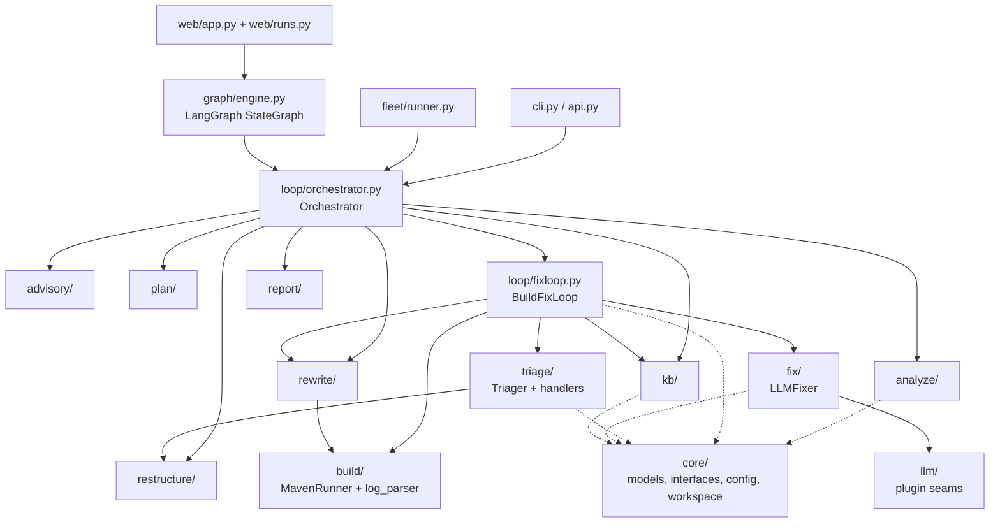
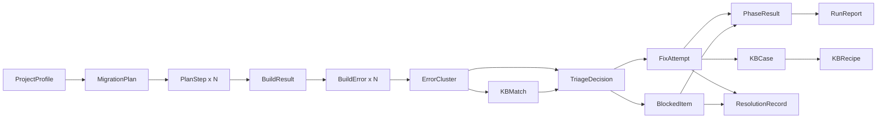
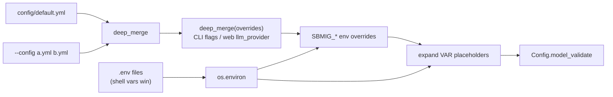
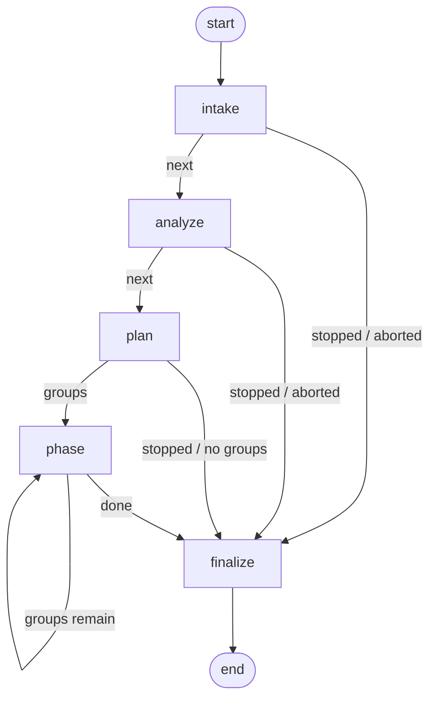
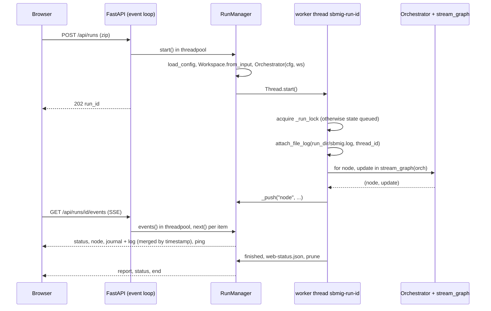
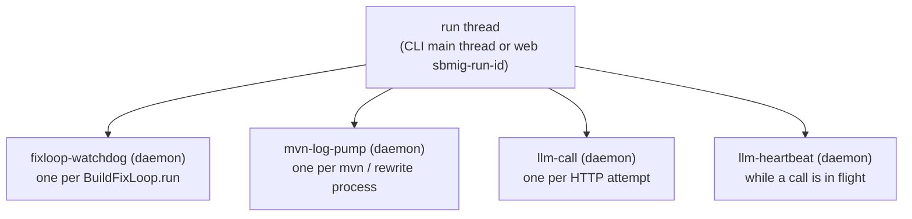

# 03. 에이전트 아키텍처

`sbmig`는 회사 Maven 프로젝트 약 500개를 JDK 21 + Spring Boot 4.1.0으로 옮기는 마이그레이션 에이전트입니다. 이 문서는 에이전트의 내부 구조를 설명합니다. 다룰 내용은 설계 원칙과 불변식 6개, 패키지별 책임, 핵심 데이터 모델, 설정이 겹쳐 적용되는 순서, 실행 엔진(Orchestrator와 LangGraph), 웹 서버, 작업 공간(Workspace)과 git 스냅샷, 운영 진단 장치, 사내 LLM 게이트웨이와 사내 에이전트를 끼우는 플러그인 심, 타임아웃과 예산, 쓰레드 모델입니다. 모든 내용은 코드에서 확인했으며, 근거가 되는 파일을 항목마다 함께 적었습니다.

## 이 문서를 읽고 나면

- 이전 사내 에이전트가 실패한 두 가지 이유와, 그 때문에 `sbmig`가 "결정적 계획 + 빌드 게이트" 구조를 택한 까닭을 설명할 수 있습니다.
- 어떤 문제가 생겼을 때 `sbmig/` 아래 어느 패키지와 어느 파일을 열어야 하는지 바로 찾을 수 있습니다.
- `config/default.yml` → `--config` → CLI 플래그 → 환경 변수 순서로 설정이 덮어써지는 규칙을 알고, 키(LLM_API_KEY)를 어디에 두어야 하는지 압니다.
- 실행 하나가 intake → analyze → plan → phase×N → finalize로 진행되는 과정과 "중단(stop)"이 실제로 언제 효력을 갖는지 압니다.
- "멈췄나?" 싶을 때 로그 한 줄, 워치독, 스레드 덤프 가운데 무엇을 보면 되는지 압니다.

## 관련 코드

- 진입점: `sbmig/cli.py`, `sbmig/api.py`, `sbmig/web/app.py`
- 실행 엔진: `sbmig/loop/orchestrator.py`, `sbmig/graph/engine.py`, `sbmig/loop/fixloop.py`, `sbmig/loop/budget.py`, `sbmig/loop/blocked_registry.py`, `sbmig/loop/components.py`
- 계약(모델·인터페이스·설정): `sbmig/core/models.py`, `sbmig/core/interfaces.py`, `sbmig/core/config.py`, `sbmig/core/workspace.py`, `sbmig/core/diag.py`
- 웹: `sbmig/web/runs.py`, `sbmig/web/static/index.html`
- 플러그인 심: `sbmig/llm/registry.py`, `sbmig/llm/adapter.py`, `sbmig/fix/company.py`, `sbmig/fix/client.py`, `examples/adapters/`
- 설계 문서: `docs/ARCHITECTURE.md`, `docs/INTERFACES.md`, `docs/ADAPTERS.md`, `docs/ERROR-HANDLING.md`, `docs/RUNBOOK.md`

---

## 1. 설계 원칙과 불변식

### 1.1 출발점: 이전 사내 에이전트가 실패한 이유

`sbmig` 이전에도 사내에 마이그레이션 에이전트가 있었습니다. 그 에이전트는 두 가지 이유로 실패했고, `sbmig`의 설계는 대부분 이 두 실패를 되풀이하지 않으려는 결정에서 나왔습니다.

| 이전 에이전트의 실패 | 결과 | `sbmig`의 대응 |
|---|---|---|
| 수정을 맡은 LLM이 빌드를 돌려 보지도 않고 "끝났다"고 판단함 | 겉으로는 성공이었지만 실제로는 컴파일조차 되지 않는 결과물이 나옴 | **빌드 게이트**: 끝났는지는 LLM이 아니라 오케스트레이터가 실제 `mvn` 결과(`BUILD SUCCESS`)를 보고 판단합니다. LLM은 빌드를 돌릴지 말지 결정하지 못합니다. |
| 작은 LLM에게 어떤 레시피를 쓸지 고르게 함 | 레시피 선택이 약하고 실행할 때마다 결과가 달라짐 | **결정적 계획**: 레시피는 프로젝트 유형별 규칙 표(`sbmig/plan/planner.py`)와 카탈로그(`knowledge/recipes/catalog.yml`)에서 결정적으로 정해집니다. LLM은 기본적으로 계획에 관여하지 않습니다(`plan.advisor: none`). |

두 결정을 합치면 실행 흐름은 이렇게 정리됩니다. 결정적 레시피(OpenRewrite)를 먼저 돌리고, 결정적 핸들러로 알려진 문제를 고치고, 남은 것만 LLM에게 맡깁니다. 그리고 어느 단계에서 무엇을 바꾸든 실제 빌드로 결과를 확인합니다.

### 1.2 불변식 6개

`CLAUDE.md`의 "Invariants"는 코드를 바꿀 때도 깨면 안 되는 규칙입니다. 각 규칙과 그 이유는 다음과 같습니다.

| # | 불변식 | 왜 필요한가 | 코드에서 지키는 곳 |
|---|---|---|---|
| 1 | **빌드 게이트**: 페이즈는 BUILD SUCCESS일 때만 완료로 봅니다. 실행은 반드시 마지막 `mvn clean package`를 시도한 뒤 끝나고, 리포트에 해결되지 않은 에러를 남깁니다. | 이전 에이전트의 첫 번째 실패를 막습니다. 운영자가 리포트만 보고도 "정말 빌드되는가"를 믿을 수 있어야 합니다. | `BuildFixLoop._run`은 빌드 직후에만 루프를 빠져나옵니다. 계획에는 항상 `verify.build`가 들어갑니다(`loop.always_final_verify`). 내부 오류로 중단돼도 `_final_build_after_abort`가 최종 빌드를 시도합니다. |
| 2 | 회사별 정보는 Python 코드가 아니라 설정/지식 YAML에 둡니다. | 실제 사내 좌표(`xxx-parent` 등)는 이 저장소에서 알 수 없습니다. 회사에서 YAML만 바꿔 쓸 수 있어야 합니다. | `config/artifacts.example.yml`(placeholder), `knowledge/libraries/advisories.yml`, `knowledge/config/externalized.yml`, `sbmig/triage/handlers/versions.yml` 등 |
| 3 | 지식 베이스(KB)는 **파일 기반**입니다(데이터베이스 금지). | 회사 환경에 DB를 둘 수 없고, git으로 이력을 남기거나 zip으로 옮길 수 있어야 합니다. | `sbmig/kb/store.py` (`FileKnowledgeBase`): JSON/YAML/JSONL 파일만 씁니다. |
| 4 | 플러그인 심은 바꾸지 않습니다: `LLMRequest` / `LLMResponse`, `FixerLike`, `sbmig.api.migrate(...)`. | 회사의 LLM 게이트웨이와 에이전트 프레임워크가 이 계약에 맞춰 붙습니다. 계약이 바뀌면 회사 쪽 어댑터가 깨집니다. | `sbmig/core/interfaces.py`, `sbmig/api.py`, `docs/ADAPTERS.md` |
| 5 | `knowledge/recipes/catalog.yml`이 레시피 id의 유일한 출처입니다. 레시피 BOM은 3.37.0, rewrite-spring은 6.37.1로 고정합니다. | 레시피 이름을 잘못 쓰면 OpenRewrite가 "recipe not found"로 실패하고, 3.38.0 BOM은 Maven Central에서 일관되지 않습니다. | `sbmig recipes check`, 스냅샷 테스트, `openrewrite.recipe_bom_version` |
| 6 | 테스트와 데모 실행은 `out/` 아래에만 씁니다. 저장소의 `kb/`에는 쓰지 않습니다. | 데모와 테스트 결과가 실제 운영 KB를 오염시키면 다음 프로젝트들이 잘못 학습합니다. | `config/artifacts.local-e2e.yml`의 `kb.dir`이 `out/e2e/kb`를 가리킵니다. |

> **확인 포인트**: 불변식 1이 지켜졌는지는 `out/<run id>/report.md` 상단 요약과 `out/<run id>/journal.jsonl`의 마지막 `verify` 이벤트(`ok`, `errors`)로 확인합니다. 내부 오류로 중단된 실행에도 `phase_start` 이벤트에 `"after_abort": true`가 붙은 verify 페이즈가 남습니다.

### 1.3 그 밖의 설계 원칙 (코드에서 읽히는 것)

- **레시피 → 핸들러 → KB → LLM 순서**: 같은 에러라도 결정적인 방법을 먼저 시도합니다. 자세한 순서는 [04. 트리아지와 빌드-수정 루프](04-triage-and-loop.md)에 있습니다.
- **고칠 수 없는 것에 매달리지 않고, 숨기지도 않습니다**(`docs/ERROR-HANDLING.md` 원칙). 프로젝트 안에서 고칠 수 없는 클러스터(외부 라이브러리가 아직 javax API를 쓰는 경우 등)는 `blocked`로 표시하고, LLM을 부르지 않고 넘어간 뒤 리포트에 남깁니다.
- **EOL 라이브러리는 막지 않습니다**: advisory 정책에는 `guide`와 `recipe`만 있고 `block`은 없습니다. 500개 프로젝트를 모두 완벽하게 만들 수는 없으니, 빌드할 수 있는 데까지 빌드하고 Handover 섹션으로 넘깁니다.
- **모든 변경은 git 커밋 1개**입니다. 되돌리기, diff, 리포트 작성 모두 이 커밋을 기준으로 합니다(§7).
- **운영자는 로그만 봅니다**: 회사 PC에서는 복사·붙여넣기가 제한됩니다. 그래서 진행 로그 한 줄만 읽어도 "지금 무엇을 하는지"를 알 수 있게 만들었습니다(§8, [09. 운영](09-operations.md)).

---

## 2. 패키지 지도

### 2.1 패키지별 책임

| 패키지 / 파일 | 책임 | 핵심 모듈·클래스 |
|---|---|---|
| `sbmig/cli.py` | `sbmig` 명령줄. 무거운 import는 지연시켜 `--help`는 항상 동작합니다. 실행마다 `<run dir>/sbmig.log` 파일 로그를 붙입니다. | `run`, `serve`, `llm-probe`, `analyze`, `plan`, `build`, `parse-log`, `rewrite`, `version` 명령과 `kb` / `recipes` / `fleet` / `advisories` 하위 앱, `attach_file_log`, `run_exit_code` |
| `sbmig/api.py` | 사내 에이전트 코드에서 부르는 프로그래밍 진입점(불변식 4) | `migrate(...)`, `exit_code(report)` |
| `sbmig/core/` | 공용 계약: 데이터 모델, 인터페이스(Protocol), 설정 스키마와 로더, 작업 공간, 진단 | `models.py`, `interfaces.py`, `config.py` (`load_config`, `Config`), `workspace.py` (`Workspace`), `diag.py` (`dump_threads`) |
| `sbmig/analyze/` | as-is 프로젝트를 읽어 `ProjectProfile`을 만듭니다. pom 그래프, 소스 스캔, 라이브러리 감지, 케이스 분류, 외부화 설정 인벤토리를 담당합니다. 네트워크와 mvn은 쓰지 않습니다. | `analyzer.py` (`analyze_project`), `pom_parser.py`, `source_scanner.py`, `libraries.py`, `classifier.py`, `properties.py`, `build_tool.py` (`detect_build_tool`), `edges.py` |
| `sbmig/advisory/` | EOL·비관리 라이브러리(springfox, hystrix, sleuth …)의 advisory를 평가하고 검증합니다. LLM 프롬프트에 넣을 힌트도 만듭니다. | `catalog.py`, `evaluate.py` (`evaluate_advisories`), `verify.py` (`verify_advisories`), `hints.py` (`hints_for`) |
| `sbmig/plan/` | LLM 없이 규칙만으로 `MigrationPlan`을 만들고, 선제 핸들러를 고르고, 레시피 카탈로그를 관리합니다. | `planner.py` (`build_plan`), `pre_handlers.py` (`pre_handlers_for`), `catalog.py`, `jarcheck.py`, `catalog_cli.py` |
| `sbmig/rewrite/` | OpenRewrite(rewrite-maven-plugin) 실행기. `rewrite.yml`을 조립하고, 다운로드 실패 재시도, OOM 재시도, `runNoFork` 폴백을 처리합니다. | `runner.py` (`OpenRewriteRunner`), `compose.py`, `versions.py` |
| `sbmig/build/` | 실제 `mvn` 실행, 로그 파싱, 에러 시그니처, 클래스→jar→GAV 추적, effective-pom 캡처를 맡습니다. | `runner.py` (`MavenRunner`), `mvn.py` (`run_logged`, `HEARTBEAT_S`), `log_parser.py` (`parse_maven_log`), `signatures.py`, `classpath.py`, `effective.py` |
| `sbmig/triage/` | 에러를 클러스터로 묶고, 마스킹하고, 클러스터마다 결정을 내립니다(HANDLER > KB_RECIPE > KB_PATCH > blocked > LLM_FIX). 결정적 핸들러도 여기에 있습니다. | `triager.py` (`Triager`), `cluster.py`, `decide.py` (`DecisionEngine`), `blocked.py` (`classify_blocked`), `rules.py` + `recipe_rules.yml`, `handlers/` (`HandlerRegistry`) |
| `sbmig/fix/` | LLM 수정기. 컨텍스트를 패킹하고, 프롬프트를 렌더링하고, SEARCH/REPLACE 프로토콜을 파싱하고, 패치를 적용합니다. 회사 게이트웨이 클라이언트도 여기에 있습니다. | `fixer.py` (`LLMFixer`), `context.py` (`ContextPacker`), `protocol.py`, `apply.py` (`PatchApplier`), `client.py` (`make_llm_client`, `RecordingClient`), `company.py` (`CompanyClient`), `prompts/` |
| `sbmig/llm/` | 어댑터 심 1단계(`llm.plugin`)와 2단계(`fix.plugin`)의 플러그인을 로딩합니다. | `registry.py` (`resolve_llm_plugin`, `resolve_fixer_plugin`), `adapter.py` (`LLMAdapter`, `AdapterClient`) |
| `sbmig/kb/` | 파일 기반 지식 베이스: 케이스, 시그니처 인덱스, 레시피 후보와 활성 레시피, ledger, symbols, 수확(harvest), 수정 라벨 | `store.py` (`FileKnowledgeBase`), `harvest.py` (`harvest_phase`), `labels.py` (`label_changes`, `compile_recipe`), `ledger.py` (`Ledger`, `SymbolIndex`), `recipes.py`, `cli.py` |
| `sbmig/loop/` | 실행의 핵심. 오케스트레이터(단계 진행)와 빌드-수정 루프, 예산, 실행 전체에서 공유하는 blocked 레지스트리를 둡니다. | `orchestrator.py` (`Orchestrator`, `parse_stop_after`, `ALWAYS_PREEMPTIVE`), `fixloop.py` (`BuildFixLoop`, 워치독 상수), `budget.py` (`LoopBudget`), `blocked_registry.py` (`BlockedRegistry`), `components.py` (`LazyFixer`, `NullKnowledgeBase`) |
| `sbmig/graph/` | LangGraph `StateGraph`로 오케스트레이터의 단계를 구동합니다. 회사 규칙이 LangGraph 기반 에이전트이기 때문입니다. | `engine.py` (`build_graph`, `run_graph`, `stream_graph`, `MigrationState`) |
| `sbmig/restructure/` | 회사 레이아웃으로 재구성합니다(부모 교체, mandatory/optional, `{name}-boot` / `-back` / `-front`, Boot as-is는 pom만 수정, MSA는 pom만 수정). 서식을 보존하는 pom 편집기도 있습니다. | `restructurer.py` (`Restructurer`), `pom_editor.py` (`PomEditor`), `templates/` |
| `sbmig/report/` | `report.json` / `report.md` / 콘솔 요약과 Handover(교체한 버전, 이제부터 팀이 할 일) | `writer.py` (`write_report`), `markdown.py`, `handover.py` (`build_handover`) |
| `sbmig/fleet/` | 에이전트 하나로 N개 프로젝트를 엄격히 순차 처리합니다. KB를 공유하고 재개할 수 있습니다. | `runner.py`, `manifest.py`, `summary.py`, `cli.py` |
| `sbmig/web/` | FastAPI 웹 UI. 업로드 → 프로세스 내 실행 → SSE 스트림. 실행은 한 번에 하나씩입니다. | `app.py` (`create_app`), `runs.py` (`RunManager`), `static/index.html` |

각 영역의 자세한 동작은 다른 핸드북 문서에서 다룹니다. 파이프라인 단계는 [01-pipeline.md](01-pipeline.md), 재구성은 [06-restructure-and-layouts.md](06-restructure-and-layouts.md), 설정 키는 [08-config-reference.md](08-config-reference.md)를 보십시오.

### 2.2 의존 관계와 호출 흐름

`sbmig/core/`는 모든 패키지가 의존하는 바닥입니다. 오케스트레이터는 다른 패키지를 대부분 **지연 import**합니다(`sbmig/loop/components.py`의 `lazy_attr`). 그래서 어떤 패키지가 깨져 있으면 실행 전체가 죽지 않고 `MissingComponentError`로 기록된 뒤 중단 처리됩니다.



설명:
- `triage/` → `restructure/` 화살표는 pom 핸들러가 `PomEditor`(서식 보존 편집기)를 빌려 쓰기 때문입니다(`sbmig/triage/handlers/base.py`의 `_default_pom_editor_factory`).
- `rewrite/` → `build/`는 OpenRewrite도 결국 Maven 플러그인이므로 `sbmig/build/mvn.py`의 `run_logged`로 실행하기 때문입니다.
- `kb/`는 수확 단계에서 레시피 후보를 만들 때 LLM 클라이언트를 받습니다. 이 클라이언트는 오케스트레이터가 예산을 차감하도록 감싼 것(`_BudgetedLLM`)입니다.

---

## 3. 핵심 데이터 모델

모든 모델은 pydantic `BaseModel`이고 `sbmig/core/models.py`에 있습니다(`RestructureResult`와 LLM 관련 모델은 `sbmig/core/interfaces.py`). 모델에 저장되는 경로는 필드 이름이 `_abs`로 끝나거나 로그/출력 경로가 아니라면 **프로젝트 루트 기준 상대 경로**입니다. 아래 표에는 운영자와 개발자가 읽을 때 중요한 필드만 골라 적었습니다.

### 3.1 분석 결과: `ProjectProfile`과 구성 요소

| 모델 | 중요한 필드 | 의미 |
|---|---|---|
| `ProjectProfile` | `case_type` (`CaseType`: `pure_java` / `spring_legacy` / `spring_boot` / `servlet_tomcat` / `msa` / `unknown`), `build_tool`, `poms`, `root_pom`, `source`, `libraries`, `java_version`, `spring_boot_version`, `services` (MSA), `optional_artifacts_in_use`, `warnings`, `fingerprint`, `properties`, `boot_modules` | as-is 프로젝트의 모든 사실입니다. 계획, 선제 핸들러, 트리아지, 프롬프트 요약이 모두 이 객체를 읽습니다. `<run dir>/profile.json`에 저장됩니다. |
| `PomInfo` | `path`, `artifact_id`, `packaging`, `parent`, `parent_in_repo`, `modules`, `dependencies`, `dependency_management`, `repositories`, `plugins`, `java_version`, `has_spring_boot_plugin`, `is_root`, `is_aggregator` | pom 하나의 요약입니다. `repositories`(pom에 선언된 저장소 URL)는 X9(망분리 환경) 판단에 쓰입니다. |
| `SourceStats` | `java_files`, `packages`, `base_package`, `main_classes`, `controllers`, `javax_imports`, `jakarta_imports`, `jsp_paths`, `web_static_dirs`, `xml_bean_configs`, `lombok` | 정규식으로 스캔한 소스 통계입니다. `javax_imports`는 jakarta 레시피를 쓸지 판단하는 근거이고, `jsp_paths`는 front 모듈과 WAR 패키징을 판단하는 근거입니다. |
| `LibraryUsage` | `name` (lombok, mapstruct, querydsl, junit4 …), `version`, `evidence` | 라이브러리 감지 결과입니다. 선제 핸들러 선택(예: lombok < 1.18.30)과 advisory 매칭에 쓰입니다. |
| `PropertyInventory` / `PropertyFinding` | `findings[].key`, `status` (`defined` / `defaulted` / `external`), `refs`, `boot_keys`, `service`; `filtered_resources`, `filtered_binary_files`, `placeholder_files`, `placeholders_written` | 코드가 읽는 외부 설정의 인벤토리입니다. `external` 키는 재구성 단계에서 `__SET_ME__` placeholder로 쓰입니다. `filtered_binary_files`가 있으면 `resources-binary-filtering` 핸들러가 선제 실행됩니다. |

### 3.2 계획: `MigrationPlan`, `PlanStep`, `StepKind`, `Phase`

| 모델 | 중요한 필드 / 값 | 의미 |
|---|---|---|
| `Phase` | `intake`, `analyze`, `plan`, `jdk21`, `spring`, `restructure`, `verify`, `report` | 파이프라인 단계입니다. `--stop-after`에는 `report`를 뺀 값만 쓸 수 있습니다(`STOP_AFTER_PHASES`). |
| `StepKind` | `openrewrite`, `handler`, `restructure`, `msa_pom`, `build_fix_loop`, `build` | 계획 단계의 종류이며, `Orchestrator._run_phase`가 이 값에 따라 분기합니다. |
| `PlanStep` | `id` (`jdk21.rewrite`, `jdk21.loop`, `spring.rewrite`, `spring.optional_bump`, `spring.loop`, `restructure.apply`, `restructure.boot_pom`, `restructure.msa_pom`, `restructure.loop`, `verify.build` …), `kind`, `phase`, `recipes`, `params` (`mode` 등), `build_goal`, `max_iterations`, `target` (MSA 서비스), `optional` | 실행할 단계 하나입니다. MSA는 서비스마다 id에 접미사가 붙습니다. |
| `MigrationPlan` | `case_type`, `steps`, `notes` (`followup:`으로 시작하는 노트는 리포트의 수동 후속 조치로 옮겨짐), `llm_usage` | 규칙으로 만든 계획입니다. `<run dir>/plan.json`에 저장됩니다. |

### 3.3 빌드와 에러: `BuildError`, `ErrorKind`, `BuildResult`, `ErrorCluster`

| 모델 | 중요한 필드 | 의미 |
|---|---|---|
| `ErrorKind` | `compile`, `test_compile`, `dependency_resolution`, `plugin_resolution`, `parent_resolution`, `plugin_execution`, `enforcer`, `pom_invalid`, `rewrite`, `test_failure`, `unknown` | 에러 종류입니다. 종류마다 예시 로그는 [04 §2](04-triage-and-loop.md)에 있습니다. |
| `BuildError` | `kind`, `message`, `file`, `line`, `symbol`, `location`, `module`, `artifact`, `goal`, `raw`, `signature` (L1), `signature_generic` (L2) | 로그 파서가 만든 구조화된 에러입니다. 시그니처는 KB 매칭, blocked 키, 정체(stall) 판정에 쓰입니다. |
| `BuildResult` | `ok`, `goal`, `command`, `exit_code`, `duration_s`, `log_path`, `errors`, `timed_out` | `mvn` 한 번의 결과입니다. `signature_multiset()`으로 정체와 진동을 판정합니다. |
| `ErrorCluster` | `id` (`<kind>:<sha1 8자리>`), `kind`, `file`, `module`, `errors`, `signatures`, `priority` | 함께 고칠 에러 묶음입니다. 컴파일 에러는 파일 단위, 해석(resolution) 에러는 아티팩트 단위로 묶습니다. |

### 3.4 결정과 시도: `TriageDecision`, `DecisionKind`, `FixAttempt`

| 모델 | 중요한 필드 / 값 | 의미 |
|---|---|---|
| `DecisionKind` | `handler`, `kb_recipe`, `kb_patch`, `llm_fix`, `skip`, `escalate`, `blocked` | 클러스터 하나에 대한 결정입니다. |
| `TriageDecision` | `cluster_id`, `kind`, `handler_id`, `recipe_ids`, `kb_case_ids`, `rationale` | 결정과 그 이유입니다. 운영자 로그와 journal의 `decision` 이벤트에 그대로 남습니다. |
| `FixAttempt` | `id` (`<phase>-<build 번호>-<n>`), `decision`, `changes`, `advisory_ids`, `applied`, `apply_errors`, `commit`, `model`, `llm_usage`, `errors_before`/`errors_after`, `cluster_signatures`, `cluster_resolved`, `outcome`, `analysis` | 실제로 적용한 시도 하나입니다. 다음 빌드 뒤에 점수가 매겨집니다(`outcome`). |
| `AttemptOutcome` | `pending`, `improved`, `no_change`, `regressed`, `reverted`, `build_ok`, `apply_failed`, `blocked` | `improved`·`build_ok`만 성공으로 칩니다(KB 수확 대상). |

### 3.5 결과: `PhaseResult`, `BlockedItem`, `RunReport`

| 모델 | 중요한 필드 | 의미 |
|---|---|---|
| `PhaseResult` | `phase`, `step_ids`, `ok`, `build_ok`, `iterations`, `rewrite_results`, `attempts`, `iteration_records`, `remaining_errors`, `notes`, `blocked` | 페이즈 그룹 하나의 결과입니다. `notes`에는 `test-compile-skipped:`, `tests-skipped:` 같은 표식도 들어갑니다. |
| `BlockedItem` | `id` (`blk-<sha1 10자리>`), `reason` (`BlockReason`), `phase`, `signatures`, `files`, `artifact`, `owner_class`, `required_type`, `found_type`, `suggestion`, `attempts` | 의도적으로 멈춘 클러스터입니다. 리포트의 "Blocked — needs human / library action" 섹션에 실립니다. |
| `BlockReason` | `external_javax_api`, `external_api_incompatible`, `artifact_not_found`, `parent_not_found`, `plugin_incompatible`, `unsupported_source`, `encoding`, `budget_exhausted`, `llm_unavailable`, `repeated_failure`, `oscillation` | `loop.blocked_policy`의 키이기도 합니다(앞의 7개). |
| `RunReport` | `run_id`, `success`, `profile`, `plan`, `phases`, `final_build`, `llm_usage`, `harvest`, `unresolved`, `blocked`, `manual_followups`, `advisories`, `handover`, `merge_conflicts`, `properties`, `flags`, `outputs`, `timings_s` | 실행 하나의 최종 결과입니다. `<run dir>/report.json`이 이 객체를 직렬화한 것이고, `<run dir>/report.md`는 이를 사람이 읽을 수 있게 만든 것입니다. |

`success`는 "모든 verify 빌드가 `ok`이고 `restructure-failed` 플래그가 없을 때"만 `True`입니다(`Orchestrator._finalize`). 종료 코드는 `sbmig/cli.py`의 `run_exit_code`가 정합니다. `aborted` 계열 플래그나 `mvn-not-found`가 있으면 3, 성공이면서 blocked가 없으면 0, 나머지는 2입니다.

### 3.6 `RestructureResult` (`sbmig/core/interfaces.py`)

| 필드 | 의미 |
|---|---|
| `ok`, `error` | 재구성 단계의 성공 여부. 실패하면(`optional_bump` 모드는 예외) 플래그 `restructure-failed`가 붙고 `success=False`가 됩니다. |
| `changed_files`, `moved_files`, `generated_files` | 바뀐 파일, 옮긴 파일 수, 생성된 파일(Application 클래스 등) |
| `optional_bumped`, `mandatory_added` | `"g:a old→new"` 형식의 optional 버전 상향 목록과 추가된 mandatory |
| `merged_modules`, `kept_boot_module`, `merge_conflicts` | 다중 모듈 `merge` 정책의 결과 |
| `placeholder_files`, `placeholders_written` | 외부화 설정 placeholder를 쓴 파일과 키 |
| `managed_versions_dropped`, `parents_set` | 새 부모가 관리하게 되어 지운 버전 목록과, 설정·교체한 부모 목록 |
| `boot_module`, `comp_module`, `front_module`, `boot_packaging`, `front_files` | 회사 레이아웃(9c)에서 실제로 쓴 모듈 경로, boot 모듈 패키징(`jar`/`war`), front로 옮긴 파일 수 |

### 3.7 KB 모델

| 모델 | 중요한 필드 | 의미 |
|---|---|---|
| `KBCase` | `id`, `project`, `symbol`, `symbol_owner`, `fix_labels`, `replacement`, `signatures` (L1), `signatures_generic` (L2), `errors` (정제됨), `changes`, `summary`, `reuse_count`, `recipe_candidate_id` | 해결된 사례 하나입니다(`kb/cases/` 아래에 파일 하나). |
| `KBRecipe` | `id`, `status` (`candidate` / `active` / `rejected`), `path`, `signatures`, `source_case_ids`, `success_count` / `fail_count`, `projects` | 선언형 OpenRewrite 레시피입니다. 후보는 `kb.auto_promote_after_projects`개의 서로 다른 프로젝트에서 성공하면 자동으로 승격됩니다. |
| `KBMatch` | `recipe_ids`/`recipe_files` (active), `candidate_recipe_ids`, `cases`, `replayable`, `handler_ids`, `hints` | 클러스터 하나에 대한 KB 조회 결과로, 트리아지 결정의 입력입니다. |
| `ResolutionRecord` | `project`, `run_id`, `phase`, `signature`, `symbol`, `resolution` (`handler` / `plan_recipe` / `kb_recipe` / `kb_patch` / `llm_patch` / `optional_bump` / `blocked` / `unresolved` / `advisory`), `resolver_id`, `fix_labels`, `replacement`, `outcome`, `files` (basename만) | `ledger.jsonl`의 한 줄입니다. 함대(fleet) 학습의 단위입니다. |
| `HarvestResult` | `cases_created`, `candidates_created`, `recipes_credited`, `recipes_promoted`, `ledger_entries` | 페이즈 하나의 수확 결과입니다. |

### 3.8 모델 관계 한 장



---

## 4. 설정 계층

### 4.1 덮어쓰기 순서

설정 로딩은 `sbmig/core/config.py`의 `load_config(*paths, overrides=None, repo_root=None)`가 맡습니다. 코드에 적힌 순서는 다음과 같으며, 뒤에 오는 것이 앞의 것을 덮어씁니다.

| 순서 | 출처 | 설명 |
|---|---|---|
| 0 | `.env` 파일들 → `os.environ` | `load_dotenv_files()`가 가장 먼저 실행됩니다. 후보는 `$SBMIG_ENV_FILE`, `<sbmig 저장소 루트>/.env`, `<현재 디렉터리>/.env` 순입니다. **이미 설정된 쉘 환경 변수가 이깁니다**(`if k and k not in os.environ`). `.env` 내용은 설정 dict로 들어가지 않고 환경 변수로만 전달됩니다. |
| 1 | `config/default.yml` | 기본값 |
| 2 | `--config` 파일들(순서대로) | 예: 회사 좌표 파일(`config/artifacts.example.yml`을 복사해 실제 좌표를 채운 것, 저장소에는 없음). 나중에 준 파일이 이깁니다. `deep_merge`로 합치므로 dict는 키 단위로, 리스트는 통째로 바뀝니다. |
| 3 | `overrides` dict | CLI 플래그(`--llm-provider`, `--llm-plugin`, `--fix-plugin`, `--java-home`, `--settings`, `--no-kb`)와 웹 UI의 `llm_provider`가 여기로 들어옵니다. |
| 4 | `SBMIG_*` 환경 변수 | `SBMIG_LLM__MODEL=foo` → `llm.model = foo`. 밑줄 두 개(`__`)가 중첩을 뜻하고, 값은 YAML로 해석합니다. **코드상 CLI 플래그보다 나중에 적용되므로 같은 키라면 `SBMIG_*`가 이깁니다.** |
| 5 | `${VAR}` / `${VAR:-기본값}` 확장 | 모든 문자열 값에서 환경 변수를 확장합니다. 예: `llm.base_url: "${LLM_BASE_URL}"`, `llm.model: "${LLM_MODEL:-gpt-6-luna}"`. 변수가 없고 기본값도 없으면 `${...}` 그대로 남고, 클라이언트가 "not set" 오류를 냅니다. |
| 6 | `repo_root` | `--repo-root`를 주면 KB, knowledge 등 상대 경로의 기준이 바뀝니다. |



> **확인 포인트**: 어떤 값이 실제로 적용됐는지는 `out/<run id>/journal.jsonl`의 `preflight` 이벤트(`artifacts.parent`, `artifacts.boot_parent`, `java_home`)와 `<run dir>/sbmig.log`의 LLM 호출 줄(`llm call provider=company role=fix model=…`)로 확인합니다. LLM 요청 형태는 `sbmig llm-probe`가 그대로 출력합니다.

### 4.2 `artifacts`는 기본값이 없습니다

`Config.artifacts`는 필수 필드입니다(`artifacts: ArtifactsConfig`). 그래서 `--config config/artifacts.yml` 없이 실행하면 `config error … artifacts: Field required`로 멈춥니다(`docs/RUNBOOK.md`). 회사 좌표의 예시는 `config/artifacts.example.yml`에 placeholder로 들어 있습니다. 문서에서는 `xxx-parent`, `xxx-boot-jar`, `xxx-comp-jar`(4.0.0)로 표기합니다.

### 4.3 YAML에 절대 두지 않는 값

| 값 | 어디에 두나 | 이유 |
|---|---|---|
| LLM API 키 | 환경 변수 `LLM_API_KEY`(또는 git에 올라가지 않는 `.env`). YAML에는 변수 **이름**만 둡니다(`llm.api_key_env: LLM_API_KEY`). | 키가 저장소, 설정 파일, 로그에 들어가면 안 됩니다. `CompanyClient.__repr__`도 키를 숨기고, `llm-probe`는 Authorization 헤더를 가립니다. |
| 게이트웨이 URL / 모델 | `.env`의 `LLM_BASE_URL`, `LLM_MODEL`, `LLM_RECIPE_MODEL`, `LLM_ESCALATION_MODEL`, `LLM_RESPONSE_PATH`, `LLM_RECORD_DIR` | 회사마다, PC마다 다릅니다. `config/default.yml`은 `${…}`로 참조만 합니다. |
| 실제 사내 좌표 | 회사 쪽에서 `config/artifacts.example.yml`을 복사해 만든 파일(저장소에는 예시만 있음) | 불변식 2 |

`.env`의 예시는 `.env.example`에 있습니다.

---

## 5. 실행 엔진

### 5.1 Orchestrator의 단계 메서드

`sbmig/loop/orchestrator.py`의 `Orchestrator`는 실행 하나를 책임집니다. 두 엔진(graph / inline)이 **같은 `step_*` 메서드**를 호출하므로 리포트와 journal이 같게 나옵니다(`tests/graph/test_engine.py`가 이를 검증합니다).

| 메서드 | 하는 일 | False/None을 돌려주는 경우 |
|---|---|---|
| `step_intake` | `ws.git_init()`(브랜치 `sbmig/<run id>`, as-is 스냅샷 커밋), 인코딩 후보 설정, `_preflight`(mvn 실행 가능 여부, `artifacts.parent` 설정 여부), `_check_build_tool`(Gradle/Ant/빌드 없음이면 거부, 플래그 `unsupported-build-tool:<tool>`), `_capture_effective`(as-is effective dependencyManagement 캡처) | `mvn-not-found`, Maven이 아닌 프로젝트, `stop_after=intake` |
| `step_analyze` | `analyze_project` → `<run dir>/profile.json`, advisory 평가 | Maven이 아님, pom.xml 없음, `stop_after=analyze` |
| `step_plan` | `build_plan`(advisory 포함) → `_advise_plan`(선택) → X9 저장소 노트 → `<run dir>/plan.json`, 선제 핸들러 id 선택, `BuildFixLoop` 생성, 계획 단계를 **연속된 같은 페이즈끼리** 묶은 페이즈 그룹 반환. 계획에 BUILD 단계가 없으면 `verify.build`(`clean package`)를 붙입니다. | `stop_after=plan`이면 None |
| `step_phase` | 페이즈 그룹 하나를 실행합니다(`_run_phase`). 끝나면 KB 레시피 점수 부여(`_credit_plan_recipes`)와 수확(`_harvest`)을 합니다. 루프가 중단 상태면 `_RunAborted`를 던집니다. | `stop_after` 이후 페이즈는 `phase_skipped` |
| `step_finish` | 마지막 그룹 뒤에 `stop_after` 표식을 기록합니다. | – |
| `_run_phase` | 단계 종류별 분기: `openrewrite` → `_step_rewrite`(그 전에 `_maybe_pre_handlers`), `handler` → `_step_handlers`, `build_fix_loop` → `_step_loop`, `restructure`/`msa_pom` → `_step_restructure`, `build` → `_step_verify` | – |
| `_finalize` | LLM 사용량 합산, 루프 플래그와 후속 조치 병합, `success` 계산, 미해결 에러 정리, blocked 정리(`_finalize_blocked`), `changes.patch` / `result.zip`, advisory 검증과 Handover, 실행 단위 ledger, 리포트 작성, journal `report` | 항상 실행됩니다(가드의 `finally`). |

페이즈 그룹 예시(단일 모듈 Spring Boot 프로젝트): 기본값 `plan.parent_phase: restructure`이면 `jdk21`[`jdk21.rewrite`, `jdk21.loop`] → `spring`[`spring.rewrite`, `spring.optional_bump`, `spring.loop`] → `restructure`[`restructure.boot_pom`, `restructure.loop`] → `verify`[`verify.build`]입니다. 회사 설정(`config/artifacts.example.yml`)처럼 `plan.parent_phase: spring`이면 재구성 단계가 spring 페이즈로 옮겨져 `spring.loop` 바로 앞에 들어가고 (`spring`[`spring.rewrite`, `spring.optional_bump`, `restructure.boot_pom`, `spring.loop`]), restructure 페이즈의 루프는 빠져서 그 뒤에는 `verify`만 남습니다(`_apply_parent_phase`). MSA는 서비스마다 jdk21/spring 그룹이 반복됩니다. 케이스별로 실제 들어가는 단계는 [01-pipeline.md](01-pipeline.md)를 보십시오.

선제 핸들러의 실행 시점(`_maybe_pre_handlers`):
- `ALWAYS_PREEMPTIVE = ("strip-utf8-bom", "source-encoding")`는 프로필과 관계없이 항상 맨 앞에 붙습니다. JDK 21에서 `unmappable character`는 경고일 뿐이라 빌드는 통과하지만, 한글 리터럴이 조용히 U+FFFD로 깨지기 때문입니다.
- `preemptive_phase`가 `JDK21`인 핸들러는 첫 rewrite/빌드 전에 실행되고, `SPRING`인 핸들러(jakarta 의존)는 spring 레시피가 끝난 뒤 spring 빌드-수정 루프 직전(또는 restructure 직전)에 실행됩니다.

> **확인 포인트**: journal에서 `handlers_preemptive` 이벤트의 `why`가 `pre-emptive (before the first build)` 또는 `pre-emptive (after the jakarta/spring recipes)`이고, `changed`에 실제로 무언가를 바꾼 핸들러 id가, `commit`에 `handlers: …` 커밋 SHA가 남습니다.

### 5.2 LangGraph `StateGraph` (`loop.engine: graph`, 기본값)

회사 규칙(2026-10-20)에 따라 사내 에이전트는 uvicorn 위의 LangGraph로 동작해야 합니다. `sbmig/graph/engine.py`는 파이프라인을 **다시 구현하지 않고**, 노드마다 오케스트레이터의 `step_*`를 하나씩 호출합니다.



| 노드 | 호출하는 단계 | 메모 |
|---|---|---|
| `intake` | `step_intake` | 실패하면 `aborted`, `stop_after`면 `stopped` |
| `analyze` | `step_analyze` | 동일 |
| `plan` | `step_plan` | 페이즈 그룹은 노드 함수가 클로저로 쥐고 있는 holder에 저장합니다. 상태에는 그룹 **이름**만 둡니다. |
| `phase` | `step_phase` | 그룹 하나당 한 번 호출됩니다. MSA는 여러 번 호출됩니다. |
| `finalize` | `step_finish` | `_finalize`(리포트)는 노드가 아니라 실행 가드(`_run_guard`)가 실행합니다. |

- **상태(`MigrationState`)**: `run_id`, `stop_after`, `dry_run`, `phases`(남은 그룹 이름), `phase`, `aborted`, `stopped`, `summary`처럼 작은 JSON 값만 담습니다. 무거운 객체(`RunReport`, `PlanStep`, `BuildFixLoop`)는 오케스트레이터가 갖고 있습니다.
- **오류 처리**: 노드는 예외를 잡지 않습니다. `_RunAborted`, `MissingComponentError`, 그 밖의 예외는 그래프 밖으로 나가 `_run_guard`가 처리합니다.
- **`RECURSION_LIMIT = 1000`**: LangGraph 기본값(25)으로는 MSA 서비스가 많을 때 부족하기 때문입니다.
- **journal**: 노드가 시작될 때마다 `{"event": "graph_node", "node", "phase"}`가 추가됩니다. inline 엔진과 다른 점은 이것뿐입니다.

### 5.3 `loop.engine: inline`

`Orchestrator._run`이 같은 단계를 일반 Python 루프로 호출합니다(`step_intake` → `step_analyze` → `step_plan` → 그룹마다 `step_phase` → `step_finish`). LangGraph가 설치되지 않은 환경에서 웹 서버를 띄우면 `RunManager`가 자동으로 `orch.run()`(설정된 엔진)으로 넘어갑니다. 이때는 `node` SSE 이벤트가 없어 UI의 그래프 표시가 꺼져 있고, 중단 버튼도 효과가 없습니다.

### 5.4 실행 가드와 중단(abort)

`_run_guard`(컨텍스트 매니저)는 실행을 시작하고 반드시 끝냅니다.

| 상황 | 처리 | 최종 빌드 | 종료 코드 |
|---|---|---|---|
| `_RunAborted` (Maven 없음, 사내 부모 해석 불가 등 의도된 중단) | 조용히 끝내고 `_finalize`를 실행합니다. | **안 함**: 같은 이유로 실패할 것이 뻔하기 때문입니다. | 3 |
| `MissingComponentError` (패키지 import 실패) | `aborted` 플래그, `_final_build_after_abort` | 함(불변식 1) | 3 |
| 그 밖의 예외(버그) | `internal error: …`로 중단 처리, `_final_build_after_abort` | 함 | 3 |
| 정상 | – | `verify.build` | 0 / 2 |

사내 부모(`artifacts.parent` / `artifacts.boot_parent` / `artifacts.comp_parent`)를 해석할 수 없으면 `BuildFixLoop._parent_abort`가 플래그 `aborted:parent-not-found`를 붙이고 실행을 멈춥니다. 다른 어떤 것도 빌드할 수 없기 때문입니다.

### 5.5 멈춤의 두 종류: `--stop-after`와 웹 "중단"

| 구분 | `--stop-after <phase>` (CLI / API / 웹 파라미터) | 웹 UI "중단" 버튼 |
|---|---|---|
| 해석 | `parse_stop_after`: `intake` … `verify`만 허용(대소문자 무시). 잘못된 값은 오류입니다. | `RunManager.stop()` → 취소 플래그 |
| 효력 시점 | 해당 단계가 끝난 직후. 이후 페이즈 그룹은 `phase_skipped`가 됩니다. | **그래프 노드 사이에서만** 효력이 있습니다. 실행 중인 Maven 빌드, OpenRewrite 실행, LLM 호출은 중간에 끊지 않습니다(LangGraph는 실행 중인 동기 노드를 취소할 수 없음). |
| 결과 | 플래그 `stopped-after-<phase>` | verify 전에 멈추면 `aborted`와 후속 조치 "stopped by user (web UI) — the final `mvn clean package` did not run", 종료 코드 3. verify 그룹이 끝난 뒤나 `finalize` 노드 뒤에 들어온 중단은 무시하고 정상 종료합니다. |

---

## 6. 웹 서버 구조

### 6.1 구성

- **앱**: `sbmig/web/app.py`의 `create_app(out_dir, repo_root)`. 모듈 수준 `app`은 환경 변수 `SBMIG_WEB_OUT`(기본 `out/web`)과 `SBMIG_WEB_REPO_ROOT`로 만들어집니다. 띄우는 방법은 `uvicorn sbmig.web.app:app` 또는 `sbmig serve --port 8765`(기본 바인드 `127.0.0.1`)입니다.
- **정적 UI**: `sbmig/web/static/index.html`(순수 JS). `Cache-Control: no-store`로 제공됩니다.
- **업로드 한도**: 기본 512 MB(`DEFAULT_MAX_UPLOAD_MB`). `create_app(..., max_upload_mb=)` — 즉 `sbmig serve --max-upload-mb N` 또는 환경 변수 `SBMIG_MAX_UPLOAD_MB`(`.env`도 가능: `create_app`이 `load_dotenv_files()`를 먼저 부릅니다; `resolve_max_upload`, 옵션이 변수보다 우선) — 로 바꾸고 `0`이면 한도가 없습니다. 본문은 `<out>/_uploads/.incoming-*.part`로 스트리밍하면서 한도와 `PK` 서명을 검사하고(400 / 413), 거절된 업로드는 지웁니다. 화면은 `/api/configs`의 `max_upload_mb`로 올리기 전에 크기를 미리 봅니다.
- **anyio 쓰레드 풀**: 시작할 때 `THREAD_POOL_SIZE = 256`으로 늘립니다. 열린 SSE 스트림(브라우저 탭) 하나가 워커 쓰레드 하나를 차지하기 때문입니다.
- **접근 토큰(round 10)**: `create_app(..., token=)`(`sbmig serve --token`, 또는 `SBMIG_WEB_TOKEN`)이면 미들웨어 `TokenGuard`가 모든 요청에 `Authorization: Bearer <토큰>`이나 쿠키를 요구합니다(`?token=`을 한 번 주면 토큰의 해시를 담은 HttpOnly·SameSite=Strict 쿠키를 7일 동안 줌, 없거나 틀리면 401). 토큰이 없으면 루프백(127.0.0.1 / ::1) 클라이언트만 받고 다른 주소는 403 — 순수 `uvicorn --host 0.0.0.0`으로 띄워도 같습니다. `sbmig serve`는 토큰 없이 루프백이 아닌 `--host`면 아예 뜨지 않습니다(종료 코드 2). 결과 zip(회사 소스)과 Maven이 실행할 pom 업로드를 네트워크에 열어 두지 않기 위해서입니다.

| 라우트 | 용도 |
|---|---|
| `GET /` | 페이지 |
| `GET /api/configs` | 체크할 수 있는 `config/*.yml` 이름(`default.yml` 제외), `repo_root`, `out_dir`, `max_upload_mb` |
| `GET /api/runs` | 실행 목록(최신순, 상태 포함) |
| `POST /api/runs?name=…&configs=a.yml,b.yml[&stop_after=…][&llm_provider=…]` | zip 업로드 → 202 `{"run_id", "status"}` |
| `GET /api/runs/{id}` | 상태(`queued` / `running` / `finished`, `exit_code`, `node`, `success`, `blocked`, `unresolved`, `llm_calls`) |
| `GET /api/runs/{id}/events` | SSE: `status`, `node`, `error`, `journal`, `log`, `report`, `ping`, `end` |
| `POST /api/runs/{id}/stop` | 다음 노드 경계에서 중단 |
| `GET /api/runs/{id}/files/{name}` | `report.md`, `report.json`, `result.zip`, `sbmig.log`, `journal.jsonl`, `changes.patch`, `plan.json`, `profile.json`, `error_cases.csv`, `error_cases.jsonl`, `fix_attempts.jsonl`만 허용(`SERVED_FILES`) |
| `GET /api/threads` | 모든 쓰레드의 스택(텍스트). 동시에 `<out>/threads-<ts>.txt`로도 기록합니다. SIGUSR1이 없고 `sbmig serve` 창의 Ctrl+Break가 서버를 끄는 Windows용입니다(실행 디렉터리의 `dump-threads` 파일 트리거도 됨, §8). |

### 6.2 `RunManager` (`sbmig/web/runs.py`)



동작의 핵심:
1. **검증은 동기로**: `start()`는 설정 이름, `stop_after`, 설정 로딩, Workspace 생성까지 요청 처리 중에 끝냅니다. 잘못된 요청은 그 자리에서 400을 받습니다.
2. **실행 하나에 워커 쓰레드 하나**: 쓰레드 이름은 `sbmig-run-<run id>`이고 데몬 쓰레드입니다.
3. **한 번에 마이그레이션 하나**: 모든 워커가 `RunManager._run_lock`을 기다립니다. 기다리는 동안 상태는 `queued`입니다. 파일 기반 KB(`kb/`)를 모든 실행이 공유하므로 학습 순서를 지키기 위해서입니다. round 10부터 KB 쓰기 자체는 프로세스 간 잠금 `<kb.dir>/.lock`(`sbmig/kb/lock.py`)으로 직렬화되므로 웹·플릿·`sbmig kb` 명령이 같은 KB를 써도 파일이 깨지지 않습니다.
4. **실행별 로그 분리**: `attach_file_log(path, thread_id=…)`는 `_ThreadFilter`를 붙입니다. 이 필터는 레코드의 `thread`가 실행 쓰레드이거나, contextvar `_LOG_THREAD`(`sbmig/cli.py`)가 그 쓰레드를 가리킬 때만 통과시킵니다. LLM 하트비트·호출 쓰레드와 워치독 쓰레드는 `contextvars.copy_context().run`으로 시작하므로 이들이 남기는 줄도 해당 실행의 `sbmig.log`에 들어갑니다.
5. **SSE 순서 정렬**: `journal.jsonl`과 `sbmig.log`는 같은 쓰레드가 쓰는 두 파일입니다. 파일을 하나씩 읽어 보내면 순서가 뒤바뀌어 보일 수 있으므로, 매 tick마다 읽은 묶음을 타임스탬프(`ts`, 로그의 `asctime`) 순으로 정렬해 보냅니다. 타임스탬프가 없는 줄(트레이스백 등)은 파일 안에서의 위치를 유지합니다. 15초 동안 아무것도 없으면 `ping`을 보냅니다.
6. **메모리 정리**: 끝난 실행은 최대 `max_finished_runs`(기본 `DEFAULT_MAX_FINISHED_RUNS = 200`)개까지 메모리에 둡니다. 넘는 오래된 실행은 메모리에서 지우되, 상태는 실행 디렉터리의 `report.json`과 `web-status.json`으로 계속 답합니다.
7. **노드 업데이트 크기 제한**: 20,000자(`MAX_UPDATE_CHARS`)가 넘는 업데이트는 키 목록으로 요약합니다.

> **확인 포인트**: 업로드한 실행이 시작되지 않으면 `GET /api/runs/{id}`의 `state`가 `queued`인지 확인합니다. 앞선 실행이 끝나야 시작됩니다. 서버 전체 로그는 콘솔(INFO)에 나오고, 실행별 상세 로그(DEBUG)는 `out/web/<run id>/sbmig.log`에 있습니다.

---

## 7. Workspace (`sbmig/core/workspace.py`)

### 7.1 실행 디렉터리 레이아웃

```
<out>/<run id>/
    project/          작업 사본 (git 저장소, 단계·시도마다 커밋 1개)
    logs/             NNN-<label>.log (build-*, rewrite-*), LLM 기록
    journal.jsonl     append-only 이벤트 로그
    profile.json, plan.json, report.json, report.md, changes.patch, result.zip
    sbmig.log         실행별 DEBUG 로그 (cli.attach_file_log)
    effective/        as-is effective pom / depmgmt 캡처
    merge-conflicts/  merge 정책에서 버린 사본
```

- **run id**: `new_run_id()` → `run-YYYYMMDD-HHMMSS-<uuid 6자리>`. 웹은 `web-YYYYMMDD-HHMMSS-<uuid 6자리>`입니다.
- **로그 파일 이름**: `new_log_path(label)` → `logs/001-<label>.log`처럼 일련번호 3자리 뒤에 레이블을 붙입니다(영숫자와 `-_.` 외의 문자는 `_`). 레이블 앞에는 종류가 붙습니다: 빌드는 `build-<phase>-<build 번호>`(예: `007-build-spring-3.log`), 대체 빌드는 `build-<phase>-skip-tests` / `build-<phase>-skip-tests-run`, 최종 빌드는 `build-verify`(MSA는 `build-verify-<service>`), 레시피는 `rewrite-<step id>`, 클래스패스 추적은 `classpath-…`, effective pom 캡처는 `effective-pom-…`입니다.

### 7.2 Intake: 압축 해제와 복사

- 디렉터리를 입력하면 `.git`, 빌드 출력 `target`, `.idea`, `*.iml`, `.DS_Store`, `__MACOSX`를 빼고 복사합니다. round 10: `target`은 `src/` 아래가 아니고 옆에 `pom.xml`이 있을 때(또는 `maven-status/` / `maven-archiver/`를 담을 때)만 빌드 출력입니다(`is_build_output`). `target`이라는 Java 패키지는 복사·KB 스캔·재구성·분석·핸들러·`result.zip` 어디서도 빠지지 않습니다. `Workspace.rel()` / `glob()` / `java_files()` / `pom_files()`는 POSIX 경로를 돌려줍니다.
- zip을 입력하면 `_safe_extract`로 풉니다. zip-slip(루트 밖 경로)은 막습니다. UTF-8 플래그가 없는 이름은 cp437로 읽은 뒤 UTF-8, 이어서 cp949로 다시 해석합니다(E3, 한국어 Windows 압축 도구 대응). 최상위에 폴더가 하나뿐이고 빌드 파일이 없으면 그 안으로 내려갑니다(`_detect_project_root`). Gradle·Ant 파일을 만나도 내려가기를 멈추므로, 거부 사유에 실제 도구 이름이 남습니다.

### 7.3 인코딩

- `detect_encoding`은 UTF-8 BOM이면 `utf-8-sig`로 보고, 아니면 후보(`build.encoding_candidates`, 기본 utf-8 → cp949 → euc-kr → shift_jis → latin-1)를 차례로 대입해 파일 전체를 엄격하게 디코딩되는 첫 인코딩을 고릅니다. 결과는 경로·mtime·크기를 키로 캐시합니다(round 10: 스레드 안전 LRU, 20,000개).
- `Workspace.read` / `write`는 파일마다 **원래 인코딩으로 읽고 다시 씁니다**. 개행(`\r\n`)도 그대로 둡니다. 원래 인코딩으로 표현할 수 없는 문자는 `.java`에서는 `\uXXXX` 이스케이프로 바꾸고, 다른 파일은 UTF-8로 다시 씁니다(경고 로그). LLM 패치가 MS949 소스의 한글 주석을 깨뜨리지 않는 것도 이 덕분입니다.

### 7.4 git 스냅샷

| 메서드 | 동작 |
|---|---|
| `git_init()` | 저장소가 없으면 `git init` 후 브랜치 `sbmig/<run id>`를 만들고, 있으면 `checkout -B`로 그 브랜치에 섭니다. `.git/info/attributes`에 `* -text -eol -filter -ident -working-tree-encoding`을 써서(round 10) 프로젝트 `.gitattributes`의 `eol=crlf` 등이 되돌리기 때 줄 끝을 바꾸지 않게 합니다. `.gitignore`에 없는 줄만 추가합니다: `target/`, `!**/src/**/target/`, `!**/src/**/target/**`, 빌드 출력이 아닌 `target`마다 `!/<디렉터리>/target/`, `.sbmig/`, `*.class`, `.flattened-pom.xml`, `**/src/main/generated/`, `**/src/test/generated/`, `.apt_generated/`, `.apt_generated_tests/`(생성물 항목은 as-is 트리에 이미 있으면 넣지 않음 — 빌드 뒤 `is_dirty()`가 늘 참이 되던 문제). 그리고 `sbmig: as-is snapshot` 커밋(빈 커밋 허용)을 만듭니다. |
| `commit(message)` | `git add -A` → (round 10) 프로젝트 `.gitignore`가 숨긴 jar(`*.jar`, `lib/`)를 빌드 출력이 아니면 `git add -f`로 강제 추가(WEB-INF/lib · systemPath jar가 `changes.patch`에서 빠지고 되돌리기로 복구되지 않던 문제, 그 밖에 무시된 파일은 넣지 않음) → `commit -q -m`. 변경이 없으면 HEAD를 돌려줍니다. 커밋 메시지는 `rewrite: <step id>`, `handlers: <ids>`, `fix(handler:<id>): <cluster>`, `fix(llm): <cluster> <model>`, `fix(kb-patch:<ids>): …`, `fix(recipe): <ids>`, `restructure: <step id>` 형식입니다. |
| `revert_to(sha)` | `reset --hard` + `clean -qfd -e target/ -e !**/src/**/target/`(+ `.gitignore`의 `!/<디렉터리>/target/` 줄). 회귀한 시도를 되돌리거나 X8 재실행 전에 씁니다. |
| `discard_uncommitted()` | `checkout -- .` + `clean`. 적용에 실패했거나 핸들러가 예외를 냈을 때 씁니다. |
| `diff_bytes(...)` / `write_patch()` | `git diff`를 **바이트 그대로** `changes.patch`에 씁니다. MS949 소스는 패치 안에서도 MS949로 남습니다. |
| `zip_result()` | `result.zip`. `.git`과 빌드 출력 `target`은 넣지 않습니다(`target` 패키지는 넣음). 압축 안의 최상위 폴더는 `project`입니다. |
| `changed_between(a, b)` | round 10: 두 커밋 사이에 바뀐 파일 이름(NUL 구분, 한글·공백 경로 안전). 재구성 이동은 `git diff -M`으로 따라가 blocked 레지스트리에 반영(저널 `restructure_moves`) |

구조적 회귀(pom 편집 뒤 `pom_invalid` 등이 새로 나타남)는 `reset` 대신 `git revert --no-edit <sha>`로 되돌립니다. 그 뒤에 이어진 커밋을 보존하기 위해서입니다(`BuildFixLoop._score`).

### 7.5 비대화형 git 하드닝 (round 9c)

회사 Windows에서 "llm_fix 뒤에 멈춤"으로 보였던 문제의 원인은 사용자 전역 git 설정이었습니다(GPG 서명 암호 입력, 훅, 자격 증명 관리자). 서비스 프로세스에서는 이런 입력을 영원히 기다리게 됩니다. 그래서 `_git_bytes`는 git 명령을 호출할 때마다 다음을 적용합니다.

- 환경 변수: `GIT_TERMINAL_PROMPT=0`, `GIT_ASKPASS=echo`, `GCM_INTERACTIVE=never`, `GIT_EDITOR=true`, 작성자·커미터 `sbmig <sbmig@local>`
- 옵션: `-c commit.gpgsign=false -c tag.gpgsign=false -c core.hooksPath=<run dir>/no-hooks`(존재하지 않는 디렉터리이므로 훅 없음), round 10: `-c core.longpaths=true -c core.autocrlf=false -c core.quotepath=false -c safe.directory=*`(긴 Windows 경로, 줄 끝 변환 없음, 한글 경로를 따옴표 없이, 다른 사용자가 만든 디렉터리도 허용)
- Windows에서는 git / mvn 자식 프로세스를 숨은 콘솔(`CREATE_NO_WINDOW`)로 띄웁니다(round 10). 콘솔의 Ctrl+Break가 `mvn.cmd`를 끊지 않고 sbmig의 스레드 덤프로만 가게 하기 위해서입니다. 타임아웃 때 트리 전체는 여전히 `taskkill /T /F`로 죽입니다.
- `stdin=DEVNULL`, 타임아웃 `GIT_TIMEOUT_S = 600.0`초. 시간을 넘기면 "antivirus / indexer lock, a global hook, a credential or GPG prompt"를 언급하는 `GitError`가 납니다.
- 출력은 콘솔 코드 페이지가 아니라 UTF-8(대체 문자 허용)로 디코딩합니다. cp949로 디코딩하다 subprocess 리더 쓰레드가 죽어 `changes.patch` 작성이 실패한 사례(2026-10-21)가 있었기 때문입니다.

---

## 8. 진단 장치

운영자는 회사 Windows PC에서 로그만 보고 판단합니다. "느린 것"과 "멈춘 것"을 구분할 수 있도록 장치를 네 겹으로 두었습니다. 로그 문구별 해석은 [04 §9](04-triage-and-loop.md)와 [09-operations.md](09-operations.md)에 있습니다.

| 장치 | 위치 | 주기 / 기준 | 로그·산출물 |
|---|---|---|---|
| LLM 하트비트 | `sbmig/fix/company.py` `CompanyClient._post_with_heartbeat` | 응답을 기다리는 동안 `heartbeat_s = 30`초마다 | `llm call still in flight: 60s elapsed (timeout 180s) — role=fix model=…` |
| LLM 하드 데드라인 | 같은 곳 | 호출 하나의 벽시계 상한 = `llm.timeout_seconds + 30`초(기본 210초) | 넘으면 `LLMHardDeadline` → 전송 실패로 재시도 → 쿨다운 → unavailable. `requests`의 timeout은 바이트 사이의 침묵만 재므로, 연결을 계속 붙잡는 게이트웨이를 막으려면 별도 상한이 필요합니다. |
| mvn 하트비트 | `sbmig/build/mvn.py` `run_logged` | `HEARTBEAT_S = 60`초마다 | `mvn still running: 120s elapsed (timeout 1800s) — N output line(s) so far, log: …` (실행 파일 이름 그대로, Windows에서는 `mvn.cmd`일 수 있음) |
| mvn 타임아웃 종료 | 같은 곳 | `build.timeout_minutes`(빌드) / `openrewrite.timeout_minutes`(rewrite) | `timeout after Ns, killing process group of mvn`. POSIX에서는 `killpg`(SIGTERM → SIGKILL), Windows에서는 `taskkill /PID <pid> /T /F`(`_kill_tree_windows`)로 프로세스 트리 전체를 죽입니다. `terminate()`만 하면 자식 java가 남아 `target/`을 잠그기 때문입니다. 로그 끝에 `[ERROR] sbmig: killed after timeout of Ns`가 붙습니다. |
| 수정 루프 마일스톤 | `sbmig/loop/fixloop.py` `BuildFixLoop._mark` | 단계를 지날 때마다 DEBUG `[<phase>] → <milestone>` | 예: `mvn compile (build 2)`, `KB match for <id>`, `deciding <id>`, `handler <hid> on <id>`, `advisory hints for <id>`, `merge-conflict hints for <id>`, `fixer.propose for <id> (prompt packing + LLM call)`, `LLM answered for <id>: applying`, `git commit for <id>` |
| 수정 루프 워치독 | 같은 곳 `_start_watchdog` | `WATCHDOG_S = 30.0`초마다 깨어나서 마지막 마일스톤 이후 `WATCHDOG_QUIET_S = 60.0`초 이상 조용하면 경고, `WATCHDOG_DUMP_S = 300.0`초 이상이면 스레드 덤프를 자동으로 씀(같은 마일스톤에 한 번만). round 10: 루프 빌드·rewrite·LLM HTTP 호출·살아 있는 Maven 자식이 도는 동안에는 조용(그 시간은 하트비트가 맡음) | `[spring] fix loop quiet for 120s since 'fixer.propose for compile:… (prompt packing + LLM call)' (loop running 300s) — still working or stuck? a thread dump follows after 300s (also: GET /api/threads, kill -USR1 <pid>)` |
| 스레드 덤프 | `sbmig/core/diag.py` | 요청할 때(SIGUSR1 / Ctrl+Break / `dump-threads` 파일 / `/api/threads`) 또는 워치독 | `dump_threads(out_dir)` → `threads-YYYYMMDD-HHMMSS.txt`(워치독은 실행 디렉터리, 신호는 기본 `out/`, 파일 트리거는 그 파일이 있던 디렉터리). 로그: `thread dump written to … (N threads)` |
| SIGUSR1 / SIGBREAK | `install_thread_dump_signal()` (`setup_logging`에서 설치) | 메인 쓰레드에서만 | POSIX `kill -USR1 <pid>`, Windows 콘솔 Ctrl+Break(`SIGBREAK`, round 10). Windows 핸들러는 메인 쓰레드가 다음에 Python 코드를 돌 때(Maven을 기다리는 중이면 최대 60초 뒤) 실행됩니다. `sbmig serve`에서는 uvicorn이 Ctrl+Break를 받아 서버를 끕니다. |
| `dump-threads` 파일 트리거 | `start_dump_trigger_watcher` / `check_dump_triggers` | `TRIGGER_POLL_S = 2.0`초마다, 시작 디렉터리와 최근 실행 디렉터리(`MAX_WATCHED_RUN_DIRS = 8`, `Workspace`가 등록) | round 10, Windows·웹에서도 동작: `dump-threads`(또는 `dump-threads.txt`) 파일이 생기면 그 자리에 덤프를 쓰고 파일을 지움. 로그 `thread dump requested by <경로>` |

워치독이 조용하다는 것의 의미: LLM 호출과 빌드는 각자 하트비트로 계속 로그를 남깁니다. 따라서 워치독 경고가 나온다는 것은 **그 사이의 코드**(힌트 계산, 프롬프트 패킹, 패치 적용, git)가 오래 걸리고 있다는 뜻입니다. 2026-10-21의 "stuck in fixer.propose" 문제는 이 장치로 `nearest_pom`이 Windows 절대 경로에서 무한 루프를 돈다는 것을 찾아냈습니다(`8c41670`에서 수정).

---

## 9. 플러그인 심

회사에는 자체 LLM API 게이트웨이와 자체 에이전트 프레임워크가 있습니다. 둘 다 새 HTTP 클라이언트를 추가하는 방식이 아니라 아래 심(seam)으로 붙입니다(불변식 4, `docs/ADAPTERS.md`).

### 9.1 기본 provider `company`

`config/default.yml`의 기본값은 `llm.provider: company`이고, 구현은 `sbmig/fix/company.py`의 `CompanyClient`입니다. 2026-10-20 게이트웨이에서 503이 반복된 뒤 사용자 요청으로 **최대한 단순하게** 만들었습니다(LangChain도 httpx 설정 옵션도 없음).

| 항목 | 값 |
|---|---|
| 요청 | `requests.post(LLM_BASE_URL, headers={"Authorization": "Bearer <LLM_API_KEY>", **llm.extra_headers}, json={"model", "messages", **llm.payload_extra}, timeout=llm.timeout_seconds)` |
| 기본 payload_extra | `need_origin: true` (`llm.payload_extra`) |
| 보내지 않는 것 | `max_tokens` / `temperature` / `stop`. 생성 파라미터는 게이트웨이가 정합니다. `role`과 `metadata`는 받기만 하고 무시합니다(`RecordingClient`가 journal에 남김). |
| 응답 본문 자동 탐지 | `choices.0.message.content`, `choices.0.text`, `message.content`, `data.choices.0.message.content`, `data.content`, `data.answer`, `data.text`, `content`, `answer`, `response`, `output`, `output_text`, `result`, `text`, `reply`, `completion` 순서(`sbmig/fix/client.py`의 `_REPLY_PATHS`). 맞지 않으면 `LLM_RESPONSE_PATH`(`llm.response_path`)로 점 경로를 지정합니다. 예: `data.result.content` |
| 콘텐츠 필터 | HTTP 200이어도 `finish_reason=content_filter`이거나 Azure 형식 `prompt_filter_results`이면 "이 요청의 문제"로 분류합니다. LLM 불가 판정에는 넣지 않습니다. |
| 재시도 | `llm.max_retries`(기본 3 → 시도 최대 4회). 재시도 상태 코드는 `RETRY_STATUS = {408, 409, 425, 429, 500, 502, 503, 504, 520, 522, 524, 529}`. 간격은 `Retry-After`(최대 120초)가 있으면 그것을, 없으면 `min(30, 2^attempt)`초입니다. |
| 기록 | `LLM_RECORD_DIR`(`llm.record_dir`)를 지정하면 `RecordingClient`가 호출마다 `llm-NNNN.json`을 남깁니다(비밀값 없음). 수정기는 클러스터별 `fix-<cluster>-<hash>.json`도 남깁니다. |
| 확인 도구 | `sbmig llm-probe`(`--bare`, `--model`, `--payload-extra`, `--no-system`): `.env`만으로 정확한 요청, 프록시, 응답을 출력합니다. |

### 9.2 역할별 모델

| 역할 | 설정 키 | `.env` 변수 | 쓰는 곳 |
|---|---|---|---|
| 수정(fix) | `llm.model` | `LLM_MODEL` (기본 `gpt-6-luna`) | 빌드-수정 루프의 패치 |
| 상향(fix_escalation) | `llm.escalation_model` | `LLM_ESCALATION_MODEL` (비우면 `LLM_MODEL`) | 정체 수준이 `loop.stall_limit` 이상인 클러스터(`FixContext.use_escalation_model`) |
| 레시피 작업 | `llm.recipe_model` | `LLM_RECIPE_MODEL` (비우면 `LLM_MODEL`) | 계획 조언(`plan.advisor: llm`)과 KB 레시피 후보 생성 |

LLM 호출에는 `LLMRole`(`fix`, `fix_escalation`, `plan_advisor`, `recipe_candidate`, `other`) 태그가 붙습니다. 게이트웨이는 이 태그로 라우팅하거나 예산을 나눌 수 있습니다.

### 9.3 1단계 심: `llm.plugin` (채팅 완성 교체)

- 설정: `llm.provider: plugin` + `llm.plugin: "pkg.module:attr"`(또는 `sbmig.llm_adapters` entry point 그룹에 등록한 이름). 옵션은 `llm.plugin_options`로 넘깁니다.
- 계약: `LLMAdapterLike.complete(LLMRequest) -> LLMResponse`. `LLMRequest`에는 `messages`, `model`, `max_tokens`, `temperature`, `stop`, `role`, `metadata`(run_id, phase, cluster_id 등, 비밀값 없음)가 들어 있습니다.
- sbmig는 어댑터를 `AdapterClient`로 감싸 `LLMClientLike`로 씁니다. 그래서 기록, 예산, 프롬프트, SEARCH/REPLACE 프로토콜, 피드백 라운드는 그대로 sbmig가 처리합니다. 어댑터에서 예외가 나면 `LLMError`로 바뀌어 L5(LLM 불가) 규칙을 탑니다.
- 키는 `llm.api_key_env`에 적힌 환경 변수에서 읽어 `options["api_key"]`로 메모리 안에서만 넘깁니다.
- 예시: `examples/adapters/company_gateway_adapter.py`, `config/llm-plugin.example.yml`.

### 9.4 2단계 심: `fix.plugin` (수정기 전체 교체)

- 설정: `fix.plugin: "pkg.module:attr"`(또는 `sbmig.fixers` entry point), 옵션은 `fix.plugin_options`.
- 계약: `FixerLike.propose(ws, cluster, ctx) -> FixProposal`, `apply(ws, changes) -> (applied, errors)`(파일 단위로 원자적, 부분 편집 금지). `apply`를 구현하지 않은 플러그인은 `ApplyDelegatingFixer`가 기본 `PatchApplier`로 대신 적용합니다.
- 사내 에이전트가 패치를 결정하더라도 트리아지, blocked 규칙, 빌드 루프, 되돌리기·진동 감지, KB 수확은 sbmig가 그대로 처리합니다. 빌드 게이트는 바뀌지 않습니다.
- sbmig의 패킹된 컨텍스트를 재사용할 수도 있습니다: `ContextPacker(cfg).pack(ws, cluster, ctx, ctx.profile_summary)`.
- 예시: `examples/adapters/agent_fixer.py`. 프로그래밍 방식으로는 `sbmig.api.migrate(path, configs=[...], llm=MyAdapter())`를 씁니다.

> **확인 포인트**: `fix.plugin`이 로딩되면 journal에 `{"event": "fixer", "plugin": "<spec>"}`가, 실패하면 `"error"` 필드가 남습니다.

---

## 10. 타임아웃·예산 한눈에 보기

| 대상 | 값(기본) | 설정 / 상수 | 넘으면 |
|---|---|---|---|
| Maven 빌드 1회 | 30분 | `build.timeout_minutes` | 프로세스 트리 종료, `timed_out`, 에러 `build timed out after … minutes` |
| OpenRewrite 1회 | 40분 | `openrewrite.timeout_minutes` | 같은 방식으로 종료. 실패해도 빌드 루프로 계속 진행 |
| OpenRewrite 다운로드 재시도 | 1회, 30초 대기 | `openrewrite.download_retry`, `openrewrite.download_retry_wait_s` | 계속 실패하면 에러에 `download-retry:` 접두사 |
| OpenRewrite OOM | 1회 재시도 | `openrewrite.oom_retry_jvm_args` (`-Xmx8g`) | 빌드 루프로 계속 진행 |
| LLM 호출 1회(바이트 사이 침묵) | 180초 | `llm.timeout_seconds` | 전송 오류 → 재시도 |
| LLM 호출 1회(벽시계) | 210초 | `CompanyClient.hard_deadline_s` = timeout + 30 | `LLMHardDeadline` → 재시도 |
| LLM 재시도 | 3회(총 4번 시도) | `llm.max_retries` | `llm company giving up after 4 attempt(s)` |
| LLM 쿨다운 | 60초, 실행당 1회 | `llm.cooldown_seconds` | 두 번째 연속 실패 묶음이 오면 LLM unavailable(플래그 `llm-unavailable`) |
| LLM 컨텍스트 요청 라운드 | 2 | `llm.max_context_rounds` | 마지막 라운드라고 알리고 답을 요구 |
| 프롬프트 크기 | 60,000자 | `llm.max_context_chars` | 섹션을 줄임(`truncated`) |
| `<need_grep>` | 파일 3,000개, 파일당 512 KB, 45초, 결과 40줄 | `MAX_GREP_FILES`, `MAX_GREP_FILE_BYTES`, `GREP_BUDGET_S`, `MAX_GREP_LINES` (`sbmig/fix/fixer.py`) | 중단하고 "ask for specific files instead" |
| 실행당 LLM 호출 | 60 | `loop.max_llm_calls` (`LoopBudget`) | 남은 LLM 전용 클러스터는 `budget_exhausted`, 플래그 `llm-budget-exhausted` |
| 실행 전체 시간 | 180분 | `loop.max_total_minutes` | rewrite·루프 단계 생략, `time-budget-exhausted`, verify와 리포트는 항상 실행 |
| 함대 전체 LLM 호출 | 0 = 무제한 | `fleet.max_llm_calls_total` | 함대 차원의 예산 |
| 페이즈별 수정 라운드 | jdk21 3 / spring 6 / restructure 6 | `loop.phases.jdk21.max_iterations` 등 | `max fix rounds (N) used up` 후 페이즈 종료 |
| 반복당 처리 클러스터 수 | 8 | `loop.max_clusters_per_iteration` | 다음 반복으로 넘김 |
| 클러스터당 LLM 시도 | 2 | `loop.max_llm_attempts_per_cluster` | `repeated_failure`로 blocked |
| git 명령 1회 | 600초 | `GIT_TIMEOUT_S` | `GitError` |
| 워치독 | 30초 / 60초 / 300초 | `WATCHDOG_S` / `WATCHDOG_QUIET_S` / `WATCHDOG_DUMP_S` | 경고 → 스레드 덤프 |
| LLM / mvn 하트비트 | 30초 / 60초 | `CompanyClient.heartbeat_s` / `HEARTBEAT_S` | (정보성 로그) |
| 웹 SSE keep-alive | 15초 | `KEEPALIVE_S` | `ping` 이벤트 |
| KB 잠금 대기 / 낡음 | 300초 | `kb.lock_timeout_seconds` | 낡은 잠금은 경고와 함께 풀고, 기다린 쪽은 경고 후 잠금 없이 진행(round 10) |
| 플릿 인프라 대기 | 15분 × 최대 4회, 연속 3개 | `fleet.infra_retry_minutes`, `fleet.infra_max_waits`, `fleet.infra_failure_limit` | 다시 점검해 이어 가거나 `fleet stopped: …`(종료 코드 3, round 10) |
| 플릿 사전 점검의 저장소 GET | 10초 | `REPOSITORY_TIMEOUT_S` (`sbmig/fleet/preflight.py`) | `preflight: repository FAIL … unreachable: cause=…` |
| Maven 네거티브 캐시 재빌드 | 아티팩트당 실행에 1회 | `build.retry_negative_cache` | 같은 빌드를 `-U`로 한 번 더(round 10) |

LLM 호출 수를 세는 방법: `fixer.propose` 한 번은 LLM 호출 여러 번일 수 있습니다(첫 호출, 컨텍스트 라운드 최대 2회, 패치 검증 피드백 1회). 예산에서는 `max(1, proposal.llm_usage.calls)`만큼 차감합니다. HTTP 재시도는 호출 수에 들어가지 않습니다. KB 수확 중 레시피 후보 생성 호출도 같은 예산에서 차감합니다(`_BudgetedLLM`).

---

## 11. 쓰레드 모델: 무엇이 병렬이고 무엇이 순차인가

### 11.1 실행 하나 안에서



- 오케스트레이터와 빌드-수정 루프는 **실행 쓰레드 하나에서 순차적으로** 돕니다. 클러스터는 한 반복 안에서 하나씩 결정하고 적용합니다(병렬 패치 없음). 같은 작업 트리와 git 커밋 순서를 공유하기 때문입니다.
- 보조 쓰레드는 모두 데몬이고, 실행 쓰레드의 contextvar를 복사해서 시작하므로 로그가 같은 `sbmig.log`로 갑니다.
- LLM 하드 데드라인을 넘기면 `llm-call` 쓰레드는 버려집니다(죽도록 둠). 실행 쓰레드는 그 결과를 기다리지 않고 재시도로 넘어갑니다.

### 11.2 웹 서버에서

- uvicorn 이벤트 루프는 요청만 받습니다. 블로킹 작업(`start`, SSE의 `next()`)은 anyio 쓰레드 풀에서 실행됩니다.
- 실행은 업로드마다 워커 쓰레드를 하나씩 만들지만 `_run_lock` 때문에 **한 번에 하나만 실제로 마이그레이션**하고 나머지는 `queued`로 기다립니다.

### 11.3 함대(fleet): 엄격히 순차

`sbmig fleet run <manifest>`(`sbmig/fleet/runner.py`)는 프로젝트를 하나씩 순서대로 처리합니다. 순차로 처리하는 이유는 다음과 같습니다.

1. **학습이 다음 프로젝트에 바로 쓰입니다**: 프로젝트 k의 수정은 다음 프로젝트가 시작되기 전에 KB(케이스, 라벨, ledger, symbols, 레시피 후보)로 수확됩니다. 그래서 프로젝트 k+1은 k가 만든 레시피로 계획하고, 프롬프트에서 symbol 힌트를 받고, 효과가 있는 후보를 자동 승격시킵니다. 병렬로 돌리면 이 사슬이 끊깁니다.
2. **KB는 파일 기반입니다**(불변식 3). round 10부터 쓰기는 `<kb.dir>/.lock`으로 직렬화되어 파일이 깨지지는 않지만, 병렬로 돌리면 학습 순서(앞 프로젝트의 수확 → 뒤 프로젝트의 계획)가 무너집니다.
3. **운영 모델이 그렇습니다**: 에이전트 하나가 약 500개 프로젝트를 차례로 처리하고, 기록이 누적될수록 LLM 호출이 줄어드는 것이 목표입니다.

`fleet/state.json`은 프로젝트마다 원자적으로 다시 쓰므로, 중단된 함대는 멈춘 자리에서 이어서 실행됩니다. 자세한 내용은 [02-workflows.md](02-workflows.md)와 `docs/FLEET.md`에 있습니다.

### 11.4 요약 표

| 대상 | 병렬? | 근거 |
|---|---|---|
| 실행 하나 안의 클러스터 수정 | 아니오(순차) | `BuildFixLoop._fix_round` |
| 실행 하나 안의 빌드 / rewrite | 아니오(한 번에 mvn 하나) | `MavenRunner.run` / `OpenRewriteRunner.run`을 동기 호출 |
| LLM 호출과 하트비트 | 보조 쓰레드(호출 1개 + 하트비트 1개) | `CompanyClient._post_with_heartbeat` |
| 웹의 여러 업로드 | 큐에서 순차 | `RunManager._run_lock` |
| 함대의 여러 프로젝트 | 엄격히 순차 | `sbmig/fleet/runner.py` |
| SSE 스트림(여러 탭) | 병렬(쓰레드 풀 256) | `THREAD_POOL_SIZE` |
