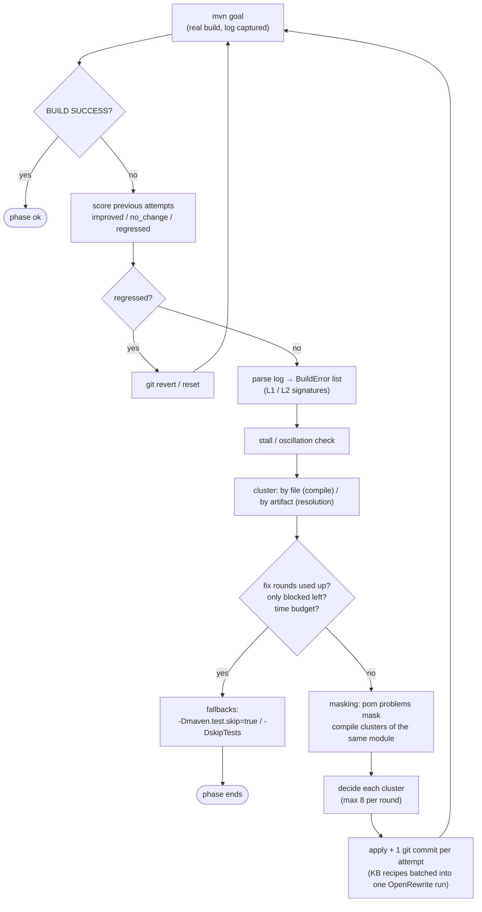
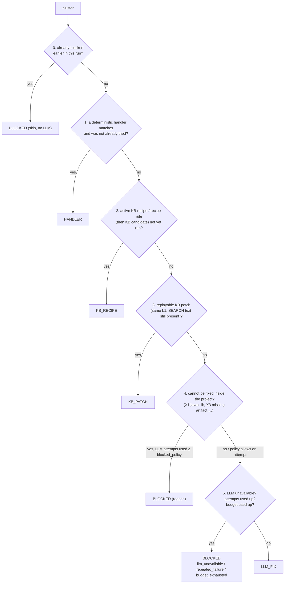

# 04. 트리아지와 빌드-수정 루프 쉽게 이해하기

빌드-수정 루프는 `sbmig`의 핵심입니다. 이 루프는 "빌드한다 → 로그를 읽는다 → 에러를 파일·아티팩트 단위 묶음(클러스터)으로 나눈다 → 묶음마다 누가 고칠지 정한다 → 고친다 → 다시 빌드한다"를 반복합니다. 누가 고칠지는 정해진 순서로 결정합니다. 먼저 결정적 핸들러, 다음으로 KB 레시피, 그다음 KB 패치 재생을 시도하고, 프로젝트 밖의 문제인지(blocked) 확인한 뒤, 그래도 남은 것만 LLM에게 맡깁니다. 끝났는지는 언제나 실제 `mvn` 결과로 판단합니다. 이 문서에서는 로그 한 줄이 에러 객체가 되는 과정, 클러스터와 시그니처, 결정 사다리, 핸들러 카탈로그 전체, LLM 프롬프트의 구성, 루프 종료 조건, 정체(stall)와 예산, KB 기록, 운영 로그를 해석하는 법을 차례로 설명합니다. 끝에는 실제로 있었던 세 가지 시나리오를 처음부터 끝까지 따라갑니다.

## 이 문서를 읽고 나면

- `sbmig.log`의 `[spring it2] cluster compile:… — asking the LLM …` 같은 줄을 보고, 지금 어느 클러스터를 누가 왜 고치고 있는지 말할 수 있습니다.
- 어떤 에러가 LLM 호출 없이 처리되는지(핸들러, 레시피, KB, blocked), 어떤 에러가 LLM으로 가는지 미리 예상할 수 있습니다.
- 페이즈가 끝나는 조건(빌드 성공, 수정 라운드 소진, blocked만 남음, 더 할 수 있는 것이 없음, 시간 초과)과 대체 빌드 플래그(`test-compile-skipped`, `tests-skipped`)의 의미를 압니다.
- 같은 문제가 다음 프로젝트에서 LLM 없이 해결되기까지 무엇이 기록되는지(ledger, 라벨, 레시피 후보) 압니다.
- lombok, 바이너리 리소스 필터링, javax 라이브러리라는 세 가지 실제 사례에서 로그, journal, ledger, 리포트에 무엇이 남는지 압니다.

## 관련 코드

- 루프: `sbmig/loop/fixloop.py` (`BuildFixLoop`), `sbmig/loop/budget.py`, `sbmig/loop/blocked_registry.py`, `sbmig/loop/orchestrator.py`
- 빌드·로그: `sbmig/build/runner.py`, `sbmig/build/mvn.py`, `sbmig/build/log_parser.py`, `sbmig/build/signatures.py`, `sbmig/build/classpath.py`
- 트리아지: `sbmig/triage/triager.py`, `sbmig/triage/cluster.py`, `sbmig/triage/decide.py`, `sbmig/triage/blocked.py`, `sbmig/triage/rules.py`, `sbmig/triage/recipe_rules.yml`
- 핸들러: `sbmig/triage/handlers/base.py`, `sbmig/triage/handlers/pom_handlers.py`, `sbmig/triage/handlers/edge_handlers.py`, `sbmig/triage/handlers/versions.yml`, `sbmig/triage/handlers/relocations.yml`, `sbmig/triage/handlers/known_packages.yml`, `sbmig/plan/pre_handlers.py`
- LLM 수정: `sbmig/fix/fixer.py`, `sbmig/fix/context.py`, `sbmig/fix/protocol.py`, `sbmig/fix/apply.py`, `sbmig/fix/prompts/system_v1.md`, `sbmig/fix/prompts/user_v1.md.j2`, `knowledge/notes/index.yml`, `sbmig/advisory/hints.py`
- KB: `sbmig/kb/store.py`, `sbmig/kb/harvest.py`, `sbmig/kb/labels.py`, `sbmig/kb/ledger.py`
- 참고 문서: `docs/ERROR-HANDLING.md`(에러 카탈로그 X/E/L/S), `docs/ARCHITECTURE.md` §3–§7

---

## 1. 한 장 그림

### 1.1 비유로 먼저

빌드-수정 루프는 응급실 분류(triage)와 비슷합니다.

1. **검사**: 환자(프로젝트)에게 실제 검사(`mvn compile` 등)를 합니다. 검사 없이 진단하지 않습니다.
2. **증상 기록**: 검사지(빌드 로그)를 읽고 증상(에러)을 표준 양식(`BuildError`)으로 적습니다.
3. **묶기**: 같은 부위(같은 파일, 같은 아티팩트)의 증상을 한 차트(클러스터)로 묶습니다.
4. **분류**: 차트마다 처치 방법을 정합니다. 정해진 처치 지침(핸들러)이 있으면 그대로 따르고, 예전에 효과를 본 처치(KB)가 있으면 재사용하고, 병원 밖에서 해결해야 하는 문제(외부 라이브러리)면 기록만 하고 넘기고, 나머지만 전문의(LLM)에게 보냅니다.
5. **처치 후 재검사**: 처치를 하나 할 때마다 git 커밋을 하나 남기고, 다시 검사해 효과를 채점합니다. 나빠졌으면 되돌립니다.

### 1.2 전체 흐름



### 1.3 결정 사다리 (`sbmig/triage/decide.py`)

클러스터 하나에 대한 결정은 아래 순서를 위에서부터 따라 내려가며, **처음 해당하는 단계에서 결정이 끝납니다**. 코드 주석에 적힌 원문은 다음과 같습니다.

```
run-wide blocked registry → HANDLER > KB_RECIPE > KB_PATCH > blocked check (cfg.loop.blocked_policy) > LLM_FIX
→ BLOCKED(repeated_failure | budget_exhausted | llm_unavailable)
```



이 순서인 이유:
- **결정적인 것이 먼저**: 핸들러와 레시피는 결과를 예측할 수 있고 비용이 들지 않습니다. 이전 에이전트의 실패 원인은 "작은 LLM이 레시피를 고르는 구조"였습니다. 그래서 `sbmig`에서는 어떤 레시피를 쓸지 규칙이 정합니다.
- **고칠 수 없는 것은 LLM에게 보내지 않습니다**: 외부 jar가 javax 타입을 받는 문제는 프로젝트 코드를 아무리 고쳐도 해결되지 않습니다. 이런 데 LLM을 부르면 예산만 쓰고, 더 나쁘게는 LLM이 그럴듯한 버전 번호를 지어낼 수 있습니다(X3 정책: "the LLM must never invent versions").
- **LLM은 유한합니다**: 클러스터마다 시도 횟수 상한이 있고, 실행 전체에도 호출 예산이 있습니다(§7).

---

## 2. 빌드 로그 파싱 (`sbmig/build/log_parser.py`)

### 2.1 파서의 동작

`parse_maven_log(text, project_root)`는 Maven 3.6–3.9의 `-B`(batch) 출력을 **한 번 훑으며** 줄 단위 상태 기계로 처리합니다.

- **문맥 추적**: `-----< g:a >-----` 헤더, `Building <name> <version>`, `--- compiler:3.13.0:compile (default-compile) @ shop ---` 같은 mojo 줄을 읽어 지금 어느 모듈의 어느 goal인지 기억합니다. 그래서 에러마다 `module`과 `goal`이 채워집니다.
- **경로 정규화**: 프로젝트 루트 절대 경로를 지워 상대 경로로 바꿉니다(`/private/tmp` 같은 macOS 별칭도 처리). 덕분에 실행 디렉터리가 달라도 같은 에러가 같은 시그니처를 갖습니다.
- **중복 병합**: javac 에러는 `COMPILATION ERROR :` 블록과 마지막 `[ERROR]` 반복에 두 번 나옵니다. 같은 (파일, 줄, 열, 메시지)는 하나로 합칩니다.
- **안전망**: 아무것도 이해하지 못했는데 빌드가 실패했다면 `UNKNOWN` 에러 하나를 만듭니다(첫 의미 있는 `[ERROR]` 줄과 로그 마지막 40줄을 담음). 실패한 빌드인데 에러 목록이 비어 있는 일은 없습니다.

### 2.2 `ErrorKind`별 예시

아래 예시는 저장소의 실제 로그 샘플(`tests/build/logs/`)을 파서에 넣어 얻은 결과입니다.

| `ErrorKind` | 로그 예시 (요약) | 의미와 다음 처리 |
|---|---|---|
| `compile` | `[ERROR] /work/proj/src/main/java/com/example/sec/SecurityConfig.java:[5,37] cannot find symbol` + 다음 줄 `  symbol: class WebSecurityConfigurerAdapter` | 메인 소스 컴파일 에러입니다. `file`, `line`, `symbol`, `location`이 채워집니다. annotation processor가 죽은 경우(lombok)에는 메시지가 `annotation-processor: java.lang.IllegalAccessError: …`로 시작하고 `file`이 없습니다. |
| `test_compile` | `[ERROR] src/test/java/com/example/CalcTest.java:[3,29] package org.junit.jupiter.api does not exist` | goal이 `testCompile`이거나 경로에 `/src/test/`가 있는 경우입니다. 우선순위는 compile보다 뒤입니다. |
| `dependency_resolution` | `Could not resolve dependencies for project com.example:missing-dep:jar:1.0.0` … `Could not find artifact com.example:does-not-exist:jar:1.0 in central (https://repo.maven.apache.org/maven2)` | 의존성을 찾을 수 없습니다. `artifact`에 GAV가 들어갑니다. 재배치 핸들러가 먼저 시도하고, 모르는 아티팩트면 X3로 blocked(LLM 0회)됩니다. |
| `plugin_resolution` | `Plugin com.example.plugins:nonexistent-maven-plugin:1.0.0 or one of its dependencies could not be resolved` | 플러그인을 찾을 수 없습니다. 버전 하한 핸들러나 X3 처리로 갑니다. |
| `parent_resolution` | `[FATAL] Non-resolvable parent POM for com.example:bad-parent:1.0.0: … com.company:company-parent:pom:9.9.9 …` | 부모 pom을 해석할 수 없습니다. 설정된 사내 부모(`artifacts.parent` 등)라면 **실행 전체를 중단**합니다(`aborted:parent-not-found`). |
| `plugin_execution` | `Failed to execute goal org.apache.maven.plugins:maven-resources-plugin:3.3.1:resources … filtering … fontawesome-webfont.woff2 … failed with MalformedInputException: Input length = 1` | 컴파일러가 아닌 플러그인이 실행 중에 실패했습니다. 해당 핸들러(예: `resources-binary-filtering`)가 처리하거나, X5/X6 blocked가 됩니다. |
| `enforcer` | `Rule 0: …RequireJavaVersion failed with message: Detected JDK version 21.0.1 … is not in the allowed range [99,).` | maven-enforcer 규칙 위반입니다. `enforcer-relax` 핸들러(E4)가 처리합니다. |
| `pom_invalid` | `'dependencies.dependency.version' for org.apache.commons:commons-lang3:jar is missing. @ line 4, column 27` / `[FATAL] Non-parseable POM pom.xml: end tag name </dependencies> must match …` | pom이 잘못됐습니다. 버전 누락이면 `carry-over-managed-version`이나 `missing-dependency-version` 핸들러가 처리합니다. XML이 깨진 경우는 대개 직전 pom 편집의 회귀이므로 되돌립니다(§7.3). |
| `rewrite` | (로그 파서가 아니라 오케스트레이터가 만듦) `OpenRewrite failed (…)` | OpenRewrite 실행이 실패했습니다. 페이즈를 멈추지 않고 "빌드가 진짜 문제를 보여줄 것"이라는 노트를 남긴 뒤 계속 진행합니다. |
| `test_failure` | `Failed to execute goal …maven-surefire-plugin:3.2.5:test … There are test failures.` + `Results:` 섹션의 `ATest.one:5 expected:<1> but was:<2>` | 테스트가 **실행 중에** 실패했습니다. 실패 항목마다 에러 하나가 생기고 `symbol`에는 `ATest.one`이 들어갑니다. 기본 설정(`build.skip_tests: true`)에서는 테스트를 실행하지 않으므로 보통 나오지 않습니다. |
| `unknown` | `Unknown lifecycle phase "comple". You must specify a valid lifecycle phase …` | 이해하지 못한 실패입니다. 안전망이 만든 에러입니다. |

### 2.3 javac 연속 줄(continuation)

javac은 에러 한 건을 여러 줄에 걸쳐 출력합니다. 파서는 바로 앞 javac 에러에 다음 줄들을 붙입니다.

```
[ERROR] /work/proj/src/main/java/com/example/web/HelloServlet.java:[7,23] cannot find symbol
  symbol:   class HttpServletRequest
  location: class com.example.web.HelloServlet
```

| 연속 줄 | 저장 위치 | 쓰임 |
|---|---|---|
| `symbol:` | `BuildError.symbol` (첫 값만) | L1/L2 시그니처, ledger의 symbol, KB 매칭 |
| `location:` | `BuildError.location` | L1 시그니처(프로젝트 클래스면 `class *`로 마스킹), blocked 판정의 owner 추출 |
| `required:` / `found:` / `reason:` | `BuildError.raw`에 줄째로 추가 | X1(javax/jakarta 불일치) 판정에 쓰입니다(`_REQUIRED_RE`, `_FOUND_RE`). |

접두사가 없는 들여쓴 줄과 `[ERROR]`로 시작하면서 4칸 들여쓴 줄도 `raw`에 붙습니다. 그래서 LLM 프롬프트와 blocked 분류기는 javac이 출력한 원문 그대로를 봅니다.

> **확인 포인트**: 로그 하나가 어떻게 파싱되는지 직접 보려면 `sbmig parse-log <log 파일> --root <프로젝트 루트> --json`을 실행합니다. 실행 중 빌드 로그는 `out/<run id>/logs/` 아래 `NNN-build-<phase>-<build 번호>.log`로 남습니다.

---

## 3. 시그니처와 클러스터

### 3.1 시그니처: 같은 문제를 같은 이름으로 (`sbmig/build/signatures.py`)

에러마다 두 가지 시그니처를 만듭니다. 시그니처는 `BuildError`만으로 계산하는 순수 함수이므로, 같은 에러는 언제나 같은 시그니처를 갖습니다.

| 수준 | 형식 | 예 | 쓰임 |
|---|---|---|---|
| **L1 (구체적)** | `kind|메시지 분류|심볼|위치 유형` | `compile|cannot_find_symbol|class WebSecurityConfigurerAdapter` / `compile|cannot_find_symbol|class Foo|class *` / `dependency_resolution|com.example:does-not-exist:1.0` | 같은 문제 판정(정체, blocked 키), KB 패치 재생 조건 |
| **L2 (일반적)** | `kind|메시지 분류|이름` | `compile|cannot_find_symbol|WebSecurityConfigurerAdapter` / `compile|package_does_not_exist|org.springframework.security` / `dependency_resolution|com.example:does-not-exist` | 프로젝트를 넘나드는 같은 종류의 문제 묶기, KB 사례 조회 |

정규화 규칙:
- 경로, URL, 줄·열 번호, 16진 주소(`@0x74a820bf` → `<hex>`), 버전(`<v>`), 숫자(`#`), 모듈 이름(`<module>`)을 지웁니다.
- javac 메시지는 `package_does_not_exist`, `cannot_find_symbol`, `incompatible_types`, `cannot_be_applied`, `no_suitable_method`, `does_not_override_abstract` 같은 분류명으로 바꿉니다.
- **프로젝트 FQCN 마스킹**: `com.example.sec.SecurityConfig` 같은 프로젝트 고유 클래스는 `*`가 됩니다. `org.springframework.`, `javax.`, `lombok.` 등 라이브러리 접두사(`EXTERNAL_PACKAGE_PREFIXES`)만 남깁니다. 그래서 "Spring Security의 `WebSecurityConfigurerAdapter`가 없다"는 문제는 프로젝트가 달라도 같은 시그니처가 됩니다.
- **사내 라이브러리 접두사**: `build.external_package_prefixes`에 적은 접두사와 `artifacts.parent` / `artifacts.mandatory` / `artifacts.optional`의 groupId는 자동으로 "라이브러리"로 취급해 마스킹하지 않습니다(`external_prefixes_from_config`). 사내 라이브러리의 API 변경이 프로젝트를 넘어 학습되려면 이 설정이 필요합니다.
- lombok 같은 annotation processor 크래시는 L2가 `compile|annotation_processor|lombok`이 됩니다.

### 3.2 클러스터: 함께 고칠 묶음 (`sbmig/triage/cluster.py`)

| 에러 종류 | 클러스터 키 | 이유 |
|---|---|---|
| `compile`, `test_compile` | 파일(`file`). 파일을 모르면 `module:<모듈>` | LLM은 파일 하나를 보고 고치는 것이 가장 정확합니다. |
| `dependency_resolution`, `plugin_resolution`, `parent_resolution` (아티팩트가 있을 때) / 아티팩트가 있는 `pom_invalid` | 아티팩트 `g:a` | 같은 아티팩트 문제는 pom 한 곳만 고치면 됩니다. |
| 그 밖 | 모듈 | |

클러스터 id는 `<kind>:<키의 sha1 앞 8자리>`(예: `compile:3f2a9c1d`)입니다. 사람이 읽는 레이블은 `compile src/main/java/Foo.java (3)` 형식(`cluster_label`)입니다.

**처리 우선순위**(숫자가 작을수록 먼저): `parent_resolution` 10, `pom_invalid` 15, `dependency_resolution` 20, `plugin_resolution` 25, `enforcer` 30, `rewrite` 35, `compile` 50 + 리액터 순서, `test_compile` 80 + 리액터 순서, `plugin_execution` 90, `test_failure` 95, `unknown` 99. 모듈을 모르는 compile 계열에는 +40을 더합니다. 같으면 에러가 많은 것이 먼저입니다.

**마스킹**(`plan_iteration`): 해석(resolution) 종류의 클러스터(부모, pom, 의존성, 플러그인)가 있으면 **같은 모듈**의 compile·test_compile 클러스터는 이번 반복에서 `SKIP`합니다. pom이 고쳐지면 컴파일 에러가 대개 함께 사라지기 때문입니다. 다만 마스킹한 클러스터가 escalate되거나 blocked되어 "가망 없음(hopeless)"이 되면 가려졌던 컴파일 클러스터를 같은 라운드에서 다시 처리합니다(`(unmasked: its pom problem was escalated/blocked)` 접두사).

### 3.3 왜 이름이 바뀐 메서드 하나가 N번의 LLM 호출이 되는가

클러스터는 **파일 단위**입니다. 라이브러리 메서드 하나의 이름이 바뀌었고 그 메서드를 프로젝트 파일 10개가 호출한다면, 클러스터는 10개가 되고 첫 프로젝트에서는 LLM 호출도 10번 일어납니다. 이것은 알려진 한계입니다(`CLAUDE.md` Known follow-ups: "cross-file clustering by symbol would cut that"). 대신 학습이 이를 상쇄합니다.

1. 첫 번째 LLM 수정이 성공하면 수확 단계에서 라벨 `method-rename`이 붙고, 소유 FQCN이 해석되면 `ChangeMethodName` 레시피 후보가 **LLM 없이** 컴파일됩니다(§8).
2. 같은 실행의 다음 페이즈나 다음 프로젝트에서는 이 후보가 계획의 `spring.rewrite`에 들어가 모든 호출부를 한 번에 바꿉니다(`kb.try_candidates_in_plan`).
3. 서로 다른 프로젝트 `kb.auto_promote_after_projects`(기본 2)곳에서 성공하면 active로 승격됩니다. 이후에는 LLM 호출이 0번입니다(`fixtures/projects/boot2-method-rename`: 첫 실행 LLM 2회 → 세 번째 실행 0회).

---

## 4. 결정 단계별 상세

### 4.0 이미 blocked인가 (실행 전체 레지스트리)

`BlockedRegistry`(`sbmig/loop/blocked_registry.py`)는 실행 하나에 하나만 있고, 모든 페이즈의 루프가 공유합니다. 키는 L1 시그니처이고, compile 에러에는 `src/…` 아래 경로를 덧붙입니다(`normalize_file`). 재구성 단계에서 파일이 `{name}-back/src/...`로 옮겨져도 키가 그대로 유지되도록 하기 위해서입니다. spring 페이즈에서 blocked된 클러스터는 restructure와 verify에서도 핸들러나 LLM 없이 바로 건너뜁니다.

클러스터의 **일부만** blocked일 수도 있습니다. 같은 파일에 javax 불일치 1건과 고칠 수 있는 에러 3건이 있다면 1건만 blocked로 등록하고, 나머지 3건으로 줄인 클러스터는 계속 처리합니다(`(rest of a partially blocked cluster)` 접두사).

### 4.1 핸들러 (HANDLER)

`HandlerRegistry.matching(cluster, profile, cfg)`가 등록 순서대로 일치하는 핸들러를 찾습니다. 판정 기준은 `kinds`(어떤 에러 종류에 반응하는지), `triggers`(클러스터 텍스트에서 찾는 정규식), `applicable()`(프로필 조건)입니다. KB 패턴이 제안한 `handler_ids`도 후보에 더합니다. 같은 클러스터에서 이미 실패한 핸들러는 건너뜁니다. 결정의 rationale은 `deterministic handler '<id>' matches <label>: <description>` 형식입니다. 핸들러 카탈로그 전체는 §5에 있습니다.

### 4.2 KB 레시피 (KB_RECIPE)

후보는 다음과 같습니다.
- **active KB 레시피**: `KBMatch.recipe_ids`. 클러스터의 L1/L2 시그니처가 레시피의 `signatures`와 겹치는 경우입니다(`sbmig/kb/store.py` `match`).
- **반응형 레시피 규칙**: `sbmig/triage/recipe_rules.yml`. 에러 패턴에서 내장 OpenRewrite 레시피로 연결합니다. 현재 규칙은 `javax-ee-to-jakarta`(`package javax.(servlet|persistence|…) does not exist` → `JavaxMigrationToJakarta`), `javax-xml-bind`, `junit4-to-junit5`, `mockbean-spybean`, `spring-security-config`(`WebSecurityConfigurerAdapter|antMatchers|…` → `UpgradeSpringSecurity_6_0`), `boot4-modularized-autoconfigure`입니다. 규칙마다 적용 페이즈(`phases`)를 제한할 수 있습니다. 예를 들어 jakarta 레시피는 javax 클래스패스 위에서 돌면 안 되므로 spring·restructure 페이즈에서만 씁니다. `once_per_run`인 레시피는 계획에서 이미 실행했으면 다시 돌리지 않습니다.
- 위 둘이 없으면 **KB 후보 레시피**(`candidate_recipe_ids`)를 씁니다.

같은 라운드의 KB_RECIPE 결정들은 모아서 **OpenRewrite 한 번**으로 실행합니다(`_run_recipe_batch`). 이때 goal은 `rewrite:runNoFork`입니다. 프로젝트가 아직 컴파일되지 않는 상태라 `rewrite:run`(먼저 `compile`을 fork함)은 쓸 수 없기 때문입니다. 레시피가 아무 파일도 바꾸지 못하면 같은 라운드 안에서 그 클러스터들에 다음 선택지를 줍니다(`(after a no-op recipe run)` 접두사, 이때 레시피는 다시 고르지 않음).

### 4.3 KB 패치 재생 (KB_PATCH)

KB에 같은 L1 시그니처의 사례가 있고 **그 사례의 SEARCH 텍스트가 지금 파일에 그대로 있으면**(`replayable`) 과거의 SEARCH/REPLACE 패치를 LLM 없이 다시 적용합니다. LLM이 설정되지 않은 실행에서도 동작합니다(`LazyFixer.apply`가 `PatchApplier`로 대신 적용, round 7a B1).

### 4.4 blocked 판정 (`sbmig/triage/blocked.py`의 `classify_blocked`)

"이 클러스터(또는 그 일부)는 프로젝트 안에서 고칠 수 없다"는 것을 **보수적으로** 판정합니다. 애매하면 blocked로 보지 않습니다.

| 판정 | 근거 | `BlockReason` | 기본 LLM 허용 횟수 (`loop.blocked_policy`) |
|---|---|---|---|
| X1 javax API를 쓰는 의존성 | `X cannot be converted to Y`에서 javax와 jakarta가 엇갈림, `required:`/`found:` 줄, `no suitable method/constructor` 후보가 javax를 받음, `does not override abstract method m(javax.…)`, `cannot access javax.X … class file for javax.X not found` | `external_javax_api` | 0 (바로 blocked) |
| X2 의존성 API 변경(javax 무관) | `cannot find symbol`의 location이나 `cannot be applied`의 소유 클래스가 라이브러리 클래스이고, 마이그레이션 대상 API(`java.`, `org.springframework.`, `lombok.` 등 `MIGRATION_TARGET_PREFIXES`)가 아님 | `external_api_incompatible` | 1 |
| X3 아티팩트 없음 | 해석 에러 + `Could not find artifact` / `could not be resolved` / `Failure to find` | `artifact_not_found` | 0 |
| X4 부모 없음 | `parent_resolution` | `parent_not_found` | 0 |
| X5 플러그인 비호환 | `plugin_execution` + `Unsupported class file major version`, `NoSuchMethodError`, `IllegalAccessError … com.sun.tools.javac`, `InaccessibleObjectException`, `due to an API incompatibility` | `plugin_incompatible` | 1 |
| X6 지원하지 않는 소스 | 코드 생성 플러그인(protobuf, jaxb2, openapi-generator, kotlin, gmavenplus, scala) 실패, `.kt`/`.groovy`/`.scala` 컴파일 에러 | `unsupported_source` | 0 |
| (인코딩) | 소스 인코딩을 판별할 수 없음 | `encoding` | 0 |

X1을 **blocked로 보지 않는** 경우(고칠 수 있음):
- `cannot find symbol`이나 `package javax.x does not exist`: 이것은 jakarta 레시피가 할 일입니다.
- 소유 클래스가 프로젝트 클래스이거나 에러가 난 그 파일 자신인 경우.
- 프로젝트 소스가 아직 해당 javax 패키지를 import하는 경우: 마이그레이션이 덜 끝난 것이므로 프로젝트 안에서 고칠 수 있습니다.

`allowed = blocked_policy[reason]` 값과 지금까지 실패한 LLM 시도 수를 비교합니다. 시도 수가 이 값 이상이면 blocked이고, 아니면 "LLM attempt n/allowed before blocking" 노트를 달고 LLM으로 넘깁니다. rationale은 `blocked: <reason> — <detail> (policy: no LLM attempt for this reason)` 또는 `(after N LLM attempt(s))`로 끝납니다.

blocked로 등록할 때는 행동할 수 있는 정보를 최대한 모읍니다(`BuildFixLoop._register_blocked`).
- X1/X2: 소유 클래스 → jar → GAV를 `sbmig/build/classpath.py`(`mvn dependency:build-classpath`)로 추적합니다.
- 제안 문구(`compose_suggestion`): 그 아티팩트가 `artifacts.optional`에 설정돼 있으면 "`spring.optional_bump`에서 버전이 올라간다. 그 뒤에도 blocked라면 그 버전 자체가 아직 javax이므로 라이브러리 담당자에게 Jakarta 빌드를 요청하라"고 안내합니다. 아니면 "`g:a`를 Jakarta 빌드로 올리거나(`artifacts.optional`에 그 버전으로 추가) shim으로 감싸라"고 안내합니다.

### 4.5 LLM 수정 또는 최종 blocked

| 조건 | 결정 |
|---|---|
| LLM이 이번 실행에서 unavailable로 표시됨 | `blocked: llm_unavailable` |
| 쓸모없는 답(패치 없음, 적용 실패 = `apply_failed`)이 `loop.max_llm_attempts_per_cluster`(기본 2)회 이상 | `blocked: repeated_failure` |
| 해결하지 못한 LLM 시도가 `max(max_llm_attempts_per_cluster, stall_limit + 1)` = 기본 3회 이상 | `blocked: repeated_failure` |
| 실행의 LLM 호출 수가 `loop.max_llm_calls` 이상 | `blocked: budget_exhausted` |
| 그 밖 | `LLM_FIX` (`no handler/recipe/KB patch for <label> → LLM fix`, 이전 시도가 있으면 `(attempt n/limit, previous attempts included in the prompt)`, 정체 중이면 `; stall level N`) |

루프는 결정을 받은 뒤 한 번 더 확인합니다. 그사이 LLM이 unavailable이 됐거나 예산이 바닥났으면 LLM_FIX를 BLOCKED로 바꿉니다(`_handle_cluster`의 `forced`). 클러스터 하나에 대해 **한 라운드에 LLM은 한 번만** 부릅니다.

### 4.6 결정적 선택지가 "아무것도 바꾸지 못했을 때"

`_handle_cluster`는 한 클러스터에 대해 최대 6번까지 결정을 다시 내립니다. 핸들러가 "바꿀 것이 없다"며 `apply_failed`로 끝나면 그 핸들러를 "이미 시도함"으로 표시하고 다음 단계(레시피 → KB 패치 → blocked → LLM)로 바로 넘어갑니다. 예외도 있습니다. 모듈 전체를 고치는 핸들러(`source-encoding`, `strip-utf8-bom` 등)가 같은 반복에서 이미 그 모듈을 고쳤다면 실패로 보지 않고 재빌드를 기다립니다(`no_change`).

---

## 5. 결정적 핸들러 카탈로그

### 5.1 전체 목록 (`HandlerRegistry.default().ids()` 순서 = 매칭 우선순위)

| id | 언제(반응형 트리거 / 선제 조건) | 무엇을 바꾸나 | 카탈로그 id |
|---|---|---|---|
| `source-encoding` | 반응형: `unmappable character … for encoding UTF-8`, `illegal character: '�'`. **항상 선제 실행**(`ALWAYS_PREEMPTIVE`) | 감지한 인코딩으로 `project.build.sourceEncoding`을 설정(`build.source_encoding_policy: set-property`)하거나 UTF-8로 변환(`convert-utf8`). 플래그 `source-encoding-set:cp949` 등 | E1 |
| `strip-utf8-bom` | `illegal character: ''`. **항상 선제 실행** | UTF-8 BOM 제거 | E2 |
| `carry-over-managed-version` | `pom_invalid` + 버전 누락(`'dependencies.dependency.version' … is missing`), 그리고 as-is effective pom이 그 버전을 알고 있을 때 | intake에서 캡처한 as-is effective 버전을 명시적으로 고정합니다. 그보다 `sbmig/triage/handlers/versions.yml`의 하한이 높으면 하한을 씁니다. Spring Boot 아티팩트는 목표 Boot 버전. Handover에 ⚠(carried over)로 표시 | E6 |
| `enforcer-relax` | `enforcer`, `RequireJavaVersion`, `DependencyConvergence`, `BannedDependencies` | `requireJavaVersion`을 `[21,)`로 완화하고, convergence/banned 실행을 건너뜀. 대안은 `enforcer.skip=true`(플래그). 정책 키 `build.enforcer_policy` | E4 |
| `remove-werror` | `warnings found and -Werror specified` | 컴파일러 설정에서 `-Werror` 제거(플래그 `werror-removed`). `build.werror_policy` | E5 |
| `systempath-relocate` | `at specified path`, `refers to a non-existing file`, `systemPath` … | 재구성 뒤 위치가 바뀐 system 스코프 jar의 `systemPath`를 새 위치(`${project.basedir}/…`)로 고침. 후속 조치: Nexus에 설치 | E7 |
| `missing-dependency-version` | `pom_invalid` 버전 누락 + 알려진 버전 있음 | `versions.yml`(또는 목표 Boot, optional 설정 버전)의 검증된 버전 설정 | E6 보조 |
| `mysql-connector-relocation` | 해당 아티팩트 해석 에러 / 그 패키지 누락 (+ pom에 선언됨) | `mysql:mysql-connector-java` → `com.mysql:mysql-connector-j` | X3 앞 단계 |
| `javax-servlet-api-to-jakarta` | 선제(SPRING): pom에 `javax.servlet:javax.servlet-api` / `servlet-api` | → `jakarta.servlet-api` 6.1.0 / `jakarta.servlet.jsp-api` 4.0.0 (provided) | – |
| `jstl-to-jakarta` | 선제(SPRING): javax JSTL 의존성. 반응형: 누락 버전 / jstl 문구 | → `org.glassfish.web:jakarta.servlet.jsp.jstl` 등. 버전은 Boot BOM에 맡김 | E11 |
| `dependency-relocation` | 표(`sbmig/triage/handlers/relocations.yml`)의 옛 아티팩트가 에러에 나오거나, 그 패키지가 누락되고 pom에 선언돼 있을 때 | javax→jakarta API, `hibernate` → `org.hibernate.orm`, Boot 4 starter 이름 변경 등 재배치 | X3 앞 단계 |
| `querydsl-jakarta-classifier` | 선제(SPRING): querydsl 사용. 반응형: `querydsl`, `javax/persistence`, `class Q…` | `querydsl-jpa` / `querydsl-apt` → 5.1.0 + classifier `jakarta` | – |
| `jaxb-runtime-add` | 선제: `javax.xml.bind` import. 반응형: `javax.xml.bind`, `JAXBContext` … | JAXB API + 런타임 추가(소스에 따라 javax 또는 jakarta) | S8 |
| `add-known-dependency` | `package X does not exist` / `cannot access` / `class file for … not found` / `cannot find symbol`이고 그 패키지의 아티팩트를 알 때(`known_packages.yml`) | hamcrest, jakarta.*, `spring-boot-jackson2`, 모듈화된 `*-test` starter, jsr305 등을 모듈 pom에 추가. 부모가 관리하면 버전 생략 | – |
| `lombok-version-floor` | 선제: lombok 버전 < 1.18.30(또는 모름). 반응형: `lombok`, `TypeTag :: UNKNOWN`, `com.sun.tools.javac.code.TypeTags`, `IllegalAccessError … lombok` | lombok을 1.18.38 이상으로. processor path 버전 고정, 상속받은 `annotationProcessorPaths`는 `combine.self="override"`로 끊음(§10.1) | X5 계열 |
| `mapstruct-version-floor` | 선제: mapstruct < 1.6.0. 반응형: `mapstruct`, `No implementation was created for` | mapstruct / mapstruct-processor를 1.6.3 이상으로 | – |
| `maven-compiler-plugin-floor` | 선제: 컴파일러 플러그인이 미선언이거나 < 3.13.0. 반응형: `invalid target release`, `Source option N is no longer supported`, `Unsupported class file major version` | maven-compiler-plugin 3.14.0 이상, `<source>/<target>` 대신 `<release>` | X5 |
| `compiler-legacy-config` | 선제: 컴파일러 설정에 `fork`/`executable`/`compilerVersion`/`compilerArguments`/옛 `compilerArgs`. 반응형: `--boot-class-path`, `-Xbootclasspath`, `cannot be used together with --release`, `Cannot run program …javac` | 그 요소들과 bootclasspath/extdirs/endorseddirs/-source/-target 인자 제거(encoding 등은 유지) | E10 |
| `surefire-plugin-floor` | 선제: surefire/failsafe < 3.0.0. 반응형: `maven-(surefire|failsafe)-plugin` | 3.5.3 이상 | X5 |
| `remove-classic-loader-implementation` | 선제: spring-boot-maven-plugin `loaderImplementation=CLASSIC`. 반응형: `loaderImplementation`, `CLASSIC` | 해당 설정 제거(Boot 4에서 사라짐) | – |
| `resources-binary-filtering` | 선제: 분석 결과 `PropertyInventory.filtered_binary_files`가 있을 때. 반응형: `MalformedInputException`, `UnmappableCharacterException`, `Input length = N`, `filtering … to … failed with` | 실패한 플러그인(resources / war)에 `<nonFilteredFileExtensions>` 추가. filtering은 켠 채로 둠(§10.2) | E12 |
| `strip-pom-repositories` | `build.pom_repositories: remove`일 때만. 선제: pom에 저장소 URL이 있음. 반응형: `Could not transfer artifact`, `Blocked mirror for repositories`, `UnknownHostException` … | pom의 `<repositories>` / `<pluginRepositories>` 삭제(프로필 포함). settings 미러 필요 | X9 |
| `test-compile-skip` | 자동으로 매칭되지 않음(자리 표시용) | 실제 `-Dmaven.test.skip=true` 대체 빌드는 루프가 직접 수행(§7.5) | L7 |

주의: 선제 선택 기준(`sbmig/plan/pre_handlers.py`의 `LOMBOK_FLOOR = "1.18.30"`, `MAPSTRUCT_FLOOR = "1.6.0"`, `COMPILER_FLOOR = "3.13.0"`, `SUREFIRE_FLOOR = "3.0.0"`)과 핸들러가 실제로 올리는 버전(`LOMBOK_VERSION = "1.18.38"`, `MAPSTRUCT_VERSION = "1.6.3"`, `COMPILER_VERSION = "3.14.0"`, `SUREFIRE_VERSION = "3.5.3"`)은 다릅니다. "이 버전보다 낮으면 손댄다"는 기준과 "손대면 이 버전까지 올린다"는 목표가 따로 있는 것입니다.

### 5.2 선제 실행: 빌드 전에 미리 고치기

선제(pre-emptive) 핸들러는 첫 빌드를 기다리지 않고 프로필만 보고 미리 실행합니다. 에러가 날 것이 확실한 경우(예: lombok 1.18.20은 JDK 21 javac에서 반드시 죽음)에 빌드 한 번과 반복 한 번을 아낄 수 있습니다.

| 단계 | 누가 정하나 | 언제 실행되나 |
|---|---|---|
| 선택 | `pre_handlers_for(profile, cfg)` → `pre_handler_reasons`가 (id, 이유) 목록을 만듭니다. journal `plan` 이벤트의 `pre_handlers` | – |
| 항상 추가 | `ALWAYS_PREEMPTIVE = ("strip-utf8-bom", "source-encoding")` (오케스트레이터) | 맨 앞 |
| JDK21 그룹 | `preemptive_phase`가 `Phase.JDK21`인 핸들러 | 실행의 첫 rewrite/빌드 전(보통 `jdk21.rewrite` 전) |
| SPRING 그룹 | `preemptive_phase`가 `Phase.SPRING`인 핸들러(`javax-servlet-api-to-jakarta`, `jstl-to-jakarta`, `querydsl-jakarta-classifier`, `add-known-dependency`) | spring 레시피(jakarta 변환)가 끝난 뒤 spring 빌드-수정 루프 직전. spring 루프가 없으면 restructure 전 |

jakarta에 의존하는 핸들러를 기다리게 하는 이유는, javax 소스가 아직 남아 있는 상태에서 servlet-api를 jakarta로 바꾸면 jakarta 레시피가 타입을 인식하지 못하고 jdk21 빌드도 깨지기 때문입니다.

선제 핸들러는 한 실행에서 한 번만 돌고(`_handlers_done`), 바꾼 것이 있으면 `handlers: <ids>` 커밋을 하나 만듭니다. **선제 실행은 `FixAttempt`가 아니므로 ledger에 기록되지 않습니다.** 대신 페이즈 노트에 `handlers pre-emptive (before the first build): …`가 남습니다.

> **확인 포인트**: journal `handlers_preemptive` 이벤트의 `requested`(시도), `changed`(실제로 바꿈), `files`, `commit`. 실패하면 `handler_failed` 이벤트가 남고 작업 트리의 변경은 버립니다.

---

## 6. LLM 수정

### 6.1 무엇이 프롬프트에 들어가나

`LLMFixer.propose`(`sbmig/fix/fixer.py`)는 `ContextPacker.pack`(`sbmig/fix/context.py`)이 만든 섹션을 `sbmig/fix/prompts/user_v1.md.j2`에 넣어 렌더링합니다. 시스템 프롬프트는 `sbmig/fix/prompts/system_v1.md`입니다(`llm.prompt_version: v1`).

**시스템 프롬프트의 핵심 제약**(요약):
1. 최소한의 기계적 수정만. 리팩터링, 재포맷, import 재정렬은 하지 않습니다.
2. 동작을 유지합니다. 로직, 메서드, 테스트를 지우지 않고, 주석 처리, `@Disabled`, 빌드 건너뛰기도 하지 않습니다.
3. 목표 스택의 API를 씁니다(jakarta, Security lambda DSL, `@MockitoBean` 등).
4. 새 서드파티 의존성은 추가하지 않습니다(마이그레이션 노트가 대체 아티팩트를 명시한 경우만 예외). 버전은 부모에 맡깁니다.
5. 루트 `<parent>`를 바꾸거나 Java/Boot 버전을 내리지 않습니다.
6. 런타임에 확인할 것이 남으면 `// MIGRATION-TODO: …` 주석을 남깁니다.
7. 보지 않은 코드는 추측하지 말고 `<need_files>` / `<need_grep>`으로 요청합니다.
8. 이전 시도가 나와 있으면 그것과 다른 방법을 씁니다.
9. "Library migration guidance"가 있으면 제거된 라이브러리를 다시 넣지 말고 대체 라이브러리로 포팅합니다.
10. 프로토콜 태그 외에는 출력하지 않습니다.

시스템 프롬프트에는 "오케스트레이터가 패치를 적용하고 Maven을 다시 돌린다. 끝났는지는 오케스트레이터가 정한다(`BUILD SUCCESS`만 인정)"는 내용도 적혀 있습니다. LLM이 스스로 "끝났다"고 판단할 여지를 없애기 위해서입니다.

**사용자 프롬프트 섹션**(렌더링 순서):

| 순서 | 섹션 제목 | 내용 |
|---|---|---|
| 0 | `Situation` | 페이즈, 반복, 정체 수준, 프로젝트 한 줄 요약(`case=… java=… boot=… libs=… | target: JDK 21, Spring Boot 4.1`), 클러스터 id·종류·모듈·파일 |
| 1 | `Errors to fix (N)` | 클러스터의 에러 전체(원문 포함) |
| 2 | `Source (exact text; copy SEARCH blocks from here)` | 에러가 난 파일. 400줄 이하면 전체(`WHOLE_FILE_MAX_LINES`), 그보다 길면 에러 줄 주변 ±60줄 창(`WINDOW_RADIUS`) |
| 2.5 | `Reference files (read-only, NOT in the build …)` | merge first-wins로 버려진 사본(§7.7). 클러스터당 최대 3개, 각 12,000자 |
| 3 | `POM (<path>)` | 가장 가까운 pom(`nearest_pom`). 250줄 이하면 전체, 아니면 발췌 |
| 4 | `Library migration guidance (what to migrate TO)` | 이 클러스터에 맞는 advisory 힌트(`hints_for`). 대체 라이브러리와 `## fix-loop: <library>` 노트 |
| 4.5 | `Module merge notes (…)` | "이 파일은 모듈 X에서 first-wins로 합쳐졌다" 등 |
| 5 | `Knowledge-base hints (similar resolved cases)` | 비슷한 사례 요약, symbols.json의 "symbol X was fixed in N projects by Y: old → new". 최대 `kb.max_hints`(5)개 |
| 6 | `Previous attempts on this cluster (they did NOT resolve it — do not repeat them)` | 이전 시도의 요약과 analysis(쿨다운에 걸린 시도는 제외) |
| 7 | `Other error clusters in this build (…)` | 다른 클러스터 한 줄씩(최대 4,000자) |
| 8 | `Plan notes` | 계획 노트 |
| 10+ | `Migration note: <title>` | `knowledge/notes/*.md`에서 고른 노트 |

**마이그레이션 노트 선택**: `knowledge/notes/index.yml`의 노트마다 `keywords`(정규식), `cases`, `phases`, `always`가 있습니다. 에러 메시지, 심볼, 위치, raw, 아티팩트 좌표, 파일의 import 문을 합친 텍스트에서 **서로 다른 키워드가 몇 개 맞는지**로 점수를 매겨 상위 `DEFAULT_MAX_NOTES = 4`개를 고릅니다. `always: true` 노트(`fix-policy.md`)는 항상 맨 앞에 들어가고, 예산을 넘으면 가장 나중에 빠집니다. 예를 들어 `jdk21.md`의 키워드에는 `lombok|mapstruct|annotation process`, `add-opens|InaccessibleObjectException|IllegalAccessError`, `javax\.xml\.bind` 등이 있습니다.

**예산 맞추기**: 전체가 `llm.max_context_chars`(60,000자)를 넘으면 뒤쪽 섹션부터 줄입니다. 줄인 섹션 이름은 프롬프트 끝의 "Context was shortened …" 문장과 로그의 `truncated …`에 나옵니다.

### 6.2 응답 프로토콜

```
<analysis>왜 실패하는지, 무엇을 바꾸는지 1–5줄</analysis>
<confidence>0.0–1.0</confidence>
<patches>
=== MODIFY relative/path/File.java
<<<<<<< SEARCH
기존 텍스트 그대로 (파일에서 정확히 한 곳)
=======
바꿀 텍스트
>>>>>>> REPLACE
=== CREATE relative/path/New.java
=== DELETE relative/path/Old.java
=== RENAME old/path -> new/path
</patches>
```

또는 패치 대신 `<need_files>a.java, pom.xml</need_files>` / `<need_grep>정규식</need_grep>`으로 컨텍스트를 더 요청할 수 있습니다.

### 6.3 컨텍스트 라운드와 `<need_grep>`

- 요청은 최대 `llm.max_context_rounds`(2)라운드까지 받습니다. 라운드마다 파일은 최대 6개(`MAX_SERVED_FILES`)를 줍니다. 파일이 300줄을 넘으면 앞 200줄과 뒤 80줄만 줍니다. 경로가 정확하지 않으면 접미사나 FQCN으로 찾고, 여러 개가 걸리면 후보 목록을 돌려줍니다.
- `<need_grep>`은 **범위가 제한된 도구**입니다. 한 번에 패턴 5개까지, java·pom·리소스 파일 최대 3,000개, 파일당 512 KB 이하, 45초 안에서만 찾고, 결과는 40줄까지만 돌려줍니다. 회사 Windows 환경에서 실시간 백신 검사 때문에 grep이 지나치게 느려진 일이 있어 이런 상한을 두었습니다.
- 마지막 라운드에는 "This was the LAST context round. Answer now with <patches> …"를 덧붙입니다.

### 6.4 패치 검증과 적용 (`sbmig/fix/apply.py`)

1. **사전 검사**(`PatchApplier.check`): SEARCH가 정확히 한 번 맞는지 봅니다. 정확히 맞지 않으면 공백을 정규화한 줄 단위로 한 번 더 찾고, 그래도 유일하게 맞지 않으면 실패로 봅니다.
2. **피드백 라운드 1회**: 실패한 블록이 있으면 "search text not found. Here is the current exact text of lines a–b:"처럼 실제 텍스트를 보여주고, 전체 답을 다시 보내라고 요청합니다. 새 답에 패치가 없으면 첫 제안을 유지합니다.
3. **적용**: 파일 단위로 원자적으로 적용합니다(가상 오버레이에서 모두 성공했을 때만 디스크에 씀). 개행 방식과 원래 인코딩을 보존합니다. **축소 방어**: 원래 크기의 30% 미만만 남기는 쓰기(`SHRINK_GUARD_RATIO`)는 거부합니다(120자 미만의 작은 파일은 예외). 잘린 파일을 통째로 덮어쓰는 사고를 막기 위해서입니다.
4. **참조 사본 보호**: merge-conflict 참조 파일을 겨냥한 패치는 적용하지 않고 버립니다(노트 `dropped N change(s) aimed at a read-only reference copy`).
5. **커밋**: 적용에 성공하면 `fix(llm): <cluster> <model>` 커밋을 만들고 `_Pending`으로 기록합니다. 아무 파일도 바뀌지 않았으면 `apply_failed` (`no file changed`)입니다.

### 6.5 판정: 다음 빌드가 채점합니다

LLM의 "고쳤다"는 말은 판정 기준이 아닙니다. 다음 빌드 결과로 `_score`가 시도를 채점합니다.

| 결과 | 조건 |
|---|---|
| `build_ok` | 다음 빌드가 성공함 |
| `improved` | 이 시도의 클러스터 시그니처가 다음 빌드에서 사라짐(`cluster_resolved=True`) |
| `no_change` | 사라지지 않았지만 회귀도 아님 |
| `regressed` | 시도가 건드린 파일에 새 에러가 생겼거나, 아무 클러스터도 해결되지 않았는데 전체 에러가 `loop.regression_ratio`(1.5)배를 넘거나, pom을 고친 뒤 구조적 종류(`loop.structural_regression_kinds`: `pom_invalid`, `parent_resolution`, `plugin_resolution`)가 새로 나타남 |
| `reverted` | 회귀해서 되돌림(`loop.revert_on_regression`) |

### 6.6 역할별 모델

- 기본 수정 모델은 `llm.model`(`LLM_MODEL`)입니다.
- 정체 수준이 `loop.stall_limit`(2) 이상이면 `FixContext.use_escalation_model`이 켜지고, `llm.escalation_model`(`LLM_ESCALATION_MODEL`)이 설정돼 있으면 그 모델을 씁니다(LLM role `fix_escalation`). 설정되지 않았으면 같은 모델을 씁니다.
- 레시피 후보 생성은 `llm.recipe_model`(`LLM_RECIPE_MODEL`)을 씁니다.

---

## 7. 루프 제어 (`sbmig/loop/fixloop.py`)

### 7.1 페이즈별 목표와 반복 수 (`config/default.yml`의 `loop.phases`)

| 페이즈 | goal | 수정 라운드(`max_iterations`) | 의미 |
|---|---|---|---|
| `jdk21` | `compile` | 3 | 메인 소스가 JDK 21에서 컴파일되는지 |
| `spring` | `test-compile` | 6 | jakarta / Boot 4 / Framework 7 변환 뒤 테스트 소스까지 컴파일되는지 |
| `restructure` | `package` | 6 | 회사 레이아웃으로 패키징되는지 |
| `verify` | `clean package` → 실패 시 `package` 루프 | 3 (실패했을 때만) | 최종 빌드; 실패하면 마지막 수정 루프를 돌고 `clean package`를 다시 실행 |

`build.skip_tests: true`(기본값)이므로 빌드에는 항상 `-DskipTests`가 붙습니다. 테스트는 컴파일은 하지만 실행하지는 않습니다.

`max_iterations`는 **수정 라운드** 수입니다. 빌드는 "라운드 수 + 1"번까지 일어납니다. 마지막 라운드에서 고친 것도 반드시 한 번 더 빌드해서 채점하기 때문입니다.

**최종 검증 루프(2026-10-22).** 회사 설정(`plan.parent_phase: spring`)은 restructure 루프를 빼기 때문에 최종 `mvn clean package`가 실행 중 첫 `package` 빌드입니다. 거기서 처음 나타나는 오류(패키징에서만 나는 오류, 또는 spring 루프가 라운드를 다 쓴 클러스터)는 예전에는 손도 못 대고 FAILED로 끝났습니다. 이제 최종 빌드가 실패하면 `loop.phases.verify`(goal `package`, 3라운드)로 build-fix 루프를 한 번 더 돌리고 `clean package`를 다시 실행합니다(불변식 1은 그대로: 실행은 항상 `clean package`로 끝납니다). 이 루프에서는
- 앞 단계에서 `repeated_failure` / `oscillation`으로 blocked된 클러스터를 풀어 주고(journal `blocked_released`, 노트 `released blocked blk-… for the final fix loop`), 클러스터당 LLM 시도 상한을 `loop.verify_extra_llm_attempts`(2)만큼 올립니다(`decide.py`가 phase가 `verify`일 때 두 상한에 더함). `0`이면 풀지 않습니다.
- `LLM_ESCALATION_MODEL`이 있으면 정체 여부와 상관없이 그 모델로 묻습니다(시도 노트 `escalation model requested (final verify loop)`).
- 정책 blocked(`external_javax_api`, `artifact_not_found` …)와 예산 blocked는 풀지 않습니다. 그런 클러스터만 남았으면 루프 없이 끝납니다(노트 `failed with blocked cluster(s) only (…) → no final fix loop`).
- `restructure`용으로 쓴 마이그레이션 노트는 verify 루프에서도 선택됩니다. 루프가 무언가 고쳤으면 verify 단계도 harvest됩니다.
- 끄기: `loop.phases.verify.max_iterations: 0` 또는 `enabled: false`. 시간 예산이 끝났으면 돌지 않습니다.

### 7.2 루프가 끝나는 조건 (모두 빌드 직후에만 판단)

| 조건 | 노트 / 로그 |
|---|---|
| BUILD SUCCESS | `pr.build_ok = True` |
| 사내 부모 해석 불가 | 실행 중단(`aborted:parent-not-found`) |
| blocked 클러스터만 남음 | `build N: only blocked cluster(s) remain … — ending the phase; see 'Blocked' in the report` (journal `only_blocked`) |
| 수정 라운드 소진 | `max iterations (N) reached with M error(s) left`, 로그 `max fix rounds (N) used up` |
| 실행 시간 예산 초과 | `run time budget exhausted …`, 남은 클러스터는 `budget_exhausted`로 blocked, 플래그 `time-budget-exhausted` |
| 적용된 것이 하나도 없음 | `build N: no actionable fixes (all clusters skipped/escalated/blocked/failed to apply) — rebuilding would not change anything` |
| dry-run | `dry-run: decisions computed and journaled, nothing applied` |

**같은 빌드에서 다시 묻기(reround)**: LLM이 적용할 수 있는 것을 하나도 내놓지 못하면 트리가 바뀌지 않았으므로, 다시 빌드해도 같은 에러가 나옵니다. 그래서 다시 빌드하지 않고 같은 빌드 결과로 다음 수정 라운드를 진행합니다(journal `reround`). 이 반복도 수정 라운드 상한과 클러스터당 LLM 시도 상한에 묶입니다.

**되돌린 직후**: 회귀한 시도를 되돌렸으면 노트 `regressed attempt(s) reverted → rebuilding the reverted tree`를 남기고, 클러스터 처리 없이 바로 다시 빌드합니다.

### 7.3 정체(stall)와 진동(oscillation)

| 판정 | 조건 | 효과 |
|---|---|---|
| 정체 | 이번 빌드의 시그니처 multiset이 직전 빌드와 완전히 같음 | `stall_level += 1`, journal `stall` |
| 진동 | 정체는 아니지만 최근 `loop.oscillation_window`(4)개 빌드 가운데 하나와 같음(A→B→A) | 정체로 취급해 `stall_level += 1`, journal `oscillation`, 노트 `oscillation #n` |
| 진동 2회째 | `oscillations >= 2` | 관련 클러스터를 `oscillation`으로 blocked 처리 |
| 개선 | 위에 해당하지 않음 | `stall_level = 0` |

정체 수준별로 하는 일:
- **1**: 로그 `→ fix round n/N (stall level 1)`이 남고, 프롬프트 `Situation`에 `stall level 1`이 들어갑니다. 결정 rationale에도 `; stall level 1`이 붙습니다.
- **`loop.stall_limit`(2) 이상**: 상향 모델(`fix_escalation`)을 요청합니다. 시도 노트에 `escalation model requested (stall level N)`이 남습니다.
- 같은 클러스터의 실패한 LLM 시도가 `stall_limit + 1`(3)회가 되면 `repeated_failure`로 blocked됩니다(§4.5). 최종 검증 루프(§7.1)에서는 이 상한에 `loop.verify_extra_llm_attempts`(2)가 더해집니다.

### 7.4 예산 (`sbmig/loop/budget.py`의 `LoopBudget`)

| 예산 | 기본값 | 차감 / 확인 |
|---|---|---|
| `loop.max_llm_calls` | 60 | `fixer.propose` 한 번에 `max(1, proposal.llm_usage.calls)`만큼 차감(컨텍스트 라운드와 피드백 포함). propose가 예외로 끝나도 1을 차감합니다. KB 수확의 레시피 후보 생성 호출도 같은 예산에서 차감(`_BudgetedLLM`) |
| `loop.max_total_minutes` | 180 | 실행 시작부터의 벽시계 시간. 넘으면 rewrite·루프 단계를 건너뛰고 verify와 리포트만 실행 |
| `loop.max_clusters_per_iteration` | 8 | 한 라운드에 처리하는 클러스터 수(blocked로 판정된 것은 세지 않음) |

### 7.5 대체 빌드: 테스트 문제로 메인 코드가 막히지 않게

| 대체 빌드 | 조건 | 동작 | 플래그 / 기록 |
|---|---|---|---|
| test-compile 건너뛰기 (L7) | `build.allow_skip_test_compile_fallback`가 켜져 있고, goal이 테스트를 컴파일하며(`test-compile`, `package` …), 마지막 빌드의 **모든** 에러가 `test_compile`일 때 | `-Dmaven.test.skip=true`로 다시 빌드(레이블 `<phase>-skip-tests`) | `test-compile-skipped`. 남은 테스트 컴파일 에러는 후속 조치("test sources do not compile …")와 미해결 목록에 들어갑니다. 최종 verify도 같은 플래그로 빌드합니다. |
| 테스트 실행 건너뛰기 (L7b, round 8) | `build.allow_skip_tests_fallback`가 켜져 있고, goal이 테스트를 실행하며, 모든 에러가 `test_failure`일 때 | `-DskipTests`로 다시 빌드(레이블 `<phase>-skip-tests-run`) | `tests-skipped`. 실패한 테스트마다 "likely an externalized setting (see Handover 'Properties to set') …" 후속 조치. 최종 verify도 `-DskipTests` |

`build.skip_tests: true`가 기본이라 테스트가 실행되지 않으므로, 두 번째 대체 빌드는 회사 설정에서 `skip_tests: false`로 바꿨을 때만 의미가 있습니다.

### 7.6 LLM 쿨다운과 unavailable (L5)

- **전송·설정 실패로 분류하는 것**: `llm-error:`로 시작하는 analysis 중 HTTP 상태, timeout, connect, SSL, API key, 401/403, 5xx, `invalid JSON`, `cannot find the reply text`, `response_path` 등이 들어 있는 것(`is_llm_transport_error`).
- **세지 않는 것**: 프로토콜을 지키지 않은 답(모델 탓), `status=400/413/422`, 콘텐츠 필터(요청 탓).
- **연속 2회 실패**: 실행에서 처음이면 `llm.cooldown_seconds`(60초)만큼 쉬고 다시 시도합니다(journal `llm_cooldown`, 플래그 `llm-cooldown`, 로그 `LLM transport failed twice in a row (…) — cooling down 60s before retrying`). 이 두 시도는 클러스터당 LLM 시도 수에 넣지 않습니다.
- **두 번째 연속 실패 묶음**(또는 `cooldown_seconds: 0`, 또는 남은 시간 예산이 쿨다운보다 짧음): LLM을 이번 실행 동안 unavailable로 표시합니다(플래그 `llm-unavailable`, journal `llm_unavailable`). LLM이 필요한 클러스터는 `llm_unavailable`로 blocked되고, 핸들러와 레시피는 계속 동작합니다.

### 7.7 merge-conflict 힌트 (round 9)

다중 모듈을 `merge` 정책으로 합칠 때 같은 경로의 파일이 여러 모듈에 있으면 먼저 나온 것만 남기고(first-wins) 나머지는 `<run dir>/merge-conflicts/`에 보관합니다. restructure 페이즈의 루프에서 어떤 클러스터의 파일이 first-wins로 남은 파일이거나, 에러 메시지에 그 클래스의 단순 이름이 나오면 노트("…was merged first-wins from module X; the copy from Y was dropped …")와 버려진 사본을 **읽기 전용 참조**로 프롬프트에 넣습니다. 남은 사본에는 없고 버려진 사본에만 있던 멤버를 LLM이 옮겨 올 수 있게 하려는 것입니다(journal `merge_conflict_hints`).

### 7.8 마일스톤, 워치독, 자동 스레드 덤프

루프는 단계를 지날 때마다 마일스톤을 갱신합니다(`_mark`). 워치독 쓰레드는 30초마다 깨어나서, 60초 넘게 마일스톤이 바뀌지 않았으면 경고하고, 300초가 넘으면 실행 디렉터리에 스레드 덤프를 씁니다. 자세한 내용은 [03 §8](03-architecture.md)에 있습니다.

---

## 8. 기록: 다음 프로젝트를 위해 무엇을 남기나

### 8.1 수확(harvest)은 페이즈가 끝날 때

`Orchestrator.step_phase`는 페이즈 그룹이 끝나면 `_credit_plan_recipes`를 실행한 뒤 `kb.harvest(pr, profile, ws, llm)`를 부릅니다(`sbmig/kb/harvest.py`의 `harvest_phase`).

1. **사례(case) 만들기**: `llm_fix`이고, 적용됐고, 결과가 `improved`/`build_ok`이고, 클러스터가 미해결로 남지 않았고, 변경이 있는 시도만 대상입니다(`_is_harvestable`). 경로와 비밀값을 정제(`sanitize_case`, `redact`)한 뒤 `kb/cases/` 아래에 저장합니다. 이미 있는 사례와 같으면 재사용 횟수만 늘립니다.
2. **점수 부여**: KB_RECIPE 시도는 성공·실패를 레시피에 기록하고, 성공한 KB_PATCH는 사례의 재사용 횟수를 늘립니다.
3. **레시피 후보**: 먼저 라벨에서 결정적으로 컴파일합니다(`compile_candidate`, LLM 없음, `kb.deterministic_candidates`). 안 되면 "기계적으로 보이는" 사례만 레시피 모델에게 물어봅니다(`propose_recipe_candidate`, `kb.generate_recipe_candidates`).
4. **symbols.json 갱신**: 에러 심볼별로 "어떻게, 몇 개 프로젝트에서, 어떤 사례·레시피로 고쳤는지"를 기록합니다(`kb.symbol_index`).
5. **ledger 추가**: 시도마다, 계획 레시피마다, blocked 항목마다 한 줄씩 `ledger.jsonl`에 씁니다(`kb.ledger`).

### 8.2 수정 라벨 (`sbmig/kb/labels.py`)

diff에서 결정적으로 붙는 라벨(`FixLabel`)입니다. 기계적인 라벨은 레시피로 컴파일됩니다.

| 라벨 | 의미 | 컴파일되는 레시피 |
|---|---|---|
| `import-rename` | import 줄만 바뀜(옛 FQCN → 새 FQCN) | `ChangeType` |
| `type-rename` | 코드의 타입 참조 이름 변경 | `ChangeType` |
| `package-rename` | 패키지 접두사 통째 이동 | `ChangePackage` |
| `annotation-replace` | `@Old` → `@New` | 1:1이면 `ChangeType` |
| `method-rename` | 수신자와 인자는 같고 메서드 이름만 바뀜 | `ChangeMethodName` (변경된 파일의 import로 소유 FQCN을 해석할 수 있을 때만) |
| `method-signature-adapt` / `override-signature` | 호출부 적응 / 오버라이드 시그니처 변경 | (컴파일 안 됨) |
| `dependency-add` / `dependency-replace` / `dependency-remove` / `dependency-version` | pom 의존성 추가 / 교체 / 삭제 / 버전 | `AddDependency` / `ChangeDependency` / `RemoveDependency` / `UpgradeDependencyVersion` |
| `plugin-version` / `pom-property` | 플러그인 버전 / pom 속성 | `UpgradePluginVersion` / `ChangePropertyValue` |
| `spring-property-rename` | application.properties/yml 키 이름 변경 | `ChangeSpringPropertyKey` |
| `config-value`, `remove-code`, `add-code`, `generic-rewrite` | 그 밖(공백만 바뀐 것도 `generic-rewrite`) | (LLM 판단 또는 없음) |

### 8.3 ledger 한 줄 (`ResolutionRecord`)

```json
{"id": "…", "at": "2026-10-21T09:35:05Z", "project": "shop", "project_fingerprint": "…", "run_id": "run-20261021-093000-a1b2c3",
 "case_type": "spring_boot", "phase": "spring",
 "signature": "compile|cannot_find_symbol|method oldName()|class *", "signature_generic": "compile|cannot_find_symbol|oldName",
 "error_kind": "compile", "symbol": "oldName",
 "resolution": "llm_patch", "resolver_id": "<model>", "fix_labels": ["method-rename"], "replacement": "oldName → newName",
 "outcome": "improved", "files": ["OrderService.java"], "case_id": "…", "recipe_id": "com.company.kb.…", "model": "<model>",
 "notes": []}
```

- `resolution`: `handler`, `plan_recipe`, `kb_recipe`, `kb_patch`, `llm_patch`, `optional_bump`, `blocked`, `unresolved`, `advisory`
- `resolver_id`: 핸들러 id / 레시피 id / KB 사례 id / 모델 이름 / blocked 사유
- `files`: **파일 이름(basename)만** 남깁니다. 경로는 남기지 않습니다.
- advisory 힌트를 받은 시도는 `notes`에 `advisory:<id>`가 들어갑니다.

ledger를 읽는 명령은 `sbmig kb ledger`와 `sbmig kb learning`입니다. 사람이 할 일 목록(LLM이 계속 고치는 심볼 → 레시피·핸들러로 만들 후보, 여러 프로젝트를 막는 아티팩트 → 라이브러리 담당자)을 보여 줍니다.

### 8.4 "빌드 없이는 KB 점수를 주지 않는다"

KB가 엉뚱하게 학습하지 않도록, 증거가 없는 결과는 점수에 반영하지 않습니다.

| 규칙 | 이유 | 코드 |
|---|---|---|
| 빌드-수정 루프가 없던 페이즈(`pr.iterations == 0`)에서는 계획 레시피에 점수를 주지 않음 | `build_ok=False`는 "실패"가 아니라 "증거 없음"입니다. (로그: `phase <p> ran no build: KB recipes are not credited`) | `Orchestrator.step_phase` (round 7a R1) |
| 페이즈가 **의존성 해석만으로** 실패했으면 점수를 주지 않음 | 프록시 429, 레이트 리밋, 없는 아티팩트는 레시피가 만든 문제가 아닙니다(journal `kb_credit_skipped`). | `Orchestrator._resolution_only_failure` (round 9 X8) |
| 최종 빌드 없이 멈춘(또는 중단된) 실행은 `unresolved` ledger 줄을 쓰지 않음 | 마이그레이션 도중의 에러는 결론이 아닙니다. | `FileKnowledgeBase.record_run` (round 7a R7) |
| 수확은 다음 빌드에서 확인된(`improved`/`build_ok`) LLM 수정만 대상 | LLM의 자기 평가는 믿지 않습니다. | `_is_harvestable` |

---

## 9. 로그 한 줄 해석표

아래 문구는 코드의 포맷 문자열을 그대로 옮긴 것입니다. `<…>` 부분은 실행마다 달라집니다. 모든 줄은 `<run dir>/sbmig.log`에 남고, INFO 이상은 콘솔과 웹 UI 로그 패널에도 나옵니다.

### 9.1 빌드-수정 루프 (`sbmig/loop/fixloop.py`)

| 로그 | 뜻 | 운영자가 할 일 |
|---|---|---|
| `[spring] build 3: 12 error(s) in 4 cluster(s) → fix round 3/6` | spring 페이즈의 3번째 빌드가 실패했습니다. 에러 12개가 클러스터 4개로 묶였고, 6번 중 3번째 수정 라운드를 시작합니다. | 정상 진행 |
| `… → fix round 4/6 (stall level 1)` | 직전 빌드와 에러 집합이 같습니다(정체). 2에 도달하면 상향 모델을 씁니다. | 계속되면 아래 클러스터 줄에서 같은 파일이 반복되는지 봅니다. |
| `[jdk21] build 4: 3 error(s) in 2 cluster(s) — max fix rounds (3) used up; the phase ends here and the next phase / the final build carry the rest (reported as unresolved)` | 이 페이즈의 수정 라운드를 모두 썼습니다. 남은 에러는 다음 페이즈와 최종 빌드로 넘어가고, 끝까지 남으면 리포트의 "Unresolved errors"에 실립니다. | 리포트 확인 |
| `[spring it2] cluster compile:3f2a9c1d (compile, 2 error(s), src/main/java/…/OrderService.java): asking the LLM (attempt 1/2 for this cluster; a call can take up to 180s × 4 tries — quiet until it answers)` + 다음 줄 `    first error: src/main/java/…/OrderService.java:42: cannot find symbol (symbol method oldName())` | 2번째 빌드의 이 클러스터를 LLM에게 맡깁니다. 응답이 올 때까지 조용할 수 있다는 안내도 함께 나옵니다. `first error:`는 클러스터의 첫 에러 `파일:줄: 메시지`입니다. | 기다립니다. 30초마다 `llm call still in flight`가 나오면 정상입니다. |
| `…: deterministic handler lombok-version-floor` | 결정적 핸들러가 처리합니다. journal `decision`의 rationale에는 `deterministic handler 'lombok-version-floor' matches compile shop (1): raise lombok to ≥ 1.18.38 …`가 남습니다. | – |
| `…: KB recipe(s) com.company.kb.… (OpenRewrite, no LLM)` | KB 레시피(또는 recipe rule)를 OpenRewrite 배치로 실행합니다. | – |
| `…: replaying KB patch <case id> (no LLM)` | 과거 사례의 패치를 다시 적용합니다. | – |
| `…: blocked: external_javax_api — a dependency API requires javax.servlet.http.HttpServletRequest (project supplies jakarta.servlet.http.HttpServletRequest) (policy: no LLM attempt for this reason)` | 프로젝트 밖의 문제라 LLM 없이 blocked 처리합니다. | 리포트 "Blocked"의 제안대로 라이브러리 담당자에게 넘깁니다. |
| `…: blocked: external_javax_api — already blocked earlier in this run (blk-…, spring); skipped` | 이전 페이즈에서 이미 blocked된 것입니다. | – |
| `…: skipped this round (masked this iteration by pom/resolution problem(s) in the same module: …)` | 같은 모듈의 pom 문제를 먼저 고칩니다. | – |
| `…: giving up on this cluster (escalated: only recipes left and they changed nothing)` | 쓸 수 있는 수단이 없습니다. | – |
| `[spring it2] cluster compile:3f2a9c1d: LLM answered — 1 change(s) in src/main/java/…/OrderService.java — Renamed the call to newName().` | LLM이 답했고 변경 1건을 적용합니다. 끝은 LLM `<analysis>`의 첫 문장입니다. 적용 실패가 있으면 `, N apply error(s)`가 붙습니다. 판정은 **다음 빌드**에서 합니다. | 다음 `build` 줄에서 에러 수가 줄었는지 봅니다. |
| `[spring] fix loop quiet for 120s since 'fixer.propose for compile:3f2a9c1d (prompt packing + LLM call)' (loop running 900s) — still working or stuck? a thread dump follows after 300s (also: GET /api/threads, kill -USR1 <pid>)` | 루프의 마지막 마일스톤 이후 120초 동안 아무 진척이 없습니다. LLM 하트비트도 같이 나오고 있다면 LLM을 기다리는 중이고, 하트비트가 없다면 그 사이의 코드가 오래 걸리는 것입니다. | 300초가 지나면 실행 디렉터리에 `threads-*.txt`가 생깁니다. 이 파일과 마지막 로그 30줄을 공유합니다. |
| `LLM transport failed twice in a row (…) — cooling down 60s before retrying` | 게이트웨이 장애가 의심됩니다. 실행당 한 번 쉬었다가 다시 시도합니다. | 게이트웨이 상태를 확인합니다(`sbmig llm-probe`). |

### 9.2 LLM 호출 (`sbmig/fix/company.py`, `sbmig/fix/fixer.py`)

| 로그 | 뜻 |
|---|---|
| `fix prompt for compile:3f2a9c1d: packing (1 advisory hint(s), 2 KB hint(s), 0 reference file(s))` | 프롬프트를 만들기 시작합니다. |
| `fix prompt for compile:3f2a9c1d packed: 18234 chars, sections [Situation, Errors to fix (2), Source …] → calling the LLM` | 프롬프트 완성. 크기와 섹션 목록이 나옵니다(줄인 섹션이 있으면 `truncated …`). |
| `llm call provider=company role=fix model=<model> attempt 1/4 → POST <url> (prompt 18950 chars, timeout 180s)` | HTTP 요청을 보냅니다. |
| `llm call still in flight: 60s elapsed (timeout 180s) — role=fix model=<model>` | 30초마다 나옵니다. 느린 것이지 멈춘 것이 아닙니다. |
| `llm call provider=company model=<model> in=5120 out=812 latency=42.3s finish=stop` | 응답 성공 |
| `llm company HTTP 503 (attempt 1/4)` → `llm call retrying in 1s (attempt 1/4 failed: status=503)` | 재시도할 상태 코드라 다시 시도합니다. |
| `llm company giving up after 4 attempt(s): status=… body=…` | 재시도를 모두 썼습니다. 이 시도는 전송 실패로 집계됩니다(§7.6). |
| `fix prompt for …: the LLM asked for more context (round 1/2): 2 file(s) [...], 1 grep(s) [...]` | LLM이 파일이나 grep을 요청했습니다. |
| `grep for the LLM: 1 pattern(s) over 812 file(s)` → `grep for the LLM done: 812 file(s) scanned in 0.4s, 7 line(s) returned` | 범위가 제한된 grep |
| `fix prompt for …: 1 patch block(s) did not apply → one feedback round` | SEARCH 블록이 맞지 않아 실제 텍스트를 보여주며 다시 요청합니다. |

### 9.3 빌드와 레시피 (`sbmig/build/runner.py`, `sbmig/build/mvn.py`, `sbmig/rewrite/runner.py`)

| 로그 | 뜻 |
|---|---|
| `mvn -B -ntp -Dstyle.color=never test-compile -DskipTests (cwd=.)` | 실제로 실행하는 명령입니다(`build.extra_args`, 설정 시 `-s <settings>`, goal, `-DskipTests`). MSA 서비스는 `-pl <service> -am`이 붙거나 `cwd`가 서비스 디렉터리입니다. |
| `mvn still running: 120s elapsed (timeout 1800s) — 4312 output line(s) so far, log: …/logs/007-build-spring-3.log` | 60초마다. 빌드가 계속 출력하고 있으면 정상입니다. |
| `build test-compile: FAILED (12 errors, 95.2s)` | 빌드 결과 요약 |
| `timeout after 1800s, killing process group of mvn` | 빌드 타임아웃. 프로세스 트리 전체를 종료합니다. |
| `rewrite org.openrewrite.java.migrate.UpgradeToJava21 (run)` → `rewrite OK: 37 changed files (210.4s)` | 레시피 실행과 결과 |
| `rewrite: forked run failed in compile → retrying with runNoFork` | `rewrite:run`은 먼저 `compile`을 fork하는데, as-is 코드가 컴파일되지 않아 실패했습니다. 클래스패스만 보고 파싱하는 `runNoFork`로 자동 재시도합니다(E9). |
| `rewrite: download failure (…) → waiting 30s, retry 1/1` | 프록시 429·5xx 같은 다운로드 실패(X8)로 기다렸다 재시도합니다. |
| `rewrite: OutOfMemoryError → retrying once with MAVEN_OPTS -Xmx8g` | OOM이 나서 메모리를 늘려 한 번 재시도합니다(E8). |
| `handler lombok-version-floor changed pom.xml` | pom 핸들러가 파일을 바꿨습니다. |

---

## 10. 세 가지 실제 시나리오

### 10.1 lombok: `IllegalAccessError … LombokProcessor cannot access JavacProcessingEnvironment`

**배경**: lombok 1.18.30 미만은 JDK 21 javac의 내부 API에 접근하지 못합니다. 첫 회사 실행(round 9b)에서 더 까다로운 변형이 나왔습니다. 프로젝트는 최신 lombok을 선언했는데, **부모 pom의 maven-compiler-plugin `<annotationProcessorPaths>`에 옛 lombok이 있었고**, Maven이 상속받은 목록을 자식 설정에 병합하면서 processor path가 의존성 선언보다 우선한 것입니다.

**경로 A: 선제 실행(흔한 경우)**

1. analyze: `LibraryUsage(name="lombok", version="1.18.20")` → `pre_handler_reasons`가 `("lombok-version-floor", "lombok 1.18.20 < 1.18.30 (JDK 21 needs ≥ 1.18.30)")`를 냅니다.
2. journal `plan` 이벤트의 `pre_handlers`에 `lombok-version-floor`가 들어갑니다.
3. `jdk21.rewrite` 전에 실행: 모든 pom에서 lombok 의존성과 `lombok.version` 속성을 1.18.38로 올리고, `annotationProcessorPaths`의 lombok 버전도 텍스트 치환으로 올립니다.
4. 로그 `handler lombok-version-floor changed pom.xml`, journal `handlers_preemptive` (`changed: ["lombok-version-floor", …]`, `commit`), 커밋 `handlers: …`.
5. 기록: 페이즈 노트 `handlers pre-emptive (before the first build): lombok-version-floor`. **ledger에는 남지 않습니다**(시도가 아니므로). Handover의 "Versions replaced"에 lombok 버전 변경이 보입니다.

**경로 B: 반응형(상속받은 processor path)**

1. 빌드 로그(실제 샘플 `tests/build/logs/real-lombok-jdk21.log`):
   ```
   [ERROR] Failed to execute goal org.apache.maven.plugins:maven-compiler-plugin:3.13.0:compile (default-compile) on project lombok-old: Fatal error compiling: java.lang.IllegalAccessError: class lombok.javac.apt.LombokProcessor (in unnamed module @0x74a820bf) cannot access class com.sun.tools.javac.processing.JavacProcessingEnvironment (in module jdk.compiler) because module jdk.compiler does not export com.sun.tools.javac.processing to unnamed module @0x74a820bf -> [Help 1]
   ```
2. 파싱 결과: `ErrorKind.COMPILE`, 메시지 `annotation-processor: java.lang.IllegalAccessError: class lombok.javac.apt.LombokProcessor …`, 파일 없음. L2 시그니처 `compile|annotation_processor|lombok`. 클러스터 키는 `module:<모듈>`입니다.
3. 결정: blocked 분류기의 X5 패턴(`IllegalAccessError … com.sun.tools.javac`)은 `plugin_execution`에만 적용되므로 여기서는 해당하지 않습니다. 그보다 앞서 핸들러 단계에서 `lombok-version-floor`가 일치합니다. "hard" 문구(`IllegalAccessError.*lombok`)가 있으면 프로젝트가 lombok을 선언했는지와 관계없이 적용 대상이 됩니다.
4. 운영자 로그:
   ```
   [jdk21 it1] cluster compile:<id> (compile, 1 error(s)): deterministic handler lombok-version-floor
       first error: -: annotation-processor: java.lang.IllegalAccessError: class lombok.javac.apt.LombokProcessor …
   handler lombok-version-floor changed pom.xml
   ```
5. 적용 순서(`LombokVersionFloor.edit`):
   1. 선언된 lombok 의존성과 속성의 버전을 하한(1.18.38)까지 올립니다.
   2. 버전 없는 `annotationProcessorPaths/path`(부모가 관리하던 것)에 `<version>1.18.38</version>`을 고정합니다.
   3. 그래도 바뀐 것이 없고 프로젝트 pom 어디에도 lombok이 선언돼 있지 않으면(부모 `<dependencies>`에서 상속), 루트 pom에 `provided` 스코프로 명시적 의존성을 추가합니다.
   4. 그래도 바뀐 것이 없으면 **상속을 끊습니다**. intake에서 캡처한 as-is effective pom(`<run dir>/effective/*.xml`)에서 processor 목록 전체를 읽고, 버전을 하한까지 올린 뒤 `<annotationProcessorPaths combine.self="override">`로 다시 씁니다. mapstruct가 있으면 `mapstruct-processor`(1.6.3 이상)와 `lombok-mapstruct-binding` 0.2.0도 넣습니다. 프로젝트가 더 높은 lombok을 선언했다면 그 버전을 씁니다.
6. 커밋 `fix(handler:lombok-version-floor): compile:<id>`. 다음 빌드가 성공하거나 이 시그니처가 사라지면 `attempt_scored`의 `outcome`은 `build_ok`/`improved`입니다.
7. journal 순서: `build`(ok=false) → `triage` → `decision`(kind `handler`, handler_id `lombok-version-floor`) → `attempt`(applied=true, commit) → `build` → `attempt_scored`.
8. ledger: `resolution: "handler"`, `resolver_id: "lombok-version-floor"`, `error_kind: "compile"`, `signature_generic: "compile|annotation_processor|lombok"`. `fix_labels`는 pom diff에서 붙습니다(예: `dependency-version`, 정확한 라벨은 diff에 따라 다름).
9. 리포트: "Fix attempts" 표에 핸들러 시도가 나오고, Handover "Versions replaced"에 lombok이 나옵니다.

### 10.2 리소스 필터링: `maven-resources-plugin … fontawesome-webfont.woff2 … MalformedInputException`

**배경**: Boot 2.4+ / Boot 4 부모는 maven-resources-plugin 3.2 이상을 관리합니다. 3.2 이상은 `<filtering>true</filtering>`인 리소스 디렉터리의 **모든** 파일을 텍스트로 읽으므로, 웹폰트 같은 바이너리 파일에서 `MalformedInputException`으로 실패합니다. 2.x는 실패하지 않는 대신 폰트를 조용히 망가뜨렸습니다. 두 번째 회사 실행(2026-10-21)에서 이 문제가 나왔습니다(E12).

**경로 A: 선제 실행**: 분석 단계에서 `PropertyInventory.filtered_binary_files`에 필터링 대상 바이너리(`eot`, `ttf`, `woff`, `woff2`, `jks`, `p12`, `pdf`, `hwp`, `xlsx`, `zip` … `BINARY_RESOURCE_EXTENSIONS`)가 잡히면 이유 `N binary file(s) under a filtered resource dir (eot, woff2, …; e.g. src/main/resources/static/fonts/…): maven-resources-plugin ≥ 3.2 fails on them with MalformedInputException — nonFilteredFileExtensions keeps filtering on`으로 첫 빌드 전에 실행합니다.

**경로 B: 반응형**

1. 빌드 로그:
   ```
   [ERROR] Failed to execute goal org.apache.maven.plugins:maven-resources-plugin:3.3.1:resources (default-resources) on project shop: filtering /…/src/main/resources/static/fonts/fontawesome-webfont.woff2 to /…/target/classes/static/fonts/fontawesome-webfont.woff2 failed with MalformedInputException: Input length = 1 -> [Help 1]
   ```
2. 파싱: `ErrorKind.PLUGIN_EXECUTION`, goal `resources:resources`, 모듈 `shop`, L1 `plugin_execution|filtering <path> to <path> failed with malformedinputexception: input length = #`. 클러스터 키는 모듈입니다.
3. 결정: 트리거 `MalformedInputException` / `filtering … to … failed with`로 `resources-binary-filtering` 핸들러가 일치합니다(우선순위 90이라 같은 빌드의 compile 클러스터보다 뒤에 처리됨).
4. 적용(`ResourcesBinaryFiltering.edit`):
   - 넣을 확장자 = 기본 표 + 에러가 언급한 파일의 확장자(표에 없는 확장자도 바이너리로 간주). jpg/jpeg/gif/bmp/png는 플러그인이 원래 제외하므로 넣지 않습니다.
   - 대상 플러그인: 에러에 `maven-war-plugin`이나 `war:war`가 나오면 war 플러그인(`<webResources>` 필터링), 아니면 resources 플러그인입니다.
   - 대상 pom: 실패한 모듈의 pom이 filtering을 선언했으면 그 pom을, 모듈이 루트에서 상속받았으면 **루트 pom**을 고칩니다(목록 하나로 모든 모듈에 적용).
   - `<build><plugins>`의 선언이 `<pluginManagement>`보다 우선합니다. 선언이 없으면 새로 만듭니다. 이미 목록이 있으면 빠진 확장자만 덧붙입니다. 서식은 텍스트 그대로 유지합니다.
   ```xml
   <plugin>
     <groupId>org.apache.maven.plugins</groupId>
     <artifactId>maven-resources-plugin</artifactId>
     <configuration>
       <nonFilteredFileExtensions>
         <nonFilteredFileExtension>eot</nonFilteredFileExtension>
         <nonFilteredFileExtension>woff2</nonFilteredFileExtension>
         <!-- … -->
       </nonFilteredFileExtensions>
     </configuration>
   </plugin>
   ```
5. **왜 `<filtering>false</filtering>`가 아닌가**: filtering을 끄면 `application.properties`의 `@project.version@`이나 `${…}` 치환이 멈춥니다. 빌드는 통과하지만 런타임에 값이 리터럴 그대로 남는 **조용한 회귀**가 생깁니다. 파일을 지우는 것도 답이 아닙니다(폰트가 사라짐). `nonFilteredFileExtensions`는 바이너리만 필터에서 빼고 텍스트 치환은 그대로 유지하는 유일한 최소 수정입니다. 핸들러 docstring에도 "never `<filtering>false</filtering>`, never deleting the files"라고 적혀 있습니다.
6. 운영자 로그:
   ```
   [spring it1] cluster plugin_execution:<id> (plugin_execution, 1 error(s)): deterministic handler resources-binary-filtering
       first error: -: filtering src/main/resources/static/fonts/fontawesome-webfont.woff2 to target/classes/… failed with MalformedInputException: Input length = 1
   handler resources-binary-filtering changed pom.xml
   ```
7. journal: `decision`(kind `handler`) → `attempt` → `build` → `attempt_scored`. ledger: `resolution: "handler"`, `resolver_id: "resources-binary-filtering"`, `error_kind: "plugin_execution"`. 리포트: "Fix attempts" 표에 나옵니다.

### 10.3 javax 라이브러리: `incompatible types: jakarta.servlet.http.HttpServletRequest cannot be converted to javax.servlet.http.HttpServletRequest`

**배경**: spring 페이즈의 jakarta 레시피가 프로젝트 코드를 `jakarta.servlet`으로 바꿨습니다. 그런데 프로젝트가 쓰는 외부 jar(예: 사내 공용 웹 라이브러리의 옛 버전)는 아직 `javax.servlet.http.HttpServletRequest`를 받습니다. 프로젝트 코드를 어떻게 고쳐도 해결되지 않는 문제입니다(X1). 고칠 방법은 라이브러리를 Jakarta 빌드로 올리는 것뿐입니다.

**흐름**

1. 빌드 로그:
   ```
   [ERROR] /…/src/main/java/com/acme/web/OrderController.java:[42,38] incompatible types: jakarta.servlet.http.HttpServletRequest cannot be converted to javax.servlet.http.HttpServletRequest
   ```
2. 파싱: `ErrorKind.COMPILE`, L1 `compile|incompatible_types|incompatible types: jakarta.servlet.http.HttpServletRequest cannot be converted to javax.servlet.http.HttpServletRequest`, L2 `compile|incompatible_types|HttpServletRequest->HttpServletRequest`. 클러스터는 이 파일 하나입니다.
3. 결정 사다리:
   - 0) 레지스트리: 처음 보는 에러입니다.
   - 1) 핸들러: 일치하는 것이 없습니다. `add-known-dependency`는 `does not exist`/`cannot find symbol`류에만, 재배치 핸들러는 누락된 패키지나 아티팩트에만 반응합니다.
   - 2–3) 레시피 규칙과 KB: 없습니다(jakarta 규칙은 `package javax.… does not exist`에 반응).
   - 4) blocked 분류: `_CONVERT_RE`가 found=`jakarta…`, required=`javax…`를 잡습니다. 소유 클래스는 프로젝트 클래스가 아니고, 프로젝트 소스가 `javax.servlet`을 더 이상 import하지 않습니다. → `external_javax_api`. `loop.blocked_policy`의 `external_javax_api: 0` → **LLM 호출 0회로 즉시 BLOCKED**.
4. 운영자 로그:
   ```
   [spring it1] cluster compile:<id> (compile, 1 error(s), src/main/java/com/acme/web/OrderController.java): blocked: external_javax_api — a dependency API requires javax.servlet.http.HttpServletRequest (project supplies jakarta.servlet.http.HttpServletRequest) (policy: no LLM attempt for this reason)
       first error: src/main/java/com/acme/web/OrderController.java:42: incompatible types: jakarta.servlet.http.HttpServletRequest cannot be converted to javax.servlet.http.HttpServletRequest
   ```
5. 등록(`_register_blocked`): `sbmig/build/classpath.py`가 `mvn dependency:build-classpath`로 그 타입을 쓰는 클래스의 jar를 찾아 GAV(예: `com.company.lib:lib-web:1.4`)로 추적합니다. 제안 문구:
   - 그 아티팩트가 **설정된 optional 사내 아티팩트가 아니면**: "`com.company.lib:lib-web:1.4` (class `…`) still takes `javax.servlet.http.HttpServletRequest`; upgrade `com.company.lib:lib-web` to a Jakarta build (add it to artifacts.optional with that version) or wrap the call with a shim; left unchanged on purpose"
   - **설정된 optional 아티팩트이면**: 원래는 계획 단계 `spring.optional_bump`(`plan.optional_bump_phase: spring`)가 **spring의 첫 빌드 전에** 그 아티팩트를 설정 버전(예: 3.0.0, Jakarta 빌드)으로 올리기 때문에 이 에러가 아예 나오지 않습니다(`fixtures/projects/boot2-javax-lib-optional` → success). 그래도 나온다면 제안은 "`…` is a configured optional artifact; its version bump to `3.0.0` happens in step spring.optional_bump — if this is still blocked after the bump, `3.0.0` itself still exposes javax: ask the library owner for a Jakarta build"입니다.
6. journal `blocked` 이벤트: `reason: "external_javax_api"`, `artifact`, `owner_class`, `required_type: "javax.servlet.http.HttpServletRequest"`, `found_type: "jakarta.servlet.http.HttpServletRequest"`, `attempts: 0`, `suggestion`. 다른 클러스터가 모두 고쳐져 blocked만 남으면 `only_blocked` 이벤트가 나오고 페이즈가 끝납니다. restructure 페이즈와 verify에서는 `already blocked earlier in this run`으로 건너뜁니다.
7. 실행의 나머지(재구성, 최종 빌드, 리포트)는 **계속 진행**합니다. 최종 빌드는 이 에러 때문에 실패하므로 `success=False`이고 종료 코드는 2입니다(`fixtures/projects/boot2-javax-lib`: blocked, exit 2). 최종 빌드가 성공했는데도 이 항목이 남아 있다면, 그 시그니처가 최종 빌드에 없는 항목은 정리 단계에서 지웁니다(journal `blocked_resolved`).
8. ledger: `resolution: "blocked"`, `resolver_id: "external_javax_api"`, `outcome: "blocked"`, `symbol`(소유 클래스, 없으면 아티팩트 `g:a`), `notes: ["<제안 문구 300자 이내>", "required javax.servlet.http.HttpServletRequest, found jakarta.servlet.http.HttpServletRequest"]`. 함대에서는 `sbmig kb learning`의 "artifacts blocking many projects"에 이 아티팩트가 모입니다. 그 목록을 라이브러리 담당자에게 전달하면 됩니다.
9. 리포트: `report.md` 상단 요약의 `**Blocked**` 행, 그리고 "Blocked — needs human / library action" 섹션의 표(사유, 아티팩트·소유 클래스, required vs found, 파일, 제안, 시도 횟수)와 접힌 에러 목록에 나옵니다. Handover의 "From here on, your team" 목록에도 blocked 항목을 가리키는 줄이 들어갑니다.

> **확인 포인트(세 시나리오 공통)**: LLM을 부르지 않았다면 journal에 이 클러스터의 `llm_fix` 이벤트가 없고, 리포트 요약의 LLM 호출 수에도 반영되지 않습니다. 반대로 LLM을 불렀다면 `llm_fix` 이벤트에 `calls`, `tokens`, `changes`, `prompt_hash`가 남고, `LLM_RECORD_DIR`가 설정돼 있으면 같은 내용이 `fix-<cluster>-<hash>.json`으로 남습니다.

---

## 부록: 빌드-수정 루프의 journal 이벤트

| 이벤트 | 언제 | 주요 필드 |
|---|---|---|
| `loop_start` / `loop_end` | 루프 시작·끝 | `phase`, `goal`, `max_iterations` / `ok`, `iterations`, `attempts`, `remaining_errors`, `blocked`, `llm_calls_used`, `aborted` |
| `build` | 빌드마다 | `iteration`, `goal`, `ok`, `exit_code`, `errors`, `duration_s`, `log`, `skip_test_compile`, `skip_tests` |
| `stall` / `oscillation` | 정체·진동 | `stall_level`, `count` |
| `triage` | 수정 라운드 시작 | `clusters`(id, kind, file, module, errors, priority), `masked` |
| `decision` | 결정마다 | `cluster_id`, `kind`, `handler_id`, `recipe_ids`, `kb_case_ids`, `rationale` |
| `attempt` | 시도 적용 뒤 | `attempt`, `decision`, `applied`, `commit`, `outcome`, `files`, `apply_errors`, `analysis`, `advisory_ids` |
| `attempt_scored` | 다음 빌드 뒤 | `outcome`, `cluster_resolved`, `errors_after` |
| `revert` | 회귀를 되돌림 | `to` / `commit`, `mode: git-revert`, `structural` |
| `recipe_batch` | KB 레시피 배치 실행 | `recipes`, `clusters`, `error` |
| `reround` | 같은 빌드에서 다시 물음 | `fix_round` |
| `blocked` / `only_blocked` | blocked 등록 / blocked만 남음 | `reason`, `artifact`, `owner_class`, `required_type`, `found_type`, `suggestion` |
| `llm_fix` | LLM 제안 하나 | `cluster_id`, `model`, `rounds`, `calls`, `tokens`, `changes`, `error`, `advisory_hints` |
| `llm_cooldown` / `llm_unavailable` | L5 | `seconds`, `reason`, `clusters` |
| `merge_conflict_hints` | 참조 사본 제공 | `cluster`, `reference_files` |
| `test_compile_fallback` / `tests_fallback` | 대체 빌드 | `test_errors` / `failing` |
| `budget_exhausted` / `abort` | 시간 예산 / 부모 해석 불가 | `kind` / `reason` |

전체 파이프라인의 journal 이벤트(intake, plan, rewrite, restructure, verify, harvest, report …)와 실행 디렉터리의 다른 파일은 [05-directories-and-storage.md](05-directories-and-storage.md)를, 설정 키 전체는 [08-config-reference.md](08-config-reference.md)를, 운영 절차는 [09-operations.md](09-operations.md)를 보십시오.
