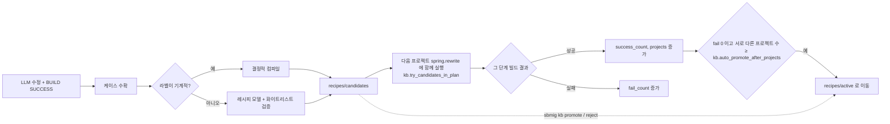

# 05. 디렉터리별 저장 방식과 활용

sbmig 저장소와 실행 결과물이 어느 디렉터리에, 어떤 형식으로, 누가 언제 쓰고 읽는지를 디렉터리 단위로 정리합니다. 핵심은 세 가지입니다. 첫째, `config/` 와 `knowledge/` 는 코드와 함께 버전 관리되는 **사람이 큐레이션하는 지식**입니다(회사 고유 값은 Python 코드가 아니라 여기에 둔다는 불변식 2). 둘째, `kb.dir`(기본 `kb/`)은 실행 중에 자라는 **파일 기반 학습 자산**이며, 500개 프로젝트를 순차로 마이그레이션하는 동안 앞 프로젝트의 수정이 뒤 프로젝트를 돕도록 반드시 보존·백업·공유해야 합니다(데이터베이스는 쓰지 않습니다). 셋째, `out/` 아래 실행 디렉터리는 기본적으로 버려도 되는 작업 공간이지만, 담당자에게 넘기는 `report.md` / `report.json` / `result.zip` / `changes.patch` 와 장애 분석용 `sbmig.log` / `journal.jsonl` 은 프로젝트가 끝날 때까지 보관합니다.

## 이 문서를 읽고 나면

- 저장소 최상위 디렉터리 각각의 역할과 "지워도 되는가 / 백업해야 하는가"를 판단할 수 있습니다.
- `kb/` 의 케이스·레시피·원장(ledger)·심볼 인덱스 파일 형식과, 빌드 수정 루프가 이를 어떻게 다시 꺼내 쓰는지 설명할 수 있습니다.
- 한 번의 실행 디렉터리(`out/<run id>/`)에 생기는 모든 파일이 어느 모듈에서 언제 쓰이는지 알고, 문제 보고 시 어떤 파일을 봐야 하는지 압니다.
- `fixtures/` 의 31개 픽스처와 `expected.json` 의 검증 키, e2e 스크립트의 동작을 이해하고 새 픽스처를 추가할 수 있습니다.
- 테스트 디렉터리 구조와 `integration` 마커, 보조 스크립트(`scripts/`), 독립 코딩 에이전트(`coding/`)의 위치를 압니다.

## 관련 코드

- `sbmig/core/config.py` (설정 계층, `kb.dir` 해석), `sbmig/core/workspace.py` (실행 디렉터리, 저널, 로그 이름, git 스냅숏)
- `sbmig/kb/store.py`, `sbmig/kb/ledger.py`, `sbmig/kb/harvest.py`, `sbmig/kb/recipes.py`, `sbmig/kb/labels.py`, `sbmig/kb/cli.py`
- `sbmig/rewrite/compose.py`, `sbmig/rewrite/runner.py`, `sbmig/fix/context.py`, `sbmig/advisory/hints.py`, `sbmig/advisory/catalog.py`, `sbmig/analyze/properties.py`
- `sbmig/loop/orchestrator.py` (KB 크레딧, 결과물 생성), `sbmig/build/effective.py`, `sbmig/build/classpath.py`, `sbmig/core/diag.py`, `sbmig/fix/client.py`
- `sbmig/fleet/runner.py`, `sbmig/fleet/summary.py`, `sbmig/fleet/cli.py`, `sbmig/web/runs.py`, `sbmig/web/app.py`
- `scripts/e2e.py`, `scripts/e2e.sh`, `tests/fixtures/test_fixture_projects.py`, `fixtures/projects/README.md`

## 1. 저장소 최상위 구조

```text
migration-agent/
├── CLAUDE.md                 작업 노트(회사 제약, 불변식, 라운드별 상태) — 개발자용
├── README.md                 사용법 개요
├── pyproject.toml            패키지 정의(sbmig CLI 엔트리포인트, pytest 마커, ruff 설정)
├── .env.example              LLM 게이트웨이 / JDK 경로 환경변수 견본 (.env 로 복사, git 제외)
├── config/                   설정 계층: default.yml + 회사/로컬 오버레이 yml + Maven settings 견본
├── knowledge/                큐레이션된 지식: 레시피 카탈로그, 선언형 레시피, 마이그레이션 노트, 라이브러리 권고, 외부화 규칙
├── kb/                       실행 중 자라는 학습 KB (케이스, 레시피 후보/활성, 패턴, 원장, 심볼 인덱스)
├── sbmig/                    에이전트 본체(Python 패키지)
├── fixtures/                 테스트용 as-is Maven 프로젝트 31개 + 사내 라이브러리 대역 + 플릿 매니페스트 견본
├── tests/                    pytest 테스트(패키지별 하위 디렉터리)
├── scripts/                  e2e, KB 학습 데모, 플릿 데모 스크립트
├── coding/                   sbmig 와 독립된 소형 코딩 에이전트(같은 게이트웨이 계약)
├── examples/adapters/        회사 LLM 게이트웨이 / 에이전트 프레임워크 연결 예제(플러그인 seam)
├── docs/                     설계·운영 문서(ARCHITECTURE, INTERFACES, RUNBOOK …)와 이 핸드북(docs/handbook)
└── out/                      모든 실행 결과물(기본 출력 위치, git 제외)
```

`.gitignore` 에서 운영상 중요한 항목은 다음과 같습니다.

| 패턴 | 의미 |
|---|---|
| `out/` | 실행 결과물 전체가 git 에서 제외됩니다. 저장소를 clone 해도 이전 실행 기록은 따라오지 않습니다. |
| **config/artifacts.yml** | 회사 실제 좌표를 넣은 설정 파일은 커밋되지 않습니다(견본은 `config/artifacts.example.yml`). |
| `.env`, `.env.*` (단 `.env.example` 은 포함) | LLM 키 등 비밀값은 저장소에 들어가지 않습니다. |
| `kb/cases/**/*.json` | **KB 케이스 파일은 git 에서 제외됩니다.** 레시피(`kb/recipes`)·원장·인덱스는 제외 대상이 아니므로, 케이스까지 공유하려면 git 이 아니라 `sbmig kb export` / `sbmig kb import` 나 디렉터리 백업을 써야 합니다(5장 참고). |

확인 포인트: 회사 PC 에서 처음 설치할 때 **config/artifacts.yml** 과 `.env` 는 직접 만들어야 하며, 둘 다 git 에 올라가지 않는 것이 정상입니다.

## 2. config/ — 설정 계층

### 2.1 파일 목록

| 파일 | 역할 | 누가 쓰나 / 언제 |
|---|---|---|
| `config/default.yml` | 모든 섹션의 기본값(레이어의 바닥). `artifacts` 섹션은 들어 있지 않습니다. | 항상 가장 먼저 로드됩니다(`sbmig/core/config.py` 의 `DEFAULT_CONFIG_PATH`). |
| `config/artifacts.example.yml` | 회사 아티팩트 정책 견본: `artifacts.parent`(base-parent), `artifacts.boot_parent`, `artifacts.comp_parent`(모두 4.0.0 자리표시자), 필수 2개(`company-core`, `company-logging`), 선택 8개(`lib-auth` … `lib-web`), `artifacts.mandatory_target: root`, `plan.parent_phase: spring`. | 회사에서 **config/artifacts.yml** 로 복사해 실제 좌표를 채웁니다. |
| `config/artifacts.local-e2e.yml` | 공개 Maven Central 만으로 로컬 e2e 를 돌리기 위한 대역 정책: 부모 = `spring-boot-starter-parent` 4.1.0, 필수 = validation/actuator 스타터, 선택 8개 = commons-lang3·guava·lombok 등. **pre-9c 레이아웃을 고정**(`layout.module_dir: module`, `layout.boot_module: boot-jar`, `layout.comp_module: comp-jar`, `layout.front_module: null`, `layout.boot_as_is: layout`, `layout.comp_artifact_suffix: "-comp"`), `llm.provider: fake`, `kb.dir: out/e2e/kb`. | `scripts/e2e.py`, 테스트(`tests/conftest.py` 의 `cfg`), 데모 스크립트. |
| `config/llm-anthropic.yml` | Anthropic API 로 실제 LLM 검증을 할 때의 프로파일(`llm.provider: anthropic`, 수정 모델 `claude-sonnet-5`, 레시피 모델 `claude-haiku-4-5`, `plan.advisor: llm`, `llm.record_dir: out/llm-records`). 키는 파일에 없고 `LLM_API_KEY` 환경변수에서만 읽습니다. | 검증 실행 시 `--config` 로 마지막에 덧붙입니다. |
| `config/llm-plugin.example.yml` | 회사 게이트웨이 어댑터(Tier 1, `llm.provider: plugin`)와 회사 에이전트 fixer(Tier 2, `fix.plugin`)를 꽂는 견본. `examples/adapters/` 의 예제를 가리킵니다. | 회사 프레임워크 연동 시 참고. |
| `config/settings.nexus.example.xml` | 폐쇄망 호스트용 Maven settings 견본. `mirrorOf external:*` 미러 하나로 pom 에 선언된 `<repositories>` 까지 사내 Nexus 그룹으로 돌립니다. | 복사 후 `build.settings_file` 로 지정하면 sbmig 가 모든 Maven 호출에 `-s` 로 넘깁니다. |

### 2.2 계층(layering) 동작 요약

`load_config(*paths)` 는 다음 순서로 병합하며 **뒤가 이깁니다**.

1. `.env` 파일을 환경변수로 읽어 둡니다(`$SBMIG_ENV_FILE`, 저장소 루트 `.env`, 현재 디렉터리 `.env`). 셸에 이미 있는 변수가 이깁니다.
2. `config/default.yml`
3. `--config` 로 준 파일들(지정한 순서대로)
4. 코드에서 준 overrides(예: 웹 UI 의 `llm_provider` 선택)
5. `SBMIG_<섹션>__<키>` 형식의 환경변수(이중 밑줄 = 중첩), 그리고 `${VAR}` / `${VAR:-기본값}` 확장

병합은 dict 단위 deep merge 이고 **리스트는 통째로 교체**됩니다. 그래서 선택 아티팩트 목록을 바꾸는 픽스처 오버레이는 8개 전체를 다시 적습니다. `artifacts` 섹션에는 기본값이 없으므로 `sbmig run` 은 `--config config/artifacts.yml`(또는 local-e2e) 없이는 검증 오류와 함께 힌트를 출력하고 끝납니다. 반면 `sbmig kb ...` 명령은 `artifacts` 가 없어도 자리표시자로 채워 동작합니다(`sbmig/kb/cli.py` 의 `_load_cfg`). 각 키의 의미와 기본값은 [08. 설정 레퍼런스](08-config-reference.md) 에서 다룹니다.

```text
sbmig run <project> --config config/artifacts.yml                       # 회사 운영
sbmig run <project> --config config/artifacts.local-e2e.yml             # 로컬 검증(공개 대역, fake LLM)
sbmig run <project> --config config/artifacts.local-e2e.yml \
                    --config fixtures/projects/<name>/sbmig.e2e.yml     # 픽스처별 오버레이
```

확인 포인트: 상대 경로 설정값(`kb.dir`, `advisories.file`, `openrewrite.base_recipe_dir`, `externalized.rules_file`, `plan.catalog_file`)은 **현재 디렉터리가 아니라 sbmig 저장소 루트**(`repo_root`) 기준으로 해석됩니다(`Config.resolve_path`). 다른 디렉터리에서 실행해도 KB 위치가 바뀌지 않는 이유입니다.

## 3. knowledge/ — 큐레이션된 지식(코드와 함께 버전 관리)

`knowledge/` 는 사람이 검토해 커밋하는 지식입니다. 실행 중에 sbmig 가 여기에 쓰는 일은 없습니다(쓰기는 모두 `kb.dir` 로 갑니다). 회사 고유 규칙도 Python 이 아니라 이곳(또는 `config/`)에 추가하는 것이 원칙입니다.

```text
knowledge/
├── recipes/
│   ├── catalog.yml                 레시피 id 의 단일 원천(34개 항목)
│   └── base/
│       ├── spring-boot-41-version.yml        com.company.migrate.SpringBoot41Version 등 (템플릿 치환)
│       └── hystrix-to-resilience4j.yml       com.company.migrate.HystrixToResilience4j (hystrix 권고의 recipe)
├── notes/
│   ├── index.yml                   노트 선택 규칙(keywords / cases / phases / always)
│   └── *.md                        마이그레이션 노트 16개 (fix-policy, jdk21, jakarta, boot2-to-3, hibernate-7, era-libraries …)
├── libraries/advisories.yml        EOL / 미관리 라이브러리 권고 64개
├── libraries/jar_names.yml    jar 파일 이름 stem → 원래 Maven 좌표(`sbmig inventory`, pom 없는 WEB-INF/lib; 버전은 파일 이름에서)
├── libraries/jakarta_libraries.yml jakarta 릴리스가 알려진 서드파티 라이브러리 44개(핸들러 jakarta-library-floor, X1 제안, javax API 절; QLRM, Jersey, CXF, Quartz, Ehcache 3(classifier) …)
└── config/externalized.yml         외부화 설정 인벤토리 규칙(JNDI / context-param / -D 매핑, 안내문)
```

### 3.1 recipes/catalog.yml — 레시피 id 의 단일 원천

`knowledge/recipes/catalog.yml` 은 sbmig 가 아는 모든 OpenRewrite 레시피 id 를 한 곳에 적은 목록입니다(불변식 5). `sbmig/plan/catalog.py` 의 `RecipeCatalog` 가 읽어 LLM 플랜 어드바이저의 허용 목록, 복합 레시피의 포함 관계(coverage), 프로파일 게이트를 만들고, `sbmig recipes list|show|check|sets` 가 이를 조회·검증합니다. 다만 **규칙 기반 플래너가 무엇을 실행할지는 카탈로그가 아니라** `config/default.yml` 의 `openrewrite.recipes` 세트와 `sbmig/triage/recipe_rules.yml` 의 반응형 규칙이 정합니다. 카탈로그는 그 둘이 참조하는 id 를 설명하고, 어긋나면 `sbmig recipes check` 가 실패합니다. KB 가 학습한 레시피(`com.company.kb.*`)는 카탈로그에 넣지 않고 `kb/` 에서 실시간으로 읽습니다.

항목 스키마(version 1)의 필드는 다음과 같습니다.

| 필드 | 의미 |
|---|---|
| `id` | 레시피 FQN(유일) |
| `origin` | `openrewrite` 또는 `project` |
| `artifact` / `provided_by` | 레시피 jar 의 Maven 좌표, 그리고 그것을 전이적으로 가져오는 설정된 레시피 아티팩트 |
| `file` | project 레시피일 때 선언형 yml 경로(`knowledge/recipes/base`) |
| `phase` | 기본 단계 `jdk21` / `spring` / `restructure` |
| `description`, `docs` | 한 줄 설명(어드바이저에 그대로 노출), 공식 문서 URL |
| `covers` | 이 복합 레시피가 이미 포함하는 레시피(어드바이저가 중복 추가하지 않음) |
| `gate` | 프로파일 조건 이름(`sbmig/plan/catalog.py` 의 GATES) 또는 null |
| `advisor` | LLM 어드바이저가 추가해도 되는지 |
| `sets`, `rules` | 참조하는 설정 세트 / 반응형 규칙 id(정보용, 검증됨) |
| `verified`, `notes`, `advisories` | 검증 시점, 관련 노트, 이 레시피로 해결되는 권고 id(양방향 검증) |

실제 항목 예시(발췌):

```yaml
- id: org.openrewrite.java.migrate.UpgradeToJava21
  origin: openrewrite
  artifact: org.openrewrite.recipe:rewrite-migrate-java
  phase: jdk21
  description: Java 8/11/17 → 21 (language level, removed JDK APIs, JAXB/JAX-WS dependencies, plugin versions)
  covers:
    - org.openrewrite.java.migrate.javax.AddJaxbDependenciesWithRuntime
  gate: null
  advisor: false
  sets: [jdk21]
  verified: "2026-10"
  notes: knowledge/notes/jdk21.md
```

확인 포인트: 카탈로그·설정 세트·반응형 규칙·base 레시피 중 하나를 고쳤다면 `sbmig recipes check`(가능하면 `--jars` 로 고정 버전 jar 안에 id 가 실제로 있는지까지)를 돌립니다. `scripts/e2e.sh` 는 픽스처 실행 전에 이것을 먼저 수행합니다. 레시피 BOM 은 3.37.0 으로 고정입니다.

### 3.2 recipes/base/*.yml — 프로젝트 소유 선언형 레시피

`knowledge/recipes/base/` 의 yml 은 OpenRewrite 선언형 레시피(`type: specs.openrewrite.org/v1beta/recipe`)입니다. 실행마다 `sbmig/rewrite/compose.py` 가 다음을 이어 붙여 그 실행 전용 `rewrite.yml` 을 만듭니다.

1. `openrewrite.base_recipe_dir`(기본 `knowledge/recipes/base`)의 모든 yml — 템플릿 치환 후
2. KB 의 활성 레시피 파일(그리고 후보 레시피를 플랜에서 시험할 때는 후보 파일)
3. 마지막에 합성 레시피 `com.company.migrate.Run` — 요청된 레시피 id 를 순서대로 `recipeList` 에 담은 것. 이것만 활성화되므로 실행 순서가 결정적입니다.

템플릿 값은 `template_values(target)` 이 `target.*` 설정에서 만듭니다.

| 자리표시자 | 값의 출처 |
|---|---|
| `{{SPRING_BOOT_VERSION}}` | `target.spring_boot_version` (기본 4.1.0) |
| `{{JAVA_VERSION}}` | `target.java_version` (기본 21) |
| `{{SPRING_FRAMEWORK_VERSION}}` | `target.spring_framework_version` (기본 7.0.x) |

`knowledge/recipes/base/spring-boot-41-version.yml` 의 `com.company.migrate.SpringBoot41Version` 은 4.0 우산 레시피가 4.0.x 에서 멈추는 문제를 메우기 위해 부모·BOM·플러그인·직접 의존성의 Boot 좌표를 `"{{SPRING_BOOT_VERSION}}"` 로 올립니다. 알 수 없는 자리표시자는 경고만 남기고 그대로 둡니다. 합성된 파일은 실행 디렉터리의 `rewrite/rewrite-N.yml` 로 남으므로(6장) "이번 실행에 정확히 어떤 레시피가 들어갔나"는 그 파일로 확인합니다.

### 3.3 notes/*.md 와 notes/index.yml — LLM 프롬프트에 들어가는 노트

마이그레이션 노트는 빌드 수정 루프가 LLM 에 보낼 컨텍스트의 일부입니다. `sbmig/fix/context.py` 의 `ContextPacker` 가 `knowledge/notes/index.yml` 을 읽고(없으면 각 md 의 front-matter 로 대체) 클러스터마다 노트를 고릅니다.

- 매칭 대상 텍스트 = 오류 메시지, 심볼, 위치, 원문 일부, 아티팩트 좌표, 그리고 클러스터 파일의 import 블록
- `keywords`: 파이썬 정규식(대소문자 구분). 점수 = 매치된 서로 다른 키워드 수
- `cases` / `phases`: 비어 있지 않으면 해당 케이스 타입·단계에서만 후보가 됩니다.
- `always: true`: 점수와 무관하게 항상 포함(예산이 모자라면 가장 마지막에 잘리고, 잘려도 축약본으로 남김). `fix-policy.md` 가 이 노트입니다.
- 점수 상위 최대 4개(`DEFAULT_MAX_NOTES = 4`) + always 노트가 "Migration note: <title>" 섹션으로 들어갑니다.

`index.yml` 항목 예:

```yaml
- file: jdk21.md
  title: JDK 8/11/17 -> JDK 21 compile issues
  keywords:
  - sun\.misc
  - javax\.xml\.bind
  - BASE64(En|De)coder
  cases: [pure_java, spring_legacy, spring_boot, servlet_tomcat, msa]
  phases: [jdk21]
  always: false
```

index 와 각 노트의 front-matter 는 일치해야 하며 `tests/fix/test_fix_notes.py` 가 이를 검사합니다.

**`## fix-loop: <library>` 섹션.** 노트 안의 이 제목은 라이브러리 권고(advisory)가 걸린 클러스터에서 "무엇으로 바꿔야 하는가" 힌트로 발췌됩니다(`sbmig/advisory/hints.py`). 권고 항목에 `notes: knowledge/notes/<file>.md` 가 있으면 그 파일에서 `## fix-loop: <library>` 섹션을 우선 찾고, 없으면 라이브러리 이름이 들어간 첫 제목을 씁니다(최대 600자). 현재 이 섹션이 있는 노트는 다음과 같습니다.

| 노트 | 섹션 |
|---|---|
| `knowledge/notes/spring-cloud.md` | `## fix-loop: hystrix` |
| `knowledge/notes/jdk21.md` | `## fix-loop: jdk-removed-apis`, `## fix-loop: jdk-generified-apis` |
| `knowledge/notes/ibatis2.md` | `## fix-loop: ibatis2` |
| `knowledge/notes/hibernate-7.md` | `## fix-loop: hibernate-commons-annotations` (Hibernate 7에서 사라진 `org.hibernate.annotations.common.*`) |
| `knowledge/notes/externalized-config.md` | `## fix-loop: externalized-config` |
| `knowledge/notes/era-libraries.md` | 2026-10-22 그 시절 라이브러리: `## fix-loop: hibernate-template`, `commons-fileupload`, `jackson1`, `tiles`, `velocity`, `ehcache2`, `commons-collections3`, `json-lib`, `jjwt`, `poi`, `commons-httpclient3`, `axis1`, `dbcp1`, `itext`, `slf4j-1-pin` (제목은 권고 id가 아니라 finding의 library 이름 — 분석기 규칙 이름, 규칙 없는 권고는 id) |

확인 포인트: 회사에서 특정 라이브러리 전환 요령을 LLM 에 꾸준히 알려 주고 싶다면, 노트에 `## fix-loop: <library>` 섹션을 만들고 권고 항목의 `notes` 로 연결하는 것이 가장 효과적입니다.

### 3.4 libraries/advisories.yml — 라이브러리 권고

`knowledge/libraries/advisories.yml` 은 마이그레이션 후에도 **컴파일은 되지만** EOL·미관리·런타임 비호환이라 그냥 두면 결과가 초록불로 보이는 라이브러리 목록입니다(`sbmig/advisory/catalog.py` 가 로드). 회사 정책상 `block` 정책은 없고 `guide` 와 `recipe` 만 있습니다.

| 필드 | 의미 |
|---|---|
| `id` | 권고 id(예: `springfox`, `sleuth`, `hystrix`, `ribbon`, `zuul`, `netflix-feign`, `spring-cloud-bom`, `spring-security-oauth2-legacy`, `log4j1`, `commons-lang2`, `httpclient4`, `jdk-removed-apis`, `ibatis2`, `jdk-generified-apis`, `hibernate-commons-annotations`, 2026-10-22 그 시절 라이브러리 49개 — `tiles`, `hibernate-template`, `ehcache2`, `jackson1`, `poi-legacy` … 전체 목록은 `docs/ADVISORIES.md`) |
| `library` / `artifacts` / `imports` | 분석기 라이브러리 규칙 이름, `g:a` glob, import 패키지 — 탐지 근거 |
| `status` | `eol` / `unmanaged` / `incompatible` / `superseded` |
| `title`, `summary` | 보고서용 설명 |
| `replacement`, `replacement_version` | 대체 아티팩트와 버전 안내 |
| `policy` | `guide`(보고서 Handover + 후속조치 + 원장) 또는 `recipe`(추가로 `spring.rewrite` 에서 `recipes` 실행, 카탈로그에 있어야 함) |
| `recipes`, `followup`, `docs`, `notes` | 실행할 레시피, 담당자 후속조치 문구, 문서 링크, 연결 노트 |
| `applies_to`, `applies_when_version_below`, `resolved_min_version` | 적용 조건 |

회사 추가분은 같은 스키마의 별도 파일을 `advisories.extra_files` 로 지정해 id 단위로 병합하고(뒤가 이김), 정책만 바꿀 때는 `advisories.policy_overrides` 를 씁니다. 발견 결과는 `advisories.ledger` 가 켜져 있으면 원장에 `resolution: advisory` 줄로 남습니다. 자세한 내용은 `docs/ADVISORIES.md` 를 봅니다.

`knowledge/libraries/jakarta_libraries.yml` 은 같은 좌표에서 나중 릴리스가 jakarta 로 옮겨 간 서드파티 라이브러리 표입니다(`sbmig/core/jakarta_libraries.py` 가 로드, 핸들러 `jakarta-library-floor`). 필드: `key`(현재 `g:a`, 항목당 하나), `old_keys`(옛 좌표 → `key` 로 이전), `jakarta_since`(첫 jakarta 릴리스, 그 이상은 건드리지 않음), `version`(핸들러가 설정하는 버전), `classifier`(선택, 2026-10-22 — jakarta 빌드가 classifier jar 인 경우. Ehcache 3 의 `jakarta`: 올린 선언에 붙이고, 없는 선언은 버전이 충분해도 "이전"으로 봄), `requires_java`, `note`(보고서 한 줄), `docs`. 회사 추가분도 이 파일에 넣습니다(코드가 아니라 지식).

`knowledge/libraries/jar_names.yml`(2026-10-23)은 pom 이 없는 웹앱의 `WEB-INF/lib` jar 를 원래 Maven 좌표로 잇는 표입니다(`sbmig/analyze/webapp_inventory.py` 의 `jar_names()` 가 로드, `sbmig inventory` 가 사용). 필드: `stem`(파일 이름에서 `-<버전>.jar` 를 뺀 부분, 대소문자 무시 — 예: `commons-lang-2.6.jar` → `commons-lang`), `artifact`(`groupId:artifactId`, jar 가 처음 배포된 원래 좌표), `note`(선택). 버전은 표가 아니라 파일 이름에서 읽습니다. 표에 없는 jar 는 inventory.md 에 "좌표 미확인"으로 먼저 나오며, 사내 jar 는 확인한 뒤 이 파일에 행을 추가합니다.

### 3.5 config/externalized.yml — 외부화 설정 규칙

`knowledge/config/externalized.yml` 은 라운드 8 의 속성 인벤토리 규칙입니다. `sbmig/analyze/properties.py` 의 `load_rules(path)` 가 읽으며, 파일이 없거나 깨져도 예외 대신 인벤토리 노트만 남깁니다.

| 섹션 | 내용 |
|---|---|
| `jndi` | `match` glob → `boot_keys`. 예: `java:comp/env/jdbc/*` → `spring.datasource.url/username/password/driver-class-name`, `java:comp/env/mail/*` → `spring.mail.*`, 그 외 `java:comp/env/*` → `{leaf}` |
| `context_param` | `default_boot_key: "server.servlet.context-parameters.{name}"`, `known` 에 이름별 skip / 매핑(`contextConfigLocation` 은 skip 등) |
| `system_property` | `skip` 목록(`catalina.home`, `user.dir` 등 컨테이너/JVM 제공 키) |
| `boot_defaults` | Boot 기본값이 있어 placeholder 를 쓰지 않을 키(`server.port` 등) |
| `guide` | Handover 의 속성 표 아래에 붙는 한국어 안내문 |

여기서 나온 `external` 키는 재구성 단계에서 `__SET_ME__`(`externalized.sentinel`) 값으로 boot 모듈 `application.properties` 에 기록됩니다. 상세는 [06. 재구성과 회사 레이아웃](06-restructure-and-layouts.md) 7장을 봅니다.

### 3.6 knowledge/ 운영 원칙

| 질문 | 답 |
|---|---|
| 지워도 되나 | 안 됩니다. 코드와 한 몸입니다(테스트가 참조). |
| 백업·공유 | git 으로 관리합니다. 회사에서 추가한 노트·권고·규칙은 커밋하고, 실제 회사 좌표나 비밀은 넣지 않습니다. |
| 변경 후 할 일 | 레시피 관련이면 `sbmig recipes check`, 권고면 `sbmig advisories check`, 노트면 `index.yml` 동기화 후 `python -m pytest tests/fix`. |

## 4. kb/ — 실행 중에 자라는 학습 KB

### 4.1 위치와 원칙

KB 루트는 `kb.dir`(기본 `kb`, 저장소 루트 기준) 입니다. 파일 기반이며 데이터베이스는 쓰지 않습니다(불변식 3). 모든 쓰기는 임시 파일 + `os.replace` 로 원자적이지만 **스레드·프로세스 동시성은 보장하지 않습니다.** 그래서 한 에이전트가 프로젝트를 엄격히 순차로 처리하고, 웹 UI 도 한 번에 한 실행만 돌립니다(나머지는 `queued`).

| 실행 방식 | 사용하는 KB |
|---|---|
| `sbmig run --config config/artifacts.yml` (회사 운영) | `kb.dir` → 기본 `kb/` |
| 로컬 e2e / 데모 (`config/artifacts.local-e2e.yml`) | `out/e2e/kb` (저장소의 `kb/` 에 쓰지 않음, 불변식 6) |
| KB 를 시험하는 픽스처 | 픽스처 오버레이의 자기 전용 `kb.dir`(예: `out/e2e/kb-method-rename`, `out/e2e/kb-java6-legacy`) — `scripts/e2e.py` 가 실행 전에 비움 |
| `scripts/demo-kb/run.sh` | `out/demo-kb/kb` |
| `scripts/fleet-demo.sh` | `out/fleet-demo/kb` |
| 웹 UI | 체크한 `config/*.yml` 로 만든 설정의 `kb.dir`(local-e2e 를 고르면 `out/e2e/kb`, 회사 설정이면 `kb/`) |
| `sbmig fleet run` | 플릿 설정의 `kb.dir` 하나를 모든 프로젝트가 공유(프로젝트별 오버레이가 `kb.dir` 을 바꿔도 플릿 값으로 되돌림, `sbmig/fleet/runner.py` 의 `project_config`) |
| `sbmig kb ...` | `--config` 의 `kb.dir`, 또는 `--kb-dir` 로 직접 지정 |
| `sbmig run --no-kb` | KB 를 읽지도 쓰지도 않음(조회·수확·원장 모두 생략) |

### 4.2 디렉터리 구조

`sbmig/kb/store.py` 머리말에 적힌 실제 레이아웃입니다(처음 쓸 때 생성).

```text
<kb.dir>/
├── cases/<YYYY-MM>/<case id>.json      KBCase (성공한 LLM 수정 1건 = 1파일)
├── index.json                          {"version":1, "l1": {sig: [case_id…]}, "l2": {…}, "recipes": {sig: [recipe_id…]}, "updated_at": …}
├── recipes/
│   ├── candidates/<id>.yml + <id>.meta.json    수확된 레시피 후보
│   ├── active/<id>.yml + <id>.meta.json        승격된 레시피(매 실행 rewrite.yml 에 합성)
│   └── rejected/<id>.yml + <id>.meta.json      거부된 레시피(인덱스에서 제외)
├── patterns/*.yml                      사람이 쓰는 결정적 패턴 {id, match: {signature_regex}, recipes, hints, handler_ids}
├── ledger.jsonl                        추가 전용 ResolutionRecord (resolved / blocked / unresolved / advisory)
├── symbols.json                        오류 심볼 → 수정 라벨 / 치환 / 프로젝트 수 / 케이스 / 레시피
├── errors.jsonl                        추가 전용 ErrorCaseRecord — 빌드 에러 1개 = 1줄(실패 포함, 2026-10-23)
├── fix_attempts.jsonl                  추가 전용 FixAttemptRecord — 수정 시도 1개 = 1줄(적용한 diff, 실패 이유)
└── error_hints.json                    L2 / 심볼 → 가장 많이 성공한 수정과 가장 많이 실패한 시도(힌트 색인)
```

저장소에는 빈 `kb/cases`, `kb/patterns`, `kb/recipes/active`, `kb/recipes/candidates` 디렉터리만 `.gitkeep` 으로 들어 있습니다.

### 4.3 cases/ — KBCase

케이스 id 는 `<생성일 YYYYMMDD>-<내용 해시 10자>` 이고, 해시는 시그니처와 변경 내용으로 계산됩니다(`case_content_hash`). 같은 내용이 다시 수확되면 새 파일을 만들지 않고 기존 케이스의 `reuse_count` 를 올리고 `reuse_projects` 에 프로젝트 지문을 추가합니다. 오류 경로는 프로젝트 상대 경로로 정리되고, `password=`·`token=` 류 값은 `***` 로 가려집니다(`sbmig/kb/harvest.py` 의 `redact`). 실제 레코드(`out/demo-kb/kb/cases/2026-10/20261017-f16da61b53.json`, 일부 생략):

```json
{
  "id": "20261017-f16da61b53",
  "created_at": "2026-10-17T18:02:32.746055Z",
  "project_fingerprint": "04ec0c98792d3471",
  "case_type": "spring_boot",
  "phase": "spring",
  "signatures": [
    "compile|cannot_find_symbol|class JsonComponent|package org.springframework.boot.jackson",
    "compile|cannot_find_symbol|class JsonComponent"
  ],
  "signatures_generic": ["compile|cannot_find_symbol|JsonComponent"],
  "error_kind": "compile",
  "errors": [{"kind": "compile", "message": "cannot find symbol",
              "file": "src/main/java/com/example/orders/json/MoneyJsonComponent.java", "line": 6, "...": "..."}],
  "fix_kind": "llm_patch",
  "changes": [
    {"path": "src/main/java/com/example/orders/json/MoneyJsonComponent.java", "op": "modify",
     "search": "import org.springframework.boot.jackson.JsonComponent;",
     "replace": "import org.springframework.boot.jackson.JacksonComponent;"}
  ],
  "outcome": "build_ok",
  "reuse_count": 0,
  "reuse_projects": [],
  "recipe_candidate_id": "com.company.kb.JsonComponentToJacksonComponent",
  "tags": ["attempt:spring-1-1"],
  "model": "claude-sonnet-5"
}
```

`signatures`(L1)는 구체적인 시그니처, `signatures_generic`(L2)는 위치·패키지를 뺀 일반형입니다. 이 밖에 `symbol`, `symbol_owner`(javac 가 단순 이름으로만 찍은 타입의 FQCN — `ChangeMethodName` 후보를 만들 때 필요), `fix_labels`, `replacement`(`old → new`) 필드가 있습니다(`sbmig/core/models.py` 의 `KBCase`).

**누가 언제 쓰나.** 각 단계(phase)가 끝날 때 `harvest_phase` 가 그 단계의 시도 중 `LLM_FIX` 이고, 적용됐고, 결과가 `improved` / `build_ok` 이며, 클러스터가 해결된 시도만 케이스로 만듭니다. 즉 **빌드로 검증되지 않은 LLM 출력은 KB 에 들어가지 않습니다.**

### 4.4 recipes/ — 후보·활성·거부 레시피

레시피 하나는 선언형 yml 과 메타 json 한 쌍입니다. 실제 활성 레시피(`out/demo-kb/kb/recipes/active/`):

```yaml
type: specs.openrewrite.org/v1beta/recipe
name: com.company.kb.JsonComponentToJacksonComponent
displayName: Migrate Spring Boot JsonComponent to JacksonComponent
description: Rename org.springframework.boot.jackson.JsonComponent to JacksonComponent for Spring Boot 4.1 compatibility.
recipeList:
  - org.openrewrite.java.ChangeType:
      oldFullyQualifiedTypeName: org.springframework.boot.jackson.JsonComponent
      newFullyQualifiedTypeName: org.springframework.boot.jackson.JacksonComponent
```

```json
{
  "id": "com.company.kb.JsonComponentToJacksonComponent",
  "status": "active",
  "path": ".../kb/recipes/active/com.company.kb.JsonComponentToJacksonComponent.yml",
  "signatures": ["compile|cannot_find_symbol|class JsonComponent|package org.springframework.boot.jackson",
                 "compile|cannot_find_symbol|class JsonComponent",
                 "compile|cannot_find_symbol|JsonComponent"],
  "source_case_ids": ["20261017-f16da61b53"],
  "promoted_at": "2026-10-17T18:03:20.641370Z",
  "success_count": 1, "fail_count": 0,
  "projects": ["04ec0c98792d3471"]
}
```

**후보가 만들어지는 경로** (`kb.generate_recipe_candidates`):

1. 결정적 컴파일(`kb.deterministic_candidates`, LLM 없음): 케이스의 수정 라벨이 기계적(1:1)이면 `sbmig/kb/labels.py` 의 `compile_recipe` 가 `ChangeType` / `ChangePackage` / `ChangeMethodName` / `AddDependency` / `ChangeDependency` / `UpgradeDependencyVersion` / `UpgradePluginVersion` / `ChangePropertyValue` / `ChangeSpringPropertyKey` 중 하나로 바꿉니다.
2. 그렇지 않으면 레시피 모델(`LLM_RECIPE_MODEL`)에게 묻고(`sbmig/kb/prompts/recipe_candidate.md`), 답을 `sbmig/kb/recipes.py` 의 화이트리스트로 엄격 검증합니다. 이름은 `com.company.kb.` 접두사여야 하고 항목은 최대 12개, 알 수 없는 레시피·옵션·스크립트처럼 보이는 내용은 거부됩니다. "NONE" 답이면 후보를 만들지 않습니다.

**승격(promote) 흐름.**



- 후보는 다음 프로젝트들의 플랜 `spring.rewrite` 단계에 마이그레이션 레시피와 함께 들어갑니다. OpenRewrite 는 타입 정보가 살아 있는 as-is 클래스패스에서만 제대로 동작하기 때문입니다. 실행 후 플러그인 출력에서 레시피별로 파일을 바꿨는지 기록하고, 실제로 파일을 바꾼 KB 레시피만 그 단계 빌드 결과로 크레딧을 받습니다(`Orchestrator._credit_plan_recipes`, 저널 `kb_credit`).
- 자동 승격 조건: 후보 상태, `fail_count == 0`, `success_count > 0`, 서로 다른 프로젝트 수 ≥ `kb.auto_promote_after_projects`(기본 2, 0 이면 자동 승격 안 함).
- 활성 레시피는 `kb.use_active_recipes` 가 켜져 있으면 매 실행의 `rewrite.yml` 에 합성되고, 빌드 수정 루프에서도 시그니처가 맞으면 `KB_RECIPE` 결정으로 실행됩니다.
- 사람이 직접: `sbmig kb list`, `sbmig kb show <id>`, `sbmig kb promote <id>`, `sbmig kb reject <id>`, `sbmig kb validate`.

**"빌드 없이는 KB 크레딧 없음"** 규칙(라운드 7a / 9):

| 상황 | 처리 |
|---|---|
| 빌드 수정 루프가 한 번도 돌지 않은 단계(`iterations == 0`) | 성공·실패 어느 쪽도 크레딧하지 않음(빌드 실패가 아니라 "증거 없음") |
| 단계가 의존성 해석 실패만으로 실패(프록시, 429, 누락 아티팩트 등) | 레시피 탓이 아니므로 크레딧 생략, 저널 `kb_credit_skipped`(`reason` 포함) |
| 최종 빌드가 없는 실행(중단) | `unresolved` 원장 줄을 쓰지 않음 |

### 4.5 patterns/*.yml — 사람이 쓰는 결정적 패턴

패턴은 시그니처 정규식에 걸리면 레시피 id, 핸들러 id, 힌트 문장을 붙여 주는 사람이 쓰는 규칙입니다. 형식(`load_patterns`):

```yaml
- id: example-pattern
  match:
    signature_regex: "compile\\|cannot_find_symbol\\|.*SomeOldType"
  recipes: [com.company.kb.SomeRecipe]     # kb.use_active_recipes 일 때 활성 레시피처럼 추가
  handler_ids: [add-known-dependency]      # 트리아지에 핸들러 후보로 전달
  hints: ["SomeOldType 은 NewType 으로 바뀌었습니다"]   # LLM 프롬프트 힌트
```

`match.signature_regex` 가 없거나 정규식이 잘못된 항목은 경고 후 건너뜁니다. 현재 저장소의 `kb/patterns` 는 비어 있습니다.

### 4.6 index.json — 시그니처 색인

`l1`, `l2` 는 시그니처 → 케이스 id 목록, `recipes` 는 시그니처 → 레시피 id 목록입니다(거부된 레시피 제외). 버전이 다르거나 읽을 수 없으면 케이스·레시피 파일로부터 자동 재구성되고, `sbmig kb reindex` 로 수동 재구성할 수 있습니다(심볼 인덱스도 함께 재구성). 플릿은 `fleet.reindex_every`(기본 10) 프로젝트마다 재색인합니다. 따라서 index.json 은 **지워도 복구되는 파생 파일**입니다.

### 4.7 ledger.jsonl — 프로젝트 간 학습 원장

`<kb.dir>/ledger.jsonl` 은 한 줄에 `ResolutionRecord` JSON 하나씩, 추가만 하는 파일입니다. "프로젝트 P 에서 오류 사례 S 를 R 로 해결(또는 차단)했다"는 기록이며, 500개 프로젝트 운영에서 무엇을 자동화해야 하는지 알려 주는 핵심 자산입니다. 실제 줄(`out/fleet-demo/kb/ledger.jsonl`):

```json
{"id":"3ecc753544c5a058","at":"2026-10-18T04:49:10.613055Z","project":"order-api","project_fingerprint":"04ec0c98792d3471","run_id":"fleet-20261018-134722-003-boot3","case_type":"spring_boot","phase":"spring","signature":"compile|cannot_find_symbol|class JsonComponent|package org.springframework.boot.jackson","signature_generic":"compile|cannot_find_symbol|JsonComponent","error_kind":"compile","symbol":"JsonComponent","resolution":"llm_patch","resolver_id":"fake","fix_labels":["annotation-replace","type-rename"],"replacement":"org.springframework.boot.jackson.JsonComponent → org.springframework.boot.jackson.JacksonComponent","outcome":"build_ok","files":["MoneyJsonComponent.java"],"case_id":"20261018-f16da61b53","recipe_id":"com.company.kb.JsonComponentToJacksonComponent","model":"fake","notes":[]}
```

같은 오류가 다음 프로젝트에서는 활성/후보 레시피로 해결되어 이렇게 남습니다.

```json
{"project":"order-api","run_id":"fleet-20261018-134722-005-boot3-again","symbol":"JsonComponent","resolution":"plan_recipe","resolver_id":"com.company.kb.JsonComponentToJacksonComponent","outcome":"build_ok","notes":["active KB recipe ran in the plan's OpenRewrite step"]}
```

| 필드 | 의미 |
|---|---|
| `resolution` | `handler` / `plan_recipe` / `kb_recipe` / `kb_patch` / `llm_patch` / `optional_bump` / `blocked` / `unresolved` / `advisory` |
| `resolver_id` | 핸들러 id, 레시피 id, KB 케이스 id, 모델 이름, 차단 사유, 또는 advisory 의 `<policy>:<recipes|->` |
| `symbol` | "오류 사례 심볼": javac 심볼, `g:a`, 소유 클래스, advisory 면 라이브러리 이름 |
| `fix_labels`, `replacement` | 결정적 수정 라벨과 `old → new` |
| `outcome` | `improved` / `build_ok` / `blocked` / `unresolved` / `apply_failed` 등, advisory 면 `replaced` / `still-present` 등 |
| `files` | 파일 **basename 만**(경로 노출 방지) |

**누가 쓰나.** 단계 수확(`harvest_phase` 가 시도·차단·플랜 레시피 줄 추가)과 실행 종료 시 `record_run`(최종 빌드가 남긴 unresolved, 아직 안 쓴 blocked, advisory 발견)입니다. `kb.harvest` 와 `kb.ledger` 가 모두 켜져 있어야 하고, dry-run 실행은 쓰지 않습니다.

**누가 읽나.** `sbmig kb ledger`(정규식 필터 `--project`, `--symbol`, `--label`, `--resolution`, `--signature`, `--json`), `sbmig kb learning`(무엇을 배웠고 무엇이 아직 LLM 을 필요로 하며 무엇이 많은 프로젝트를 막는지; `--md`), 플릿의 `learning.md`.

### 4.8 symbols.json — 심볼 인덱스

오류 심볼마다 어떤 라벨·치환으로 몇 개 프로젝트에서 고쳤는지를 모은 파일입니다(`kb.symbol_index`). 실제 내용(`out/fleet-demo/kb/symbols.json`):

```json
{
 "JsonComponent": {
  "error_kind": "compile",
  "generic_signatures": ["compile|cannot_find_symbol|JsonComponent"],
  "fixes": [
   {"labels": ["annotation-replace", "type-rename"],
    "replacement": "org.springframework.boot.jackson.JsonComponent → org.springframework.boot.jackson.JacksonComponent",
    "projects": 1, "project_keys": ["04ec0c98792d3471"],
    "cases": ["20261018-f16da61b53"],
    "recipe_id": "com.company.kb.JsonComponentToJacksonComponent"}
  ]
 }
}
```

수확 때 점진적으로 갱신되고 `sbmig kb reindex` 때 케이스로부터 재구성됩니다. 빌드 수정 루프는 이 파일로 "심볼 S 는 N 개 프로젝트에서 이렇게 고쳐졌다"는 힌트를 KB 힌트의 맨 앞에 넣습니다. 조회는 `sbmig kb symbols`.

### 4.9 수정 루프가 KB 를 쓰는 방식

빌드 오류 클러스터마다 트리아지는 다음 순서로 결정합니다(`sbmig/triage/decide.py`): **HANDLER > KB_RECIPE > KB_PATCH > 차단 정책 검사(`loop.blocked_policy`) > LLM_FIX**. KB 조회는 `FileKnowledgeBase.match(cluster, ws, profile)` 하나로 이루어지며 결과(`KBMatch`)는 다음과 같습니다.

| `KBMatch` 필드 | 만드는 방법 | 쓰임 |
|---|---|---|
| `cases` | L1 시그니처 → L2 시그니처 순으로 index 에서 케이스를 모아 재사용 횟수 내림차순, 최신순 정렬, 최대 10개 | 힌트 문장 |
| `replayable` | `kb.use_patch_replay` 일 때, `llm_patch` 케이스 중 지금 작업 트리에 그대로 다시 적용 가능한 것: modify 의 SEARCH 텍스트가 대상 파일에 **정확히 한 번** 있고, create 대상이 없고, rename 대상 경로가 비어 있음(경로가 달라도 basename 이 유일하면 찾아감) | `KB_PATCH` — **LLM 호출 없이** 패치 재생 |
| `recipe_ids` / `candidate_recipe_ids` | 시그니처가 겹치는 활성 / 후보 레시피, 패턴의 `recipes` | `KB_RECIPE` — 루프 안에서는 `rewrite:runNoFork` 로 배치 실행 |
| `handler_ids` | 패턴의 `handler_ids` | 핸들러 후보 |
| `hints` | 심볼 힌트 → 패턴 힌트 → 케이스 요약 순, 최대 `kb.max_hints`(기본 5) | LLM 프롬프트의 "Knowledge-base hints" 섹션 (`kb.use_hints`) |

재생된 패치가 다시 빌드를 통과하면 수확 단계에서 그 케이스의 `reuse_count` 가 오르고, 원장에 `kb_patch` 줄이 남습니다. 실패한 KB 레시피·패치는 같은 클러스터에서 다시 시도하지 않고 다음 결정(결국 LLM)으로 넘어갑니다.

`kb.error_hints` 가 켜져 있으면(기본) `hints` 뒤에 **에러 케이스 힌트**가 붙습니다. 클러스터의 L2 시그니처와 심볼마다 `error_hints.json` 에서 가장 많이 성공한 수정("past runs: fixed by llm … in N project(s): …; replace `a` → `b`")과 가장 많이 실패한 시도("past failure ×k: llm no_change — …; do not repeat it")를 최대 2줄 넣습니다. 전체 개수는 여전히 `kb.max_hints` 가 상한입니다.

### 4.10 수정 라벨(결정적 라벨 휴리스틱)

`sbmig/kb/labels.py` 의 `label_changes` 는 LLM 없이 변경 집합(FileChange)과 오류만으로 "어떻게 고쳤는가"를 라벨링합니다. 라벨은 가장 구체적인 것부터 이 순서로 나옵니다.

`package-rename`, `annotation-replace`, `type-rename`, `import-rename`, `method-rename`, `override-signature`, `method-signature-adapt`, `dependency-replace`, `dependency-version`, `dependency-add`, `dependency-remove`, `plugin-version`, `pom-property`, `spring-property-rename`, `config-value`, `remove-code`, `add-code`, `generic-rewrite`

이 중 기계적 라벨(`package-rename` … `spring-property-rename` 중 `override-signature` / `method-signature-adapt` 제외)만 레시피로 컴파일됩니다. `generic-rewrite`(설명할 수 없는 변경, 공백만 바뀐 변경 포함)는 레시피가 되지 않습니다. `method-rename` 은 라이브러리 소유 클래스의 FQCN 을 알 수 있을 때만(`symbol_owner`) `ChangeMethodName` 으로 컴파일됩니다.

### 4.10b 에러 케이스 — errors.jsonl · fix_attempts.jsonl (2026-10-23)

현업 요구로 추가된 기록입니다. 지금까지 KB에는 **성공한 LLM 수정**만 케이스로 남았고, 원장은 클러스터당 한 줄에 첫 시그니처만 담았으며, 실패한 시도의 이유와 적용한 코드는 로그에만 있었습니다. 이제 실행이 끝날 때(`_finalize`) 그 실행의 **빌드 에러마다 한 줄**, **수정 시도마다 한 줄**을 남깁니다.

| 파일 | 한 줄 = | 주요 필드 |
|---|---|---|
| `errors.jsonl` (`ErrorCaseRecord`) | 실행 중 나온 빌드 에러 하나(같은 에러가 여러 빌드에 나와도 한 줄, 같은 파일에 3번 나오면 3줄) | 에러(`error_kind`, `message`, `file`, `line`, `symbol`, `signature`, `signature_generic`, `error_symbol`), 처음 / 마지막 빌드(`first_seen`, `last_seen`), `status`, 해결 방법(`fix_method`, `resolver_id`, `resolved_by`, `targeted`), `description`(어떻게 해결했나 / 무엇을 시도했나), `change_kind`, `replace_pairs`, `diff_excerpt`(그 파일의 diff), `replace_rule_candidate`, `failure_reason`, `problem_errors`, `block_reason`, `suggestion`, `attempts`(시도 이력, 실패 포함) |
| `fix_attempts.jsonl` (`FixAttemptRecord`) | 수정 시도 하나(핸들러 / 레시피 / KB 패치 재생 / LLM, 실패 포함) | `fix_method`, `resolver_id`, `model`, `outcome`, `description`, `failure`, `introduced_errors`(그 시도 뒤 고친 파일에 새로 생긴 에러), `remaining_errors`, `diff`(git으로 뽑은 적용 코드, 적용되지 않은 LLM 제안은 그 제안), `change`(`ChangeClass`), `fix_labels`, 토큰 수 |
| `error_hints.json` | L2 시그니처 / 심볼 하나 | 본 횟수, 프로젝트, 방법별 해결 수, unresolved / blocked 수, 상위 성공 수정 3개(`fixes`), 상위 실패 3개(`failures`), 그 근거인 `variants`(키당 최대 25개, 처음 본 순서 — 실행마다 늘려 가는 갱신과 `sbmig kb reindex` 의 재구성이 같은 결과를 내게 합니다). 힌트 줄은 `[error <키>]` 로 시작합니다 |

**상태(`status`)**

| 값 | 뜻 |
|---|---|
| `resolved` | 이 에러를 겨냥한 시도(그 클러스터에 들어 있던 시도, `targeted: true`)나 그 파일을 고친 시도 뒤의 빌드에서 사라짐 |
| `resolved_indirectly` | 사라졌지만 겨냥한 시도가 없음: 같은 라운드의 다른 시도(pom 수정 등), plan 단계(`fix_method: plan_step`, rewrite / restructure / 선제 핸들러 / 선택 아티팩트 bump) |
| `blocked` | 끝까지 남았고 BlockedItem이 덮음(`block_reason`, `suggestion`) |
| `unresolved` | 끝까지 남음. `failure_reason` 은 마지막 시도의 결과와 이유, 시도가 없었으면 마지막 결정(가려짐 / 상향 / 라운드 소진) |
| `not_visible` | 마지막 빌드가 그 단계 전에 멈춰 보이지 않음(판단 불가). 최종 빌드가 실패했을 때만 |

에러가 사라졌다고 바로 해결로 보지 않습니다. 그 에러의 모듈이 그 단계까지 빌드됐을 때(성공 모듈 목록에 있거나, 같은 모듈에서 같거나 뒤 단계의 에러가 나왔을 때)만 닫습니다. pom 오류 때문에 컴파일이 멈춰 사라진 것처럼 보이는 에러는 열린 채로 두고, 다시 나타나면 이력에 남긴 채 다시 엽니다. 재구성으로 파일이 `{name}-back/` 아래로 옮겨져도 경로를 `src/` 부터 비교하므로 같은 에러로 봅니다. 되돌린(reverted) 라운드의 빌드는 판정에 쓰지 않습니다.

**변경 형태(`change_kind`)** 는 diff 만 보고 정합니다(`sbmig/kb/changes.py` 의 `classify_diff`). `text_replace` 는 바뀐 줄마다 옛 줄의 토큰만 바꾼 경우(`clientIp` → `remoteClientIp`, `javax` → `jakarta`, `1.0.0` → `3.0.0`)이고 바뀐 토큰 쌍이 `replace_pairs` 에 들어갑니다. 줄이 늘거나 줄거나 토큰이 끼어들면 `code_edit`, 둘이 섞이면 `mixed`, 파일 단위 작업은 `file_create` / `file_delete` / `file_rename` 입니다. **LLM이 고쳤는데 `text_replace`** 이면 `replace_rule_candidate: true` 입니다. 이런 경우는 규칙(명령) 하나로 대신할 수 있으므로 `sbmig kb errors replace-candidates` 가 L2 + 치환 쌍으로 모아 프로젝트 수 순으로 보여 줍니다.

실행 디렉터리에도 같은 내용이 `error_cases.jsonl`, `fix_attempts.jsonl`, `error_cases.csv`(엑셀용 UTF-8 BOM)로 남습니다(5.2 절). 조회 명령은 [07. API 레퍼런스](07-api-reference.md)의 `sbmig kb errors` 입니다.

### 4.11 kb/ 운영: 지우기·백업·공유

| 항목 | 지워도 되나 | 비고 |
|---|---|---|
| `cases/` | 지우면 패치 재생과 힌트를 잃습니다. 보관하세요. | git 제외 대상이므로 별도 백업 필요 |
| `recipes/active`, `recipes/candidates` | 지우면 학습한 자동 수정을 잃습니다. | 리뷰 후 `reject` 로 정리하는 것이 원칙 |
| `recipes/rejected` | 지워도 동작에는 영향 없음 | 왜 거부했는지(`rejected_reason`) 기록이 사라짐 |
| `patterns/` | 사람이 쓴 것이므로 보관 | |
| `index.json` | 지워도 자동 재구성 | `sbmig kb reindex` |
| `symbols.json` | 지워도 `sbmig kb reindex` 로 케이스에서 재구성 | `kb.symbol_index` |
| `ledger.jsonl` | **절대 지우지 마세요.** 재구성할 원천이 없습니다. | 플릿 학습 보고서의 유일한 근거 |
| `errors.jsonl`, `fix_attempts.jsonl` | **지우지 마세요.** 재구성할 원천이 없습니다. | 실패 사례와 적용 코드의 유일한 기록. 나중에 RDBMS / 벡터 DB 로 옮길 원본 |
| `error_hints.json` | 지워도 `sbmig kb reindex` 로 위 두 파일에서 재구성 | `kb.error_hints` |

공유와 이관은 zip 으로 합니다.

```text
sbmig kb --config config/artifacts.yml export kb-backup-2026-10-21.zip    # cases/ recipes/ patterns/ index.json ledger.jsonl symbols.json
sbmig kb --config config/artifacts.yml import kb-backup-2026-10-21.zip    # 기본은 병합(로컬 상태 우선), 원장은 id 로 중복 제거
sbmig kb --config config/artifacts.yml import kb-backup.zip --replace     # 병합 대신 로컬 KB 를 교체
sbmig kb --kb-dir D:/sbmig/kb stats                                       # 케이스·레시피·패턴·시그니처·심볼·원장 수
```

`--config` / `--kb-dir` 은 `kb` 그룹의 옵션이므로 하위 명령(`export`, `stats` …)보다 앞에 씁니다(`sbmig/kb/cli.py` 의 callback). export 는 먼저 reindex 를 수행하고, import 는 zip slip 을 막으며, 병합 시 케이스는 재사용 정보를 합치고 레시피는 성공/실패 횟수의 최댓값과 프로젝트·시그니처 합집합을 취합니다.

확인 포인트: 회사 운영에서는 하루 작업이 끝날 때마다 `kb/` 전체(특히 `ledger.jsonl` 과 `cases/`)를 백업하는 것을 권장합니다. 동시에 두 프로세스가 같은 `kb.dir` 을 쓰지 않도록 하세요(웹 UI 와 CLI 를 같은 KB 로 동시에 돌리지 않기).

## 5. out/<run id>/ — 한 번의 실행 디렉터리

### 5.1 실행 id 와 위치

`sbmig run` 의 실행 id 는 `run-<YYYYMMDD-HHMMSS>-<6자 hex>`(`new_run_id`), 웹 UI 는 `web-<…>`, 플릿은 `<fleet id>-<NNN>-<프로젝트명>`(재시도면 `-r<n>`) 입니다. 출력 위치는 `--out`(CLI 기본 `out`, 웹 `out/web`) 아래 `<run id>/` 입니다. 실제 디렉터리 예(`out/e2e/run-20261021-015411-1aed9f/`):

```text
out/<run id>/
├── project/                  작업 사본(git 저장소, 브랜치 sbmig/<run id>) — 마이그레이션되는 트리
├── logs/                     001-effective-pom-root.log, 002-rewrite-jdk21.rewrite.log, 004-build-jdk21-1.log, … 009-build-verify.log
├── rewrite/                  rewrite-1.yml … rewrite-N.yml (합성된 레시피 파일), artifact-versions.json
├── effective/                depmgmt.json, root.xml (as-is effective pom), 재구성 후 캡처 파일
├── classpath/                (필요할 때) <module>.txt + <module>.meta.json
├── deptree/                  (최종 빌드 뒤) <module>[-<hash>].txt + .meta.json — mvn dependency:tree
├── merge-conflicts/          (멀티모듈 merge 충돌이 있을 때) 버려진 사본
├── journal.jsonl             이벤트 스트림
├── sbmig.log                 DEBUG 로그
├── profile.json              분석 결과 ProjectProfile
├── plan.json                 MigrationPlan
├── report.json / report.md   최종 보고서
├── changes.patch             as-is 대비 전체 git diff (원본 바이트)
├── result.zip                마이그레이션된 프로젝트(.git, target 제외)
└── threads-<ts>.txt          (워치독이 멈춤을 감지했을 때) 스레드 덤프
```

### 5.2 파일별 상세

| 경로 | 형식 / 내용 | 누가 쓰나 | 언제 / 누가 읽나 |
|---|---|---|---|
| `project/` | as-is 를 복사(디렉터리) 또는 압축 해제(zip, 단일 최상위 폴더면 그 안으로 내려감)한 작업 사본. `.git`, `target`, `.idea`, `*.iml` 은 복사하지 않습니다. git 브랜치 `sbmig/<run id>` 에 단계·시도마다 커밋합니다. | `Workspace.from_input` (intake) | 모든 단계. 회귀 시 이전 커밋으로 되돌리는 근거. 담당자는 `git log` 로 단계별 변화를 봅니다. |
| `logs/NNN-<label>.log` | Maven / OpenRewrite 원문 출력. 이름은 `new_log_path(label)` 이 실행 내 일련번호 3자리 + 라벨(영숫자·`-_.` 외 문자는 `_`)로 만듭니다. 예: `effective-pom-root`, `rewrite-jdk21.rewrite`, `rewrite-jdk21.rewrite-nofork`, `build-spring-1`, `build-restructure-1`, `build-verify`. | 빌드 러너, rewrite 러너, effective-pom 캡처, 클래스패스 수집 | 오류 분석. 저널의 `build` / `rewrite` 이벤트가 `log` 필드로 정확한 파일을 가리킵니다. |
| `rewrite/rewrite-N.yml` | 3.2 절에서 설명한 합성 `rewrite.yml`. 이름이 겹치면 번호를 올립니다. | `sbmig/rewrite/runner.py` 의 `compose` | "이번에 어떤 레시피가 어떤 순서로 실행됐나" 확인 |
| `rewrite/artifact-versions.json` | 레시피 아티팩트 버전 해석 캐시 | rewrite 러너 | 같은 실행의 다음 rewrite 호출 |
| `effective/depmgmt.json` | as-is 부모 체인이 관리하던 버전: `{"managed": {g:a: v}, "direct": …, "plugins": …, "properties": …, "parent": "g:a:v", "modules": […], "by_module": {…}}` | intake 시 `capture_effective_depmgmt` (`sbmig/build/effective.py`) | 부모 교체 후 버전이 사라졌을 때 `carry-over-managed-version` 핸들러가 as-is 버전을 고정하는 근거 |
| `effective/<stem>.xml` | `help:effective-pom` 출력(as-is 는 `root.xml` 등) | 같은 캡처 | 사람이 직접 비교할 때 |
| `effective/depmgmt-after-restructure.json` | 사내 부모를 붙인 **재구성 후** 트리의 관리 버전(as-is 캡처를 덮어쓰지 않도록 별도 파일) | `Orchestrator._effective_pom_after` | `layout.drop_managed_versions` 가 새 부모가 관리하는 명시 버전을 지울 때 |
| `classpath/<module>.txt` + `.meta.json` | `dependency:build-classpath` 결과와 pom 스탬프(같으면 재사용) | `sbmig/build/classpath.py` | 오류의 원인 라이브러리 귀속, 심볼 소유자 해석 |
| `deptree/<module>[-<hash>].txt` + `.meta.json` | `dependency:tree -Dincludes=<javax API 패턴>` 결과(여러 reactor 모듈의 트리가 이어 붙음)와 pom 스탬프 | `sbmig/build/deptree.py` (`report.javax_api_inventory`) | 클래스패스에 남은 javax API jar와 그것을 끌어오는 라이브러리(X1 `via`, X1b) |
| `merge-conflicts/<module>/…` | 멀티모듈 `merge` 에서 first-wins 로 버려진 다른 내용의 사본, 레지스트리 합집합의 원본들, pom 패키징 모듈의 컴파일되지 않던 `src/` | 재구성기(`_merge`) | 담당자 검토(Handover "Merge conflicts"), 재구성 단계 수정 루프가 LLM 에 읽기 전용 참고로 제공 |
| `journal.jsonl` | 한 줄 = `{"ts", "run_id", "event", …}` | `Workspace.journal` (모든 모듈) | 실행 재구성, e2e 검증(`journal_events`), 웹 UI 스트림 |
| `sbmig.log` | DEBUG 레벨 로그(실행 스레드만) | CLI `run` 이 `attach_file_log`, 웹은 스레드 필터 | 문제 보고 시 공유하는 기본 파일 |
| `profile.json` / `plan.json` | `ProjectProfile` / `MigrationPlan` 의 JSON | 오케스트레이터 `save_model` | 분석·계획 검토, 플랜 단계 id 확인 |
| `report.json` / `report.md` | `RunReport` 직렬화 / 사람이 읽는 보고서(첫 섹션 Handover) | `sbmig/report/writer.py` | 담당자 인계, e2e 검증, 플릿 요약 |
| `changes.patch` | as-is 첫 커밋 대비 `git diff` 를 **바이트 그대로**(MS949 소스는 MS949 그대로) | `Workspace.write_patch` (`report.include_diff`) | 리뷰, 다른 체크아웃에 적용 |
| `result.zip` | 마이그레이션된 `project/` 에서 `.git` 과 `target` 을 뺀 zip | `Workspace.zip_result` (`report.zip_result`, dry-run 제외) | 담당자에게 전달하는 산출물 |
| `error_cases.jsonl` / `fix_attempts.jsonl` | 이 실행의 `ErrorCaseRecord`(빌드 에러 하나 = 한 줄) / `FixAttemptRecord`(시도 하나 = 한 줄, diff 포함). KB 에 쓰는 것과 같은 정제본(4.10b 절) | 오케스트레이터 `_finalize` (`kb.error_cases`, dry-run 제외. `kb.harvest: false` 여도 씀) | 담당자 검토, 웹 UI 다운로드, `report.json` 의 `error_cases` 는 diff 발췌를 뺀 사본 |
| `error_cases.csv` | 같은 에러 기록의 엑셀용 사본(UTF-8 BOM, 에러 하나 = 한 행) | 같은 단계 | 현업 공유 |
| `threads-<YYYYMMDD-HHMMSS>.txt` | 모든 스레드 스택 | 수정 루프 워치독이 300초(`WATCHDOG_DUMP_S`, `sbmig/loop/fixloop.py`) 동안 진행 신호가 없으면 실행 디렉터리에 자동 기록(`sbmig/core/diag.py`) | 멈춤 진단 |

이 밖의 위치에 생기는 진단 파일도 있습니다.

| 파일 | 위치 | 비고 |
|---|---|---|
| LLM 요청·응답 기록 `llm-NNNN.json` | `llm.record_dir`(예: `.env` 의 `LLM_RECORD_DIR=out/llm-records`) | 비밀값 없음. 지원 요청 시 공유 |
| `threads-<ts>.txt` (POSIX `kill -USR1`) | CLI 기본 `out/` | 웹은 `GET /api/threads` 가 `out/web/` 에 기록 |
| `out/web/_uploads/<run id>-<파일명>.zip` | 웹 업로드 원본 | 웹 실행 디렉터리는 `out/web/<run id>/`, 최종 상태는 `web-status.json` |
| `out/web/_uploads/.incoming-<hex>.part` | 받는 중인 업로드 | 다 받으면 위 이름으로 옮기고, 거절되면 지웁니다. 서버가 죽어 남은 것은 지워도 됩니다 |

### 5.3 journal.jsonl 이벤트

실제 레코드 몇 줄입니다.

```json
{"ts": "2026-10-20T16:54:11.927801+00:00", "run_id": "run-20261021-015411-1aed9f", "event": "intake", "source": ".../fixtures/projects/java6-legacy", "project_dir": ".../project"}
{"ts": "...", "event": "build", "goal": "compile", "module": null, "ok": false, "exit_code": 1, "duration_s": 1.525, "error_count": 4, "log": ".../logs/004-build-jdk21-1.log", "timed_out": false, "label": "jdk21-1"}
{"ts": "...", "event": "decision", "phase": "jdk21", "iteration": 1, "cluster_id": "compile:43b8bc92", "kind": "llm_fix", "rationale": "no handler/recipe/KB patch for compile src/main/java/com/example/legacy/util/Codec.java (4) → LLM fix"}
{"ts": "...", "event": "restructure", "step": "spring.optional_bump", "mode": "optional_bump", "ok": true, "optional_bumped": ["org.apache.commons:commons-lang3 3.1→3.17.0"], "merge_conflicts": 0, "error": null}
```

코드에 등장하는 이벤트 이름(전체)을 용도별로 묶으면 다음과 같습니다.

| 분류 | 이벤트 |
|---|---|
| 접수·분석·계획 | `intake`, `preflight`, `build_tool`, `effective_pom`, `effective_depmgmt`, `analyze`, `advisories`, `advisories_planned`, `plan`, `plan_advice`, `handlers_preemptive` |
| 그래프·단계 진행 | `graph_node`, `phase_start`, `phase_end`, `phase_skipped`, `step_start`, `step_end`, `stop_after` |
| OpenRewrite | `rewrite`, `rewrite_oom_retry`, `rewrite_oom_retry_result`, `rewrite_download_retry`, `rewrite_download_retry_result`, `rewrite_unresolved_versions`, `recipe_batch` |
| 빌드 | `build`, `classpath`, `verify`, `tests_fallback`, `test_compile_fallback` |
| 수정 루프 | `loop_start`, `loop_end`, `triage`, `decision`, `attempt`, `attempt_scored`, `revert`, `reround`, `stall`, `oscillation`, `only_blocked`, `blocked`, `blocked_resolved`, `blocked_released`, `verify_loop_start`, `verify_loop_end`, `handler_failed`, `merge_conflict_hints`, `budget_exhausted` |
| LLM | `fixer`, `llm_fix`, `llm_call`, `llm_cooldown`, `llm_unavailable` |
| KB | `harvest`, `kb_credit`, `kb_credit_skipped` |
| 재구성 | `restructure`, `restructure_failed`, `placeholders`, `effective_depmgmt_after` |
| 종료 | `advisories_verified`, `handover`, `report`, `abort`, `run_aborted`, `warning` |

확인 포인트: "왜 이 클러스터를 LLM 에 보냈나"는 `decision` 의 `rationale`, "LLM 이 무엇을 바꿨나"는 `llm_fix` 의 `changes`, "시도가 효과가 있었나"는 `attempt` 의 `outcome` 으로 봅니다. 각 이벤트의 의미는 [04. 트리아지와 수정 루프](04-triage-and-loop.md) 에서 다룹니다.

### 5.4 out/ 운영: 무엇을 지우고 무엇을 남기나

| 대상 | 판단 |
|---|---|
| `project/`, `logs/`, `rewrite/`, `effective/`, `classpath/`, `deptree/` | 프로젝트 인계가 끝나면 지워도 됩니다(용량이 가장 큼). |
| `report.md`, `report.json`, `result.zip`, `changes.patch` | 인계 산출물. 담당자 확인이 끝날 때까지 보관합니다. |
| `journal.jsonl`, `sbmig.log`, `threads-*.txt` | 문제 재현·보고용. 해당 프로젝트가 종결될 때까지 보관합니다. |
| `merge-conflicts/` | 담당자가 충돌 검토를 마칠 때까지 보관합니다. |
| `out/e2e/`, `out/demo-kb/`, `out/fleet-demo/` | 로컬 검증 산출물. 언제든 지워도 됩니다(스크립트가 다시 만듭니다). |
| 플릿 `<out>/fleet/` | `state.json` 이 재개(resume)의 근거이므로 플릿이 끝날 때까지 지우지 마세요. |

KB 는 `out/` 에 있지 않다는 점(회사 운영 기준)을 다시 강조합니다. 로컬 설정은 KB 를 `out/e2e/kb` 에 두므로, 로컬에서 `out/` 를 지우면 로컬 KB 도 사라집니다.

### 5.5 플릿 출력 구조

`sbmig fleet run <manifest> --config <yml> --out <dir>` 의 결과(`sbmig/fleet/runner.py`, `sbmig/fleet/summary.py`):

```text
<out>/
├── fleet/
│   ├── state.json           FleetState — 프로젝트마다 원자적으로 다시 씀(죽어도 재개 가능)
│   ├── fleet-config.json    마지막 run 의 configs + overrides (resume 이 사용)
│   ├── summary.md / summary.csv / summary.json    프로젝트별 상태·LLM 호출·비용(llm_cost)·차단·advisory 표 (fleet.summary_formats)
│   ├── learning.md          이 플릿 실행들의 원장 요약 + KB 통계
│   └── sbmig.log            플릿 전체 로그(각 실행의 sbmig.log 는 별도)
├── <fleet id>-001-<name>/   일반 실행 디렉터리와 동일 구조
├── <fleet id>-002-<name>/
└── …
```

`fleet id` 는 `fleet-<YYYYMMDD-HHMMSS>` 입니다. 실제 데모(`scripts/fleet-demo.sh`)는 `out/fleet-demo/runs/` 를 `--out` 으로 써서 `out/fleet-demo/runs/fleet/summary.md` 등이 생깁니다. 진행 상황은 `sbmig fleet status`, 재개는 `sbmig fleet resume` 입니다(자세한 운영은 [09. 운영](09-operations.md), `docs/FLEET.md`).

## 6. fixtures/ — 테스트 코퍼스

### 6.1 구조

```text
fixtures/
├── projects/<name>/              as-is Maven 프로젝트 (≤ 10 Java 파일 수준)
│   ├── pom.xml, src/…            실제로 빌드되는 as-is 프로젝트
│   ├── README.md                 시나리오 설명 + as-is 빌드 명령(JDK 포함)
│   ├── expected.json             analyze 기대값 + expect 블록(실행 결과 단언)
│   ├── sbmig.e2e.yml             (선택) 픽스처별 설정 오버레이
│   └── replay/llm-NNN.json       (선택) 재생용 LLM 응답 {"note", "response"}
├── projects/README.md            매트릭스·expect 키·추가 절차 문서
├── libs/
│   ├── install.sh                사내 라이브러리 대역을 로컬 저장소에 설치(멱등)
│   ├── legacy-web-lib/v1.0.0 v2.0.0 v3.0.0   com.company.legacy:legacy-web-lib (javax / jakarta / 메서드 이름 변경판)
│   └── ghost-lib/                절대 설치하지 않는 아티팩트(missing-artifact 용), make-repo.sh
├── webapps/<name>/               pom 이 없는 Tomcat 웹앱 트리(`sbmig inventory` 입력, 빌드하지 않음)
│   └── README.md                 시나리오와 기대 인벤토리
└── fleet/manifest.example.yml    플릿 매니페스트 견본
```

`fixtures/webapps/legacy-exploded` 는 웹앱 루트 2개(`portal`: web.xml 2.3 DTD, cp949 소스, JNDI `jdbc/PortalDS`, 소스 없는 Java 1.6 클래스, `*.jar.old` 백업 / `admin`: web.xml 2.5 + `DispatcherServlet`)와 두 소스 루트에 중복된 `com.acme.common.Util` 을 담은 인벤토리 전용 픽스처입니다. `tests/analyze/test_webapp_inventory.py` 가 기대값을 고정합니다(e2e 대상이 아님).

### 6.2 31개 픽스처

| 픽스처 | 케이스 | 무엇을 검증하나 |
|---|---|---|
| `pure-java` | `pure_java` | 순수 Java, 0 LLM, 선택 아티팩트 bump, JAXB 를 버전 없이 선언(부모 관리) |
| `servlet-tomcat` | `servlet_tomcat` | 서블릿 전용 WAR, commons-io bump |
| `spring5-xml` | `spring_legacy` | Spring 5 XML, `WebMvcConfigurerAdapter` 는 LLM/KB 대상(≤ 2 LLM) |
| `boot2` | `spring_boot` | Boot 2 → 4.1, 0 LLM |
| `boot3` | `spring_boot` | Boot 3 → 4.1, 0 LLM (KB 데모의 기본 대상) |
| `msa` | `msa` | 서비스 2개 pom-only, 서비스별 속성 placeholder |
| `boot2-javax-lib` | `spring_boot` | javax 를 노출하는 사내 라이브러리 → `external_javax_api` 차단, exit 2 |
| `boot2-javax-lib-optional` | `spring_boot` | 같은 라이브러리를 선택 아티팩트(2.0.0)로 bump → 성공 |
| `euckr-legacy` | `pure_java` | MS949 소스 인코딩 유지(E1) |
| `enforcer-java8-werror` | `pure_java` | enforcer 완화, `-Werror` 제거(E4, E5) |
| `missing-artifact` | `pure_java` | 없는 아티팩트 → `artifact_not_found` 차단, 0 LLM, 시간 제한 |
| `msa-shared-lib` | `msa` | 공유 라이브러리(`common`)는 부모만, 필수 의존성 없음 |
| `boot2-method-rename` | `spring_boot` | 라이브러리 메서드 이름 변경 → 재생 LLM 2회 → `ChangeMethodName` 후보 결정적 컴파일(`expect.kb`) |
| `boot2-cloud-legacy` | `spring_boot` | 라이브러리 권고 + Handover 기준 실행(springfox, sleuth, spring-cloud-bom, hystrix) |
| `boot2-hystrix-command` | `spring_boot` | 레시피로 못 바꾸는 HystrixCommand 하위 클래스를 권고 힌트 받은 LLM 이 변환 |
| `multi-module-merge` | `spring_boot`(멀티모듈) | `merge` 정책, as-is boot 모듈 유지, first-wins 충돌, 동일 사본 제거 |
| `legacy-role-parents` | `spring_boot`(역할 부모, 이전 이관) | Boot as-is 제자리 유지, pom 만 변경, 이전 역할 부모 이동 |
| `legacy-external-config` | `spring_legacy` | 외부화 설정 인벤토리, `__SET_ME__` placeholder, Handover 속성 표 |
| `java6-legacy` | `pure_java` | Java 1.6 소스 레벨, `sun.misc.BASE64*` → 재생 LLM 수정, `jdk-removed-apis` 권고 |
| `multi-module-conflict` | `spring_boot`(멀티모듈) | 같은 FQCN 클래스 충돌 → 재구성 단계 컴파일 오류 → 버려진 사본을 참고로 받은 LLM 수정, 서비스 레지스트리 합집합 |
| `legacy-ibatis` | `spring_legacy` | iBATIS 2 + Spring 3.2 → `repeated_failure` 차단, `ibatis2` guide, exit 2 |
| `company-boot-single` | `spring_boot`(단일 jar) | 회사 레이아웃: 단일 Boot 앱을 `shop-boot` 로 감쌈(wrap) |
| `company-spring5-web` | `spring_legacy`(war, 정적 파일) | 회사 레이아웃: `shop-boot` / `shop-back` / `shop-front` |
| `company-servlet-jsp` | `servlet_tomcat`(war, JSP+JSTL) | 회사 레이아웃: JSP → boot WAR + front jar(Servlet 3) |
| `boot2-rewrite-excluded` | `spring_boot` | `openrewrite.exclusions` 아래의 vendored 헬퍼(FQN `javax.persistence`)와 paging 전용 리포지토리 → 레시피가 못 본 파일을 `jakarta-namespace-sweep` / `spring-data-crud-repository` 가 고침(E13, E14), 0 LLM |
| `boot2-qlrm-javax` | `spring_boot` | QLRM 1.7.1(옛 좌표 `ch.simas.qlrm`)의 `JpaResultMapper`가 `javax.persistence.Query`를 받음 → `jakarta-library-floor` 가 `org.qlrm:qlrm:4.2.1` 로 재배치(X1b), 0 LLM |
| `servlet-webxml-legacy` | `servlet_tomcat`(war, web.xml 2.3 DTD만) | W1: web.xml에만 선언된 서블릿 / 필터 / 리스너 / 오류 페이지 → `legacy-boot`의 생성 클래스 `WebXmlRegistrations`, `server.servlet.session.timeout=30m`, 0 LLM |
| `servlet-nonstandard-dirs` | `servlet_tomcat`(war, 비표준 디렉터리) | `APP/src` 소스, 웹 루트 `STATIC/`(`warSourceDirectory`), 필터링되는 `STATIC/resources`(Excel·템플릿·동영상), `DB/` → JSP·정적 파일은 `ndirs-front`, `STATIC/resources` 는 `ndirs-back` 클래스패스(E12 로 xlsx·mp4 바이트 유지), boot WAR 에 `warSourceDirectory` 없음, 0 LLM |
| `boot2-fix-failures` | `spring_boot` | 일부러 틀리는 재생 LLM(SEARCH 불일치 → `apply_failed`, 호출을 남긴 수정 → `no_change`, 그다음 진짜 수정) → `ClientIpFilter` 에러는 `resolved`(llm, `text_replace` `clientIp → remoteClientIp`, `replace_rule_candidate`, 이력 `apply_failed → improved`), `MemberController` 에러는 `blocked`(`repeated_failure`)와 실패 이유, 실행 디렉터리와 KB 의 `errors.jsonl` / `fix_attempts.jsonl` / `error_cases.csv`(`expect.error_cases`), 실패 종료(exit 2) |
| `ear-sibling-poms` | `servlet_tomcat`(루트 pom 없음, EAR) | `APP/BATCH` / `APP/WEB` / `APP/EAR` 형제 pom, `DB/`, `STATIC/` → intake가 집합 pom 생성(`aggregator-generated`), merge로 `portal-back` / `portal-front` / `portal-boot` WAR, EAR 제거(`ear-module-dropped`, `asis-ear/`, context root 후속 조치), 모듈 의존성·`maven-ear-plugin` 없음, `STATIC/` 그대로(`web-content-left`), 0 LLM |
| `servlet-war-overlay` | `servlet_tomcat`(war overlay) | 사내 공통 화면 WAR(`legacy-base-web`)를 `<type>war</type>` + `<overlays>`로 받는 서블릿 → back / front에는 없고 boot WAR에 overlay로(`war-overlay-moved`), 빌드된 WAR에 overlay의 JSP·css 포함, 0 LLM |

정확한 기대 결과는 `fixtures/projects/README.md` 의 매트릭스가 원본입니다. 레이아웃별 전후 트리는 [06. 재구성과 회사 레이아웃](06-restructure-and-layouts.md) 에서 다룹니다.

### 6.3 expected.json

두 부분으로 되어 있습니다. 위쪽은 `sbmig analyze` 가 내야 할 값(`case_type`, `java_version`, `spring_boot_version`, `packaging`, `is_multi_module`, `libraries`, `optional_artifacts_in_use`, `main_classes`, `catalog`, 9c 이후 `web_resources` 등)이고, `expect` 블록은 `sbmig run` 결과에 대한 단언입니다. 실제 예(`company-servlet-jsp`, 발췌):

```json
"expect": {
  "success": true, "exit_code": 0, "max_llm_calls": 0, "blocked": [], "unresolved_max": 0,
  "journal_events": [{"event": "restructure", "mode": "layout", "ok": true}],
  "phases": {"restructure": "ok"},
  "post_checks": [
    {"pom_packaging": {"path": "shop-boot/pom.xml", "packaging": "war"}},
    {"pom_module_list": {"path": "pom.xml", "modules": ["shop-back", "shop-boot", "shop-front"], "any_order": true}},
    {"file_contains": {"path": "shop-boot/src/main/java/**/*Application.java", "contains": "SpringBootServletInitializer"}},
    {"file_exists": {"path": "shop-boot/target/*.war"}},
    {"file_absent": {"path": "module"}}
  ]
}
```

`expect` 키 요약(`scripts/e2e.py` 가 평가):

| 키 | 의미 |
|---|---|
| `success` / `exit_code` | `RunReport.success` 와 CLI 종료 코드(0 성공, 2 차단/미해결, 3 중단) |
| `max_llm_calls`, `max_duration_s`, `unresolved_max` | 상한 |
| `blocked` | 차단 항목 집합의 정확한 일치(`reason`, `artifact`, `owner_class?`, `phase?`), `[]` = 차단 없어야 함 |
| `flags` / `forbidden_flags` | 보고서 플래그 포함 / 불포함(`regex:` 지원) |
| `optional_bumped` | 기록된 bump(`"g:a old→new"`) |
| `journal_events` | 각 dict 가 어떤 저널 이벤트의 부분집합 |
| `phases` | 단계의 마지막 결과(`ok` / `FAIL` / `skipped`) |
| `advisories`, `advisories_exact`, `advisories_absent` | 권고 발견 결과 |
| `handover` | Handover 요약(`changes_min`, `parent_before/after`, `from_here_contains` …) |
| `followups_contains` | 후속조치 문장 |
| `kb` | 픽스처 전용 KB 검사(`dir` 은 `out/` 아래여야 하며 실행 전에 삭제됨, `candidates_min`, `recipes[]`) |
| `properties` | 외부화 인벤토리(`external`, `absent`, `external_in`(MSA 서비스별), `written`, `placeholder_file_contains`) |
| `post_checks` | 마이그레이션된 `project/` 검사: `file_exists`, `file_absent`, `file_contains`, `file_decodes_as`, `pom_parent`, `pom_dependency_present`, `pom_dependency_absent`, `pom_dependency_unversioned`, `pom_dependency_versioned`, `pom_packaging`, `pom_module_list`, `file_same_as`(`{path, source}`: 결과 파일이 as-is 픽스처 파일과 바이트까지 같은지 — 바이너리 확인용, 2026-10-23) (경로에 `**` glob 가능) |

최상위 보조 키: `catalog`(오류 카탈로그 id), `requires_libs`(로컬 저장소에 있어야 할 `g:a:v`), `requires_absent`(없어야 할 `g:a:v`, `missing-artifact` 의 ghost-lib).

### 6.4 픽스처별 오버레이(sbmig.e2e.yml)와 레지스트리

`config/artifacts.local-e2e.yml` 다음에 `--config` 로 덧붙는 파일입니다. 10개 픽스처에 있으며, `tests/fixtures/test_fixture_projects.py` 의 네 레지스트리가 각 오버레이의 최상위 키를 정확히 고정합니다.

| 레지스트리 | 픽스처 | 오버레이 키 |
|---|---|---|
| `OVERRIDES` | `boot2-javax-lib-optional`(legacy-web-lib 2.0.0), `boot2-method-rename`(3.0.0), `boot2-fix-failures`(3.0.0) | `artifacts`(+ `llm`, `kb`) — 선택 목록 8개를 통째로 다시 적음 |
| `LLM_ONLY_OVERRIDES` | `boot2-hystrix-command`, `java6-legacy`, `multi-module-conflict` | `llm`(재생 LLM), `kb`(전용 KB) |
| `REWRITE_ONLY_OVERRIDES` | `boot2-rewrite-excluded` | `openrewrite.exclusions`(기본 JSP/HTML 4개 + `**/vendor/**`, `**/repository/**` — 목록은 통째로 대체됨) |
| `COMPANY_OVERRIDES` | `legacy-role-parents`, `company-boot-single`, `company-spring5-web`, `company-servlet-jsp`, `servlet-webxml-legacy`, `servlet-nonstandard-dirs` | `layout`(`module_dir`, `boot_module`, `comp_module`, `front_module`, `boot_as_is` 를 회사 기본값으로 되돌림) + `artifacts`(`boot_parent`, `comp_parent`) |

로컬 설정이 pre-9c 레이아웃을 고정하고 있으므로, 회사 레이아웃 픽스처는 오버레이로 레이아웃 키를 회사 기본값(= `LayoutConfig` 코드 기본값)으로 되돌리고 역할 부모를 `spring-boot-starter-parent` 4.1.0 대역으로 지정합니다. 테스트는 선택 아티팩트가 항상 정확히 8개인지, 회사 픽스처의 루트 artifactId 가 `shop` 인지도 확인합니다. (요청서의 `PARENT_OVERRIDES` 라는 레지스트리는 현재 코드에 없습니다.)

재생 LLM: `llm.provider: fake` + `llm.base_url: "replay:<경로>"` 이면 `replay/llm-001.json` 부터 순서대로 응답을 소비하고 마지막 응답을 반복합니다. 예: `fixtures/projects/boot2-method-rename/replay`, `scripts/demo-kb/replay`.

### 6.5 사내 라이브러리 대역(fixtures/libs)

- `fixtures/libs/install.sh [local-repo]` — `legacy-web-lib` 1.0.0(Java 8, `javax.servlet`), 2.0.0(Java 17, `jakarta.servlet`), 3.0.0(2.0.0 에서 `clientIp` → `remoteClientIp` 이름 변경)을 설치합니다. 기본은 `~/.m2`, 인자가 있으면 그 저장소. 멱등입니다. `scripts/e2e.sh` 가 자동 호출합니다(`--skip-libs` 로 생략).
- `fixtures/libs/ghost-lib/` — `com.company.nonexistent:ghost-lib:1.2.3`, **설치하지 않습니다.** `make-repo.sh <dir>` 로 임시 저장소에만 만들어 `missing-artifact` 의 as-is 빌드에 씁니다. `scripts/e2e.py` 는 이 jar 가 `~/.m2` 에 있으면 해당 픽스처 실행을 거부합니다(`requires_absent`).
- JDK 8/11 이 없는 환경에서는 `JAVA8_HOME=$JAVA21_HOME` 으로 설치할 수 있습니다(1.8 타깃을 JDK 21 이 경고와 함께 컴파일).

### 6.6 e2e 실행과 결과

```text
scripts/e2e.sh                                   # recipes check --jars + advisories check + libs 설치 + 24개 전체
scripts/e2e.sh --only boot2,msa                  # 일부만
scripts/e2e.sh --skip-libs --only euckr-legacy
python scripts/e2e.py --expect-only              # 기대값만 출력
```

`scripts/e2e.py` 는 픽스처마다 `python -m sbmig.cli run fixtures/projects/<name> --config config/artifacts.local-e2e.yml [--config <fixture>/sbmig.e2e.yml] --out out/e2e` 를 실행하고, 새로 생긴 실행 디렉터리의 `report.json` 과 `journal.jsonl` 로 `expect` 를 평가합니다. 픽스처별 표준 출력은 `out/e2e/_e2e-logs/<name>.log`, 결과 표는 `out/e2e/summary.md`, 원자료는 `out/e2e/summary.json` 입니다. 하나라도 불일치면 종료 코드가 0 이 아닙니다. JDK 21(`JAVA21_HOME`), Maven, Maven Central 접근이 필요합니다.

### 6.7 새 픽스처 추가 절차

1. `fixtures/projects/<name>/` 를 만들고(Java 10개 이하, 현실적인 사용 예), 해당 JDK 로 as-is 빌드(`JAVA_HOME=… mvn -q -DskipTests package`)를 확인한 뒤 명령을 `README.md` 에 적습니다.
2. `expected.json` 에 analyze 키와 `expect` 블록을 씁니다. 오류 카탈로그 id 를 `catalog` 와 `docs/ERROR-HANDLING.md` 의 Fixture 열에 추가합니다. 다른 아티팩트 정책이 필요하면 `sbmig.e2e.yml`(리스트는 통째 교체, 선택 8개 유지)을 둡니다.
3. LLM 수정이 필요한 시나리오는 재생 LLM(`replay/llm-NNN.json`)을 쓰고, KB 를 시험하면 `out/` 아래 전용 `kb.dir` 과 `expect.kb` 를 둡니다.
4. `tests/fixtures/test_fixture_projects.py` 의 `NAMES`/`SCENARIOS`, `BUILD_MATRIX`(오버레이가 있으면 해당 레지스트리), `scripts/e2e.py` 의 `DEFAULT_ORDER`, `fixtures/projects/README.md` 매트릭스에 추가합니다.
5. `python -m pytest tests/fixtures`(스키마), `python -m pytest tests/fixtures -m integration -k <name>`(as-is 빌드), `scripts/e2e.sh --only <name>` 순으로 확인합니다.

## 7. tests/ — 테스트

### 7.1 구조

패키지 구조를 그대로 따릅니다.

```text
tests/
├── conftest.py      공용 픽스처: repo_root, cfg, make_ws, fixture_project, no_llm_cooldown_sleep(autouse)
├── advisory/  analyze/  build/  core/  fix/  fleet/  graph/  kb/  llm/  loop/  plan/  report/  restructure/  rewrite/  triage/  web/
├── fixtures/        픽스처 스키마·빌드 매트릭스·e2e 스크립트 단위 테스트
└── docs/            핸드북 검증(tests/docs/test_handbook.py)
```

| 공용 픽스처 | 내용 |
|---|---|
| `cfg` | `config/artifacts.local-e2e.yml` 로 만든 설정(공개 대역 + fake LLM) |
| `make_ws` | `make_ws(src)` → `tmp_path/out` 아래 Workspace(실행 id 기본 `test-run`) |
| `fixture_project` | `fixtures/projects/<name>` 을 `tmp_path` 로 복사 |
| `no_llm_cooldown_sleep` | 자동 적용. LLM cool-down 이 실제로 잠들지 않게 하고 요청된 대기 시간을 리스트로 기록 |
| `kit` (`tests/triage/conftest.py`) | pom 핸들러 테스트용 `PomKit` |

`tests/fix`, `tests/fleet`, `tests/kb`, `tests/loop` 에도 각자의 `conftest.py` 가 있습니다. `tests/restructure/snapshots` 는 pre-9c 레이아웃이 바이트 단위로 변하지 않았는지 보는 스냅숏입니다.

### 7.2 마커와 실행 범위

`pyproject.toml` 에 마커 두 개가 정의되어 있습니다: `integration`(mvn / java / 네트워크 필요), `llm`(실제 LLM 엔드포인트 필요).

| 명령 | 범위 |
|---|---|
| `python -m pytest -m "not integration"` | 빠른 검사(약 3분). Python 로직 전부: 분석, 계획, 트리아지, 재구성(가짜 빌드), KB, 보고서, 웹, 핸드북 검증 등. Maven 을 실제로 부르지 않습니다. |
| `python -m pytest -q -m integration` | 실제 Maven/JDK 로 픽스처 as-is 빌드 등. 시나리오 라이브러리는 `maven.repo.local.tail` 로 임시 저장소에 두어 `~/.m2` 를 건드리지 않습니다. |
| `scripts/e2e.sh` | 픽스처 전체 마이그레이션(테스트가 아니라 스크립트) |

모든 테스트·데모는 `out/` 또는 `tmp_path` 에만 쓰고 저장소 `kb/` 에는 쓰지 않습니다(불변식 6). lint(`ruff`)는 게이트가 아닙니다.

## 8. scripts/ — 보조 스크립트

| 스크립트 | 하는 일 | 결과 위치 |
|---|---|---|
| `scripts/e2e.sh` | venv 활성화, `JAVA21_HOME` 기본값 설정, `sbmig recipes check --jars`, `sbmig advisories check`, 이어서 `scripts/e2e.py --install-libs` | `out/e2e/summary.md`, `out/recipes-check` |
| `scripts/e2e.py` | 픽스처 실행·평가(6.6 절) | `out/e2e/` |
| `scripts/demo-kb/run.sh [fixture] [llm-config]` | KB 학습 루프 데모: 같은 프로젝트를 두 번 실행. 1회차 재생 LLM 이 `@JsonComponent` 를 고치고 케이스·후보 수확, 2회차는 LLM 0회로 후보가 고치고 크레딧·자동 승격(`scripts/demo-kb/config.yml` 이 해당 project 레시피를 일부러 끔, `kb.auto_promote_after_projects: 1`) | `out/demo-kb/` (`runs/kb-run-1`, `runs/kb-run-2`, `kb/`, `run1.log`, `run2.log`) |
| `scripts/fleet-demo.sh` | 오프라인 플릿 데모: pure-java, boot2, boot3(재생 LLM), spring5-xml, boot3-again 을 새 KB 하나로 순차 실행 → 결정적 후보 컴파일 → 마지막 프로젝트 LLM 0회 → 자동 승격, 끝에 `sbmig kb learning` 과 `sbmig fleet status` 출력 | `out/fleet-demo/` |

두 번째 인자로 실제 LLM 프로파일(예: `config/llm-anthropic.yml`)을 주면 demo-kb 는 재생 대신 실제 모델을 씁니다(키는 환경변수에서만).

## 9. coding/ — 독립 코딩 에이전트

`coding/` 은 sbmig 와 독립된 작은 코딩 에이전트입니다(`coding/agent.py` 한 파일, 표준 라이브러리 위주). 회사 게이트웨이와 **같은 계약**(`post(url, headers={"Authorization": "Bearer <token>"}, json={"model", "need_origin", "messages"})`)만 있으면, 도구 호출 API 없이 텍스트 프로토콜(`coding/prompts/system.md`: `READ` / `LIST` / `GREP`, `=== EDIT` + SEARCH/REPLACE, `RUN`, `<done>`)로 파일을 읽고 고치고 테스트를 돌립니다. 설정은 **coding/.env**(git 제외, `CODING_API_URL`, `CODING_API_KEY` 등), 첫 확인은 `python coding/agent.py --probe` 입니다. 편집 백업은 `coding/.backups/<session>/`, 대화 기록은 `coding/sessions/<session>.jsonl` 에 남습니다. sbmig 파이프라인의 일부가 아니므로 sbmig 운영과 별개로 다룹니다. 자세한 내용은 `coding/README.md`.

## 10. examples/adapters — 플러그인 예제

회사 LLM 게이트웨이와 에이전트 프레임워크는 새 HTTP 클라이언트가 아니라 어댑터 seam 으로 연결합니다(`docs/ADAPTERS.md`).

| 파일 | 계층 | 내용 |
|---|---|---|
| `examples/adapters/company_gateway_adapter.py` | Tier 1: LLM 어댑터 | OpenAI 형 사내 게이트웨이용 `LLMAdapter` 하위 클래스(`X-Api-Key` 헤더, 429/5xx 재시도, 역할별 모델 라우팅) |
| `examples/adapters/agent_fixer.py` | Tier 2: fixer | `ContextPacker` 로 컨텍스트를 만들고 에이전트 결과를 `FixProposal` 로 바꾸는 `FixerLike` |

`config/llm-plugin.example.yml` 이 두 예제를 연결하는 설정 견본이며, 저장소 로컬 예제를 쓸 때만 `PYTHONPATH=.` 가 필요합니다. 상세는 [07. API 레퍼런스](07-api-reference.md) 와 `examples/adapters/README.md` 를 봅니다.

## 11. 한눈에 보는 보존 정책

| 디렉터리 | 성격 | 버전 관리 | 지워도 되나 | 백업·공유 |
|---|---|---|---|---|
| `config/` | 설정 | git(단 **config/artifacts.yml** 제외) | 아니오 | 회사 `artifacts.yml` 은 사내 별도 보관 |
| `knowledge/` | 큐레이션 지식 | git | 아니오 | git |
| `kb/` (= `kb.dir`) | 학습 자산 | 부분(케이스는 git 제외) | 아니오 — 특히 `ledger.jsonl` | 정기 백업, `sbmig kb export` |
| `fixtures/`, `tests/`, `scripts/` | 검증 | git | 아니오 | git |
| `out/<run id>/` | 실행 작업 공간 | 제외 | 인계 후 `project/` 등은 예 | `report.*`, `result.zip`, `changes.patch`, `sbmig.log`, `journal.jsonl` 는 종결까지 보관 |
| `out/e2e`, `out/demo-kb`, `out/fleet-demo` | 로컬 검증 | 제외 | 예 | 불필요 |
| `<out>/fleet/` | 플릿 상태 | 제외 | 플릿 종료 후 예 | `summary.*`, `learning.md` 는 보고용으로 보관 |
| `llm.record_dir` | LLM 기록 | 제외 | 예(지원 종료 후) | 장애 보고 시 공유 |

확인 포인트(문제 보고 시): 운영자는 해당 실행의 `sbmig.log`, `journal.jsonl`, `report.md` 를 우선 확인하고, 멈춤이면 `threads-*.txt`, LLM 응답 이상이면 `llm.record_dir` 의 해당 `llm-NNNN.json` 을 함께 봅니다.
