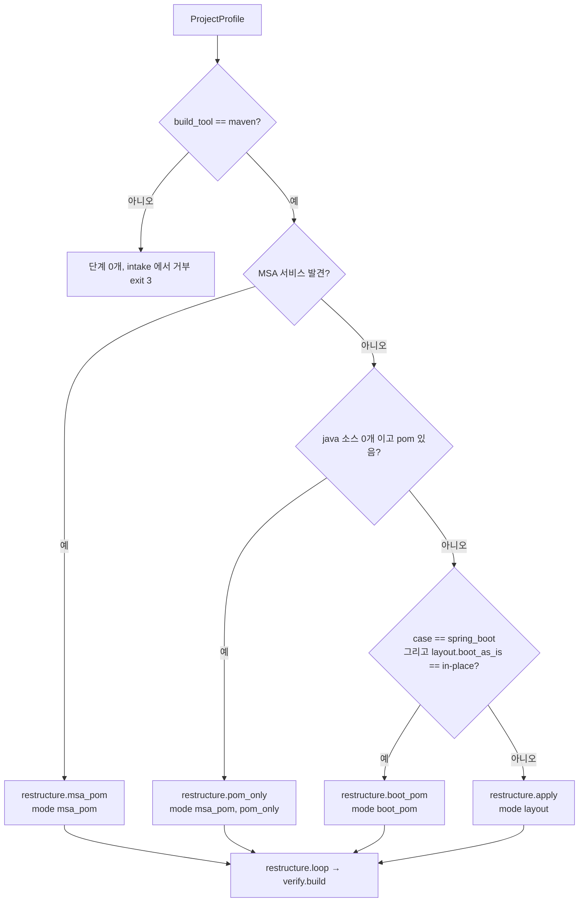

# 06. 재구성(restructure)과 회사 레이아웃

재구성은 마이그레이션된 프로젝트를 회사 표준 모듈 구조와 사내 부모 pom 체계로 옮기는 단계입니다. 회사 규칙(2026-10-21, 라운드 9c)은 이렇습니다. 루트 pom 은 사내 `base-parent`(`artifacts.parent`, 이 문서에서는 `xxx-parent` 4.0.0)를 상속하는 aggregator 이고 필수 의존성 2개를 선언합니다. Spring Boot 가 아닌 프로젝트(Spring Framework, 서블릿, 순수 Java)는 루트 바로 아래 `{name}-boot`(Boot 설정만, 부모 `xxx-boot-jar`) / `{name}-back`(컨트롤러를 포함한 모든 소스, 부모 `xxx-comp-jar`) / 웹 리소스가 있을 때만 `{name}-front`(정적 파일·JSP, 부모 `xxx-comp-jar`) 로 나뉩니다. JSP 가 있으면 boot 모듈은 외장 Tomcat 용 WAR 가 됩니다. 반면 Spring Boot as-is 프로젝트(MSA, 예전 사내 도구로 한 번 이관된 프로젝트 포함)는 디렉터리를 유지하고 pom 만 바꿉니다. 이 문서는 플래너가 어떤 경우에 어떤 모드를 고르는지, 재구성기가 각 모드에서 파일과 pom 을 정확히 어떻게 바꾸는지, 결과를 어떻게 확인하는지를 실제 픽스처의 전후 트리와 함께 설명합니다.

## 이 문서를 읽고 나면

- 프로젝트 유형별로 어떤 재구성 모드(`layout` / `boot_pom` / `msa_pom` / `optional_bump`)가 선택되는지, 결과 디렉터리 트리가 어떻게 되는지 설명할 수 있습니다.
- 역할 부모(`artifacts.boot_parent` / `artifacts.comp_parent`), 필수·선택 아티팩트, 관리 버전 정리(`layout.drop_managed_versions`)가 pom 에 어떻게 반영되는지 압니다.
- 멀티모듈 `merge` 정책의 first-wins 충돌 처리, `merge-conflicts/` 사본, 레지스트리 합집합을 이해하고 검토할 수 있습니다.
- 웹 리소스·JSP 의 이동 규칙과, 마이그레이션 후에도 사람이 해야 할 일(web.xml, 뷰 경로, 외부화 설정 값)을 알 수 있습니다.
- `RestructureResult`, 보고서, 저널을 보고 재구성이 제대로 됐는지 판정할 수 있습니다.

## 관련 코드

- `sbmig/restructure/restructurer.py` (모드 분기와 모든 재구성 로직), `sbmig/restructure/pom_editor.py` (pom 편집)
- `sbmig/restructure/templates` (boot / comp / front pom, Application 클래스 템플릿)
- `sbmig/plan/planner.py` (모드 선택, `plan.parent_phase`), `sbmig/loop/orchestrator.py` (`_step_restructure`, `_restructure_failed`, `_effective_pom_after`)
- `sbmig/core/config.py` (`LayoutConfig`, `ArtifactsConfig`), `sbmig/core/interfaces.py` (`RestructureResult`)
- `sbmig/analyze/classifier.py` (`boot_module_findings`), `sbmig/analyze/properties.py` (외부화 설정 인벤토리)
- `sbmig/build/effective.py` (effective pom 캡처), `sbmig/triage/handlers/edge_handlers.py` (`carry-over-managed-version`)
- 문서: `docs/ARCHITECTURE.md` §8, 픽스처 `fixtures/projects/README.md`

## 1. 회사 레이아웃 규칙

### 1.1 규칙 요약

| 대상 | 규칙 | 설정 |
|---|---|---|
| 루트 pom | packaging `pom`, 부모 = `xxx-parent` 4.0.0, `<modules>` 나열, **필수 의존성 2개는 루트에 선언** | `artifacts.parent`, `artifacts.mandatory_target: root` |
| `{name}` | 루트 pom 의 artifactId (`layout.project_name` 으로 덮어쓰기 가능) | `layout.project_name` |
| `{name}-boot` | Boot 설정만: `@SpringBootApplication` 클래스, `application*.properties|yml`, 로깅 설정, banner, `@SpringBootTest`, 가져온 XML 설정. 부모 `xxx-boot-jar` | `layout.boot_module`, `artifacts.boot_parent` |
| `{name}-back` | 컨트롤러를 포함한 모든 as-is 소스와 의존성. 부모 `xxx-comp-jar` | `layout.comp_module`, `artifacts.comp_parent` |
| `{name}-front` | 웹 리소스가 있을 때만: 정적 파일 → `src/main/resources/static`, JSP → `src/main/resources/META-INF/resources/WEB-INF/jsp`(Servlet 3 jar 리소스). 부모 `xxx-comp-jar` | `layout.front_module`, `layout.front_static_dir`, `layout.front_jsp_dir` |
| boot 패키징 | JSP 가 있으면 외장 Tomcat 용 `war`, 아니면 실행 가능한 jar | `layout.jsp_boot_packaging` |
| Spring Boot as-is | 디렉터리 유지, pom 만: 루트 → `xxx-parent`, 이름이 `*-boot` 이고 pom 이 Boot 앱인 모듈 → `xxx-boot-jar`, 나머지 모듈 → `xxx-comp-jar`. 단일 모듈 Boot 앱은 `{name}-boot` 로 감쌈 | `layout.boot_as_is: in-place`, `layout.boot_module_pattern` |
| MSA | 서비스마다 같은 부모·필수·선택 규칙, 디렉터리 구조 그대로(pom-only) | `layout.msa_parent_policy` |
| 사내 아티팩트 버전 | 모두 한 버전 라인(4.0.0) | `artifacts.*.version` |
| 선택 아티팩트 8개 | 이미 쓰고 있을 때만 버전 상향 | `artifacts.optional` |

artifactId 는 `<루트 artifactId>` + `layout.boot_artifact_suffix`(기본 `-boot`) / `layout.comp_artifact_suffix`(기본 `-back`) / `-front` 입니다. boot 모듈은 `${project.groupId}:<root>-back:${project.version}`(+ front 가 있으면 `<root>-front`)에 의존합니다.

### 1.2 회사 설정 예

`config/artifacts.example.yml` 의 자리표시자를 회사 값으로 채운 모양입니다(이 문서의 표기: `xxx-parent` = base-parent, `xxx-boot-jar` = boot-jar, `xxx-comp-jar` = comp-jar).

```yaml
artifacts:
  parent:      { group_id: com.company.platform, artifact_id: base-parent, version: 4.0.0 }   # xxx-parent
  boot_parent: { group_id: com.company.platform, artifact_id: boot-jar,    version: 4.0.0 }   # xxx-boot-jar
  comp_parent: { group_id: com.company.platform, artifact_id: comp-jar,    version: 4.0.0 }   # xxx-comp-jar
  parent_manages_spring_boot: true
  parent_manages_java_version: true
  mandatory:
    - { group_id: com.company.platform, artifact_id: company-core,    version: null }
    - { group_id: com.company.platform, artifact_id: company-logging, version: null }
  optional:
    - { group_id: com.company.lib, artifact_id: lib-auth, version: 3.0.0, aliases: ["com.company.legacy:auth"] }
    - { group_id: com.company.lib, artifact_id: lib-db,   version: 3.0.0, property_name: lib-db.version }
    # … 8개
  mandatory_target: root
  optional_version_policy: floor
plan:
  parent_phase: spring
```

레이아웃 키는 회사 규칙이 곧 코드 기본값이므로(`config/default.yml` 과 `LayoutConfig` 기본값) 회사 설정에 따로 적을 필요가 없습니다.

### 1.3 pre-9c 레이아웃(비교용)

라운드 9c 이전 레이아웃은 `module/boot-jar` + `module/comp-jar`(front 없음, Boot 프로젝트도 분할)입니다. 다음 값으로 그대로 재현되며, `config/artifacts.local-e2e.yml` 이 앞선 21개 픽스처를 위해 이 값을 고정합니다(스냅숏 `tests/restructure/snapshots` 로 바이트 단위 불변 확인).

```yaml
layout:
  module_dir: module
  boot_module: boot-jar
  comp_module: comp-jar
  front_module: null
  boot_as_is: layout
  comp_artifact_suffix: "-comp"     # local-e2e 값
```

회사 레이아웃 픽스처 4개(`legacy-role-parents`, `company-boot-single`, `company-spring5-web`, `company-servlet-jsp`)는 각자의 `sbmig.e2e.yml` 에서 이 키들을 회사 기본값으로 되돌리고 역할 부모를 지정합니다. 로컬 대역에서는 세 사내 부모가 모두 `spring-boot-starter-parent` 4.1.0 입니다.

## 2. 모드 선택과 실행 시점

### 2.1 플래너가 고르는 재구성 단계

`sbmig/plan/planner.py` 의 규칙(LLM 없음):



| 프로젝트 | 단계 id | 모드 | 디렉터리 이동 |
|---|---|---|---|
| 순수 Java (`pure_java`) | `restructure.apply` | `layout` | 있음(boot / back) |
| Spring Framework 4/5 XML (`spring_legacy`) | `restructure.apply` | `layout` | 있음(boot / back / front) |
| 서블릿·Tomcat 전용 (`servlet_tomcat`) | `restructure.apply` | `layout` | 있음(boot / back / front, JSP 면 boot WAR) |
| Spring Boot as-is (`spring_boot`, 기본 `in-place`) | `restructure.boot_pom` | `boot_pom` | 없음(단일 모듈이면 `{name}-boot` 로 감싸기만) |
| Spring Boot + `layout.boot_as_is: layout` | `restructure.apply` | `layout` | 있음(다른 케이스처럼 분할) |
| MSA | `restructure.msa_pom` | `msa_pom` | 없음 |
| 소스 없는 pom 전용(BOM, 부모, aggregator) | `restructure.pom_only` | `msa_pom` | 없음 |
| (모든 케이스, 선택 아티팩트가 설정된 경우) | `spring.optional_bump` | `optional_bump` | 없음 |

`layout` 모드의 starter 는 `layout.starter_by_case`(순수 Java `spring-boot-starter`, 서블릿·Spring legacy `spring-boot-starter-webmvc`, Boot 는 `auto` = as-is 스타터 유지)로 정해집니다.

### 2.2 `optional_bump` 단계

`plan.optional_bump_phase: spring`(기본)이고 `artifacts.optional` 또는 `artifacts.remove_when_present` 가 있으면 `spring.optional_bump` 단계가 `spring.rewrite` 바로 뒤에 들어갑니다. 사내 라이브러리의 jakarta 빌드가 첫 spring 빌드 전에 클래스패스에 올라오게 하기 위해서입니다. 이 모드는 이동도 부모 변경도 하지 않고 모든 pom 의 선택 아티팩트 bump 와 `remove_when_present` 제거만 합니다. 멱등이라 나중의 `layout` / `msa_pom` 단계는 bump 할 것이 없다고 보고합니다. 이 단계의 실패는 실행 실패가 아니라 후속조치("bump the in-house optional artifacts by hand")로만 남습니다.

### 2.3 `plan.parent_phase`: 언제 부모·레이아웃을 적용하나

| 값 | 동작 |
|---|---|
| `restructure` (코드 기본값) | spring 단계의 빌드 수정 루프가 as-is 부모 체인 위에서 컴파일될 때까지 고친 뒤, restructure 단계에서 부모·레이아웃 적용 → `restructure.loop`(goal `package`) → 최종 검증 |
| `spring` (**회사 설정**) | `restructure.apply` / `restructure.boot_pom` / `restructure.msa_pom` 을 spring 단계로 옮겨 `spring.rewrite`(와 `spring.optional_bump`) 바로 뒤, **spring 빌드 수정 루프 전에** 실행. restructure 단계의 루프는 없어지고 최종 검증만 남음 |

회사가 `spring` 을 쓰는 이유: OpenRewrite 의 Boot/Spring 레시피(`spring.rewrite`)는 타입 정보가 있는 **as-is 부모 체인과 클래스패스** 위에서 돌아야 제대로 동작하므로 레시피는 여전히 as-is 상태에서 먼저 실행됩니다. 그 다음 곧바로 `xxx-parent` / `xxx-boot-jar` / `xxx-comp-jar` 를 붙이면, 이후의 spring 빌드 수정 루프가 **실제로 운영에 쓸 회사 부모 체인**을 상대로 오류를 고칩니다(같은 오류를 두 번 고치지 않음). 또 사내 부모를 해석할 수 없으면(Nexus 미설정 등) 루프에 시간을 쓰기 전에 빠르게 실패합니다. 소스가 없는 pom 전용 프로젝트는 spring 단계가 없으므로 이 설정이 무시됩니다(플랜 노트).

### 2.4 재구성 단계의 실행과 실패 처리

오케스트레이터(`_step_restructure`)는 재구성기를 호출하고, 작업 트리가 바뀌었으면 `restructure: <step id>` 로 커밋한 뒤 저널 `restructure` 이벤트를 씁니다(`mode`, `ok`, `changed_files`, `moved`, `generated`, `mandatory_added`, `optional_bumped`, `merged_modules`, `kept_boot_module`, `merge_conflicts`, `error`). placeholder 를 썼으면 `placeholders` 이벤트도 씁니다. `layout` / `msa_pom` / `boot_pom` 모드이고 `layout.drop_managed_versions` 가 `off` 가 아니면 재구성 후 effective pom 캡처 함수를 `params["effective_pom"]` 으로 넘깁니다(4.5 절).

재구성이 실패하거나 예외가 나면(라운드 9c) 커밋되지 않은 변경을 버리고, 저널 `restructure_failed` 를 쓰고, 플래그 `restructure-failed` 를 붙입니다. 이 플래그가 있으면 최종 `mvn clean package` 가 as-is 트리에서 성공하더라도 `success=false`(종료 코드 2)이며, 후속조치에 "BUILD SUCCESS here does not mean the migration is complete" 가 남습니다. 남은 restructure 단계는 건너뛰지만 최종 검증은 항상 실행됩니다(불변식 1).

## 3. 모드별 동작과 전후 트리

재구성기 진입점은 `Restructurer.apply(ws, profile, cfg, mode=…, params=…)` 하나입니다.

| mode | 메서드 | 요지 |
|---|---|---|
| `layout` | `_layout` → `_single` / `_merge` / `_wrap` | 루트를 aggregator 로, back·boot·(front) 모듈 생성 |
| `boot_pom` | `_boot_pom` → `_boot_wrap`(단일 모듈일 때) + `_boot_in_place` | 디렉터리 유지, 부모·좌표·필수·BOM·java 레벨 |
| `msa_pom` | `_msa` | 서비스 루트·라이브러리 루트·top aggregator 의 pom 만 |
| `optional_bump` | `_optional_bump` | 선택 bump 와 `remove_when_present` 만 |

모든 모드에서 공통으로 선택 아티팩트 bump 와 `remove_when_present` 가 모든 프로젝트 pom 에 적용됩니다(`_all_poms_pass`).

### 3.1 `layout` — 이미 재구성된 프로젝트

`layout` 은 먼저 "이미 재구성됨"을 판정합니다. 루트 packaging 이 `pom` 이고 `<modules>` 에 boot 모듈과 back 모듈이 모두 있으면(merge 정책 기준) 이동 없이 다음만 합니다: 루트 부모가 `artifacts.parent` 와 같은 키인데 버전이 다르면 설정 버전으로 이동, 역할 부모 정렬, 모든 pom 패스, 관리 버전 정리, placeholder 기록. 두 번째 실행은 아무것도 바꾸지 않습니다.

### 3.2 `layout` — 단일 모듈(순수 Java, Spring XML, 서블릿)

`_single` 의 순서:

1. as-is 소스 루트(`src`, 그리고 `<build>` 의 custom source/resource 디렉터리 최상위)를 `{name}-back/` 아래로 이동
2. 웹 리소스가 있으면 front 모듈로 분리(`_populate_front`, 6장)
3. back pom 작성(`comp-pom.xml.j2` + as-is 의존성·빌드 설정 복사, 필수·`remove_when_present` 제외)
4. boot 리소스(`layout.boot_resources_glob`: `application*.yml|yaml|properties`, `bootstrap*`, `logback*.xml`, `log4j2*.xml`, `banner.txt`, `config/` 하위 포함), `@SpringBootApplication` 클래스, `@SpringBootTest` 테스트, `SpringBootServletInitializer` 하위 클래스를 boot 모듈로 이동(`_populate_boot`; `layout.split_policy: web-layer` 면 `@Controller`·`@Configuration` 등도 이동, 기본 `minimal` 은 이동 안 함)
5. boot pom 작성(`boot-pom.xml.j2`), `@SpringBootApplication` 이 없으면 Application 클래스 생성
6. 루트 재작성: 부모 `artifacts.parent`, packaging `pom`, `<modules>` = back, (front), boot, 의존성 제거 후 필수 추가

**순수 Java** (`fixtures/projects/pure-java`, 루트 artifactId `inventory-core`, 회사 레이아웃 기준):

```text
as-is                                   to-be (회사 레이아웃)
inventory/                              inventory/
├── pom.xml (jar)                       ├── pom.xml            packaging pom, parent xxx-parent, modules [inventory-core-back, inventory-core-boot], 필수 2개
└── src/                                ├── inventory-core-back/
    ├── main/java/com/example/          │   ├── pom.xml        parent xxx-comp-jar, as-is 의존성
    │   inventory/InventoryCli.java     │   └── src/main/java/com/example/inventory/…  (InventoryCli 포함 전부)
    │   … service/, util/, io/          │       src/main/resources/inventory.properties, src/test/…
    ├── main/resources/inventory.props  └── inventory-core-boot/
    └── test/java/…                         ├── pom.xml        parent xxx-boot-jar, jar, spring-boot-starter + back 의존성, repackage
                                            └── src/main/java/com/example/inventory/Application.java   (생성)
```

생성된 Application 은 as-is 의 `public static void main` 클래스(`InventoryCli`)를 호출하지 않습니다. 이 경우 후속조치 "existing main class(es) … kept in comp-jar; they are not invoked by the generated Spring Boot Application" 이 남습니다. 기본 패키지를 알 수 없으면 `com.company.app` 에 생성하고 경고를 남깁니다. 같은 이름의 클래스가 이미 있으면 `BootApplication` 으로 이름을 바꿉니다.

**Spring Framework XML 웹앱 + 정적 파일** (`fixtures/projects/company-spring5-web`, `com.example:shop`, war):

```text
as-is                                        to-be
shop/                                        shop/
├── pom.xml (war, Spring 5.3)                ├── pom.xml          pom, parent xxx-parent, modules [shop-back, shop-front, shop-boot](순서 무관), 필수 2개
└── src/main/                                ├── shop-back/       parent xxx-comp-jar, jar
    ├── java/com/example/shop/               │   └── src/main/java/com/example/shop/web/HomeController.java
    │   ├── web/HomeController.java          │                                      service/GreetingService.java
    │   └── service/GreetingService.java     ├── shop-front/      parent xxx-comp-jar, jar, Java 없음
    └── webapp/                              │   └── src/main/resources/static/index.html, css/site.css, js/app.js
        ├── index.html, css/, js/            └── shop-boot/       parent xxx-boot-jar, jar (JSP 없음)
        └── WEB-INF/                             ├── src/main/java/<base package>/Application.java   (생성, @ImportResource)
            ├── web.xml                          └── src/main/resources/legacy-config/applicationContext.xml
            ├── applicationContext.xml                                  legacy-config/dispatcher-servlet.xml
            └── dispatcher-servlet.xml                                  asis-webinf/web.xml   (Boot 가 읽지 않음)
```

XML 빈 설정(`<beans xmlns="http://www.springframework.org/schema/beans">` 를 담은 파일)은 `layout.import_xml_bean_configs` 가 켜져 있으면 boot 모듈 `legacy-config/` 로 복사되고 생성된 Application 에 `@ImportResource("classpath:legacy-config/…")` 로 연결됩니다. 같은 XML 이 front 이동 과정에서 `asis-webinf/` 에도 들어가면 `_dedupe_webinf_stash` 가 `legacy-config/` 사본 하나만 남깁니다. 후속조치: "XML bean configs imported via @ImportResource … — verify bean overlaps with Boot auto-configuration and relative <import> paths".

**서블릿 + JSP** (`fixtures/projects/company-servlet-jsp`, `com.example:shop`, war, JSTL):

```text
as-is                                        to-be
shop/                                        shop/
├── pom.xml (war, javax.servlet 3.1, jstl)   ├── pom.xml          pom, parent xxx-parent, modules [shop-back, shop-front, shop-boot], 필수 2개
└── src/main/                                ├── shop-back/       parent xxx-comp-jar, jar
    ├── java/com/example/shop/               │   └── src/main/java/com/example/shop/web/HelloServlet.java   (jakarta.servlet)
    │   ├── web/HelloServlet.java            │                                      service/GreetingService.java
    │   └── service/GreetingService.java     ├── shop-front/      parent xxx-comp-jar, jar
    └── webapp/                              │   └── src/main/resources/META-INF/resources/WEB-INF/jsp/hello.jsp
        ├── css/site.css                     │                     src/main/resources/static/css/site.css
        └── WEB-INF/                         └── shop-boot/       parent xxx-boot-jar, packaging war
            ├── web.xml                          ├── pom.xml      spring-boot-starter-tomcat (provided), tomcat-embed-jasper (provided),
            └── jsp/hello.jsp                    │                spring-boot-web-server, JSTL api + impl (버전 없음)
                                                 ├── src/main/java/<base package>/Application.java
                                                 │      @SpringBootApplication @ServletComponentScan … extends SpringBootServletInitializer
                                                 └── src/main/resources/asis-webinf/web.xml
                                             mvn package → shop-boot/target/*.war
```

`/WEB-INF/jsp/hello.jsp` 로 forward 하던 코드는 그대로 동작합니다. Servlet 3 규격상 jar 안의 `META-INF/resources/` 는 웹 루트로 노출되므로 front jar 의 `META-INF/resources/WEB-INF/jsp/hello.jsp` 가 같은 경로로 보이기 때문입니다.

### 3.3 `boot_pom` — Spring Boot as-is 제자리 유지

`_boot_pom` 은 Spring Boot 프로젝트의 디렉터리를 유지하고 pom 만 바꿉니다.

1. 루트에 `<modules>` 가 없고 소스가 있으면(단일 모듈 Boot 앱) `_boot_wrap`: `src/**`(+ custom 소스 루트, `lib/`)를 `{name}-boot/` 로 옮기고, as-is 루트 pom 을 그대로 복사해 `{name}-boot/pom.xml` 로 만듭니다(의존성·빌드·profiles 유지, artifactId `<root>-boot`, 명시 groupId/version, packaging 유지). 루트는 관리 정보(properties, dependencyManagement, pluginManagement, repositories)만 남긴 aggregator 가 됩니다. `{name}-boot` 디렉터리가 이미 있으면 오류입니다.
2. boot 모듈 결정: 분석기의 `profile.boot_modules`(이름이 `layout.boot_module_pattern` 에 맞고 pom 이 Boot 앱인 모듈). 비어 있으면 대체 규칙으로 `<build><plugins>` 에 spring-boot-maven-plugin 이 있거나 `src/main/java` 에 `@SpringBootApplication` 클래스가 있는 모듈.
3. `_boot_in_place`: 역할 부모가 설정되어 있으면 boot 모듈 → `artifacts.boot_parent`, 나머지 모듈 → `artifacts.comp_parent`(둘 다 `<relativePath/>`, 명시 groupId/version). 더 이상 in-repo pom 을 상속하지 않게 되는 모듈은 그 pom 의 `<dependencies>`, `<build><plugins>`(spring-boot-maven-plugin 은 boot 모듈만, `<inherited>false</inherited>` 는 제외), dependencyManagement, pluginManagement, repositories, 참조하는 properties 를 복사받습니다. in-repo 중간 pom 을 상속하는 모듈은 그대로 두고 중간 pom 이 재지정됩니다.
4. 루트: 부모 `artifacts.parent`, 모듈이 있으면 packaging `pom`. 역할 부모가 있으면 루트에는 필수 의존성만 남기고 dependencyManagement / pluginManagement / build plugins / 참조되지 않는 properties 를 제거합니다. 모듈이 자체적으로 필수 아티팩트를 선언하고 있으면 버전만 설정값으로 맞춥니다(`_align_mandatory`).
5. 각 boot 모듈 `src/main/resources` 에 placeholder 기록, 모든 pom 패스(java 레벨, boot 플러그인 버전), 관리 버전 정리.

역할 부모가 없으면 모듈은 계속 루트를 상속하고(루트가 `artifacts.parent` + 필수 + BOM + java 레벨을 가짐), 외부 부모를 가진 모듈은 자기 자신이 루트인 것처럼 처리됩니다. 두 번째 실행은 "boot_pom: already in place" 노트만 남깁니다.

**단일 모듈 Boot** (`fixtures/projects/company-boot-single`, `com.example:shop`, Boot 2.7.18):

```text
as-is                                          to-be
shop/                                          shop/
├── pom.xml (jar, spring-boot-starter-parent)  ├── pom.xml       pom, parent xxx-parent, modules [shop-boot], 필수 2개만
└── src/main/                                  └── shop-boot/
    ├── java/com/example/shop/                     ├── pom.xml   parent xxx-boot-jar (<relativePath/>), groupId com.example,
    │   ├── ShopApplication.java                   │             version 1.0.0-SNAPSHOT, jar, as-is 의존성·빌드
    │   ├── web/ProductController.java             └── src/main/java/com/example/shop/ShopApplication.java, web/…, service/…
    │   └── service/ProductService.java                src/main/resources/application.properties
    └── resources/application.properties       (shop-back, shop-front, module/, 루트 src/ 없음)
```

**멀티모듈 Boot as-is / 예전 이관 프로젝트** (`fixtures/projects/legacy-role-parents`): 예전 사내 도구가 `boot-jar` 와 서비스 모듈을 나란히 두고 각 모듈이 역할 부모(옛 1.0.0 라인, 대역 2.7.18)를 직접 상속하게 만든 프로젝트입니다.

```text
as-is                                              to-be (디렉터리 그대로)
shop/                                              shop/
├── pom.xml   aggregator, parent 옛 base-parent    ├── pom.xml          parent xxx-parent 4.0.0, modules [boot-jar, catalog-service, order-service], 필수 2개
├── boot-jar/        parent 옛 boot-jar 1.0.0      ├── boot-jar/        parent xxx-boot-jar 4.0.0 (Boot 앱이지만 이름이 *-boot 가 아님 → 프로필 경고)
├── catalog-service/ parent 옛 comp-jar 1.0.0      ├── catalog-service/ parent xxx-comp-jar 4.0.0
└── order-service/   parent 옛 comp-jar 1.0.0      └── order-service/   parent xxx-comp-jar 4.0.0
                                                   모든 모듈 <relativePath/>, 명시 groupId/version 유지, module/·shop-boot 없음
```

`boot-jar` 는 이름이 `*-boot` 패턴에 맞지 않지만 pom 이 Boot 앱이라 boot 부모를 받습니다. 분석기는 "boot module boot-jar is not named *-boot (company naming rule)" 경고를 남기며 차단하지 않습니다. 반대로 이름은 `*-boot` 인데 pom 이 Boot 앱이 아니면 "is named like a boot module but its pom is not a Boot app" 경고입니다(`sbmig/analyze/classifier.py` 의 `boot_module_findings`).

### 3.4 `msa_pom` — MSA

MSA 는 디렉터리를 전혀 옮기지 않습니다. 서비스 탐지 결과(`profile.services`)에서 라이브러리 루트(공유 모듈)와 서비스 루트를 나눕니다.

| 대상 | 역할 부모 있음 | 역할 부모 없음 |
|---|---|---|
| 서비스 루트 | `artifacts.boot_parent` + 필수 의존성 | `artifacts.parent` + 필수 의존성 |
| 라이브러리 루트(`common` 등) | `artifacts.comp_parent`, 필수 없음 | `artifacts.parent`, 필수 없음 |
| top aggregator | `artifacts.parent`(`mandatory_target: root` 면 필수도) | `layout.msa_parent_policy: top-aggregator` 일 때만 부모 설정 |

`layout.msa_parent_policy` 기본값 `per-service-root` 는 서비스 루트마다 부모를 붙이고, `top-aggregator` 는 최상위 aggregator 에만 붙입니다. 서비스 pom 이 in-repo 부모를 상속하면 체인을 따라 올라가 그 최상위에 부모를 붙입니다(역할 부모 + per-service-root 에서는 top aggregator 바로 아래에서 멈추고, aggregator 에서 상속받던 내용을 복사받음).

```text
fixtures/projects/msa-shared-lib (as-is = to-be 디렉터리)
shop-services/
├── pom.xml            top aggregator → xxx-parent (역할 부모 설정 시), 필수 2개
├── common/            라이브러리 루트 → xxx-comp-jar (역할 부모 없으면 xxx-parent), 필수 없음
├── order-service/     서비스 루트 → xxx-boot-jar (역할 부모 없으면 xxx-parent), 필수 2개, src/main/resources/application.properties 에 그 서비스의 placeholder
└── user-service/      서비스 루트 → xxx-boot-jar (역할 부모 없으면 xxx-parent)
```

placeholder 는 서비스마다 그 서비스 코드가 읽는 키(+ 모든 서비스 밖의 공유 코드만 읽는 키)를 그 서비스의 `src/main/resources` 에 씁니다. `msa` 픽스처에서 `order-service` 는 `${order.tax-rate}` 를 읽으므로 `order.tax-rate=__SET_ME__` 가 기록되고, `user-service` 는 자기 `application.yml` 에 정의된 키만 읽으므로 아무것도 쓰지 않습니다. `src/main/java` 가 없는 서비스에는 디렉터리를 만들지 않습니다.

### 3.5 `layout` — 멀티모듈 merge / wrap

as-is 가 `<modules>` 를 가진 비-MSA 프로젝트이고 `layout` 모드가 선택되면 `layout.multi_module_policy` 를 따릅니다(5장에서 상세).

- `merge`(기본): 모든 모듈과 루트 `src/` 를 back 모듈로 합칩니다. 디렉터리 basename 이 boot 모듈 이름(`layout.boot_module` 의 `{name}` 확장값)인 as-is 모듈은 **유지되는 boot 모듈**이 됩니다.
- `wrap`: 기존 모듈을 `layout.module_dir` 아래로(회사 기본 `""` 이면 제자리에) 그대로 두고 boot 모듈을 추가해 jar 모듈에 의존시킵니다. WAR 모듈은 그대로 WAR 로 남고 boot 가 의존하지 않습니다(후속조치). 루트의 의존성·빌드 플러그인은 유지됩니다.

주의: 회사 기본값(`layout.boot_as_is: in-place`)에서는 **Spring Boot 멀티모듈 프로젝트가 `boot_pom` 으로 가므로 merge 되지 않습니다.** merge 는 Spring Framework / 서블릿 / 순수 Java 멀티모듈, 그리고 `boot_as_is: layout` 일 때의 Boot 멀티모듈에 적용됩니다. `multi-module-merge` / `multi-module-conflict` 픽스처는 pre-9c 설정(`boot_as_is: layout`, boot 모듈 이름 `boot-jar`)으로 이 경로를 검증합니다.

```text
fixtures/projects/multi-module-merge (pre-9c 설정)
as-is                                   to-be
shop/ (pom, modules core, web, boot-jar) shop/ (pom, modules [module/comp-jar, module/boot-jar])
├── core/   shop-core, commons-lang3 3.9 ├── module/comp-jar/   shop-comp: core + web 의 소스·리소스·의존성(모듈 간 의존 제외)
│   messages.properties "hello from core"│     messages.properties = "hello from core" (first-wins)
│   META-INF/shared.txt                  │     META-INF/shared.txt (동일 사본은 노트만 남기고 제거)
├── web/    shop-web → shop-core         └── module/boot-jar/   as-is boot-jar 유지: ShopApplication·application.properties·테스트 그대로,
│   messages.properties "hello from web"       shop-web 의존 → ${project.groupId}:shop-comp:${project.version}
└── boot-jar/ shop-app → shop-web       <run dir>/merge-conflicts/web/src/main/resources/messages.properties  (버려진 사본)
```

## 4. 템플릿, 부모, 버전 처리

### 4.1 템플릿 (`sbmig/restructure/templates`)

| 템플릿 | 렌더링 결과 | 입력값 |
|---|---|---|
| `boot-pom.xml.j2` | 실행 가능한 boot 모듈 pom: `<parent>`(역할 부모면 `<relativePath/>`, 아니면 루트까지의 상대 경로), 선택적 groupId/version, artifactId `<root>` + `layout.boot_artifact_suffix`, packaging `jar`/`war`, 의존성 목록, `spring-boot-maven-plugin`(`repackage` execution, 여러 Application 이면 `mainClass`) | `artifacts.boot_parent` 또는 루트 좌표, back/front lib 의존성, starter, WAR 의존성, 테스트 의존성, `finalName` |
| `comp-pom.xml.j2` | back 모듈의 뼈대(부모·좌표·packaging `jar`); 이후 as-is 의존성·플러그인·리소스 설정이 복사됨 | `artifacts.comp_parent` 또는 루트 좌표, artifactId `<root>` + `layout.comp_artifact_suffix` |
| `front-pom.xml.j2` | front 모듈 뼈대(부모·좌표·packaging `jar`) | `artifacts.comp_parent` 또는 루트 좌표, artifactId `<root>-front` |
| `Application.java.j2` | `@SpringBootApplication` 엔트리포인트. 조건부로 `@ServletComponentScan`(서블릿 케이스이거나 `@WebServlet`/필터/리스너 클래스가 있고 `layout.add_servlet_component_scan`), `@ImportResource({...})`, `extends SpringBootServletInitializer` + `configure(SpringApplicationBuilder)`(boot WAR 일 때) | 기본 패키지, `layout.application_class_name`, 케이스 타입 |

`@ServletComponentScan` 의 FQCN 은 Boot 4.1 의 `org.springframework.boot.web.server.servlet.context.ServletComponentScan` 입니다(4.1.0 jar 로 확인된 값이 코드에 고정).

**spring-boot-maven-plugin 은 boot 모듈에만** 둡니다. back / front pom 으로는 복사하지 않고, 루트와 wrap 된 모듈에서는 제거합니다("spring-boot-maven-plugin removed from … (repackage happens in …)"). 버전은 `artifacts.parent_manages_spring_boot: true` 면 쓰지 않고(부모 관리), `false` 면 `target.spring_boot_version` 을 씁니다. 기존 플러그인 선언도 같은 규칙으로 정리됩니다(`_fix_boot_plugin`). 유지되는 as-is boot 모듈에 플러그인이 없으면 `repackage` 와 함께 추가합니다. Boot 4 에서 사라진 `<loaderImplementation>CLASSIC</loaderImplementation>` 은 재구성기가 아니라 사전 핸들러 `remove-classic-loader-implementation` 이 제거합니다(`sbmig/plan/pre_handlers.py`).

### 4.2 역할 부모

`artifacts.boot_parent` 와 `artifacts.comp_parent` 를 **둘 다** 설정하면 역할 부모 모드(`role_parents`)입니다. 이때 루트(`xxx-parent`)는 모듈이 상속하지 않는 순수 aggregator 가 되고, 각 모듈은 외부 역할 부모를 `<relativePath/>` 로 상속하며 groupId/version 을 명시합니다(boot → back 의존성 `${project.groupId}:<root>-back:${project.version}` 이 해석되도록).

예전에 상속으로 흘러오던 것들은 모듈 pom 으로 옮겨집니다.

| 항목 | 어디로 |
|---|---|
| 필수 의존성 2개 | `artifacts.mandatory_target: root`(회사): 루트 pom 에만. `modules`: 각 역할 모듈 pom(front 포함) |
| Spring Boot BOM | `artifacts.parent_manages_spring_boot: false` 일 때만 각 모듈에 `spring-boot-dependencies` import. `true` 면 as-is BOM import 를 제거("the in-house parent manages Spring Boot") |
| java 레벨 | `artifacts.parent_manages_java_version: true` 면 `maven.compiler.*`, `java.version` 속성과 compiler 플러그인의 source/target/release 제거. `false` 면 `maven.compiler.release` = `target.java_version` |
| 루트의 dependencyManagement / pluginManagement / repositories | 각 모듈 pom 으로 복사(merge 된 모듈 항목 제외) |
| 루트의 properties | back pom 에는 전부, boot pom 에는 참조하는 것 + `project.*` / `maven.*` |
| merge 된 모듈의 dependencyManagement / properties | back pom 으로 fold(first wins) |

**옛 역할 부모 이동**(`_align_role_parents`): 루트를 제외한 모든 프로젝트 pom 중 `<parent>` 의 groupId:artifactId 가 `boot_parent` / `comp_parent` 와 같은 것(버전 무관, 예: 예전 이관의 1.0.0)은 설정된 GAV 와 `<relativePath/>` 로 옮겨집니다. 빠진 groupId/version 은 예전 effective 값으로 명시합니다. 두 역할 부모가 같은 키를 쓰면(로컬 대역처럼) 모듈 위치로 판단합니다. 이미 재구성된 프로젝트에서는 루트도 설정된 `artifacts.parent` 버전으로 옮깁니다. 설정 버전을 바꾸면 세 부모가 모두 함께 이동합니다. 다른 부모를 가진 모듈 pom 은 노트만 남기고 둡니다.

`artifacts.parent_keys()` 에 해당하는 사내 부모를 해석할 수 없으면 실행은 중단됩니다(부모는 회피할 수 없는 전제이므로). 설정된 모든 부모 변경은 `RestructureResult.parents_set` 에 `"<pom>: <old g:a:v 또는 -> → <new g:a:v>"` 로 기록됩니다.

### 4.3 필수·선택 아티팩트

- **필수(`artifacts.mandatory`)**: 버전 `null` 이면 부모 관리. 이미 있으면 버전만 설정값으로 정렬합니다(노트 "version aligned"). 기록: `RestructureResult.mandatory_added`.
- **선택(`artifacts.optional`)**: **이미 선언된 참조만** 올립니다(dependencies, dependencyManagement, 플러그인 dependencies, annotationProcessorPaths). 전이적으로만 들어오는 선택 아티팩트는 추가하지 않습니다(S6). `aliases`(옛 `g:a`)는 정식 좌표로 이름을 바꾸고, 버전이 `${prop}` 이면 그 속성을 정의한 pom 에서, `property_name` 이나 `<artifactId>.version` 관례도 따라갑니다. `artifacts.optional_version_policy: floor`(기본)는 현재 버전이 더 낮거나 알 수 없을 때만 올리고(절대 내리지 않음), `pin` 은 항상 정확히 설정 버전으로 맞춥니다. 기록: `RestructureResult.optional_bumped`(`"g:a old→new"`).
- **제거(`artifacts.remove_when_present`)**: 지정한 `g:a` 를 dependencies / dependencyManagement / plugins 에서 제거합니다(예: 옛 사내 BOM).

### 4.4 effective pom 두 번 캡처

| 캡처 | 시점 | 파일 | 쓰임 |
|---|---|---|---|
| as-is | intake | `<run dir>/effective/depmgmt.json` | 부모 교체로 버전이 사라진 의존성(`'dependencies.dependency.version' for g:a:jar is missing`)에 as-is 부모가 관리하던 버전을 명시하는 `carry-over-managed-version` 핸들러(E6). Boot 좌표는 옛 라인을 고정하지 않고 목표 버전을 씀, `versions.yml` 의 하한보다 낮으면 하한 사용 |
| 재구성 후 | 재구성기가 사내 부모를 붙인 직후 | `<run dir>/effective/depmgmt-after-restructure.json` | 관리 버전 정리(4.5) |

as-is 캡처를 덮어쓰지 않도록 두 번째는 별도 파일이며, 사용자 정의 빌드 러너이거나 Maven 이 실패하면 캡처 없이 정리를 건너뜁니다(저널 `effective_depmgmt_after`). carry-over 로 고정된 버전은 Handover 의 "carried over"(⚠) 행과 후속조치로 남아, 새 부모가 관리하지 않는 라이브러리가 무엇인지 담당자가 알 수 있습니다.

### 4.5 관리 버전 정리(`layout.drop_managed_versions`)

사내 부모를 붙인 뒤, 새 부모 체인이 관리하는 아티팩트에 남아 있는 명시 `<version>` 을 지웁니다. 버전이 둘로 갈라져 부모 업그레이드가 반영되지 않는 일을 막기 위해서입니다.

| 값 | 동작 |
|---|---|
| `gte`(기본) | 관리 버전 ≥ 명시 버전일 때만 삭제(비교 불가면 유지). 의도적으로 더 새로운 고정은 유지하고 노트 |
| `any` | 항상 삭제 |
| `off` | 정리 안 함(캡처도 안 함) |

절대 건드리지 않는 것: 부모·필수·선택·`remove_when_present` 아티팩트, 프로젝트 자기 모듈, `system` scope, jar 가 아닌 type / classifier 가 있는 의존성, dependencyManagement 항목, 플러그인, properties. `${prop}` 버전은 pom 체인의 속성으로 해석되면 비교하고, 해석되지 않으면 유지합니다. 기록: `RestructureResult.managed_versions_dropped`(`"g:a: <explicit> → managed <version> (<pom>)"`). `pure-java` / `java6-legacy` 픽스처는 JAXB 의존성이 버전 없이 선언되는지(`pom_dependency_unversioned`)로 이를 검증합니다.

## 5. 멀티모듈 merge 정책

### 5.1 동작

`_merge` 는 **모든 판단을 첫 이동 전에** 끝냅니다.

1. 평탄화: `<packaging>pom</packaging>` 하위 모듈(BOM, 중첩 aggregator)은 아무것도 옮기지 않고 자식 모듈을 깊이 우선·선언 순서로 펼칩니다. jar/war 모듈이 `<modules>` 를 가지면 오류입니다.
2. 유지 boot 모듈: 디렉터리 basename 이 boot 모듈 이름인 첫 jar/war 모듈. 같은 이름이 또 있으면 그것은 back 으로 합치고 노트.
3. 이동 계획과 충돌 판정: 각 소스(루트 `<root>` 가 먼저, 이후 `<modules>` 순서)의 파일을 back 모듈 경로로 매핑합니다.
4. 유지 boot 모듈을 boot 경로로 이동(부모 relativePath 재계산), 나머지를 back 으로 이동, 레지스트리 합집합 기록
5. back pom 작성(루트 + 모든 merge 모듈의 의존성, 모듈 간 의존 제외), 리소스 디렉터리 합집합, merge 된 모듈 디렉터리 삭제
6. boot 모듈: 유지 모듈이면 `_keep_boot`(merge 된 모듈 의존성 → back 의존성 하나, test-jar 의존이면 back 에 test-jar goal, spring-boot-maven-plugin 보장, java 레벨, system jar 재배치, 소스는 손대지 않음, Application 생성 안 함). 없으면 단일 모듈처럼 생성
7. 관리 정보 fold(`_fold_management`): merge 된 모듈의 dependencyManagement 와 pom 모듈의 properties 를 루트(역할 부모면 back pom)로, 루트에 있던 merge 된 모듈용 관리 항목(내부 BOM import 등) 제거

### 5.2 충돌 처리

같은 back 경로에 두 소스가 파일을 내면 충돌입니다.

| 경우 | `layout.merge_collision: first-wins`(기본) | `fail` |
|---|---|---|
| 내용 동일 | 하나만 남기고 노트("identical duplicate file(s) dropped") | 오류 |
| 내용 다름 | 먼저 나온 소스의 파일 유지, 나머지는 `<run dir>/merge-conflicts/<module>/<경로>` 에 저장, 후속조치 "merge conflicts: N file(s) existed in more than one module with different content …", Handover "Merge conflicts" | 오류(아무것도 옮기지 않음) |
| 줄 목록 레지스트리(`META-INF/services/*`, `META-INF/spring.factories`, `META-INF/spring/*.imports` / `*.factories`) | 충돌로 보지 않고 **합집합**: 첫 사본 그대로 + 다른 사본의 새 줄. `*.factories` 는 키별로 쉼표 값을 중복 없이 병합. 원본은 모두 `merge-conflicts/` 에 저장, 노트만 | 같음(합집합) |
| pom 패키징 모듈의 `src/`(Maven 이 컴파일하지 않던 소스) | merge 하지 않고 `merge-conflicts/` 에 저장, 후속조치 | 같음 |

`MergeConflict` 레코드(`path`, `kept_from`, `dropped_from`, `identical`, `union`, `saved_copies`)는 `RestructureResult.merge_conflicts` 와 보고서로 전달됩니다. 재구성 이후 빌드 수정 루프는 버려진 사본을 **읽기 전용 참고 파일**로 LLM 프롬프트에 넣습니다(저널 `merge_conflict_hints`). `multi-module-conflict` 픽스처가 이 경로를 검증합니다: `core` 와 `web` 이 같은 FQCN `com.example.shop.shared.Shared` 를 가지며, 유지된 `core` 사본에 없는 `farewell()` 을 `web` 의 컨트롤러가 호출해 컴파일 오류가 나고, LLM 이 참고 사본을 보고 back 의 `Shared.java` 에 메서드를 추가합니다.

### 5.3 그 밖의 merge 경계 사례

- 프로젝트 루트 밖 모듈(`<module>../sibling</module>`): merge 는 건너뛰고 노트·후속조치("migrate it separately and install it into Nexus"), wrap 은 아무것도 바꾸기 전에 오류
- WAR 모듈을 merge 하면 단일 모듈 WAR 처럼 다룸(`src/main/webapp` 이 back 으로, 후속조치 "WAR packaging converted to executable jar")
- 유지 boot 모듈의 리소스는 boot 에 남고, merge 된 모듈의 같은 이름 리소스는 back 으로 가므로 후속조치 "the boot-jar copy wins at runtime and the comp-jar settings are not read"
- custom 리소스 디렉터리(`src/main/config` 등)는 같은 상대 경로로 이동하고 back 의 `<resources>` 는 모든 모듈 디렉터리의 합집합

### 5.3b 루트 pom 없는 형제 모듈, EAR, war overlay, 모듈 밖 경로 (2026-10-23)

회사 프로젝트 중에는 업로드 루트에 `APP/`, `DB/`, `STATIC/`만 있고 **pom.xml이 없는** 것이 있습니다. `APP/BATCH`(jar), `APP/WEB`(war, 대부분의 pom 설정), `APP/EAR`(ear: WEB을 `<type>war</type>`로, BATCH를 jar로 묶음)가 각자 pom을 갖고, 하나씩 install해서 빌드했습니다.

| 경우 | 동작 |
|---|---|
| 형제 pom만 있고 서로 의존 | intake가 루트 집합 pom을 만듭니다([01. 파이프라인](01-pipeline.md) intake 7번, 플래그 `aggregator-generated`). 그다음은 일반 멀티모듈 merge입니다. `{name}`은 집합 pom의 속성 `sbmig.project-name`(EAR의 artifactId)이고, EAR이 병합된 뒤 루트 artifactId를 그 이름으로 되돌리고 속성은 지웁니다. |
| EAR 모듈(packaging `ear`) | 소스를 back에 합치지 않습니다. 모듈의 파일(보통 `src/main/application/META-INF/*.xml` 애플리케이션 서버 배포 디스크립터)은 `{name}-boot/src/main/resources/asis-ear/<모듈 이름>/…`에 보관합니다(Boot는 읽지 않음). 프로젝트 모듈에 대한 의존성은 지우고, 그 밖의 의존성(EAR의 `lib/`에 들어가던 공용 라이브러리)은 back으로 옮깁니다. `maven-ear-plugin`은 어떤 생성 pom에도 들어가지 않습니다. `<webModule><contextRoot>`(없으면 `application.xml`, 그것도 없으면 플러그인 기본값 `/<artifactId>`)는 후속 조치 "deploy {name}-boot as portal.war … or set server.servlet.context-path=/portal"이 됩니다. 플래그 `ear-module-dropped`, journal `ear_module_dropped`. 프로젝트 밖 WAR를 묶던 EAR이면 그 WAR는 가져오지 않고 후속 조치로 남깁니다. |
| 모듈 사이 의존성 판별 | groupId × artifactId에 더해, 모듈의 부모 groupId(자기 groupId가 없을 때 상속값)와 groupId가 비었거나 `${…}`인 의존성도 "같은 프로젝트 모듈"로 봅니다. 프로젝트 모듈에 대한 의존성은 어떤 생성 pom에도 남지 않습니다. |
| `<type>war</type>` 의존성(war overlay) | jar 모듈(back / front)에는 절대 넣지 않습니다. `layout.jsp_boot_packaging: war`(기본)이면 overlay가 웹 콘텐츠를 싣고 오므로 boot 모듈을 WAR로 만들고, 의존성(`type=war`, 버전은 리터럴로)과 as-is `<overlays>` 블록을 boot의 maven-war-plugin에 넣습니다. 플래그 `war-overlay-moved`. 후속 조치 "WAR overlay … must be resolvable from the configured repositories: install it into the company Nexus"는 항상 남습니다. boot가 실행 jar이면 옮기지 않고 후속 조치만 남깁니다. |
| 모듈 밖이지만 프로젝트 안인 경로 | merge되는 모듈의 `warSourceDirectory`, `<webResources>`, `sourceDirectory`, `<resources>` / `<testResources>`가 `../`로 모듈 밖을 가리키지만 프로젝트 안이면(예: `APP/WEB`의 `${basedir}/../../STATIC`) 그 폴더를 한 번만 `{name}-back/<프로젝트 기준 경로>`로 옮겨 그 모듈의 웹 루트 / 클래스패스 폴더로 씁니다(그다음은 6.7절 분할 규칙). 프로젝트를 벗어나는 경로는 지금처럼 건너뛰고 노트를 남깁니다. |
| pom이 참조하지 않는 웹 콘텐츠 | 재구성 뒤에도 옮겨지지 않았고 어느 모듈에도 속하지 않은 JSP(예: `STATIC/index.jsp`)가 있으면 최상위 폴더마다 후속 조치 "web content not referenced by any pom left in place: STATIC/ (1 JSP, N other files) — serve it as before (web server) or move it into {name}-front"를 남기고 플래그 `web-content-left`를 올립니다. 파일은 옮기지 않습니다. `DB/` 같은 비웹 폴더는 그대로 둡니다. |
| 합쳐진 jar 모듈의 독립 실행 클래스 | `@SpringBootApplication`이 아닌 클래스에 `main(String…)`이 있으면(예: 배치) 모듈마다 후속 조치 "module APP/BATCH had main class … (a standalone batch?): merged into {name}-back — run it from the boot WAR's classpath or keep it as its own module". |

WEB 모듈의 `<finalName>`은 boot WAR로 옮기지 않습니다(루트의 finalName만 씁니다). context root 후속 조치가 배포 이름(`portal.war`)을 알려 줍니다. 픽스처 `ear-sibling-poms`, `servlet-war-overlay`.

### 5.4 알려진 한계(CLAUDE.md "Known follow-ups")

- 모듈마다 내용이 다른 같은 FQCN 클래스는 first-wins 입니다. 버려진 사본은 LLM 참고로만 쓰입니다.
- merge 된 pom 패키징 모듈의 `pluginManagement` 는 루트로 fold 되지 않습니다.
- 합집합으로 다시 쓴 `spring.factories` 는 정규화되어 주석이 사라집니다(원본은 저장됨).
- 유지된 boot 모듈의 `@SpringBootApplication` 이 자기 패키지만 스캔하면 merge 된 빈을 보지 못합니다(런타임 문제, 노트로만 보고).
- 역할 부모에서 외부 부모를 가진 유지 boot 모듈은 루트 properties 를 받지 않습니다(예: `project.build.sourceEncoding` 은 `boot_parent` 에 의존). `wrap` 에서는 감싼 모듈이 루트를 계속 상속하고 생성된 boot 모듈만 `boot_parent` 를 받습니다.

## 6. 웹 리소스와 JSP

### 6.1 탐지

분석기는 `SourceStats` 에 웹 리소스를 기록합니다: `jsp_paths`(JSP 파일, 루트 상대 경로), `web_static_dirs`(정적 파일이 있는 디렉터리: `src/main/webapp` 중 WEB-INF 제외, `src/main/resources/{static,public,templates}`), `web_static_count`, `jsp_count`, `has_web_xml`, `web_xml_paths`. 2026-10-23 부터 pom 의 maven-war-plugin `<warSourceDirectory>`(예: `STATIC`)와 `<webResources>` 디렉터리도 웹 루트로 보고(`webapp_dirs`, 6.7 참고) JSP·정적 파일 집계에 포함합니다. `expected.json` 의 `web_resources` 가 이 값을 검증합니다. 플래너는 JSP 나 정적 파일이 있을 때만 front 모듈을 계획에 넣고 노트에 개수를 적습니다.

### 6.2 이동 규칙(`_populate_front`)

back 으로 옮긴 뒤 다시 front 로 옮깁니다(`layout.front_module` 이 `null` 이면 front 를 만들지 않고 웹 리소스는 back 에 남습니다).

| as-is 위치 | to-be |
|---|---|
| `src/main/webapp/**`(WEB-INF, META-INF 제외) | `<front>/<layout.front_static_dir>/**` 같은 상대 경로 |
| `src/main/resources/{static,public,templates}/**` | `<front>/src/main/resources/<dir>/**` 같은 경로 |
| `WEB-INF/jsp/**/*.jsp|jspf|jspx` | `<front>/<layout.front_jsp_dir>/**`(jsp/ 아래 경로 유지) |
| 그 밖의 `WEB-INF/` 아래 JSP(`WEB-INF/views/a.jsp`) | `<front_jsp_dir>/views/a.jsp` + 후속조치 "update jsp:include / forward paths and view-resolver prefixes" |
| WEB-INF 밖의 JSP | front jar 의 `META-INF/resources/` 루트(같은 URL) |
| `WEB-INF/tags/**`, WEB-INF 아래 `*.tld` | `META-INF/resources/WEB-INF/…`(같은 웹 경로) |
| `web.xml` 등 JSP 가 아닌 WEB-INF 파일 | `<boot>/src/main/resources/asis-webinf/`(Boot 가 읽지 않음, 참고용) |
| `WEB-INF/lib`, `WEB-INF/classes`, webapp `META-INF` | back 의 `src/main/webapp` 에 남김 + 후속조치(jar 는 Maven 의존성으로, 클래스는 `src/main/java` 로) |
| 대상 경로가 이미 차 있음 | 먼저 온 파일 유지 + 후속조치 "merge them by hand" |

정적 파일도 JSP 도 없으면 front 모듈은 생기지 않고 `<modules>` 는 back + boot 입니다. wrap 정책과 유지된 as-is boot 모듈의 자체 리소스는 분할하지 않습니다.

### 6.3 JSP → boot WAR

JSP 를 옮겼고 `layout.jsp_boot_packaging: war`(기본)이면 boot 모듈이 외장 Tomcat 용 WAR 가 됩니다(`_war_deps`).

| 추가 의존성(boot) | scope | 이유 |
|---|---|---|
| `org.springframework.boot:spring-boot-starter-tomcat` | `provided` | 외장 Tomcat 이 제공 |
| `org.apache.tomcat.embed:tomcat-embed-jasper` | `provided` | JSP 컴파일러 |
| `org.springframework.boot:spring-boot-web-server` | compile | `@ServletComponentScan` 이 이 jar 에 있고 Boot 4.1 은 Tomcat 스타터를 통해서만 가져옴 — provided 면 `WEB-INF/lib` 에서 빠짐(WAR 빌드로 확인) |
| `jakarta.servlet.jsp.jstl:jakarta.servlet.jsp.jstl-api`, `org.glassfish.web:jakarta.servlet.jsp.jstl` | compile, 버전 없음 | JSP 가 JSTL taglib(`java.sun.com/jsp/jstl/*`, `xmlns.jcp.org/jsp/jstl/*`, `jakarta.tags.*`)을 선언할 때. Boot 4.1 BOM 이 관리(3.0.2 / 3.0.1) |

생성된 Application 은 `SpringBootServletInitializer` 를 상속합니다. 기존(이동되거나 유지된) main 클래스가 상속하지 않으면 후속조치 "… does not extend SpringBootServletInitializer — extend it and override configure(SpringApplicationBuilder)" 가 남습니다. `SpringBootServletInitializer` 하위 클래스는 `_populate_boot` 가 boot 모듈로 옮깁니다. maven-war-plugin 설정은 추가하지 않습니다(war-plugin 3.0 이상은 `failOnMissingWebXml=false` 가 기본). 후속조치 "boot module packaged as WAR for external Tomcat; JSPs are served from the front jar (META-INF/resources)".

`layout.jsp_boot_packaging: jar` 이면 실행 가능한 jar 로 두고 jasper(+JSTL)를 compile scope 로 넣되, Boot 는 실행 jar 에서 JSP 를 서빙하지 않는다는 후속조치를 남깁니다. JSP 가 없는 as-is WAR 는 실행 가능한 jar 로 바뀝니다("WAR packaging converted to executable jar").

### 6.4 뷰 prefix 매핑

as-is XML / Java 에 `InternalResourceViewResolver` 의 prefix·suffix(빈 property, `p:` 속성, `<mvc:jsp>`, `setPrefix`/`setSuffix`, 2인자 생성자, `registry.jsp(…)`)가 있으면, boot `application.properties` 에 `spring.mvc.view.prefix` / `spring.mvc.view.suffix` 를 씁니다. prefix 는 옮겨진 위치로 매핑합니다(`/WEB-INF/views/` → `/WEB-INF/jsp/views/`). 매핑이 바뀌었으면 as-is 리졸버 빈을 고치거나 지우라는 후속조치가 붙습니다(그 빈이 Boot 뷰 리졸버보다 우선하므로). 이미 `spring.mvc.view.*` 가 설정되어 있으면 건드리지 않고, 리졸버를 찾지 못하면 설정하라는 후속조치를 남깁니다.

### 6.5 사람이 해야 할 일

- **web.xml 은 내장 Tomcat 이 읽지 않습니다.** `@WebServlet`/`@WebFilter`/`@WebListener` 는 `@ServletComponentScan`(`layout.add_servlet_component_scan`)이 등록하고, web.xml 에만 선언된 서블릿·필터(순서 포함)·리스너·error-page 는 2026-10-23 부터 boot 모듈에 생성되는 `WebXmlRegistrations` 가 등록합니다(`layout.web_xml_registrations: generate`, 6.6 참고). jsp-file 서블릿·welcome-file·mime-mapping·security-constraint 는 후속조치로 남습니다. WAR 로 패키징해도 `asis-webinf/web.xml` 은 WAR 의 `WEB-INF/web.xml` 이 아닙니다(후속조치에 명시).
- `asis-webinf/` 와 `legacy-config/` 의 XML 은 참고·import 용입니다. 상대 `<import>` 경로와 Boot 자동 설정과의 빈 중복을 확인합니다.
- `WEB-INF/lib` jar 는 Maven 의존성으로 선언해야 합니다.
- 서블릿 케이스의 플랜 노트가 web.xml 선언 수와 `WebXmlRegistrations` 생성 여부를 알려 줍니다(`followup` 정책이면 "자동 이관되지 않음").

### 6.6 web.xml → WebXmlRegistrations (2026-10-23)

Servlet 3 이전(web.xml 2.2 / 2.3 / 2.4) 프로젝트는 어노테이션이 없어 `@ServletComponentScan` 만으로는 모든 매핑이 사라집니다. restructure 는 Application 을 만든 뒤 첫 web.xml 을 `sbmig/analyze/webxml.py` 로 다시 읽어(네임스페이스 무관, DTD 미조회, 깨진 파일은 경고) `sbmig/restructure/webxml_registrations.py` 가 `WebXmlRegistrations.java.j2` 템플릿으로 `{name}-boot/src/main/java/<패키지>/WebXmlRegistrations.java` 를 씁니다.

| web.xml | 생성 결과 |
|---|---|
| `<servlet>` + `<servlet-mapping>` | `ServletRegistrationBean` (URL 패턴, `setName`, `setLoadOnStartup`, init-param, async, multipart). 매핑 없는 서블릿은 `alwaysMapUrl=false` |
| `<filter>` + `<filter-mapping>` | `FilterRegistrationBean` (URL 패턴 / servlet-name, dispatcher, `setOrder(n)` = web.xml 매핑 순서). 매핑 없는 필터는 등록하지 않음 |
| `<listener>` | `ServletListenerRegistrationBean` |
| `<error-page>` | `ErrorPageRegistrar` 빈 하나 (상태 코드 / 예외 타입 / 기본) |
| `<session-timeout>` | boot `application.properties` 의 `server.servlet.session.timeout=<N>m` (외부 Tomcat WAR 에는 적용되지 않아 후속조치) |
| jsp-file 서블릿, `<welcome-file-list>`, `<mime-mapping>`, `<security-constraint>` / `<login-config>` | 후속조치 |

`knowledge/config/web_xml_rules.yml` 의 skip 표(DispatcherServlet, ContextLoaderListener, CharacterEncodingFilter 등)에 있는 클래스는 Boot 가 대신하므로 생성하지 않고 대체 프로퍼티와 함께 후속조치로 알립니다. 프로젝트가 `@WebServlet` 등으로 어노테이션한 클래스는 `@ServletComponentScan` 에 맡겨 중복 등록하지 않습니다. 결과: 플래그 `web-xml-registered`, 저널 `web_xml_registrations`, 인수인계 줄 "web.xml (<spec>) → WebXmlRegistrations: N servlet(s), …". 픽스처 `servlet-webxml-legacy`.

### 6.7 비표준 디렉터리: `APP` / `STATIC` / `DB` (2026-10-23)

일부 회사 프로젝트는 pom 은 있지만 표준 디렉터리를 쓰지 않습니다: Java 소스는 `APP/src`(`<sourceDirectory>`), 웹 루트는 `STATIC/`(maven-war-plugin `<warSourceDirectory>`, `${basedir}/` 접두사 허용), SQL 은 `DB/`(pom 이 참조하지 않음). 분석기(`sbmig/analyze/source_scanner.py`: `pom_web_dirs`, `pom_build_dirs`, `webapp_dirs`)가 war 플러그인 설정(`<build><plugins>`, 그다음 `pluginManagement`; profile 은 무시)을 읽어 `SourceStats.webapp_dirs` 에 웹 루트를 적습니다. `${…}` 변수와 절대 경로는 건너뜁니다. `..` 경로는 단일 모듈에서는 건너뛰고, 멀티모듈 merge에서는 프로젝트 안을 가리키면 그 폴더를 back으로 옮겨 씁니다(5.3b절). 멀티모듈이면 pom 마다 모듈 디렉터리를 앞에 붙입니다.

restructure 는 이렇게 처리합니다.

1. 소스 이동: `sourceDirectory` / `<resource>` 디렉터리와 함께 war 웹 루트의 최상위 디렉터리(`STATIC`)도 back 으로 같은 상대 경로로 옮깁니다(`APP/src` → `{name}-back/APP/src`, pom 의 `<sourceDirectory>APP/src</sourceDirectory>` 그대로 복사). pom 이 참조하지 않는 `DB/` 는 루트에 그대로 남습니다.
2. 웹 루트 분할(`_populate_front`): 웹 루트 안의 파일마다 처음 맞는 규칙을 적용합니다.
   - (1) 웹 경로가 `WEB-INF/**`, `META-INF/**` → 6.2 표와 같음(JSP·태그 → front, web.xml 등 → boot 의 `asis-webinf/`, `WEB-INF/lib`·`classes` → back 에 남김 + 후속조치)
   - (2) JSP → front(`META-INF/resources/…`)
   - (3) 그 pom 의 `<resource>` / `sourceDirectory` 가 덮는 하위 디렉터리(예: `<resource><directory>STATIC/resources</directory>`) 안의 파일은 확장자와 관계없이 **클래스패스 리소스**로 back 에 남습니다. Excel 파일, Excel 템플릿 XML, 동영상, 이미지 모두 back 의 `STATIC/resources/…` 에 있고, 복사된 `<resources>` 항목이 계속 그 경로를 가리킵니다. 그중 정적 웹 확장자(css, js, png …) 파일은 as-is WAR 가 웹 콘텐츠로도 서빙했으므로 후속조치 "copy them into … static if pages link them" 이 남습니다.
   - (4) 나머지 → front 의 `<layout.front_static_dir>/<웹 경로>`(`src/main/webapp` 과 같은 규칙)
   - `<webResources>` 디렉터리도 웹 루트로 다루며, `targetPath` 가 웹 경로 앞에 붙습니다(`extra-web/theme.css` + `targetPath=assets` → `static/assets/theme.css`).
3. boot WAR 에는 webapp 디렉터리가 없습니다(JSP 는 front jar 에서 옵니다). 그래서 생성되거나 다시 쓴 pom(루트의 pluginManagement, boot, back, front)에서 maven-war-plugin 의 `warSourceDirectory` / `webResources` 를 지우고 노트 "maven-war-plugin … dropped from …" 을 남깁니다.
4. 큰 미디어: 웹 루트나 리소스 디렉터리 아래에서 5 MB 이상인 미디어·압축 파일(mp4 mov avi mkv wmv mp3 wav zip tgz 7z rar iso psd, 최대 20개 표시)은 노트 "N large media file(s) (M MB) are packaged into the front / comp jar: consider moving them to a file server" 로 알립니다(`SourceStats.large_media_files` / `large_media_bytes`).

필터링되는 `STATIC/resources` 안의 xlsx·mp4 는 E12 `resources-binary-filtering` 이 `nonFilteredFileExtensions` 를 붙여 바이트 그대로 `target/classes` 에 들어가게 합니다. 픽스처 `servlet-nonstandard-dirs`(post-check `file_same_as` 로 바이트 비교).

## 7. 외부화 설정 placeholder

### 7.1 무엇을 쓰나

외장 Tomcat 시절 값은 소스 밖(catalina.properties, `-D`, JNDI, web.xml context-param, `file:` 속성 파일)에 있었습니다. 실행 jar 로 바꾸면 그 공급 경로가 사라지므로, 분석기(`sbmig/analyze/properties.py`)가 코드가 읽는 모든 키를 `defined` / `defaulted` / `external` 로 분류하고, 재구성기가 `external` 키의 Boot 키를 `externalized.sentinel`(기본 `__SET_ME__`) 값으로 기록합니다(`externalized.enabled`, `externalized.write_placeholders`).

| 출처 | 기록되는 키 | 값 |
|---|---|---|
| JNDI `java:comp/env/jdbc/*` | `spring.datasource.url`, `.username`, `.password`, `.driver-class-name` | `__SET_ME__` |
| JNDI `java:comp/env/mail/*` | `spring.mail.host/port/username/password` | `__SET_ME__` |
| web.xml context-param | `server.servlet.context-parameters.<name>`(알려진 이름은 skip 또는 매핑) | **as-is 값**(있으면) |
| `@Value`, `Environment`, XML `${…}` 등 | 키 그대로 | `__SET_ME__` |
| `System.getProperty` 만으로 읽는 키 | 기록하지 않음(application.properties 는 `System.getProperty` 를 채우지 않음, `-D` 로만 공급) — Handover 에만 표시 | — |
| `System.getenv`, `@ConditionalOnProperty` 전용, Boot 기본값 키 | 기록하지 않음 | — |

매핑 규칙은 `knowledge/config/externalized.yml` 에 있습니다. 테스트에서만 읽는 키는 `externalized.include_test_refs`(기본 true)일 때 기록합니다(테스트가 컨텍스트를 띄울 수 있도록).

### 7.2 어디에 쓰나

| 모드 | 파일 |
|---|---|
| `layout`(단일, merge, wrap, 이미 재구성됨) | `<boot 모듈>/src/main/resources/<externalized.placeholder_file>`(기본 `application.properties`) |
| `boot_pom` | 각 boot 모듈의 `src/main/resources`(여러 개면 참조 위치로 나눔) |
| `msa_pom` | 각 서비스 루트의 `src/main/resources`(서비스별 인벤토리 기준, `src/main/java` 가 있는 서비스만) |
| `optional_bump` | 쓰지 않음 |

파일이 없으면 만듭니다. `application.yml` 만 있어도 `application.properties` 에 쓰고(Boot 가 둘 다 읽음) 블록에 그 사실을 적습니다. 블록은 `# --- sbmig externalized-config` 와 `# --- end sbmig externalized-config` 사이에 있으며, 재실행 시 블록만 교체하고 나머지 바이트와 줄바꿈 형식을 유지하므로 멱등입니다. `legacy-external-config` 픽스처 실행 결과(발췌):

```properties
# --- sbmig externalized-config: keys the code reads that no packaged resource defined.
# --- Before the migration they came from the container (JNDI, web.xml context-param, -D, catalina.properties).
# --- Values are placeholders: supply each one via environment (db.url → DB_URL), an external application.properties or -D.
# from @Value src/main/java/com/example/catalog/service/CatalogService.java:19
mail.host=__SET_ME__
# from web.xml context-param catalog.region src/main/webapp/WEB-INF/web.xml:13 (web.xml context-param (embedded Tomcat does not read web.xml))
server.servlet.context-parameters.catalog.region=kr
# from JNDI java:comp/env/jdbc/catalogDS (JNDI DataSource java:comp/env/jdbc/catalogDS → spring.datasource.* …)
spring.datasource.url=__SET_ME__
# … spring.datasource.username / password / driver-class-name
# --- end sbmig externalized-config
```

결과는 `RestructureResult.placeholder_files` / `placeholders_written`, 노트 1개, 후속조치 "N externalized key(s) have placeholder values (__SET_ME__) in … — set them before running (see Handover 'Properties to set')" 로 남고, 오케스트레이터가 `RunReport.properties` 에 합쳐 Handover 의 "Properties to set before running" 표를 만듭니다.

확인 포인트: 배포 전에 `grep -r __SET_ME__` 로 남은 placeholder 를 찾습니다. Boot 우선순위상 환경변수(`SPRING_DATASOURCE_URL`), `-D`, 외부 `application.properties` 가 패키지 안의 placeholder 를 이기므로 파일을 고치지 않고도 값을 공급할 수 있습니다.

## 8. 결과 확인 포인트

### 8.1 `RestructureResult` 필드 (`sbmig/core/interfaces.py`)

| 필드 | 내용 |
|---|---|
| `ok`, `error` | 성공 여부와 오류 메시지 |
| `changed_files`, `moved_files`, `generated_files` | 바뀐 파일 목록, 이동 파일 수, 새로 만든 파일 |
| `optional_bumped`, `mandatory_added` | `"g:a old→new"`, 추가된 필수 `g:a` |
| `manual_followups`, `notes` | 담당자 후속조치, 상세 노트 |
| `merged_modules`, `kept_boot_module`, `merge_conflicts` | merge 정책 결과 |
| `placeholder_files`, `placeholders_written` | 외부화 설정 placeholder |
| `managed_versions_dropped` | 관리 버전 정리 결과 |
| `parents_set` | 설정·교체된 모든 부모 |
| `boot_module`, `comp_module`, `front_module`, `boot_packaging`, `front_files` | 실제로 생긴 모듈 경로, boot 패키징(`jar`/`war`), front 로 옮긴 파일 수 |

### 8.2 보고서와 저널에서 보는 법

| 어디 | 무엇 |
|---|---|
| `<run dir>/report.md` 의 "What we changed" | 실행된 플랜 단계 목록과 "Restructure / deterministic edits": `restructure.apply (layout): N file(s) changed, M moved, K generated; mandatory added: …; optional bumped: …; placeholders: …` 요약 줄과 merge 요약 |
| "Handover" 섹션 | 부모 전후(`parent_before` / `parent_after`), 버전 변경, carried over(⚠), 외부화 속성 표, merge conflicts. 라운드 9 부터 Handover 의 파일 경로는 재구성 **후** 위치로 표시됩니다 |
| "Manual follow-ups" | 6.5·7장의 후속조치 문장들 |
| "Flags" | `restructure-failed` 가 있으면 레이아웃·부모가 적용되지 않은 것 |
| `<run dir>/journal.jsonl` | `restructure`(모드·ok·생성 파일·merge 수), `restructure_failed`, `placeholders`, `effective_depmgmt_after` |
| `<run dir>/merge-conflicts/` | 버려진 사본 |

### 8.3 as-is 담당자가 여전히 해야 할 일

1. 외부화 설정 값 공급(`__SET_ME__` 제거 또는 환경변수 설정)
2. web.xml 에만 있던 서블릿·필터·보안 설정을 Boot 빈으로 이전, JSP include/forward·뷰 리졸버 경로 확인
3. merge 충돌 사본 검토(`merge-conflicts/`), 유지된 boot 모듈의 컴포넌트 스캔 범위 확인
4. `legacy-config/` XML 빈과 Boot 자동 설정의 중복 확인
5. 기존 main 클래스(순수 Java)의 실행 방식 결정, WAR 배포 대상 Tomcat 버전 확인
6. carried-over(⚠) 버전 고정 라이브러리의 업그레이드 계획

범위는 패키징과 빌드 통과(`mvn clean package` BUILD SUCCESS)까지이며 런타임 오류는 as-is 담당자의 몫입니다.

## 9. 설정 키 요약

기본값은 `config/default.yml`(레이아웃) 과 `sbmig/core/config.py`(`artifacts` 는 기본 파일에 없음)의 값입니다. 각 키의 상세는 [08. 설정 레퍼런스](08-config-reference.md) 를 봅니다.

### 9.1 `layout.*`

| 키 | 기본값 | 의미 |
|---|---|---|
| `layout.module_dir` | `""` | 모듈을 둘 디렉터리(`""` = 루트 바로 아래, pre-9c `module`) |
| `layout.boot_module` | `{name}-boot` | boot 모듈 디렉터리 이름 |
| `layout.comp_module` | `{name}-back` | back 모듈 디렉터리 이름 |
| `layout.front_module` | `{name}-front` | front 모듈 이름, `null` = 만들지 않음 |
| `layout.project_name` | `null` | `{name}` 덮어쓰기(기본 루트 artifactId) |
| `layout.front_static_dir` | `src/main/resources/static` | 정적 파일 위치 |
| `layout.front_jsp_dir` | `src/main/resources/META-INF/resources/WEB-INF/jsp` | JSP 위치(Servlet 3) |
| `layout.boot_as_is` | `in-place` | Boot as-is: 제자리(pom 만) / `layout`(분할) |
| `layout.boot_module_pattern` | `*-boot` | Boot as-is·MSA 에서 boot 모듈 이름 규칙 |
| `layout.jsp_boot_packaging` | `war` | JSP 가 있을 때 boot 패키징 |
| `layout.boot_artifact_suffix` | `-boot` | boot artifactId 접미사 |
| `layout.comp_artifact_suffix` | `-back` | back artifactId 접미사(local-e2e: `-comp`) |
| `layout.split_policy` | `minimal` | `web-layer` 면 웹 계층·설정 클래스도 boot 로 |
| `layout.multi_module_policy` | `merge` | 멀티모듈: `merge` / `wrap` |
| `layout.merge_collision` | `first-wins` | merge 충돌: `first-wins` / `fail` |
| `layout.drop_managed_versions` | `gte` | 관리 버전 정리: `gte` / `any` / `off` |
| `layout.application_class_name` | `Application` | 생성 클래스 이름 |
| `layout.boot_resources_glob` | `application*.yml` 등 8개 | boot 로 옮길 리소스 |
| `layout.starter_by_case` | 순수 Java `spring-boot-starter`, 서블릿·Spring legacy `spring-boot-starter-webmvc`, Boot `auto` | boot 모듈 스타터 |
| `layout.add_servlet_component_scan` | `true` | `@ServletComponentScan` 추가 |
| `layout.web_xml_registrations` | `generate` | web.xml → `WebXmlRegistrations` 생성 (`followup` = 후속조치만) |
| `layout.import_xml_bean_configs` | `true` | XML 빈 설정 `@ImportResource` |
| `layout.msa_parent_policy` | `per-service-root` | MSA 부모 위치 |

### 9.2 `artifacts.*`

| 키 | 기본값 | 의미 |
|---|---|---|
| `artifacts.parent` | (필수, 기본 없음) | 루트 부모 `xxx-parent` |
| `artifacts.boot_parent` / `artifacts.comp_parent` | `null` | 역할 부모 `xxx-boot-jar` / `xxx-comp-jar`(둘 다 설정 시 역할 부모 모드) |
| `artifacts.parent_manages_spring_boot` | `true` | `false` 면 Boot BOM 을 직접 import, 플러그인 버전 명시 |
| `artifacts.parent_manages_java_version` | `true` | `false` 면 `maven.compiler.release` 설정 |
| `artifacts.mandatory` | `[]` | 필수 의존성(회사 2개) |
| `artifacts.optional` | `[]` | 선택 아티팩트(회사 8개, `aliases`, `property_name`) |
| `artifacts.remove_when_present` | `[]` | 제거할 `g:a` |
| `artifacts.mandatory_target` | `root` | 필수 의존성 선언 위치: `root` / `modules` |
| `artifacts.optional_version_policy` | `floor` | `floor`(내리지 않음) / `pin` |

### 9.3 관련 키

| 키 | 기본값 | 의미 |
|---|---|---|
| `plan.parent_phase` | `restructure`(회사 설정 `spring`) | 부모·레이아웃 적용 시점 |
| `plan.optional_bump_phase` | `spring` | 선택 bump 시점 |
| `externalized.enabled` / `externalized.write_placeholders` | `true` / `true` | 외부화 인벤토리, placeholder 기록 |
| `externalized.sentinel` | `__SET_ME__` | placeholder 값 |
| `externalized.placeholder_file` | `application.properties` | 기록 파일 |
| `externalized.rules_file` | `knowledge/config/externalized.yml` | 매핑 규칙 |
| `externalized.include_test_refs` | `true` | 테스트 전용 키도 기록 |
| `target.spring_boot_version` / `target.java_version` | `4.1.0` / `21` | 플러그인 버전·java 레벨 기준 |
