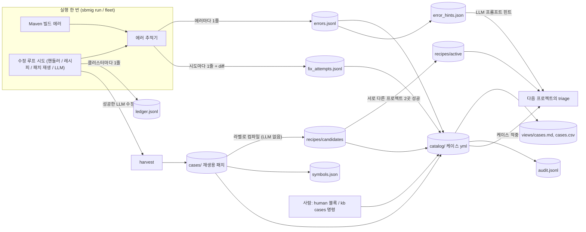
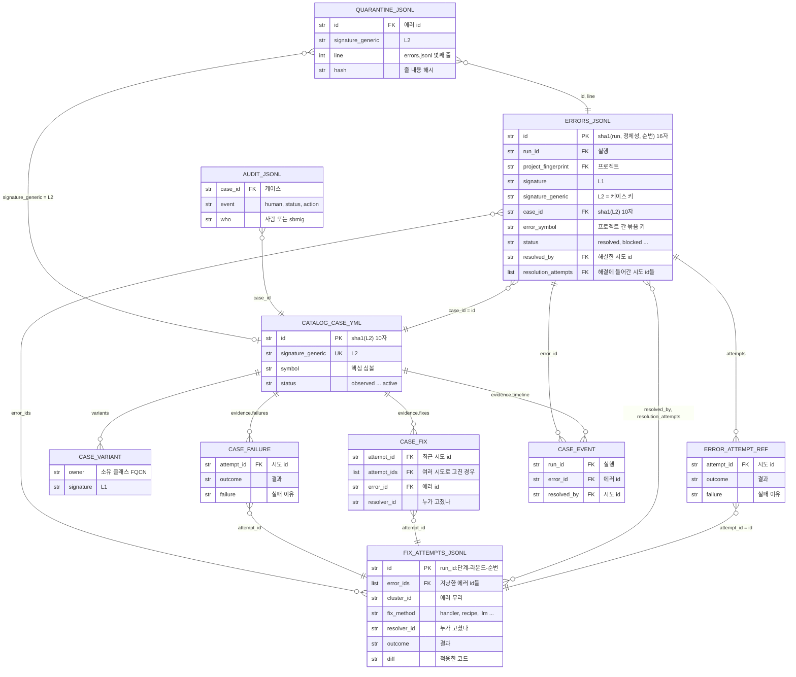
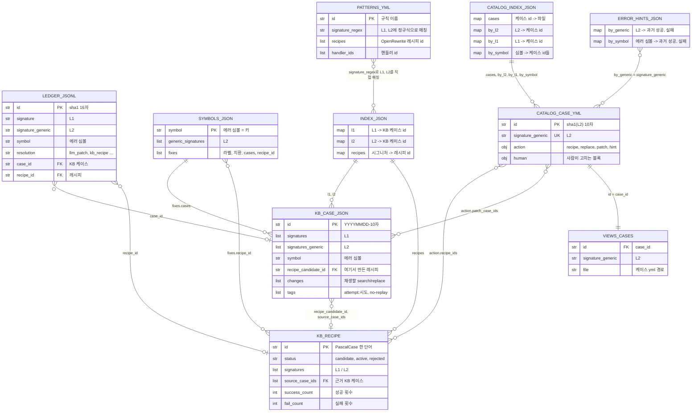
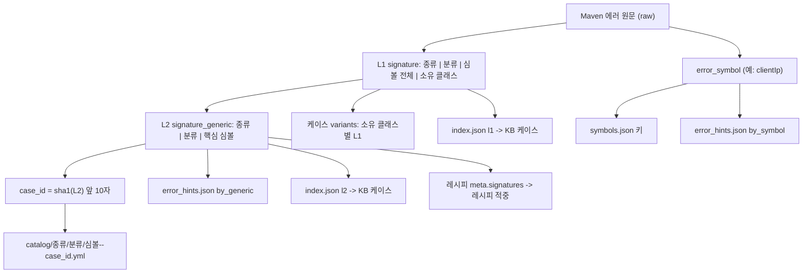
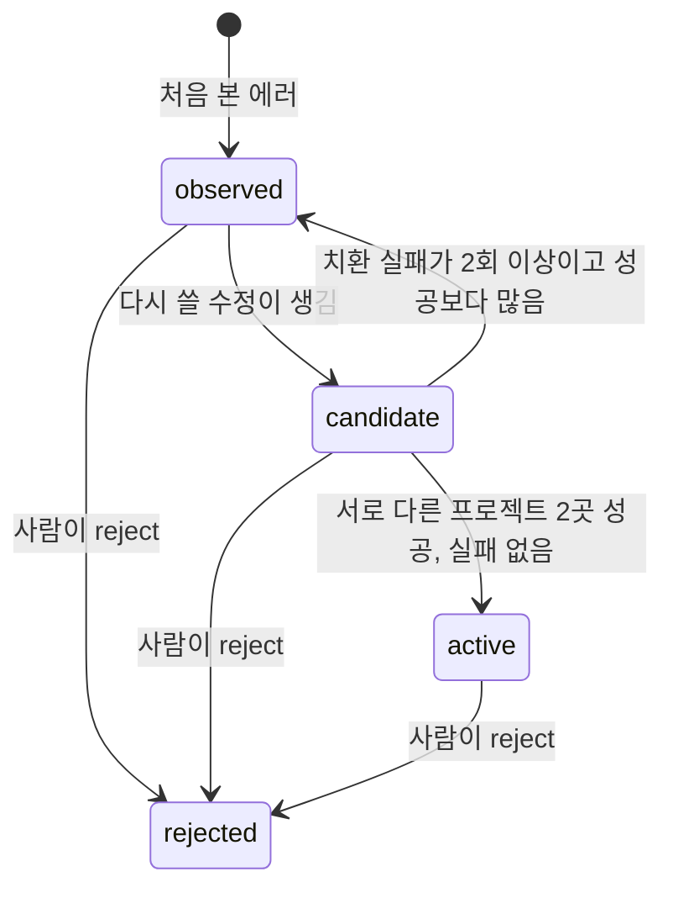
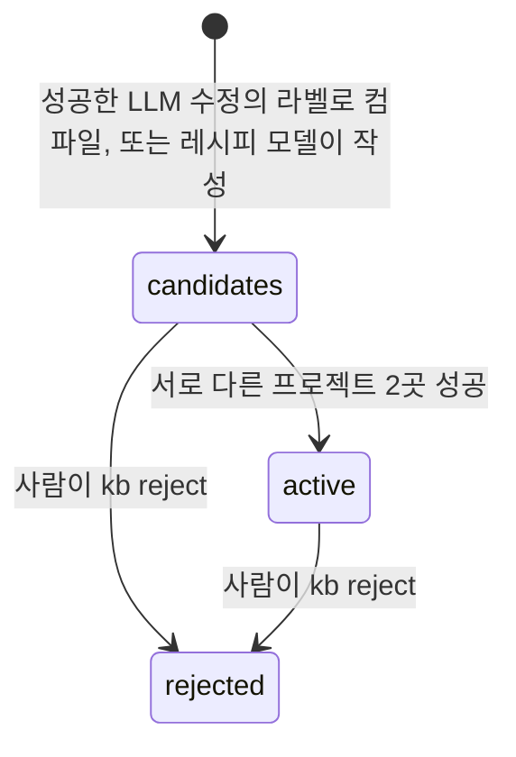

# sbmig KB 데이터 지도

> sbmig · 지식 베이스(KB) · 스키마 버전 2 (2026-10-26, round 10)

마이그레이션을 돌릴 때마다 `kb/` 폴더에 쌓이는 파일과 각 키의 뜻, 그리고 파일끼리 어떤 키로 이어지는지를 정리했습니다. 현업이 KB 데이터로 규칙을 만들 때 "이 값은 저 파일의 어느 키와 같다"를 찾는 용도입니다.

같은 내용의 HTML 판: [`index.html`](index.html) (인터넷 없이 열림, 원본 [`kb-map.html`](kb-map.html)). 이 Markdown의 Mermaid 다이어그램은 GitHub, VS Code(Mermaid 확장), Typora 등에서 그림으로 보입니다.

## 목차

1. [KB는 네 가지 층으로 나뉩니다](#layers)
2. [파일을 잇는 연결 키](#keys)
3. [데이터가 쌓이는 흐름](#flow)
4. [관계도 ① 실행 기록](#er-run)
5. [관계도 ② 재사용 지식](#er-know)
6. [시그니처 계층](#sig)
7. [상태 변화](#states)
8. [파일별 필드 사전](#fields)
9. [값 목록](#enums)
10. [자주 찾는 질문과 따라갈 키](#qa)

---

<a id="layers"></a>

## 1. KB는 네 가지 층으로 나뉩니다

| 층 | 파일 | 성격 |
|---|---|---|
| **사실 기록** | `errors.jsonl`, `fix_attempts.jsonl`, `ledger.jsonl` | 실행할 때마다 줄이 추가되고 이미 쓴 줄은 고치지 않습니다. 규칙을 만들 때 근거로 쓰는 원본 데이터입니다. |
| **재사용 지식** | `catalog/` 에러 케이스, `recipes/` OpenRewrite 레시피, `cases/` 재생용 패치, `patterns/` 사람이 쓴 규칙 | 다음 프로젝트에서 실제로 적용되는 지식입니다. 사람은 케이스 파일의 `human:` 블록만 고칩니다. |
| **파생 인덱스** | `index.json`, `symbols.json`, `error_hints.json`, `catalog/index.json`, `views/` | 위 두 층에서 계산한 검색용 사본입니다. `sbmig kb reindex`로 언제든 다시 만들 수 있으니 직접 고치지 않습니다. |
| **운영 파일** | `audit.jsonl` 변경 이력, `quarantine.jsonl` 읽지 못한 줄, `*.jsonl.corrupt`, `.lock` | 누가 언제 무엇을 바꿨는지, 깨진 줄은 무엇인지 남깁니다. 동시에 쓰지 않도록 잠금 파일도 둡니다. |

```text
kb/
├── errors.jsonl                         빌드 에러 1건 = 1줄 (ErrorCaseRecord)                       [사실 기록]
├── fix_attempts.jsonl                   수정 시도 1건 = 1줄, 실패 포함, 적용한 diff (FixAttemptRecord) [사실 기록]
├── ledger.jsonl                         에러 묶음(클러스터) 1건의 해결 방법 = 1줄 (ResolutionRecord)   [사실 기록]
├── catalog/<종류>/<분류>/<심볼>--<case_id>.yml   L2 시그니처 1개 = 케이스 1개 (CatalogCase)        [재사용 지식]
├── recipes/candidates|active|rejected/<레시피 id>.yml + .meta.json   (KBRecipe)                 [재사용 지식]
├── cases/YYYY-MM/<KB 케이스 id>.json     재생할 수 있는 LLM 패치 (KBCase)                          [재사용 지식]
├── patterns/*.yml                       사람이 쓴 매칭 규칙 (항상 켜짐)                             [재사용 지식]
├── index.json                           시그니처 → KB 케이스 / 레시피                              [파생 인덱스]
├── symbols.json                         에러 심볼 → 고친 방법 묶음                                  [파생 인덱스]
├── error_hints.json                     L2 / 에러 심볼 → 과거 성공·실패 (LLM 프롬프트 힌트)            [파생 인덱스]
├── catalog/index.json                   케이스 id → 파일, L2 / L1 / 심볼 → 케이스 id                [파생 인덱스]
├── views/cases.md, cases.csv            사람이 보는 케이스 표                                      [파생 인덱스]
├── audit.jsonl                          사람의 케이스 수정 + 자동 상태 변화                          [운영 파일]
├── quarantine.jsonl                     errors.jsonl에서 읽지 못한 줄의 메모                         [운영 파일]
├── *.jsonl.corrupt                      중간에 끊겨 반쯤 쓰인 마지막 줄을 옮겨 둔 곳                   [운영 파일]
└── .lock                                여러 프로세스가 동시에 쓰지 않게 하는 잠금                     [운영 파일]

kb.bak-<시각>/                            kb import --replace 전에 남기는 이전 KB 백업 (kb 폴더 옆)
<실행 폴더>/error_cases.jsonl, fix_attempts.jsonl, error_cases.csv   그 실행분만 따로 (같은 형식, CSV는 엑셀용)
```

<a id="keys"></a>

## 2. 파일을 잇는 연결 키

아래 키들이 서로 다른 파일에 같은 값으로 나타납니다. 조인할 때 이 키들을 씁니다. 예시는 실제 기록(e2e 픽스처 `boot2-fix-failures`)에서 가져왔습니다.

| 키 | 형식 / 만드는 법 | 예시 | 나오는 곳 |
|---|---|---|---|
| **run_id** | 실행 한 번. `run-YYYYMMDD-HHMMSS-<6자>` | `run-20261026-104410-78da18` | errors / fix_attempts / ledger의 `run_id`, 케이스 timeline의 `run_id`, 시도 id의 앞부분 |
| **project_fingerprint** | 프로젝트 하나. sha256(루트 artifactId \| pom 경로들) 앞 16자. 이름이 바뀌어도 pom 구조가 같으면 같은 값 | `83cb2456069393af` | 모든 기록의 `project_fingerprint`, symbols / hints의 `project_keys`, `projects`. 승격 기준인 "서로 다른 프로젝트 수"를 셀 때 씀 |
| **에러 id** (`errors.id`) | sha1(run_id \| 에러 정체성 \| 같은 에러 순번) 앞 16자. 실행마다 새 값 | `e6852dd17399adbe` | fix_attempts의 `error_ids[]`, 케이스의 `evidence.fixes[].error_id`, `timeline[].error_id` |
| **시도 id** (`fix_attempts.id`) | `<run_id>:<attempt_id>`. attempt_id = `<단계>-<라운드>-<순번>` | `run-20261026-104410-78da18:spring-2-1` | errors의 `resolved_by`, `resolution_attempts[]`, `attempts[].attempt_id`. 케이스의 `fixes[].attempt_id`, `attempt_ids[]`, `failures[].attempt_id`. KB 케이스 `tags`의 `attempt:<attempt_id>`(run_id 없이) |
| **L1** (`signature`) | 구체 시그니처. `종류\|분류\|심볼 전체\|소유 클래스` | `compile\|cannot_find_symbol\|method clientIp(jakarta.servlet.http.HttpServletRequest)\|class com.company.legacy.web.LegacyRequestHelper` | errors / ledger의 `signature`, KB 케이스 `signatures[]`, 레시피 meta `signatures[]`, `index.json`의 `l1`, 케이스 `variants[].signature`, `catalog/index.json`의 `by_l1` |
| **L2** (`signature_generic`) | 일반화한 시그니처. `종류\|분류\|핵심 심볼`. 프로젝트마다 다른 부분(경로, 줄, 프로젝트 클래스)은 빠짐. **케이스의 키** | `compile\|cannot_find_symbol\|clientIp` | errors / ledger의 `signature_generic`, KB 케이스 `signatures_generic[]`, 레시피 meta `signatures[]`, `index.json`의 `l2` · `recipes`, `error_hints.json`의 `by_generic`, 케이스 파일의 `signature_generic`, `catalog/index.json`의 `by_l2`, symbols의 `generic_signatures[]` |
| **case_id** | 케이스 하나. sha1(L2) 앞 10자. L2가 같으면 프로젝트가 달라도 같은 값 | `8bb4fd4a4a` | errors의 `case_id`, 케이스 파일 이름 끝(`clientIp--8bb4fd4a4a.yml`)과 `id`, `catalog/index.json`, `audit.jsonl`의 `case_id`, 학습 치환의 resolver id(`case-replace:<case_id>:…`) |
| **error_symbol** | 프로젝트를 넘어 같은 원인을 묶는 짧은 키. 메서드·클래스·패키지·아티팩트 이름 | `clientIp` | errors의 `error_symbol`, ledger / KB 케이스의 `symbol`, `symbols.json`의 키, `error_hints.json`의 `by_symbol`, 케이스의 `symbol`, `catalog/index.json`의 `by_symbol` |
| **KB 케이스 id** (`cases/…json`) | 재생용 패치 하나. `YYYYMMDD-<10자>` | `20261026-cadcc69bb2` | 파일 이름, `index.json` l1/l2의 값, 레시피 meta `source_case_ids[]`, symbols `fixes[].cases[]`, ledger `case_id`, 케이스 `action.patch_case_ids[]`, 패치 재생 시도의 `resolver_id` |
| **레시피 id** | OpenRewrite 레시피 하나. 점 없는 PascalCase 한 단어 | `LegacyRequestHelperClientIpToRemoteClientIp` | 파일 이름과 yml의 `name`, KB 케이스 `recipe_candidate_id`, `index.json`의 `recipes`, symbols `fixes[].recipe_id`, ledger `recipe_id`, 케이스 `action.recipe_ids[]`, 레시피 시도의 `resolver_id` |
| **resolver_id** | "누가 고쳤나". 방법(`fix_method`)에 따라 값이 다름: 핸들러 id / 레시피 id들(쉼표) / KB 케이스 id들 / LLM 모델 이름 / `case-replace:<case_id>:<치환 쌍 해시 8자>` | `gpt-6-luna` | errors / fix_attempts / ledger의 `resolver_id`, 케이스의 `fixes[].resolver_id`, hints의 `resolver` |
| **cluster_id** | 한 빌드에서 같은 파일·종류로 묶은 에러 무리. `<종류>:<8자>` | `compile:5e0f2951` | fix_attempts의 `cluster_id` (실행 폴더의 journal에서 같은 값으로 결정 과정을 찾을 수 있음) |

<a id="flow"></a>

## 3. 데이터가 쌓이는 흐름

빌드 에러 하나가 기록되고, 고친 방법이 다음 프로젝트에서 다시 쓰이기까지의 경로입니다. 원통 모양이 `kb/` 안의 파일입니다.



<a id="er-run"></a>

## 4. 관계도 ① 실행 기록: 에러 · 시도 · 케이스

한 실행에서 생긴 에러와 시도, 그리고 그것들을 L2 기준으로 모은 케이스의 관계입니다. 선의 글자가 연결에 쓰이는 키입니다. PK = 그 파일의 고유 키, FK = 다른 파일을 가리키는 키.

| 엔티티 이름 | 파일 |
|---|---|
| `ERRORS_JSONL` | `errors.jsonl` 에러 1건 |
| `ERROR_ATTEMPT_REF` | `errors.jsonl`의 `attempts[]` 시도 이력 |
| `FIX_ATTEMPTS_JSONL` | `fix_attempts.jsonl` 시도 1건 |
| `CATALOG_CASE_YML` | `catalog/…/<심볼>--<case_id>.yml` 케이스 |
| `CASE_VARIANT` / `CASE_FIX` / `CASE_FAILURE` / `CASE_EVENT` | 케이스 파일의 `variants[]` / `evidence.fixes[]` / `evidence.failures[]` / `evidence.timeline[]` |
| `AUDIT_JSONL` | `audit.jsonl` 변경 이력 |
| `QUARANTINE_JSONL` | `quarantine.jsonl` 읽지 못한 줄의 메모 |



<a id="er-know"></a>

## 5. 관계도 ② 재사용 지식: 패치 · 레시피 · 인덱스

다음 프로젝트에서 실제로 적용되는 지식과, 그것을 빨리 찾기 위한 인덱스의 관계입니다. 케이스의 `action`이 레시피나 패치를 가리키면, 케이스가 적중했을 때 그것이 적용됩니다.

| 엔티티 이름 | 파일 |
|---|---|
| `KB_CASE_JSON` | `cases/YYYY-MM/<KB 케이스 id>.json` 재생용 패치 |
| `KB_RECIPE` | `recipes/<상태>/<레시피 id>.yml` + `.meta.json` |
| `LEDGER_JSONL` | `ledger.jsonl` 클러스터 해결 1건 |
| `SYMBOLS_JSON`, `INDEX_JSON`, `ERROR_HINTS_JSON`, `CATALOG_INDEX_JSON` | 같은 이름의 파생 인덱스 |
| `CATALOG_CASE_YML` | 케이스 파일 |
| `VIEWS_CASES` | `views/cases.csv`, `views/cases.md`의 케이스 한 줄 |
| `PATTERNS_YML` | `patterns/*.yml` 사람이 쓴 규칙 |



> 그림 ①과 ②에 `kb/`의 모든 기록 파일이 들어 있습니다. 키로 다른 파일과 이어지지 않는 운영 파일 `.lock`(쓰기 잠금), `*.jsonl.corrupt`(반쯤 쓰인 줄), `kb.bak-<시각>/`(`kb import --replace` 전 백업)만 그림에서 뺐습니다. 실행 폴더(`out/<run id>/`의 `journal.jsonl`, `report.json`, `plan.json`, `changes.patch` 등)와 플릿 폴더(`state.json`, `summary.*`)는 KB가 아니라 이 지도에 넣지 않았습니다. 다만 실행 폴더의 `error_cases.jsonl`, `fix_attempts.jsonl`, `error_cases.csv`는 KB의 같은 이름 파일과 형식이 같습니다.

<a id="sig"></a>

## 6. 시그니처 계층: 에러 하나가 여러 키가 되는 과정

같은 에러가 어느 정도로 "같은지"에 따라 키가 셋입니다. 케이스를 찾을 때는 L1 → L2 → 에러 심볼 순서로 맞춰 봅니다.



| 키 | 예시 (같은 에러) | 얼마나 같은가 |
|---|---|---|
| L1 | `compile\|cannot_find_symbol\|method clientIp(jakarta.servlet.http.HttpServletRequest)\|class com.company.legacy.web.LegacyRequestHelper` | 메서드 인자와 소유 클래스까지 같은 에러. 케이스 안에서 `variants`로 나뉨 |
| L2 | `compile\|cannot_find_symbol\|clientIp` | 같은 이름이 같은 이유로 없는 에러. **케이스 하나** = L2 하나 |
| case_id | `8bb4fd4a4a` | L2의 짧은 이름(해시). 파일 이름과 CSV에서 씀 |
| error_symbol | `clientIp` | 가장 넓은 묶음. 종류가 달라도 같은 심볼이면 모임 |

> L2 규칙: 패키지 에러는 패키지 이름 전체(`javax.xml.bind`와 `javax.xml.ws`는 다른 케이스), 메서드 재정의 오류 등은 메서드·클래스 이름까지, 플러그인 실행 오류는 goal과 원인 문구까지 넣습니다. 프로젝트 경로, 줄 번호, 프로젝트 고유 클래스 이름은 넣지 않습니다.

<a id="states"></a>

## 7. 상태 변화: 케이스와 레시피

### 케이스 (`catalog/*.yml`의 `status`)



사람이 `human:` 블록의 `status`나 `action`을 정하면 자동 값보다 우선합니다. 상태가 바뀔 때마다 `audit.jsonl`에 한 줄이 남습니다.

### 레시피 (`recipes/` 폴더)



승격 기준 프로젝트 수는 설정 `kb.auto_promote_after_projects`(기본 2)입니다. 성공·실패 횟수는 레시피의 `.meta.json`에 쌓입니다.

<a id="fields"></a>

## 8. 파일별 필드 사전

**굵게** 쓴 키는 다른 파일과 이어지는 키입니다. 모든 레코드에 `schema_version`(현재 2, 없으면 1 = 2026-10-26 이전)과 `agent_version`(기록한 sbmig 버전)이 붙습니다.

### errors.jsonl — 빌드 에러 1건 = 1줄 (ErrorCaseRecord)

한 빌드에 에러가 N개면 N줄입니다. 경로는 프로젝트 기준 상대 경로이고, 비밀값은 가려집니다.

| 키 | 뜻 | 예시 / 값 |
|---|---|---|
| *누구의 어떤 에러인가* | | |
| **id** | 에러 기록 id. sha1(run_id \| 에러 정체성 \| 같은 에러 순번) 앞 16자 | `e6852dd17399adbe` |
| at | 기록 시각 (UTC) | `2026-10-26T01:45:12Z` |
| project | 프로젝트 폴더 이름 | `member-api` |
| **project_fingerprint** | 프로젝트 식별 해시 (2절) | `83cb2456069393af` |
| **run_id** | 실행 id | `run-20261026-104410-78da18` |
| case_type | 프로젝트 유형 (9절) | `spring_boot` |
| **case_id** | 이 에러가 속한 케이스. sha1(L2) 앞 10자 | `8bb4fd4a4a` |
| asis_java / asis_spring_boot / asis_spring | 마이그레이션 전 Java / Boot / Spring 버전 | `1.8` / `2.7.18` / `5.3.31` |
| packaging | as-is 패키징 | `jar`, `war` |
| *에러 자체* | | |
| error_kind | 에러 종류 (9절) | `compile` |
| message | 에러 메시지 첫 줄 | `cannot find symbol` |
| file / line | 에러가 난 파일과 줄 | `src/main/java/…/ClientIpFilter.java` / `24` |
| symbol / location | javac의 `symbol:`, `location:` 줄 | `method clientIp(…)` / `class …LegacyRequestHelper` |
| module | Maven 모듈 (artifactId) | `member-api-comp` |
| artifact | 의존성 해석 에러의 g:a[:v] | `com.example:lib:1.0.0` |
| **signature** | L1 시그니처 (6절) | `compile\|cannot_find_symbol\|method …\|class …` |
| **signature_generic** | L2 시그니처 = 케이스 키 | `compile\|cannot_find_symbol\|clientIp` |
| **error_symbol** | 프로젝트 간 묶음 키 | `clientIp` |
| raw | Maven 로그의 에러 원문 (최대 2,000자) | `[ERROR] …ClientIpFilter.java:[24,26] cannot find symbol …` |
| *실행 안에서의 경과* (빌드 이름 = `<단계>-<번호>`, 최종 빌드 = `verify-final`) | | |
| first_seen / first_phase | 처음 나온 빌드와 단계 | `spring-1` / `spring` |
| last_seen / builds_present | 마지막으로 보인 빌드, 보인 빌드 수 | `spring-2` / `2` |
| **introduced_by** | 이 에러가 처음 나오기 직전에 그 파일을 바꾼 시도 id, 또는 `step:<plan 단계>` | `step:spring.rewrite` |
| *해결된 경우* | | |
| status | 최종 상태 (9절) | `resolved` |
| resolved_at / resolved_phase | 사라진 빌드와 단계 | `spring-3` / `spring` |
| fix_method | 고친 방법 (9절) | `llm` |
| **resolver_id** | 누가 고쳤나 (2절) | `gpt-6-luna` |
| **resolved_by** | 해결한 시도 id (`fix_attempts.id`), 또는 `step:<단계 id>` | `run-…:spring-2-1` |
| **resolution_attempts** | 해결에 함께 들어간 시도 id 전부, 실행 순서. 앞 시도가 import를 추가하고 뒤 시도가 호출을 고친 경우 둘 다 들어감 | `["run-…:spring-1-2", "run-…:spring-2-1"]` |
| targeted | 해결한 시도가 이 에러를 직접 겨냥했나 | `true` |
| description | 어떻게 해결했나 (해결 시) / 무엇을 시도했나 (미해결 시) | `LLM gpt-6-luna: rename the call …` |
| change_kind | 바뀐 코드의 형태. 해결에 들어간 시도 전부를 합쳐 판정 (9절) | `text_replace` |
| replace_pairs | 단순 치환이면 바뀐 쌍 `[{old, new, count, files}]`. 패키지 이름은 패키지 단위로 남음 | `[{"old":"clientIp","new":"remoteClientIp"}]` |
| fix_labels | 수정의 종류 라벨 (9절) | `["method-rename"]` |
| diff_excerpt | 이 에러 파일의 해결 diff. 시도마다 한 구역, 에러 줄에 가까운 hunk (구역당 최대 1,500자) | `@@ -21,7 +21,7 @@ …` |
| replace_rule_candidate | LLM이 순수 텍스트 치환만으로 고침 → 규칙으로 바꿀 후보 | `true` |
| *해결되지 않은 경우* | | |
| failure_reason | 왜 못 고쳤나 (마지막 시도의 결과와 이유) | `llm attempt spring-1-2 no_change: …` |
| problem_errors | 마지막 시도를 실패하게 만든 에러 `"file:line message"` | `["…Filter.java:24 cannot find symbol"]` |
| block_reason / suggestion | BLOCKED 이유와 사람에게 주는 제안 | `repeated_failure` / … |
| *시도 이력* | | |
| **attempts[]** | 이 에러를 겨냥한 시도의 요약, 순서대로: `attempt_id`(= 시도 id), `phase`, `iteration`, `fix_method`, `resolver_id`, `outcome`, `failure`, `change_kind` | `[{"attempt_id":"run-…:spring-1-1","outcome":"apply_failed", …}]` |
| attempt_count / llm_attempts | 시도 수 / 그중 LLM 시도 수 | `2` / `2` |
| notes | 추적기의 메모 (다시 나타남, 가려짐, 비밀값 가림 `redacted: …` 등) | `["resolved by 2 attempts …"]` |

### fix_attempts.jsonl — 수정 시도 1건 = 1줄 (FixAttemptRecord)

성공·실패 모두 남고, 적용한 코드가 들어 있습니다.

| 키 | 뜻 | 예시 / 값 |
|---|---|---|
| **id** | 시도 id `<run_id>:<attempt_id>` | `run-20261026-104410-78da18:spring-1-1` |
| attempt_id | 실행 안의 시도 이름 `<단계>-<라운드>-<순번>` | `spring-1-1` |
| at / project / **project_fingerprint** / **run_id** / case_type | errors.jsonl과 같음 | |
| phase / iteration | 단계와 그 단계의 수정 라운드 | `spring` / `1` |
| **cluster_id** | 이 시도가 다룬 에러 무리 | `compile:5e0f2951` |
| **error_ids[]** | 이 시도가 겨냥한 에러 기록 id들 (`errors.id`) | `["e6852dd17399adbe"]` |
| fix_method | 방법 (9절) | `llm` |
| **resolver_id** | 누가 (2절) | `gpt-6-luna` |
| model | LLM 모델 이름 (LLM 시도만) | `gpt-6-luna` |
| outcome | 결과 (9절) | `apply_failed` |
| applied | 코드에 실제로 적용됐나 | `false` |
| description | 무엇을 했나 (핸들러 설명 / LLM 분석 / 레시피 / 케이스) | `LLM gpt-6-luna: …` |
| failure | 왜 실패했나 (성공이면 빈 값) | `…ClientIpFilter.java block 1: search text not found` |
| introduced_errors[] | 이 시도 뒤 고친 파일에 새로 생긴 에러 | `["…:31 incompatible types …"]` |
| remaining_errors[] | 다시 빌드한 뒤에도 남은 겨냥 에러 | |
| diff / diff_truncated | 적용한 git diff (적용 못 했으면 LLM 제안). 분류는 자르기 전 전체로 함 | `diff --git a/… b/…` |
| change | diff의 형태: `change_kind`, `replace_pairs[]`, `file_types[]`, `files[]`, `lines_added`, `lines_removed` | `{"change_kind":"text_replace", …}` |
| fix_labels / replacement | 수정 라벨과 "옛 → 새" 요약 | `["method-rename"]` / `LegacyRequestHelper.clientIp → remoteClientIp` |
| llm_calls / input_tokens / output_tokens | 이 시도의 LLM 호출 수와 토큰 | `2` / `5120` / `830` |
| advisory_ids[] | 프롬프트에 넣은 라이브러리 지침 | `["jdk-generified-apis"]` |
| notes | 채점 메모 (`partial: …`, `inconclusive: …`, `resolver: case-replace:…` 등) | |

### ledger.jsonl — 에러 묶음(클러스터) 1건이 어떻게 끝났나 = 1줄 (ResolutionRecord)

플릿 학습 보고서(`sbmig kb learning`)의 원본입니다.

| 키 | 뜻 | 예시 / 값 |
|---|---|---|
| id | sha1(run_id, 단계, 시도, 클러스터, 결과) 앞 16자 | `6aed599178c7abbb` |
| at / project / **project_fingerprint** / **run_id** / case_type / phase | errors.jsonl과 같음 | |
| **signature** / **signature_generic** | 클러스터 첫 에러의 L1 / L2 | `compile\|cannot_find_symbol\|clientIp` |
| error_kind | 에러 종류 | `compile` |
| **symbol** | 에러 심볼 (= errors의 error_symbol) | `clientIp` |
| resolution | 어떻게 끝났나 (9절) | `llm_patch` |
| **resolver_id** | 핸들러 id / 레시피 id / KB 케이스 id / BLOCK 이유 | `gpt-6-luna` |
| fix_labels / replacement | 수정 라벨 / "옛 → 새" | |
| outcome | `improved` / `build_ok` / `blocked` / `unresolved` | `improved` |
| files[] | 바뀐 파일 이름 (경로 없이) | `["ClientIpFilter.java"]` |
| **case_id** | 만들었거나 재사용한 **KB 케이스 id** (카탈로그 case_id와 다름에 주의) | `20261026-cadcc69bb2` |
| **recipe_id** | 사용했거나 만든 레시피 id | `LegacyRequestHelperClientIpToRemoteClientIp` |
| model / notes | LLM 모델 / 메모 | |

### catalog/&lt;종류&gt;/&lt;분류&gt;/&lt;심볼&gt;--&lt;case_id&gt;.yml — L2 하나 = 케이스 하나 (CatalogCase)

맨 위 `human:` 블록만 사람이 고칩니다. 나머지는 실행할 때마다, `sbmig kb reindex` 때 errors.jsonl에서 다시 계산합니다.

| 키 | 뜻 | 예시 / 값 |
|---|---|---|
| **id** | case_id = sha1(L2) 앞 10자 | `8bb4fd4a4a` |
| **signature_generic** | 이 케이스의 L2 | `compile\|cannot_find_symbol\|clientIp` |
| *human: 사람이 고치는 블록 (자동 값보다 항상 우선, 자동 갱신이 덮어쓰지 않음)* | | |
| human.name | 사람이 붙인 이름 | `null` |
| human.status | 상태를 사람이 고정 (예: `rejected`) | `null` |
| human.action | 적용할 동작을 사람이 고정 (`kb cases pin`). 수정 루프가 그대로 따름 | `{kind: handler, handler_id: …}` |
| human.hints / human.notes | LLM에 줄 힌트 / 메모 | |
| *자동 계산 부분* | | |
| name | 자동 이름 "소유 클래스.심볼 — 에러" | `LegacyRequestHelper.clientIp — cannot find symbol` |
| status | 케이스 상태 (7절, 9절) | `candidate` |
| action.kind | 적중했을 때 하는 일 (9절) | `recipe` |
| **action.recipe_ids[]** | 실행할 KB 레시피 id | `["LegacyRequestHelperClientIpToRemoteClientIp"]` |
| action.replace_pairs[] / replace_scope | 학습된 텍스트 치환 쌍 / 범위(에러 줄 + import 줄, 또는 파일 전체) | `[{old: clientIp, new: remoteClientIp}]` / `error-lines` |
| **action.patch_case_ids[]** | 재생할 KB 케이스 id | |
| action.handler_id / block_reason / suggestion | 사람이 고정한 핸들러 / 막는 이유와 제안 | |
| hints[] | LLM 프롬프트에 들어가는 힌트 (가장 좋은 수정, 가장 잦은 실패) | `past runs: fixed by llm …` / `past failure ×2 …` |
| error_kind / error_class / **symbol** | L2의 세 부분 | `compile` / `cannot_find_symbol` / `clientIp` |
| variants[] | 소유 클래스별 변형: `owner`, **signature**(L1), `seen`, `projects` | `[{owner: com.company…LegacyRequestHelper, …}]` |
| evidence.seen / projects / runs | 본 에러 기록 수 / 프로젝트 수 / 실행 수 | `2` / `1` / `1` |
| evidence.first_at / last_at | 처음 / 마지막 본 시각 | |
| evidence.by_status / resolved_by | 상태별 수 / 방법별 해결 수 | `{resolved: 1, blocked: 1}` / `{llm: 1}` |
| evidence.fixes[] | 성공한 방법 상위 5개: `method`, `resolver_id`, `change_kind`, `replace_pairs`, `description`, **attempt_id**, **attempt_ids**, **error_id**, `project`, `at`, `count`, `projects` | |
| evidence.failures[] | 실패한 방법 상위 5개: `method`, `outcome`, `failure`, **attempt_id**, `project`, `count`, `projects` | |
| evidence.timeline[] | 최근 20건, 오래된 순: `at`, `project`, **run_id**, **error_id**, `file`, `status`, `fix_method`, `attempts`("방법:결과" 순서), **resolved_by** | `llm:apply_failed → llm:improved` |
| evidence.action_successes / action_failures / action_projects | 이 케이스의 학습 치환이 직접 성공·실패한 횟수와 성공한 프로젝트들 (승격 판단) | `0` / `0` / `[]` |
| updated_at | 마지막으로 다시 계산한 시각 | |

### recipes/&lt;상태&gt;/&lt;레시피 id&gt;.yml + .meta.json — OpenRewrite 레시피 (KBRecipe)

yml은 레시피 본문, `.meta.json`은 근거와 성적입니다.

| 키 (.meta.json) | 뜻 | 예시 / 값 |
|---|---|---|
| **id** | 레시피 이름 = yml의 `name` = 파일 이름 | `LegacyRequestHelperClientIpToRemoteClientIp` |
| status / path | `candidate` / `active` / `rejected`, yml 위치 | `candidate` |
| description | 무엇을 바꾸는지, 어디서 왔는지 | `method-rename: … Compiled from KB case 20261026-cadcc69bb2 labels (no LLM) …` |
| **signatures[]** | 이 레시피가 적중하는 L1 / L2 | `["compile\|cannot_find_symbol\|clientIp", …]` |
| **source_case_ids[]** | 근거가 된 KB 케이스 id | `["20261026-cadcc69bb2"]` |
| created_at / promoted_at | 만든 시각 / active가 된 시각 | |
| success_count / fail_count / projects[] | 적용 성적과 성공한 프로젝트 (승격 판단) | `0` / `1` / `[]` |

yml 본문은 OpenRewrite 선언형 레시피입니다(`type`, `name`, `displayName`, `description`, `recipeList`). `recipeList`에는 허용된 기본 레시피(`ChangeMethodName`, `ChangeType`, `AddDependency` 등)만 들어갑니다.

### cases/YYYY-MM/&lt;KB 케이스 id&gt;.json — 재생할 수 있는 LLM 패치 (KBCase)

같은 코드가 다시 나오면 LLM 없이 다시 적용합니다.

| 키 | 뜻 | 예시 / 값 |
|---|---|---|
| **id** | KB 케이스 id `YYYYMMDD-<10자>` | `20261026-cadcc69bb2` |
| created_at / project / **project_fingerprint** | 만든 시각과 프로젝트 | |
| **symbol** / symbol_owner | 에러 심볼 / 그 심볼을 가진 클래스 FQCN (메서드 이름 변경 레시피에 필요) | `clientIp` / `com.company.legacy.web.LegacyRequestHelper` |
| fix_labels / replacement | 수정 라벨 / "옛 → 새" | `["method-rename"]` / `LegacyRequestHelper.clientIp → remoteClientIp` |
| case_type / phase / error_kind | 프로젝트 유형 / 단계 / 에러 종류 | |
| **signatures[]** / **signatures_generic[]** | L1 / L2 목록 | |
| errors[] | 당시 에러들 (kind, message, file, line, symbol, location, module, signature …) | |
| fix_kind | `llm_patch` / `handler` / `recipe` / `manual` | `llm_patch` |
| changes[] | 재생할 편집: `path`, `op`(modify / create / delete / rename), `search`, `replace`, `content`, `new_path`. 변경 전 코드(`search`)가 글자 그대로 있을 때만 재생 | |
| summary / outcome / model | 요약 / 당시 결과 / LLM 모델 | |
| reuse_count / reuse_projects[] | 재생된 횟수와 프로젝트 | `0` |
| **recipe_candidate_id** | 이 케이스에서 만든 레시피 id | `LegacyRequestHelperClientIpToRemoteClientIp` |
| **tags[]** | `attempt:<attempt_id>`(이 패치를 만든 시도), `no-replay:redacted`(비밀값이 섞여 재생 안 함) | `["attempt:spring-2-1"]` |

### 파생 인덱스 — index.json · symbols.json · error_hints.json · catalog/index.json · views/

검색용 사본입니다. `sbmig kb reindex`로 다시 만듭니다.

| 파일 · 키 | 뜻 | 값 모양 |
|---|---|---|
| ***index.json*** (KB 케이스와 레시피 찾기) | | |
| **l1** / **l2** | L1 / L2 → KB 케이스 id 목록 | `{"compile\|cannot_find_symbol\|clientIp": ["20261026-cadcc69bb2"]}` |
| **recipes** | 시그니처 → 레시피 id 목록 | `{"compile\|…\|clientIp": ["LegacyRequest…"]}` |
| version / updated_at | 형식 버전 / 갱신 시각 | `1` |
| ***symbols.json*** (에러 심볼별로 고친 방법 묶음) | | |
| **&lt;심볼&gt;** | 최상위 키 = 에러 심볼 | `"clientIp": {…}` |
| error_kind / **generic_signatures[]** | 에러 종류 / 이 심볼이 나온 L2 | |
| fixes[] | `labels`, `replacement`, `projects`, `project_keys`(지문), **cases**(KB 케이스 id), **recipe_id** | `[{"labels":["method-rename"], "cases":["20261026-…"], …}]` |
| ***error_hints.json*** (LLM 프롬프트 힌트: 과거 성공과 실패) | | |
| **by_generic** / **by_symbol** | L2 / 에러 심볼 → 항목 | |
| 항목.seen / projects / resolved / unresolved / blocked | 본 수 / 프로젝트 지문들 / 방법별 해결 수 / 미해결 수 / BLOCKED 수 | |
| 항목.fixes[] / failures[] | 상위 3개 성공(`method`, `resolver`, `change_kind`, `description`, `replace_pairs`, `count`, `projects`) / 실패(`method`, `outcome`, `failure`, `count`). 프로젝트 수가 많은 순 | |
| 항목.variants | 위 순위의 근거 목록 (키당 최대 25개) | |
| ***catalog/index.json*** (케이스 찾기, 적중 순서 L1 → L2 → 심볼) | | |
| **cases** | 케이스 id → yml 파일 경로 | `{"8bb4fd4a4a": "compile/cannot_find_symbol/clientIp--8bb4fd4a4a.yml"}` |
| **by_l2** / **by_l1** / **by_symbol** | L2 / L1 → 케이스 id, 심볼 → 케이스 id 목록 | |
| ***views/cases.md, views/cases.csv*** (사람이 보는 표, 엑셀용) | | |
| 열 | `id, name, status, action, seen, projects, resolved_by, latest_fix, top_failure, runs, first_at, last_at, error_kind, error_class, symbol, signature_generic, human, file` | |

### 운영 파일 — audit.jsonl · quarantine.jsonl · *.jsonl.corrupt · .lock · patterns/

| 파일 · 키 | 뜻 | 예시 / 값 |
|---|---|---|
| ***audit.jsonl*** (케이스 변경 1건 = 1줄) | | |
| at / schema_version / agent_version | 시각과 버전 | |
| event | `human`(사람이 kb cases 명령이나 yml로 수정) / `status` · `action`(자동 변화) | `status` |
| who | OS 사용자 이름, 자동이면 `sbmig` | `sbmig` |
| **case_id** / **signature_generic** | 어느 케이스 | `8bb4fd4a4a` |
| command / fields | 사람이 실행한 명령 / 바뀐 human 필드 (human만) | `pin --action handler:…` / `["action"]` |
| reason | 자동 변화의 이유: created / promoted / demoted / action changed … | `promoted` |
| before / after | 바뀌기 전과 후 (상태, 동작) | `{status: candidate}` → `{status: active}` |
| evidence | 그때의 근거 수: `seen`, `projects`, `action_successes`, `action_failures`, `action_projects` | |
| ***quarantine.jsonl*** (errors.jsonl에서 읽지 못한 줄의 메모) | | |
| at / file / line / id / signature_generic / hash / reason | 언제, 어느 파일 몇째 줄, 그 줄의 id와 L2, 내용 해시, 이유. 이런 줄이 있는 케이스는 다시 계산할 때 지우지 않음 | `does not validate` |
| ***그 밖*** | | |
| *.jsonl.corrupt | 프로세스가 쓰다 죽어서 반쯤 남은 마지막 줄. 다음 기록 전에 여기로 옮겨 원본은 깨끗하게 유지 | `errors.jsonl.corrupt` |
| .lock | 쓰는 동안 잡는 잠금 (pid, host, 시각, 토큰). 웹·플릿·kb 명령이 같은 KB를 써도 안전. 300초가 지나거나 프로세스가 없으면 무시 | |
| patterns/*.yml | 사람이 쓴 규칙: `id`, `match.signature_regex`, `recipes`, `hints`, `handler_ids`. 항상 켜져 있음 | |

<a id="enums"></a>

## 9. 값 목록

| 키 | 값과 뜻 |
|---|---|
| status (errors) | `resolved` 이 에러를 겨냥했거나 그 파일을 고친 시도 뒤에 사라짐 · `resolved_indirectly` 사라졌지만 겨냥한 시도 없음(pom 수정, 다른 파일 수정, plan 단계) · `blocked` 끝까지 남고 BLOCKED 항목이 덮음 · `unresolved` 끝까지 남음 · `not_visible` 마지막 빌드가 그 단계 전에 멈춰 알 수 없음 |
| fix_method | `handler` 결정적 핸들러 · `recipe` OpenRewrite 레시피 · `kb_patch` KB 패치 재생 · `llm` LLM · `plan_step` 수정 루프 밖의 plan 단계(rewrite, restructure, 선제 핸들러) · `none` 없음 |
| outcome (시도) | `build_ok` 빌드 성공 · `improved` 겨냥한 에러가 사라짐 · `partial` 일부만 사라짐(진전, 실패로 안 셈) · `no_change` 그대로 · `regressed` 새 에러를 만듦 · `reverted` 되돌림 · `apply_failed` 코드에 적용 못 함 · `inconclusive` 빌드가 판정할 수 없었음(타임아웃 등, 성공·실패 어느 쪽도 아님) · `pending` 채점 전 · `blocked` |
| change_kind | `text_replace` 토큰 치환만 · `code_edit` 줄 추가·삭제·구조 변경 · `mixed` 둘 다 · `file_create` / `file_delete` / `file_rename` · `none` |
| status (케이스) | `observed` 본 적만 있음 · `candidate` 다시 쓸 수정 있음 · `active` 검증됨 · `rejected` 사람이 막음 |
| action.kind (케이스) | `recipe` KB 레시피 실행 · `replace` 학습된 텍스트 치환(핸들러 case-replace) · `patch` KB 패치 재생 · `hint` LLM 힌트만 · `handler` / `block` 사람이 고정 |
| resolution (ledger) | `handler` · `plan_recipe` plan의 레시피 · `kb_recipe` · `kb_patch` · `llm_patch` · `optional_bump` 사내 선택 아티팩트 버전 올림 · `blocked` · `unresolved` · `advisory` 라이브러리 지침 |
| error_kind | `compile` · `test_compile` · `dependency_resolution` · `plugin_resolution` · `parent_resolution` · `plugin_execution` · `enforcer` · `pom_invalid` · `rewrite` · `test_failure` · `unknown` |
| case_type | `pure_java` · `spring_legacy`(Boot 없는 Spring 4/5) · `spring_boot` · `servlet_tomcat` · `msa` · `unknown` |
| phase | `jdk21` · `spring` · `restructure` · `verify` (그 밖 intake, analyze, plan, report) |
| fix_labels | `import-rename` · `type-rename` · `package-rename` · `annotation-replace` · `method-rename` · `method-signature-adapt` · `override-signature` · `dependency-add` · `dependency-replace` · `dependency-remove` · `dependency-version` · `plugin-version` · `pom-property` · `spring-property-rename` · `config-value` · `remove-code` · `add-code` · `generic-rewrite`. 기계적인 라벨(이름 변경, 의존성 변경 등)만 레시피로 컴파일됨 |

<a id="qa"></a>

## 10. 자주 찾는 질문과 따라갈 키

**이 에러는 어떻게 고쳤나?**
1. `errors.jsonl`에서 `status = resolved`인 줄
2. `resolution_attempts[]`의 시도 id들
3. 같은 id의 `fix_attempts.jsonl` 줄 → `diff`
4. 명령으로 한 번에: `sbmig kb errors show <에러 id>`

**무엇을 시도했다가 왜 실패했나?**
1. `errors.jsonl`의 `attempts[]`: `outcome`, `failure`
2. 실패한 시도의 코드: 같은 `attempt_id`의 `fix_attempts.diff`
3. `sbmig kb errors show <id> --all-diffs`

**같은 원인이 몇 프로젝트에서 나왔나?**
1. `errors.jsonl`을 `case_id`로 묶고 `project_fingerprint`를 셈
2. 또는 케이스 파일의 `evidence.projects`
3. 더 넓게: `error_symbol`로 묶기

**규칙으로 바꿀 후보는? (LLM이 단순 치환으로 고친 것)**
1. `errors.jsonl`에서 `replace_rule_candidate = true`
2. `replace_pairs`와 `case_id`로 묶기
3. `sbmig kb errors replace-candidates`

**이 레시피는 어디서 나왔나?**
1. `recipes/…/<id>.meta.json`의 `source_case_ids`
2. `cases/…/<KB 케이스 id>.json`의 `tags` `attempt:<attempt_id>` + `project`
3. 그 실행의 `fix_attempts.jsonl`에서 diff

**사람이 무엇을 바꿨나?**
1. `audit.jsonl`에서 `event = human`
2. `case_id` → 케이스 파일의 `human:` 블록
3. `sbmig kb cases show <case_id>` (history 구역)

**엑셀로 보고 싶다**
1. 실행 폴더의 `error_cases.csv` (UTF-8 BOM, 열 = errors.jsonl 필드)
2. KB 전체: `sbmig kb errors export --csv e.csv --attempts-csv a.csv` (`--case`, `--resolver` 필터)
3. 케이스 표: `views/cases.csv`

**주의할 점**
1. `ledger.case_id`는 KB 케이스 id(`2026…-…`), `errors.case_id`는 카탈로그 케이스 id(10자)로 서로 다름
2. 파생 인덱스는 직접 고치지 말 것 (`sbmig kb reindex`로 다시 만듦)
3. KB 형식이 바뀌면 `schema_version`이 올라감

---

기준: sbmig 스키마 버전 2 (round 10, 2026-10-26). 원본 정의는 저장소의 `sbmig/core/models.py`, `sbmig/kb/`, 문서 `docs/INTERFACES.md` "Error cases" · "Case catalog".
