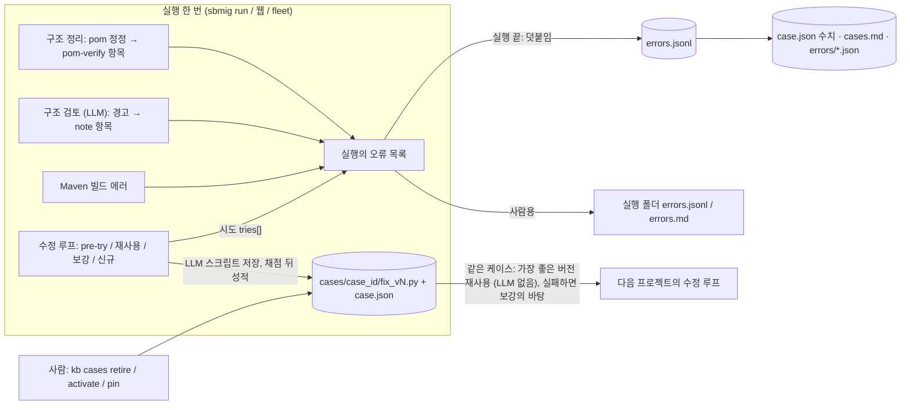
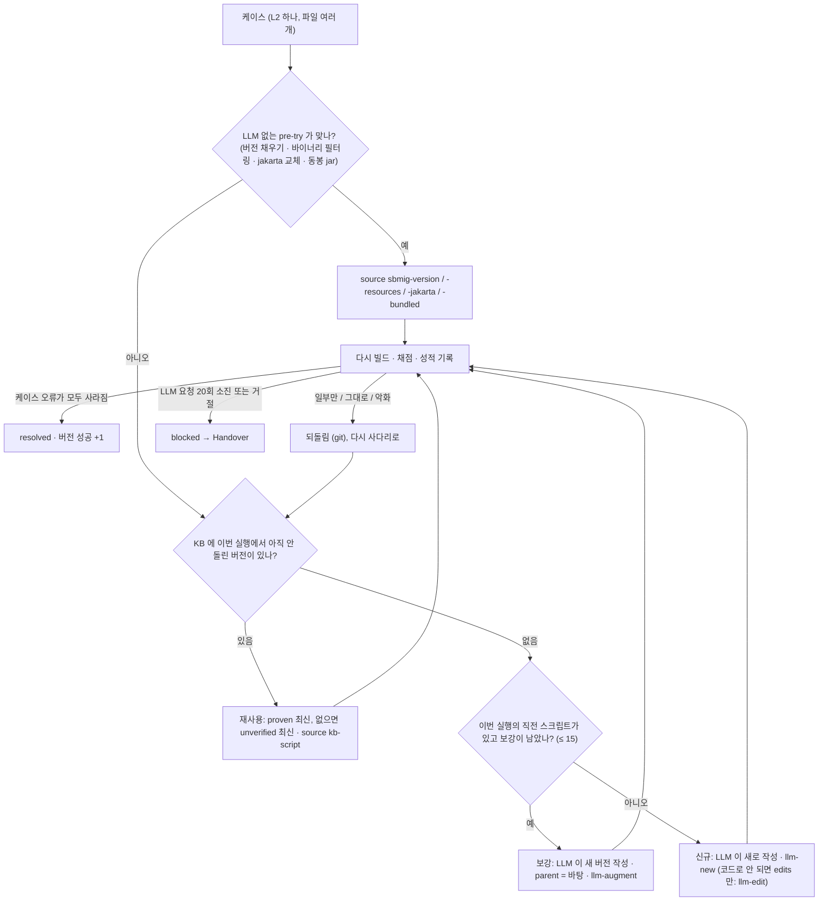
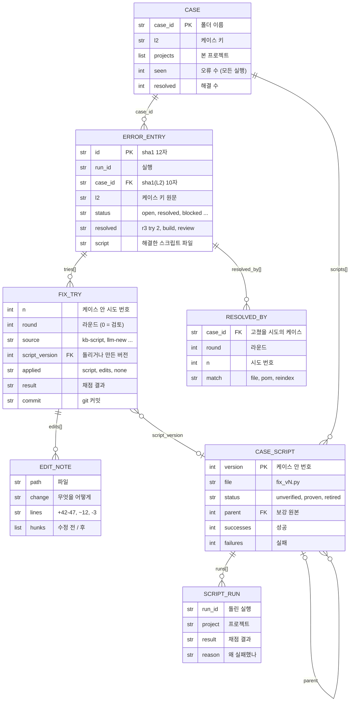
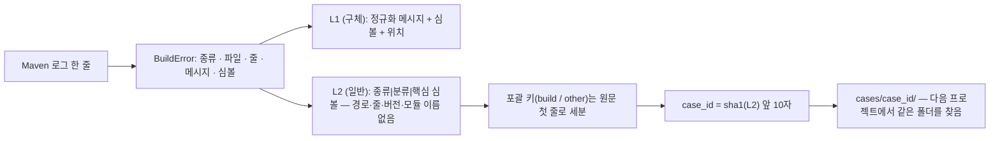
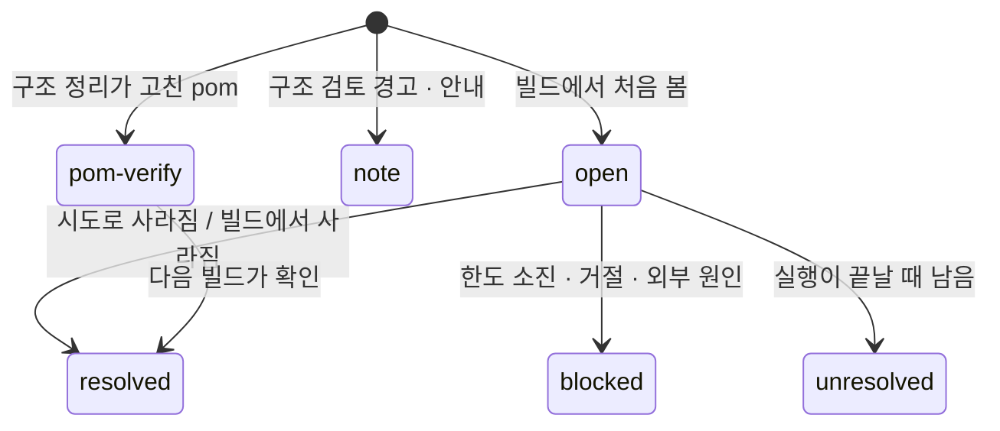
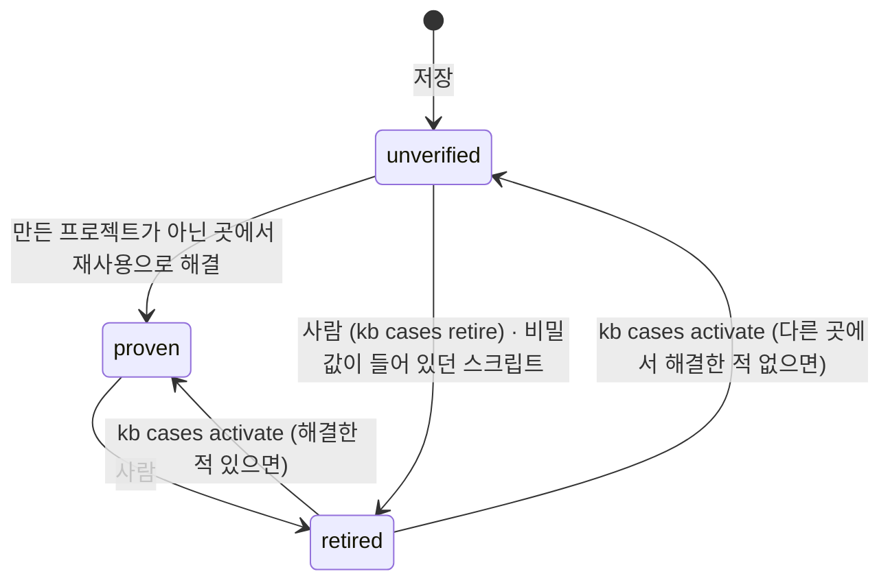

# sbmig KB 데이터 지도

> sbmig · 지식 베이스(KB) `kb-v2/` · 지금 코드 기준(`sbmig/errors/cases.py`, `sbmig/core/models.py`)

마이그레이션을 돌릴 때마다 `kb-v2/` 폴더에 쌓이는 파일과 각 키의 뜻, 그리고 파일끼리 어떤 키로 이어지는지를 정리했습니다. 현업이 KB 데이터로 규칙을 만들 때 "이 값은 저 파일의 어느 키와 같다"를 찾는 용도입니다.

> 빌드 에러는 LLM이 쓴 **파이썬 수정 스크립트**(또는 LLM 이 직접 준 편집)로 고치고, 스크립트를 케이스(L2 시그니처)마다 버전으로 쌓습니다. 같은 케이스가 다음 프로젝트에 나오면 성적이 가장 좋은 버전을 LLM 없이 먼저 돌리고, 실패하면 그 버전을 LLM이 보강합니다. KB 는 **오류 기록 한 파일 + 케이스 폴더**뿐이고, 따라갈 키는 **run_id · 오류 id · case_id(L2) · 스크립트 버전** 네 개(+ 보강 계보 `parent`)입니다.

같은 내용의 HTML 판: [`index.html`](index.html) (인터넷 없이 열림, 원본 [`kb-map.html`](kb-map.html)). 이 Markdown의 Mermaid 다이어그램은 GitHub, VS Code(Mermaid 확장), Typora 등에서 그림으로 보입니다.

## 목차

1. [폴더 구성](#layers)
2. [파일을 잇는 연결 키](#keys)
3. [데이터가 쌓이는 흐름](#flow)
4. [관계도](#er)
5. [시그니처: 에러 하나가 케이스 키가 되는 과정](#sig)
6. [상태 변화](#states)
7. [파일별 필드 사전](#fields)
8. [값 목록](#enums)
9. [자주 찾는 질문과 따라갈 키](#qa)

---

<a id="layers"></a>

## 1. 폴더 구성

| 층 | 파일 | 성격 |
|---|---|---|
| **원본 기록** | `errors.jsonl` | 모든 실행의 오류 한 건 = 한 줄. 실행이 끝날 때 그 실행의 오류 목록을 덧붙이고(이미 있는 id 는 건너뜀) 이미 쓴 줄은 재색인(`sbmig kb reindex`)과 재서명 때만 고치고 오류 id 는 바꾸지 않습니다. 나머지는 모두 이 파일에서 다시 만들 수 있습니다. |
| **재사용 지식** | `cases/<case_id>/case.json`, `fix_v<N>.py` | 다음 프로젝트에서 실제로 다시 실행되는 스크립트와 그 성적. 사람은 `sbmig kb cases retire` · `activate` · `pin` · `unpin` 으로만 손댑니다. |
| **파생 사본** | `cases.md`, `cases/<case_id>/errors/*.json` | 사람이 읽는 표와 오류별 JSON. `sbmig kb reindex` 로 다시 만들 수 있으니 직접 고치지 않습니다. |
| **사람이 채우는 표** | `libraries.yml`, `jar_names.yml` | 회사가 더하는 라이브러리 표(jakarta 빌드 좌표) / jar 이름 → 좌표 표. sbmig 는 읽기만 합니다. |
| **운영 파일** | `.lock` (+ 잠깐 생기는 `.lock.breaker`, `.lock.probe.*`, `.fix.*.tmp`), `kb.json` (+ 잠깐 생기는 `resign-pending.json`) | 웹 파드·빌드 파드·플릿·`sbmig kb` 가 동시에 쓰지 않게 하는 잠금. `kb.json` 은 이 KB 가 어느 시그니처 규칙 버전까지 재서명됐는지 적은 표식입니다. |

```text
kb-v2/
├── errors.jsonl                        오류 1건 = 1줄 (ErrorEntry: 시도·LLM 답·적용 diff·결과까지)   [원본 기록]
├── cases.md                            사람이 보는 케이스 표 (실행마다 다시 씀)                      [파생 사본]
├── cases/<case_id>/
│   ├── case.json                       케이스 하나 = L2 하나 (CaseInfo: 스크립트 버전과 성적)        [재사용 지식]
│   ├── fix_v1.py, fix_v2.py …          케이스별 수정 스크립트 (같은 코드는 한 번만 저장)            [재사용 지식]
│   └── errors/<run_id>-<id>.json       오류 1건 = 파일 1개 (errors.jsonl 과 같은 내용, 들여쓰기)     [파생 사본]
├── cases/_other/errors/…               케이스 없는 항목 (pom-verify, 메모)                          [파생 사본]
├── libraries.yml, jar_names.yml        사람이 채우는 표 (있을 때만)                                 [사람]
├── kb.json                             재서명 표식 {"sig": 규칙 버전}                               [운영]
└── .lock                               쓰기 잠금                                                    [운영]

kb-v2.bak-<시각>/                       kb import --replace 전에 남기는 이전 KB (kb-v2 옆)
<실행 폴더>/errors.jsonl, errors.md     그 실행의 오류 목록 (같은 레코드, md 는 사람용)
```

<a id="keys"></a>

## 2. 파일을 잇는 연결 키

| 키 | 형식 / 만드는 법 | 예시 | 나오는 곳 |
|---|---|---|---|
| **run_id** | 실행 한 번. `run-YYYYMMDD-HHMMSS-<6자>` | `run-20261031-193430-30da3d` | `errors.jsonl` 의 `run_id`, 오류별 JSON 파일 이름 앞부분, `scripts[].created_by`(만든 실행), `scripts[].runs[].run_id`(돌린 실행) |
| **오류 id** | `sha1(run_id \| case_id \| 파일 \| 줄 \| 메시지)` 앞 12자. 같은 입력이면 같은 값 | `3f1c9a0b7d2e` | `errors.jsonl` 의 `id`, 오류별 JSON 파일 이름 끝, `sbmig kb errors show <id>` |
| **case_id** | 케이스 하나. `sha1(L2)` 앞 10자. L2 가 같으면 프로젝트가 달라도 같은 값. **케이스 폴더 이름도 이 값** | `7a52b1cea8` | `errors.jsonl` 의 `case_id`, `cases/<case_id>/`, `case.json` 의 `case_id`, 커밋 메시지 `fix(script:<case_id>:v<N> …)`, `resolved_by[].case_id`, 로그 `[fix r3 <case_id>]` |
| **L2** | 일반화한 시그니처 `종류\|분류\|핵심 심볼` (경로·줄·버전·모듈 이름 없음). case_id 의 원문 | `compile\|package_does_not_exist\|jakarta.xml.bind` | `errors.jsonl` 의 `l2`, `case.json` 의 `l2` |
| **스크립트 버전** | 케이스 안에서 1, 2, 3 … 같은 코드는 한 번만 저장, 번호는 다시 쓰지 않음. 0 = 스크립트 없음 | `2` | 파일 `fix_v2.py`, `scripts[].version`, `tries[].script_version`, `errors.jsonl` 의 `script`(`cases/<id>/fix_v2.py`) |
| **parent** | 보강의 원본 버전 번호. 새로 쓴 버전은 `null` | `1` (v2 는 v1 을 보강) | `scripts[].parent`, `scripts[].reason`(원본이 왜 실패했나) |
| **commit** | 시도가 실행 폴더의 git 에 남긴 커밋 | `a1b2c3d` | `tries[].commit`, `resolved_by[].commit` |
| **project** | 프로젝트 이름(루트 artifactId) | `legacy-shop` | `errors.jsonl` 의 `project`, `case.json` 의 `projects[]`, `scripts[].projects[]` / `runs[].project` |

<a id="flow"></a>

## 3. 데이터가 쌓이는 흐름



한 케이스가 받는 시도는 아래 순서로 정해집니다(실행 한 번 안에서, 케이스마다). 자세한 규칙: `agent-doc/04-cases-scripts-kb.md`.



<a id="er"></a>

## 4. 관계도



<a id="sig"></a>

## 5. 시그니처: 에러 하나가 케이스 키가 되는 과정



- 리액터 모듈의 artifactId 는 `<module>` 로 가립니다. 그래서 프로젝트가 달라도 같은 원인은 같은 케이스입니다.
- L2 가 없는 오류는 `sha1(종류|파일|L1)` 앞 10자를 씁니다.
- 라이브러리 타입의 메서드·필드를 못 찾는 오류는 그 타입까지 키에 넣습니다(`compile|cannot_find_symbol|org.springframework.http.HttpHeaders.keySet`). 이름만 쓰면 `keySet`, `save` 같은 흔한 이름의 서로 다른 문제가 한 케이스가 됩니다. 클래스를 못 찾는 오류는 단순 이름 그대로입니다.
- 시그니처 규칙에는 버전이 있습니다(`SIGNATURE_VERSION`). 오류 기록과 케이스는 자기를 서명한 버전을 `sig` 로 갖습니다. 규칙이 바뀌면 KB 가 옛 기록을 지금 규칙으로 **재서명**해서 케이스와 스크립트를 새 case_id 로 옮기고, 옛 case_id 는 `aliases`(케이스) · `was`(오류 기록)에 남깁니다. `sbmig kb reindex` 를 칠 때와 실행이 KB 를 처음 볼 때 스스로 합니다.
- case_id 는 L2 전체의 해시입니다. 저장된 케이스의 L2 가 지금 묻는 L2 와 글자까지 같을 때만 그 케이스를 씁니다(10자가 우연히 겹쳐도 섞이지 않음).

<a id="states"></a>

## 6. 상태 변화

**오류 항목 (`errors.jsonl` 의 `status`)**



**스크립트 버전 (`scripts[].status`)**



재사용 순서: proven 최신 → unverified 최신. retired 와 `non_idempotent`(두 번 돌렸더니 또 바뀐 스크립트)는 고르지 않습니다.

<a id="fields"></a>

## 7. 파일별 필드 사전

### errors.jsonl — 오류 1건 = 1줄 (`ErrorEntry`)

실행 폴더의 `errors.jsonl` 과 같은 레코드입니다.

| 필드 | 뜻 |
|---|---|
| `id` | 오류 id (2절) |
| `run_id`, `project` | 실행, 프로젝트 이름 |
| `case_id`, `l2` | 케이스 (2절) |
| `kind` | 오류 종류 (8절) |
| `file`, `line`, `module` | 위치 (프로젝트 기준 상대 경로) |
| `message`, `raw` | 메시지, 로그 원문(최대 600자) |
| `seen` | 처음 본 곳: `restructure` · `review` · `build` · `fix r3` (`compile` 은 변환 뒤 컴파일을 켰을 때만) |
| `status` | 8절 |
| `tries[]` | 이 오류의 케이스에 들어간 시도 (아래 표) |
| `resolved` | 해결한 곳: `r3 try 2`(그 시도) · `build`(자기 시도 없이 사라짐) · `review` |
| `resolved_by[]` | `resolved: build` 일 때 같은 라운드에 그 파일이나 모듈 pom 을 바꾼 시도: `case_id`, `round`, `n`, `commit`, `files`, `match`(`file` · `pom` · `reindex`), `text` |
| `script` | 해결한 스크립트 파일 `cases/<case_id>/fix_v<N>.py` |
| `note` | pom-verify: 구조 정리가 한 일 / note 항목: 그 글 |
| `at` | 기록 시각 (UTC) |
| `sig` | 이 기록의 L2 를 만든 시그니처 규칙 버전 (0 = 버전이 생기기 전) |
| `l1`, `symbol`, `location`, `artifact`, `goal` | 시그니처의 재료: 구체 시그니처, javac 의 symbol / location 줄, 좌표 `g:a[:v]`, 플러그인 목표. 규칙이 바뀌면 이것으로 L2 를 다시 계산합니다 |
| `was[]` | 재서명 전의 case_id 들 (오래된 것 먼저) |

### tries[] — 시도 1건 (`FixTry`)

| 필드 | 뜻 |
|---|---|
| `n`, `round` | 케이스 안 시도 번호, 수정 루프 라운드(0 = 구조 검토) |
| `source` | 사다리 단계 (8절) |
| `script_version` | 돌리거나 만든 스크립트 버전 (0 = 없음) |
| `analysis`, `solution` | LLM 의 원인 / 해결 방법 |
| `no_script_reason` | 스크립트로 안 되는 이유 (LLM 이 편집만 준 경우) |
| `applied` | 실제로 적용된 것: `script` · `edits` · `none` |
| `files`, `edits[]` | 바뀐 파일, 수정 내역(`path`, `where`, `change`, `lines`, `source`(`llm` · `diff`), `hunks[]` = 수정 전 `before` / 수정 후 `after`) |
| `major_upgrades[]`, `verify`, `verify_source` | 이 시도가 pom 에서 올린 메이저 버전 / 바꾼 라이브러리, 운영자 확인 안내와 누가 썼는지 |
| `diff`, `commit` | 적용한 diff, git 커밋 |
| `result`, `note` | 재빌드 채점 결과 (8절), 실패 이유·되돌림 메모 |
| `llm_calls`, `seconds` | 이 시도의 LLM 호출 수, 걸린 초 |

### cases/&lt;case_id&gt;/case.json — 케이스 하나 (`CaseInfo`)

| 필드 | 뜻 |
|---|---|
| `case_id`, `l2`, `name`, `kind` | 케이스 키, 사람이 읽는 이름(예: `package jakarta.xml.bind does not exist`), 종류 |
| `projects[]` | 이 케이스를 본 프로젝트 |
| `seen`, `resolved` | 모든 실행의 오류 수, 해결 수 |
| `scripts[]` | 저장된 스크립트 버전 (아래 표) |
| `last_analysis`, `last_solution` | 마지막 LLM 원인 / 해결 |
| `updated_at` | 마지막 갱신 |
| `sig` | 이 케이스의 L2 를 만든 시그니처 규칙 버전 |
| `aliases[]` | 재서명으로 이 케이스에 옮겨 온 옛 case_id 들 — `sbmig kb cases show <옛 id>` 가 이 케이스를 엽니다 |
| `pin` | (모델 밖 키) 사람이 고정한 차단 `block[:이유]` — 이 케이스는 시도하지 않음 |
| `last_result` | (모델 밖 키) 마지막 결과 |

### scripts[] — 스크립트 버전 (`CaseScript`)

| 필드 | 뜻 |
|---|---|
| `version`, `file` | 버전 번호, 파일 `fix_v<N>.py` |
| `status` | `unverified` · `proven` · `retired` (6절) |
| `source` | 만든 사다리 단계 (`llm-new` · `llm-augment` …) |
| `created_by`, `project`, `created_at` | 만든 실행, 프로젝트, 시각 |
| `successes`, `failures`, `projects[]` | 성공 / 실패 횟수, 해결한 프로젝트 |
| `last_result`, `last_failure` | 마지막 결과, 마지막 실패 이유 |
| `parent`, `reason` | 보강 원본 버전, 원본이 왜 보강됐는지 |
| `runs[]` | 실행 기록(최신이 끝, `errors.script_runs` 개까지): `run_id`, `project`, `round`, `n`, `result`, `reason`, `errors_before`, `errors_left`, `errors_new`, `files`, `at` |
| `non_idempotent` | 두 번째 실행에서 또 바꾼 스크립트 — 기록만, 재사용 안 함 |

### cases.md — 사람이 보는 표

case, name, projects, seen / resolved, scripts(`v1 proven 3/0; v2 unverified 0/1 — 마지막 실패`), pin, last result. 실행마다 다시 씁니다.

<a id="enums"></a>

## 8. 값 목록

| 키 | 값 |
|---|---|
| `kind` | `compile`, `test_compile`, `dependency_resolution`, `plugin_resolution`, `parent_resolution`, `plugin_execution`, `enforcer`, `pom_invalid`, `rewrite`, `test_failure`, `unknown` |
| `status` | `open`, `pom-verify`, `resolved`, `blocked`, `unresolved`, `note` |
| `source` | `kb-script`(저장본 재사용, LLM 없음), `llm-new`, `llm-augment`, `llm-edit`(스크립트 없이 편집만), `review`(구조 검토의 수정), `sbmig-version`, `sbmig-resources`, `sbmig-jakarta`, `sbmig-bundled`(LLM 없는 pre-try) |
| `applied` | `script`, `edits`, `none` |
| `result` | `pending`, `build_ok`, `improved`, `partial`, `no_change`, `regressed`, `reverted`, `apply_failed`, `inconclusive`, `blocked` |
| `scripts[].status` | `unverified`, `proven`, `retired` |

<a id="qa"></a>

## 9. 자주 찾는 질문과 따라갈 키

| 질문 | 따라가는 법 |
|---|---|
| 이 오류는 어떻게 고쳤나? | `sbmig kb errors show <오류 id>` → `resolved` 가 `r3 try 2` 면 `tries[]` 의 그 시도(`analysis`, `edits[].hunks`, `diff`), `build` 면 `resolved_by[]` |
| 무엇을 시도했다가 왜 실패했나? | 같은 항목의 `tries[]` 에서 `result` 가 실패인 것의 `note`; 스크립트라면 `case.json` 의 `scripts[].runs[].reason` |
| 이 스크립트는 어디서 왔고 무엇을 보강했나? | `sbmig kb cases show <case_id>` → `scripts[]` 의 `parent` · `reason` · `created_by` |
| 다음 프로젝트에서 이 케이스는 무엇을 실행하나? | proven 최신, 없으면 unverified 최신 (`kb cases show` 의 `KB 탐색:` 줄) |
| 같은 원인이 몇 프로젝트에서 나왔나? | `case.json` 의 `projects[]`, `cases.md` |
| 나쁜 스크립트를 다시 안 쓰게 하려면? | `sbmig kb cases retire <case_id> <N>` (되돌리기: `activate`) |
| 이 케이스는 시도하지 말라고 하려면? | `sbmig kb cases pin <case_id> block:<이유>` (풀기: `unpin`) |

주의: `cases.md` 와 `errors/*.json` 은 파생 사본이라 직접 고치지 않습니다(`sbmig kb reindex` 로 다시 만듦). KB 를 다른 PC 로 옮길 때는 `sbmig kb export` / `import`.

---

원본 정의: `sbmig/core/models.py`(`ErrorEntry`, `FixTry`, `EditNote`, `CaseInfo`, `CaseScript`, `ScriptRun`), `sbmig/errors/cases.py`, `sbmig/kb/store.py`; 계약 `docs/v2/PLAN-v2.1.md` §3.3–§3.4, `docs/INTERFACES.md` "v2.1e" / "v2.1f"; 사내 LLM 용 설명 `agent-doc/04-cases-scripts-kb.md`.
