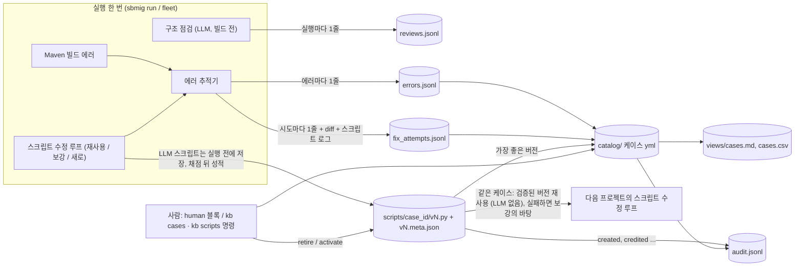
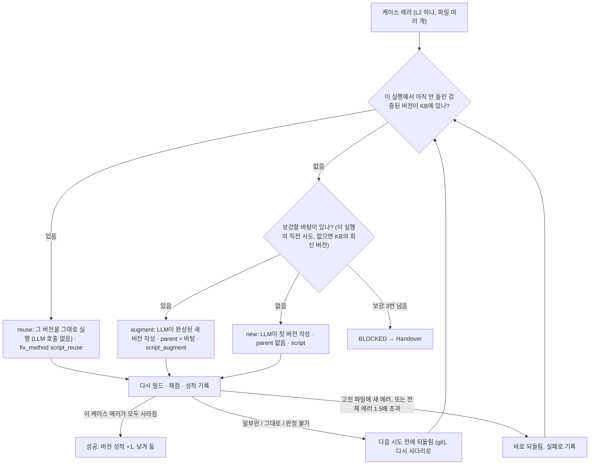
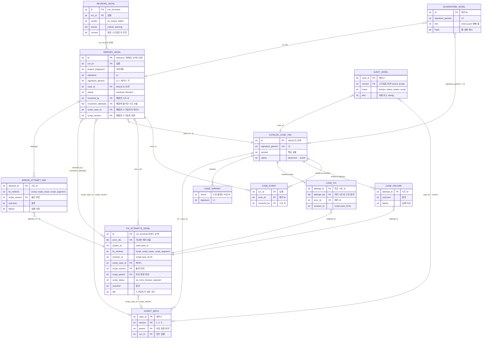
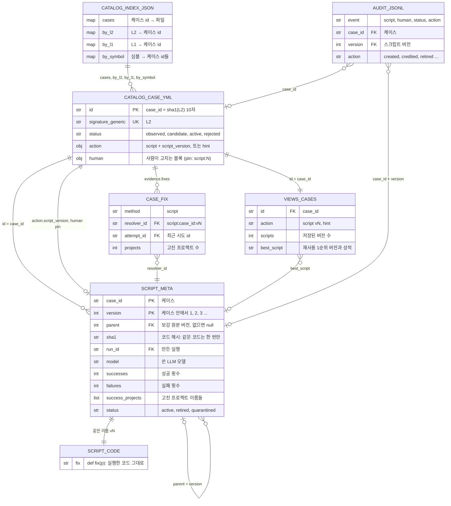
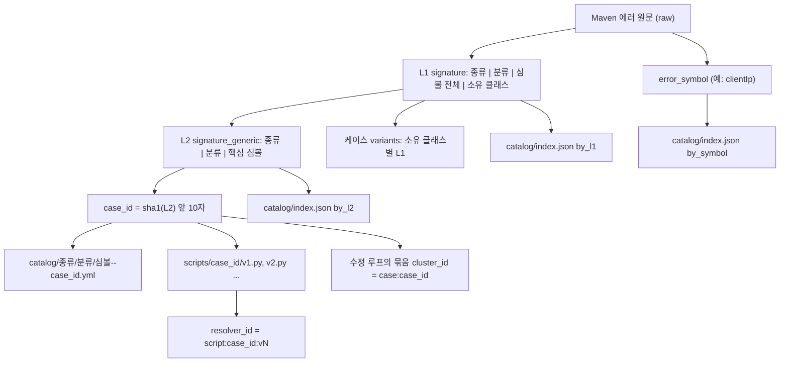
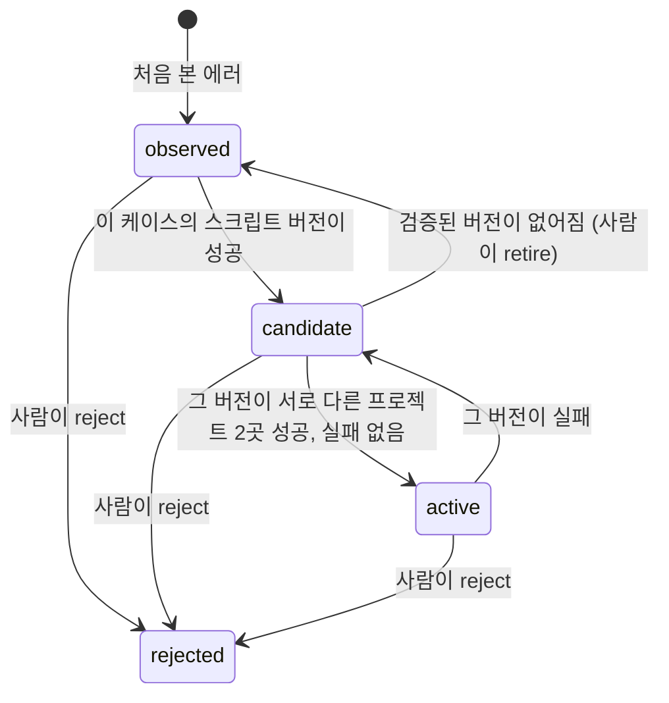
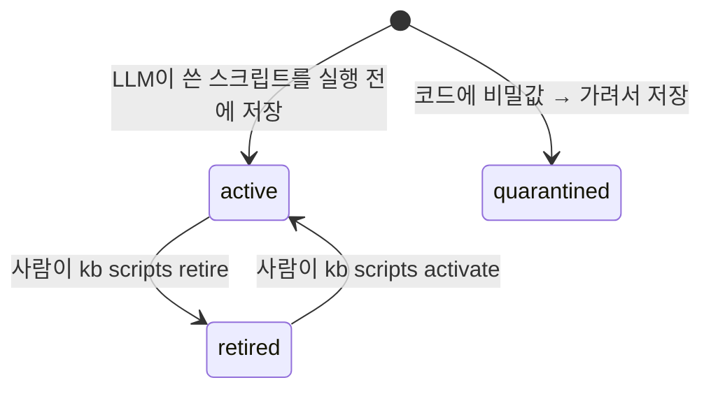

# sbmig KB 데이터 지도

> sbmig v2 · 지식 베이스(KB) `kb-v2/` · 스키마 버전 3 (2026-10-26, flow-v2)

마이그레이션을 돌릴 때마다 `kb-v2/` 폴더에 쌓이는 파일과 각 키의 뜻, 그리고 파일끼리 어떤 키로 이어지는지를 정리했습니다. 현업이 KB 데이터로 규칙을 만들 때 "이 값은 저 파일의 어느 키와 같다"를 찾는 용도입니다.

> v2 흐름(브랜치 `flow-v2`): 빌드 에러는 모두 LLM이 쓴 **파이썬 수정 스크립트**로 고치고, 스크립트를 케이스(L2 시그니처)마다 버전으로 쌓습니다. 같은 케이스가 다음 프로젝트에 나오면 성적이 가장 좋은 버전을 LLM 없이 먼저 돌리고, 실패하면 그 버전을 LLM이 보강합니다. 그래서 KB는 에러 · 시도 · 구조 점검 기록, 케이스, 스크립트로 줄었고, 현업이 따라갈 연결 키는 **run_id · 에러 id · 시도 id · case_id(L2) · 스크립트 버전** 다섯 개(+ 보강 계보 `parent`)입니다. v1(태그 `company-v1`)의 `kb/` 폴더와는 섞지 않습니다. v1에서만 쓰던 파일은 [1절 끝 상자](#v1only)에 모았습니다.

같은 내용의 HTML 판: [`index.html`](index.html) (인터넷 없이 열림, 원본 [`kb-map.html`](kb-map.html)). 이 Markdown의 Mermaid 다이어그램은 GitHub, VS Code(Mermaid 확장), Typora 등에서 그림으로 보입니다.

## 목차

1. [KB는 네 가지 층으로 나뉩니다](#layers)
2. [파일을 잇는 연결 키](#keys)
3. [데이터가 쌓이는 흐름](#flow)
4. [관계도 ① 실행 기록](#er-run)
5. [관계도 ② 케이스와 스크립트](#er-know)
6. [시그니처 계층](#sig)
7. [상태 변화](#states)
8. [파일별 필드 사전](#fields)
9. [값 목록](#enums)
10. [자주 찾는 질문과 따라갈 키](#qa)

---

<a id="layers"></a>

## 1. KB는 네 가지 층으로 나뉩니다

| 층 | 파일 | 성격 |
|---|---|---|
| **사실 기록** | `errors.jsonl`, `fix_attempts.jsonl`, `reviews.jsonl` 구조 점검 (v2 새로) | 실행할 때마다 줄이 추가되고 이미 쓴 줄은 고치지 않습니다. 규칙을 만들 때 근거로 쓰는 원본 데이터입니다. |
| **재사용 지식** | `catalog/` 에러 케이스, `scripts/` 케이스별 수정 스크립트와 성적 (v2 새로) | 다음 프로젝트에서 실제로 다시 실행되는 지식입니다. 사람은 케이스 파일의 `human:` 블록과 `sbmig kb scripts retire` · `activate` 명령으로만 손댑니다. |
| **파생 인덱스** | `catalog/index.json`, `views/` | 위 두 층에서 계산한 검색용 사본입니다. `sbmig kb reindex`로 언제든 다시 만들 수 있으니 직접 고치지 않습니다. |
| **운영 파일** | `audit.jsonl` 변경 이력 (스크립트 포함), `quarantine.jsonl` 읽지 못한 줄, `*.jsonl.corrupt`, `.lock` | 누가 언제 무엇을 바꿨는지, 깨진 줄은 무엇인지 남깁니다. 동시에 쓰지 않도록 잠금 파일도 둡니다. |

```text
kb-v2/
├── errors.jsonl                         빌드 에러 1건 = 1줄, 어떤 스크립트 버전으로 고쳤나 포함 (ErrorCaseRecord)   [사실 기록]
├── fix_attempts.jsonl                   수정 시도 1건 = 1줄, 실패 포함: 돌린 스크립트 버전, 실행 로그, git diff     [사실 기록]
├── reviews.jsonl                        구조 점검 1건 = 1줄, 실행마다 (StructureReview)              v2 새로   [사실 기록]
├── catalog/<종류>/<분류>/<심볼>--<case_id>.yml   L2 시그니처 1개 = 케이스 1개, 가장 좋은 스크립트 버전  [재사용 지식]
├── scripts/<case_id>/v1.py, v1.meta.json, v2.py, v2.meta.json …   케이스별 수정 스크립트와 기록 (ScriptMeta)
│                                                                                            v2 새로   [재사용 지식]
├── catalog/index.json                   케이스 id → 파일, L2 / L1 / 심볼 → 케이스 id                 [파생 인덱스]
├── views/cases.md, cases.csv            사람이 보는 케이스 표 (스크립트 버전 수, 재사용 1순위 포함)      [파생 인덱스]
├── audit.jsonl                          사람의 케이스 수정 + 자동 상태 변화 + 스크립트 저장·성적·폐기      [운영 파일]
├── quarantine.jsonl                     errors.jsonl에서 읽지 못한 줄의 메모                         [운영 파일]
├── *.jsonl.corrupt                      중간에 끊겨 반쯤 쓰인 마지막 줄을 옮겨 둔 곳                   [운영 파일]
└── .lock                                여러 프로세스가 동시에 쓰지 않게 하는 잠금                     [운영 파일]

kb-v2.bak-<시각>/                         kb import --replace 전에 남기는 이전 KB 백업 (kb-v2 폴더 옆)
<실행 폴더>/error_cases.jsonl, fix_attempts.jsonl, error_cases.csv   그 실행분만 따로 (같은 형식, CSV는 엑셀용)
```

<a id="v1only"></a>

### v1에서만 쓰던 파일 (v1 전용, v2에서 쓰지 않음)

태그 `company-v1`의 `kb/` 폴더에만 생깁니다. v2 흐름은 이 파일을 쓰지도 읽지도 않습니다.

| v1 파일 | 무엇이었나 | v2에서는 |
|---|---|---|
| `ledger.jsonl` | 에러 묶음(클러스터) 1건의 해결 방법 = 1줄 (ResolutionRecord), 플릿 학습 보고서의 원본 | 쓰지 않음. 해결 기록은 `errors.jsonl` · `fix_attempts.jsonl`의 스크립트 필드 |
| `recipes/` | KB가 만든 OpenRewrite 레시피 (후보 → active), `.yml` + `.meta.json` | KB 레시피를 돌리지 않음 (현업 결정). 다시 쓰는 지식은 `scripts/` |
| `cases/YYYY-MM/` | 재생할 수 있는 LLM 패치 (SEARCH/REPLACE, KBCase) | 스크립트가 대신함: 같은 케이스는 저장된 스크립트를 다시 실행 |
| `patterns/*.yml` | 사람이 쓴 매칭 규칙 (레시피 · 핸들러 · 힌트) | v2 흐름에서 쓰지 않음 |
| `index.json` | 시그니처 → KB 케이스 / 레시피 | 필요 없음: case_id(= sha1(L2))로 `scripts/<case_id>/`를 바로 찾음 |
| `symbols.json` | 에러 심볼 → 고친 방법 묶음 | 쓰지 않음 |
| `error_hints.json` | L2 / 에러 심볼 → 과거 성공·실패 (LLM 프롬프트 힌트) | 스크립트 이력(버전 성적, 보강 계보)과 케이스의 `hints`가 대신함 |

케이스 파일의 v1 동작(`action.kind` = `recipe` · `replace` · `patch`)도 v1 설정을 다시 켤 때만 계산됩니다. 이 파일들을 만드는 코드는 PLAN-v2 4단계(정리)에서 지울지 정합니다. v1 지도는 태그 `company-v1`의 같은 문서(`docs/kb-map/`)에 있습니다.

<a id="keys"></a>

## 2. 파일을 잇는 연결 키

v2에서 현업이 따라갈 키는 아래 다섯 개와 보강 계보입니다. 같은 값이 서로 다른 파일에 나타나므로 조인할 때 씁니다. 예시는 e2e 픽스처 `boot2-fix-failures`의 에러(`clientIp`)를 v2 흐름으로 고쳤을 때의 값 모양입니다.

| 키 | 형식 / 만드는 법 | 예시 | 나오는 곳 |
|---|---|---|---|
| **run_id** | 실행 한 번. `run-YYYYMMDD-HHMMSS-<6자>` | `run-20261026-104410-78da18` | errors / fix_attempts / reviews의 `run_id`, 시도 id와 점검 id의 앞부분, 스크립트 meta의 `run_id`(만든 실행)와 `last_run_id`(마지막으로 돌린 실행), 케이스 timeline의 `run_id`, audit의 `run_id` |
| **에러 id** (`errors.id`) | sha1(run_id \| 에러 정체성 \| 같은 에러 순번) 앞 16자. 실행마다 새 값 | `e6852dd17399adbe` | fix_attempts의 `error_ids[]`, 케이스의 `evidence.fixes[].error_id`, `timeline[].error_id`, quarantine의 `id` |
| **시도 id** (`fix_attempts.id`) | `<run_id>:<attempt_id>`. attempt_id = `<단계>-<라운드>-<순번>`. v2의 시도는 모두 최종 빌드 뒤 수정 루프라서 `verify-…` | `run-20261026-104410-78da18:verify-1-1` | errors의 `resolved_by`, `resolution_attempts[]`, `attempts[].attempt_id`. 케이스의 `fixes[].attempt_id`, `attempt_ids[]`, `failures[].attempt_id` |
| **case_id** (L2) | 케이스 하나. sha1(L2) 앞 10자. L2가 같으면 프로젝트가 달라도 같은 값. **스크립트 폴더 이름도 이 값** | `8bb4fd4a4a` | errors의 `case_id` · `script_case_id`, fix_attempts의 `script_case_id`와 `cluster_id`(`case:<case_id>`), 케이스 파일 이름 끝(`clientIp--8bb4fd4a4a.yml`)과 `id`, `scripts/8bb4fd4a4a/`와 meta의 `case_id`, resolver id(`script:<case_id>:v<N>`), `catalog/index.json`, audit의 `case_id`, views의 `id` |
| **스크립트 버전** (`v<N>`) | 케이스 안에서 1, 2, 3 … 순서. 같은 코드는 한 번만 저장(코드 해시 `sha1`가 같으면 기존 버전). 번호는 다시 쓰지 않음. 0 = 저장되지 않은 스크립트(KB 없이 돌린 실행) | `2` | 파일 이름 `v2.py` · `v2.meta.json`과 meta의 `version`, fix_attempts의 `script_version`, errors의 `script_version` · `attempts[].script_version`, resolver id 끝(`:v2`), 케이스의 `action.script_version`(가장 좋은 버전) · `human.action`(사람이 고정한 버전), views의 `best_script`, audit의 `version` |
| **parent** (보강 계보) | 이 버전이 보강한 원본 버전 번호. 처음부터 새로 쓴 버전은 `null`. 실패 버전도 저장되므로 계보가 끊기지 않음 | `1` (v2는 v1을 보강) | meta의 `parent`, fix_attempts의 `script_parent`, audit의 `parent`. `sbmig kb scripts show <case_id>`가 `v1 → v2 → v4`처럼 보여 줌 |

### 보조 키

| 키 | 형식 / 만드는 법 | 예시 | 나오는 곳 |
|---|---|---|---|
| **project_fingerprint** | 프로젝트 하나. sha256(루트 artifactId \| pom 경로들) 앞 16자. 이름이 바뀌어도 pom 구조가 같으면 같은 값 | `83cb2456069393af` | errors / fix_attempts의 `project_fingerprint`. 주의: 스크립트 meta의 `success_projects`는 지문이 아니라 **프로젝트 이름**(`project`) |
| **L1** (`signature`) | 구체 시그니처. `종류\|분류\|심볼 전체\|소유 클래스` | `compile\|cannot_find_symbol\|method clientIp(jakarta.servlet.http.HttpServletRequest)\|class com.company.legacy.web.LegacyRequestHelper` | errors의 `signature`, 케이스 `variants[].signature`, `catalog/index.json`의 `by_l1` |
| **L2** (`signature_generic`) | 일반화한 시그니처. `종류\|분류\|핵심 심볼`. 프로젝트마다 다른 부분(경로, 줄, 프로젝트 클래스)은 빠짐. **케이스의 키**(case_id의 원문) | `compile\|cannot_find_symbol\|clientIp` | errors의 `signature_generic`, 케이스 파일의 `signature_generic`, 스크립트 meta의 `signature_generic`, audit의 `signature_generic`, `catalog/index.json`의 `by_l2`, quarantine의 `signature_generic` |
| **error_symbol** | 프로젝트를 넘어 같은 원인을 묶는 짧은 키. 메서드·클래스·패키지·아티팩트 이름 | `clientIp` | errors의 `error_symbol`, 케이스의 `symbol`, `catalog/index.json`의 `by_symbol` |
| **resolver_id** | "누가 고쳤나". v2 스크립트 시도는 `script:<case_id>:v<N>` — case_id와 스크립트 버전을 한 값에 담음. plan 단계로 사라진 에러는 비어 있고 `resolved_by`가 `step:<단계 id>` | `script:8bb4fd4a4a:v2` | errors / fix_attempts의 `resolver_id`, 케이스의 `fixes[].resolver_id`(스크립트 버전마다 1줄) |
| **cluster_id** | 한 빌드에서 같은 케이스로 묶은 에러 무리. v2는 파일이 여러 개여도 케이스 하나 = 무리 하나: `case:<case_id>` (MSA 서비스별 루프는 `@<서비스 폴더>`가 붙음) | `case:8bb4fd4a4a` | fix_attempts의 `cluster_id`, 커밋 메시지 `fix(script:<case_id>:v<N> <방식>): case:…` (실행 폴더의 journal에서 같은 값으로 결정 과정을 찾을 수 있음) |
| **점검 id** (`reviews.id`) | 구조 점검 하나. `<run_id>:review` (실행마다 1개) | `run-20261026-104410-78da18:review` | reviews.jsonl의 `id`. 같은 실행의 에러·시도와는 `run_id`로 이어짐 |

<a id="flow"></a>

## 3. 데이터가 쌓이는 흐름

구조화 뒤 첫 빌드에서 나온 에러 하나가 기록되고, 그것을 고친 스크립트가 다음 프로젝트에서 다시 쓰이기까지의 경로입니다. 원통 모양이 `kb-v2/` 안의 파일입니다.



한 케이스가 다음에 받는 스크립트는 아래 순서로 정해집니다(실행 한 번 안에서, 케이스마다).



> LLM이 쓴 스크립트는 실행하기 **전에** `scripts/`에 저장됩니다. 실패한 버전도 남으므로 보강 계보(`parent`)가 끊기지 않습니다. 성적은 그 뒤 빌드로 채점한 결과입니다(7절 표). 되돌린 시도의 변경은 트리에 남지 않고, 그 시도로 사라졌던 에러는 다시 셉니다.

<a id="er-run"></a>

## 4. 관계도 ① 실행 기록: 에러 · 시도 · 점검 · 케이스

한 실행에서 생긴 에러와 시도, 구조 점검, 그리고 그것들을 L2 기준으로 모은 케이스와 스크립트 버전의 관계입니다. 선의 글자가 연결에 쓰이는 키입니다. PK = 그 파일의 고유 키, FK = 다른 파일을 가리키는 키.

| 엔티티 이름 | 파일 |
|---|---|
| `ERRORS_JSONL` | `errors.jsonl` 에러 1건 |
| `ERROR_ATTEMPT_REF` | `errors.jsonl`의 `attempts[]` 시도 이력 |
| `FIX_ATTEMPTS_JSONL` | `fix_attempts.jsonl` 시도 1건 |
| `SCRIPT_META` | `scripts/<case_id>/v<N>.meta.json` 스크립트 버전 |
| `REVIEWS_JSONL` | `reviews.jsonl` 구조 점검 1건 |
| `CATALOG_CASE_YML` | `catalog/…/<심볼>--<case_id>.yml` 케이스 |
| `CASE_VARIANT` / `CASE_FIX` / `CASE_FAILURE` / `CASE_EVENT` | 케이스 파일의 `variants[]` / `evidence.fixes[]` / `evidence.failures[]` / `evidence.timeline[]` |
| `AUDIT_JSONL` | `audit.jsonl` 변경 이력 |
| `QUARANTINE_JSONL` | `quarantine.jsonl` 읽지 못한 줄의 메모 |



<a id="er-know"></a>

## 5. 관계도 ② 재사용 지식: 케이스 · 스크립트 · 인덱스

다음 프로젝트에서 실제로 다시 실행되는 지식과, 그것을 찾기 위한 인덱스의 관계입니다. 케이스의 `action`이 `script`이면 `action.script_version`이 가리키는 버전이 재사용 1순위입니다. 스크립트 버전은 `parent`로 자기 자신(같은 케이스의 다른 버전)을 가리켜 보강 계보를 이룹니다.

| 엔티티 이름 | 파일 |
|---|---|
| `CATALOG_CASE_YML` | 케이스 파일 |
| `SCRIPT_META` | `scripts/<case_id>/v<N>.meta.json` 버전 기록 |
| `SCRIPT_CODE` | `scripts/<case_id>/v<N>.py` 스크립트 코드 |
| `CASE_FIX` | 케이스 파일의 `evidence.fixes[]` (스크립트 버전마다 1줄) |
| `CATALOG_INDEX_JSON` | `catalog/index.json` |
| `VIEWS_CASES` | `views/cases.csv`, `views/cases.md`의 케이스 한 줄 |
| `AUDIT_JSONL` | `audit.jsonl` 변경 이력 |



> 그림 ①과 ②에 `kb-v2/`의 모든 기록 파일이 들어 있습니다. 키로 다른 파일과 이어지지 않는 운영 파일 `.lock`(쓰기 잠금), `*.jsonl.corrupt`(반쯤 쓰인 줄), `kb-v2.bak-<시각>/`(`kb import --replace` 전 백업)만 그림에서 뺐습니다. v1에서만 쓰던 파일은 [1절 끝 상자](#v1only)에 있습니다. 실행 폴더(`out/<run id>/`의 `journal.jsonl`, `report.json`, `plan.json`, `changes.patch` 등)와 플릿 폴더(`state.json`, `summary.*`)는 KB가 아니라 이 지도에 넣지 않았습니다. 다만 실행 폴더의 `error_cases.jsonl`, `fix_attempts.jsonl`, `error_cases.csv`는 KB의 같은 이름 파일과 형식이 같습니다.

<a id="sig"></a>

## 6. 시그니처 계층: 에러 하나가 여러 키가 되는 과정

같은 에러가 어느 정도로 "같은지"에 따라 키가 셋입니다. v2는 L2(케이스)로 에러를 묶습니다. 같은 원인이 파일 N개에 있어도 스크립트 하나가 모두 고칩니다. 케이스 파일을 찾을 때는 L1 → L2 → 에러 심볼 순서로 맞춰 봅니다.



| 키 | 예시 (같은 에러) | 얼마나 같은가 |
|---|---|---|
| L1 | `compile\|cannot_find_symbol\|method clientIp(jakarta.servlet.http.HttpServletRequest)\|class com.company.legacy.web.LegacyRequestHelper` | 메서드 인자와 소유 클래스까지 같은 에러. 케이스 안에서 `variants`로 나뉨 |
| L2 | `compile\|cannot_find_symbol\|clientIp` | 같은 이름이 같은 이유로 없는 에러. **케이스 하나** = L2 하나 = 스크립트 폴더 하나 |
| case_id | `8bb4fd4a4a` | L2의 짧은 이름(해시). 파일·폴더 이름, 클러스터 id, resolver id, CSV에서 씀 |
| error_symbol | `clientIp` | 가장 넓은 묶음. 종류가 달라도 같은 심볼이면 모임 |

> L2 규칙: 패키지 에러는 패키지 이름 전체(`javax.xml.bind`와 `javax.xml.ws`는 다른 케이스), 메서드 재정의 오류 등은 메서드·클래스 이름까지, 플러그인 실행 오류는 goal과 원인 문구까지 넣습니다. 프로젝트 경로, 줄 번호, 프로젝트 고유 클래스 이름은 넣지 않습니다. L2가 없는 드문 에러는 수정 루프가 sha1(종류 | 파일 | L1) 앞 10자를 케이스 id로 써서 그 이름으로 스크립트를 저장합니다.

<a id="states"></a>

## 7. 상태 변화: 케이스와 스크립트 버전

### 케이스 (`catalog/*.yml`의 `status`)



사람이 `human:` 블록의 `status`나 `action`을 정하면 자동 값보다 우선합니다(`sbmig kb cases pin <id> --action script:N`). 상태가 바뀔 때마다 `audit.jsonl`에 한 줄이 남습니다. 승격 기준 프로젝트 수는 설정 `kb.auto_promote_after_projects`(기본 2)입니다.

### 스크립트 버전 (`v<N>.meta.json`의 `status`)



**재사용 후보** = active이고 성공이 1번 이상인 버전. 순서: 고친 프로젝트 수 → 성공 − 실패 → 최신 버전. 사람이 고정한 버전은 active이면 맨 앞(성공이 없어도). **retire가 고정보다 우선**하고, quarantined는 절대 선택되지 않으며, 사람이 reject한 케이스는 재사용하지 않습니다. 보강의 바탕(`latest`)은 가장 최근의 active 버전입니다.

### 채점 결과가 스크립트 성적이 되는 규칙 (`credit`)

| 시도 결과 (outcome) | 스크립트 meta에 남는 것 |
|---|---|
| `improved`, `build_ok` | `successes` +1, 프로젝트 이름을 `success_projects`에 추가 |
| `partial` | `partials` +1 (진전, 실패로 세지 않음) |
| `no_change`, `regressed`, `reverted`, `apply_failed`, `blocked` | `failures` +1 (스크립트 오류·시간 초과·코드 검사 거부는 `apply_failed`) |
| `inconclusive`, `pending` | 그대로 (빌드가 판정하지 못함) |
| 모든 경우 | `last_outcome`, `last_at`, `last_run_id` 갱신, `audit.jsonl`에 `event: script`, `action: credited` 한 줄 |

<a id="fields"></a>

## 8. 파일별 필드 사전

**굵게** 쓴 키는 다른 파일과 이어지는 키입니다. errors / fix_attempts 레코드에는 `schema_version`(v2 = 3, round 10 = 2, 없으면 1)과 `agent_version`(기록한 sbmig 버전)이 붙습니다. 스크립트 meta와 구조 점검 줄은 `schema_version` 3입니다.

### errors.jsonl — 빌드 에러 1건 = 1줄 (ErrorCaseRecord)

한 빌드에 에러가 N개면 N줄입니다. 경로는 프로젝트 기준 상대 경로이고, 비밀값은 가려집니다.

| 키 | 뜻 | 예시 / 값 |
|---|---|---|
| *누구의 어떤 에러인가* | | |
| **id** | 에러 기록 id. sha1(run_id \| 에러 정체성 \| 같은 에러 순번) 앞 16자 | `e6852dd17399adbe` |
| at | 기록 시각 (UTC) | `2026-10-26T01:45:12Z` |
| project | 프로젝트 폴더 이름 | `member-api` |
| **project_fingerprint** | 프로젝트 식별 해시 (2절) | `83cb2456069393af` |
| **run_id** | 실행 id | `run-20261026-104410-78da18` |
| case_type | 프로젝트 유형 (9절) | `spring_boot` |
| **case_id** | 이 에러가 속한 케이스. sha1(L2) 앞 10자 | `8bb4fd4a4a` |
| asis_java / asis_spring_boot / asis_spring | 마이그레이션 전 Java / Boot / Spring 버전 | `1.8` / `2.7.18` / `5.3.31` |
| packaging | as-is 패키징 | `jar`, `war` |
| *에러 자체* | | |
| error_kind | 에러 종류 (9절) | `compile` |
| message | 에러 메시지 첫 줄 | `cannot find symbol` |
| file / line | 에러가 난 파일과 줄 | `src/main/java/…/ClientIpFilter.java` / `24` |
| symbol / location | javac의 `symbol:`, `location:` 줄 | `method clientIp(…)` / `class …LegacyRequestHelper` |
| module | Maven 모듈 (artifactId) | `member-api-back` |
| artifact | 의존성 해석 에러의 g:a[:v] | `com.example:lib:1.0.0` |
| **signature** | L1 시그니처 (6절) | `compile\|cannot_find_symbol\|method …\|class …` |
| **signature_generic** | L2 시그니처 = 케이스 키 | `compile\|cannot_find_symbol\|clientIp` |
| **error_symbol** | 프로젝트 간 묶음 키 | `clientIp` |
| raw | Maven 로그의 에러 원문 (최대 2,000자) | `[ERROR] …ClientIpFilter.java:[24,26] cannot find symbol …` |
| *실행 안에서의 경과* (빌드 이름: v2의 첫 빌드 = 구조화 뒤 최종 빌드 `verify-final`, 수정 루프 빌드 `verify-2`, `verify-3` …, 루프 뒤 다시 하는 최종 빌드 `verify-final-2`) | | |
| first_seen / first_phase | 처음 나온 빌드와 단계 | `verify-final` / `verify` |
| last_seen / builds_present | 마지막으로 보인 빌드, 보인 빌드 수 | `verify-2` / `2` |
| **introduced_by** | 이 에러가 처음 나오기 직전에 그 파일을 바꾼 시도 id, 또는 `step:<plan 단계>` | `step:transform.rewrite` |
| *해결된 경우* | | |
| status | 최종 상태 (9절) | `resolved` |
| resolved_at / resolved_phase | 사라진 빌드와 단계 | `verify-3` / `verify` |
| fix_method | 고친 방법 (9절) | `script_augment` |
| **resolver_id** | 누가 고쳤나: `script:<case_id>:v<N>` (2절) | `script:8bb4fd4a4a:v2` |
| **resolved_by** | 해결한 시도 id (`fix_attempts.id`), 또는 `step:<단계 id>`(예: 구조 점검 스크립트 `step:restructure.review`) | `run-…:verify-2-1` |
| **resolution_attempts** | 해결에 함께 들어간 시도 id 전부, 실행 순서. 다음 시도 전에 되돌린 시도는 들어가지 않음 | `["run-…:verify-2-1"]` |
| **script_case_id** / **script_version** | **v2 새로.** 해결한 시도가 돌린 스크립트 → `scripts/<script_case_id>/v<script_version>.py` | `8bb4fd4a4a` / `2` |
| targeted | 해결한 시도가 이 에러를 직접 겨냥했나 | `true` |
| description | 어떻게 해결했나 (해결 시: 스크립트를 쓴 LLM의 분석, 재사용이면 저장된 버전의 분석) / 무엇을 시도했나 (미해결 시) | `rename the call clientIp → remoteClientIp in every caller …` |
| change_kind | 바뀐 코드의 형태. 해결에 들어간 시도 전부를 합쳐 판정 (9절) | `text_replace` |
| replace_pairs | 단순 치환이면 바뀐 쌍 `[{old, new, count, files}]`. 패키지 이름은 패키지 단위로 남음 | `[{"old":"clientIp","new":"remoteClientIp"}]` |
| fix_labels | 수정의 종류 라벨 (9절, diff에서 계산) | `["method-rename"]` |
| diff_excerpt | 이 에러 파일의 해결 diff. 시도마다 한 구역, 에러 줄에 가까운 hunk (구역당 최대 1,500자) | `@@ -21,7 +21,7 @@ …` |
| replace_rule_candidate | v1의 LLM 수정이 순수 텍스트 치환일 때만 true. v2 스크립트로 고친 에러는 항상 false | `false` |
| *해결되지 않은 경우* | | |
| failure_reason | 왜 못 고쳤나 (마지막 시도의 방법, 결과와 이유) | `script_augment attempt verify-3-1 no_change: …` |
| problem_errors | 마지막 시도를 실패하게 만든 에러 `"file:line message"` | `["…Filter.java:24 cannot find symbol"]` |
| block_reason / suggestion | BLOCKED 이유와 사람에게 주는 제안 | `repeated_failure` / … |
| *시도 이력* | | |
| **attempts[]** | 이 에러를 겨냥한 시도의 요약, 순서대로: `attempt_id`(= 시도 id), `phase`, `iteration`, `fix_method`, `resolver_id`, `outcome`, `failure`, `change_kind`, **script_version**(v2: 돌린 버전, 0 = 스크립트 없음) | `[{"attempt_id":"run-…:verify-1-1","fix_method":"script","script_version":1,"outcome":"partial", …}]` |
| attempt_count / llm_attempts | 시도 수 / 그중 LLM을 부른 시도 수 (`script`, `script_augment`. 재사용 `script_reuse`는 세지 않음) | `2` / `2` |
| notes | 추적기의 메모 (다시 나타남, 가려짐, 비밀값 가림 `redacted: …` 등) | `["resolved by …"]` |

### fix_attempts.jsonl — 수정 시도 1건 = 1줄 (FixAttemptRecord)

성공·실패 모두 남고, 바뀐 코드와 스크립트 실행 로그가 들어 있습니다.

| 키 | 뜻 | 예시 / 값 |
|---|---|---|
| **id** | 시도 id `<run_id>:<attempt_id>` | `run-20261026-104410-78da18:verify-1-1` |
| attempt_id | 실행 안의 시도 이름 `<단계>-<라운드>-<순번>` | `verify-1-1` |
| at / project / **project_fingerprint** / **run_id** / case_type | errors.jsonl과 같음 | |
| phase / iteration | 단계와 수정 라운드 (v2는 `verify`) | `verify` / `1` |
| **cluster_id** | 이 시도가 다룬 케이스 묶음 `case:<case_id>` | `case:8bb4fd4a4a` |
| **error_ids[]** | 이 시도가 겨냥한 에러 기록 id들 (`errors.id`). 같은 케이스의 모든 파일 | `["e6852dd17399adbe", …]` |
| fix_method | 방법 (9절): `script` / `script_reuse` / `script_augment` | `script` |
| **resolver_id** | `script:<case_id>:v<N>` (2절) | `script:8bb4fd4a4a:v1` |
| model | 스크립트를 쓴 LLM 모델 (새로 / 보강일 때) | `gpt-6-luna` |
| outcome | 결과 (9절) | `partial` |
| applied | 코드에 실제로 적용됐나 (스크립트가 파일을 하나 이상 바꾸고 커밋됨) | `true` |
| description | LLM의 분석 (스크립트 `<analysis>`), 재사용이면 저장된 버전의 분석 | `clientIp was renamed …` |
| failure | 왜 실패했나 (성공이면 빈 값) | `script error: FileNotFoundError …` |
| introduced_errors[] | 이 시도 뒤 고친 파일에 새로 생긴 에러 | `["…:31 incompatible types …"]` |
| remaining_errors[] | 다시 빌드한 뒤에도 남은 겨냥 에러 | |
| diff / diff_truncated | 스크립트가 실제로 바꾼 git diff. 분류는 자르기 전 전체로 함. 스크립트 코드 자체는 `scripts/<case_id>/v<N>.py` | `diff --git a/… b/…` |
| change | diff의 형태: `change_kind`, `replace_pairs[]`, `file_types[]`, `files[]`, `lines_added`, `lines_removed` | `{"change_kind":"text_replace", …}` |
| fix_labels / replacement | 수정 라벨과 "옛 → 새" 요약 | `["method-rename"]` / `LegacyRequestHelper.clientIp → remoteClientIp` |
| llm_calls / input_tokens / output_tokens | 이 시도의 LLM 호출 수와 토큰 (재사용은 0) | `1` / `5120` / `830` |
| advisory_ids[] | 프롬프트에 넣은 라이브러리 지침 | `["jdk-generified-apis"]` |
| notes | 채점·루프 메모 (`partial: …`, `inconclusive: …`, `rolled back before …`(다음 시도 전에 되돌림), 많은 파일을 바꾼 경고 등) | |
| *v2 스크립트 필드* | | |
| script_mode | 스크립트를 얻은 방식 (9절) | `new` |
| **script_case_id** | 돌린 스크립트의 케이스 = 폴더 이름 | `8bb4fd4a4a` |
| **script_version** | 돌린 버전 (0 = 저장되지 않은 스크립트) | `1` |
| **script_parent** | 보강했다면 그 원본 버전, 아니면 null | `null` |
| script_status | 스크립트 실행 결과 (9절) | `ok` |
| script_error | 예외 · 거부 · 시간 초과의 내용 (ok면 빈 값) | |
| script_log[] | 스크립트의 `p.log` / `print` 줄 (최대 50줄) | `["src/…/ClientIpFilter.java: clientIp → remoteClientIp"]` |

### reviews.jsonl — 구조 점검 1건 = 1줄 (StructureReview)

v2 새로. 실행마다, 구조화 뒤 첫 빌드 전에 LLM이 pom · 의존성 · 모듈화를 점검한 결과입니다.

| 키 | 뜻 | 예시 / 값 |
|---|---|---|
| **id** | 점검 id `<run_id>:review`. 같은 id는 한 번만 기록 | `run-20261026-104410-78da18:review` |
| schema_version / at | 형식 버전(3) / 기록 시각 (UTC) | `3` / `2026-10-26T01:40:03Z` |
| **run_id** / project / case_type | 실행, 프로젝트 이름, 프로젝트 유형 | `run-…` / `member-api` / `spring_boot` |
| model | 점검한 LLM 모델 | `gpt-6-luna` |
| verdict | 판정 (9절). `skipped`(점검 꺼짐, dry run)는 기록하지 않음 | `issues` |
| issues[] | 지적 사항: `severity`(critical / warning), `file`(pom · 모듈 경로, 빈 값 = 프로젝트 전체), `problem`, `fix_hint`. sbmig가 직접 넣은 지적은 `(sbmig check)`로 시작 (예: 한글 소스 인코딩 미설정) | `[{"severity":"critical","file":"member-api-back/pom.xml","problem":"(sbmig check) sources are MS949 …"}]` |
| analysis | LLM의 전체 의견 (`report.language: ko`면 한국어) | |
| script | 심각한 문제를 고친 스크립트 코드 (없으면 빈 값). `scripts/`에는 저장하지 않고 이 줄에만 남음 | `def fix(p): …` |
| script_result | 그 스크립트의 실행 결과: `status`, `changed_files[]`, `log[]`, `error`, `problems[]`, `duration_s` | `{"status":"ok","changed_files":["pom.xml"], …}` |
| commit | 스크립트 변경을 담은 커밋 (`review: fix critical structure issues (n)`). 되돌릴 수 있게 따로 커밋 | `3f1c9a0…` |
| reverted | 스크립트 변경을 되돌렸나 (스크립트 실패, 소스(`.java`, `.jsp` 등)를 건드림, pom을 깨뜨림) | `false` |
| llm_usage | 점검의 LLM 사용량: `model`, `calls`(최대 2), `input_tokens`, `output_tokens` | `{"calls":1, …}` |
| note | 왜 실패했나 / 스크립트가 어떻게 됐나 | |

문장(지적, 분석, 메모, 스크립트, 로그)은 비밀값을 가리고 홈 폴더를 `~`로 바꿔 저장합니다. 리포트의 "구조 점검" 절과 Handover, 마지막 결과 줄(`SBMIG-RESULT … review=issues`)에도 같은 판정이 나옵니다.

### scripts/&lt;case_id&gt;/v&lt;N&gt;.py + v&lt;N&gt;.meta.json — 케이스별 수정 스크립트 (ScriptMeta)

v2 새로. `v<N>.py`는 실제로 실행한 코드 그대로입니다(UTF-8, `def fix(p)`). 같은 코드는 한 번만 저장하고, 번호는 다시 쓰지 않습니다. 코드에 비밀값이 있으면 가려서 저장하고 `quarantined`로 둡니다(가린 코드는 실행한 코드가 아니므로 절대 선택하지 않음).

| 키 (v&lt;N&gt;.meta.json) | 뜻 | 예시 / 값 |
|---|---|---|
| **case_id** | 케이스 = 폴더 이름 | `8bb4fd4a4a` |
| **signature_generic** | 그 케이스의 L2 | `compile\|cannot_find_symbol\|clientIp` |
| **version** | 버전 번호 = 파일 이름의 N | `2` |
| **parent** | 보강한 원본 버전 (처음부터 쓴 버전은 null) | `1` |
| schema_version / sha1 | 형식 버전(3) / `.py` 파일의 sha1 (같은 코드 판별, `kb scripts validate`가 대조) | `3` / `9c1e…` |
| created_at | 저장한 시각 (UTC). 실행 전에 저장 | `2026-10-26T01:52:40Z` |
| **run_id** / project / model | 만든 실행, 프로젝트 이름, LLM 모델 | `run-…` / `member-api` / `gpt-6-luna` |
| source | 누가 만들었나: `llm` (v2 수정 루프가 쓰는 값) / `human` / `review` | `llm` |
| analysis | LLM의 `<analysis>` (비밀값 가림) | `clientIp was renamed to remoteClientIp …` |
| *성적 (7절 표의 규칙으로 쌓임)* | | |
| successes / failures / partials | 이 버전을 돌린 시도의 성공 / 실패 / 일부 해결 수 | `3` / `0` / `1` |
| success_projects[] | 이 버전이 고친 프로젝트 **이름**들 (재사용 순서와 승격의 기준) | `["member-api", "order-api"]` |
| last_outcome / last_at / **last_run_id** | 마지막으로 돌린 결과, 시각, 실행 | `improved` / … / `run-…` |
| status | `active` / `retired`(사람이 폐기) / `quarantined`(비밀값) (9절) | `active` |
| notes[] | 메모: 폐기·복구한 사람과 시각, 가져온 버전(`imported (v3 there)`), 원본이 없는 parent 등 | |

명령: `sbmig kb scripts list [--case ID] [--status S]`, `show <case_id> [--version N]`(기록, 계보, 분석, 코드), `retire <case_id> <N>`, `activate <case_id> <N>`, `validate`(meta · 코드 · sha1 · parent 점검). `kb export` / `import`는 `scripts/`와 `reviews.jsonl`도 옮기고, 가져올 때 같은 코드(sha1)는 성적을 합치고 새 코드는 다음 번호로 붙입니다(parent도 새 번호로 바꿈).

### catalog/&lt;종류&gt;/&lt;분류&gt;/&lt;심볼&gt;--&lt;case_id&gt;.yml — L2 하나 = 케이스 하나 (CatalogCase)

맨 위 `human:` 블록만 사람이 고칩니다. 나머지는 실행할 때마다, `sbmig kb reindex` 때 errors.jsonl · fix_attempts.jsonl · scripts/에서 다시 계산합니다.

| 키 | 뜻 | 예시 / 값 |
|---|---|---|
| **id** | case_id = sha1(L2) 앞 10자 | `8bb4fd4a4a` |
| **signature_generic** | 이 케이스의 L2 | `compile\|cannot_find_symbol\|clientIp` |
| *human: 사람이 고치는 블록 (자동 값보다 항상 우선, 자동 갱신이 덮어쓰지 않음)* | | |
| human.name | 사람이 붙인 이름 | `null` |
| human.status | 상태를 사람이 고정 (예: `rejected` → 이 케이스의 스크립트를 재사용하지 않음) | `null` |
| human.action | 재사용할 버전을 사람이 고정 (`kb cases pin <id> --action script:N`). 저장된, 가리지 않은 버전만 고정 가능. 그 버전을 retire하면 고정은 무시됨 | `{kind: script, script_version: 2}` |
| human.hints / human.notes | LLM에 줄 힌트 / 메모 | |
| *자동 계산 부분* | | |
| name | 자동 이름 "소유 클래스.심볼 — 에러" | `LegacyRequestHelper.clientIp — cannot find symbol` |
| status | 케이스 상태 (7절, 9절) | `candidate` |
| action.kind | 적중했을 때 하는 일 (9절). v2는 `script` 또는 `hint` | `script` |
| **action.script_version** | 재사용 1순위 버전 (7절의 순서) | `2` |
| hints[] | LLM 프롬프트에 들어가는 힌트. 맨 앞은 가장 좋은 스크립트(버전, 성적, 분석), 그다음 가장 좋은 수정과 가장 잦은 실패 | `stored fix script v2 fixed it in 2 project(s) …` |
| error_kind / error_class / **symbol** | L2의 세 부분 | `compile` / `cannot_find_symbol` / `clientIp` |
| variants[] | 소유 클래스별 변형: `owner`, **signature**(L1), `seen`, `projects` | `[{owner: com.company…LegacyRequestHelper, …}]` |
| evidence.seen / projects / runs | 본 에러 기록 수 / 프로젝트 수 / 실행 수 | `4` / `2` / `2` |
| evidence.first_at / last_at | 처음 / 마지막 본 시각 | |
| evidence.by_status / resolved_by | 상태별 수 / 방법별 해결 수 | `{resolved: 4}` / `{script_augment: 2, script_reuse: 2}` |
| evidence.fixes[] | 성공한 방법 상위 5개. 스크립트는 **버전마다 1줄**(새로 · 재사용 · 보강 모두 method `script`): `method`, **resolver_id**(`script:…:vN`), `change_kind`, `description`, **attempt_id**, **attempt_ids**, **error_id**, `project`, `at`, `count`, `projects` | |
| evidence.failures[] | 실패한 방법 상위 5개 (방법별): `method`, `outcome`, `failure`, **attempt_id**, `project`, `count`, `projects` | |
| evidence.timeline[] | 최근 20건, 오래된 순: `at`, `project`, **run_id**, **error_id**, `file`, `status`, `fix_method`, `attempts`("방법 버전:결과" 순서), **resolved_by** | `script v1:partial → script_augment v2:improved` |
| updated_at | 마지막으로 다시 계산한 시각 | |
| *v1 전용 (v1 설정을 켤 때만 채워짐)* | | |
| action.recipe_ids[] / replace_pairs[] / replace_scope / patch_case_ids[] | v1 동작 `recipe` · `replace` · `patch`의 대상 (KB 레시피, 학습 치환, 재생 패치) | |
| evidence.action_successes / action_failures / action_projects | v1 학습 치환의 직접 성적 | `0` / `0` / `[]` |

### 파생 인덱스 — catalog/index.json · views/

검색용 사본입니다. `sbmig kb reindex`로 다시 만듭니다.

| 파일 · 키 | 뜻 | 값 모양 |
|---|---|---|
| ***catalog/index.json*** (케이스 찾기, 적중 순서 L1 → L2 → 심볼) | | |
| **cases** | 케이스 id → yml 파일 경로 | `{"8bb4fd4a4a": "compile/cannot_find_symbol/clientIp--8bb4fd4a4a.yml"}` |
| **by_l2** / **by_l1** / **by_symbol** | L2 / L1 → 케이스 id, 심볼 → 케이스 id 목록 | |
| ***views/cases.md, views/cases.csv*** (사람이 보는 표, 엑셀용) | | |
| 열 | `id, name, status, action, seen, projects, resolved_by, latest_fix, top_failure, runs, first_at, last_at, error_kind, error_class, symbol, signature_generic, human, file, scripts, best_script` | |
| scripts | v2 새로. 저장된 스크립트 버전 수 | `3` |
| best_script | v2 새로. 재사용 1순위 버전과 성적. `*` = 사람이 고정한 버전. reject한 케이스는 빈 값 | `v2* (3 ok / 0 failed, 2 project(s))` |
| action | 케이스 동작 한 줄 (`script v2`, `hint`; `*` = 사람이 고정) | `script v2*` |

### 운영 파일 — audit.jsonl · quarantine.jsonl · *.jsonl.corrupt · .lock

| 파일 · 키 | 뜻 | 예시 / 값 |
|---|---|---|
| ***audit.jsonl*** (변경 1건 = 1줄) | | |
| at / schema_version / agent_version | 시각과 버전 | |
| event | `human`(사람이 kb cases 명령이나 yml로 수정) / `status` · `action`(케이스의 자동 변화) / `script`(v2: 스크립트 버전의 저장·성적·폐기) | `script` |
| who | OS 사용자 이름, 자동이면 `sbmig` | `sbmig` |
| **case_id** / **signature_generic** | 어느 케이스 | `8bb4fd4a4a` |
| command / fields | 사람이 실행한 명령 / 바뀐 human 필드 (human만) | `pin --action script:2` / `["action"]` |
| reason | 케이스 자동 변화의 이유: created / promoted / demoted / action changed … | `promoted` |
| before / after | 바뀌기 전과 후 (상태, 동작) | `{status: candidate}` → `{status: active}` |
| evidence | 케이스 변화 때의 근거 수: `seen`, `projects` … | |
| ***audit.jsonl의 event: script 줄*** (v2 새로, 스크립트 버전마다) | | |
| action | `created` 저장 · `quarantined` 비밀값이라 가려서 저장 · `credited` 채점 결과 반영(채점한 시도마다 1줄) · `retired` / `activated` 사람이 폐기 / 복구 | `credited` |
| **version** / **parent** | 스크립트 버전과 그 보강 원본 | `2` / `1` |
| **run_id** / project / model / outcome / reason / command / before | 있는 것만: 만든·돌린 실행, 프로젝트, 모델, 채점 결과, 사람이 쓴 이유와 명령, 바뀌기 전 상태 | `run-…` / `member-api` / `gpt-6-luna` / `improved` |
| after | 그 뒤의 기록: `status`, `successes`, `failures`, `partials`, `success_projects`(수) | `{status: active, successes: 3, …}` |
| ***quarantine.jsonl*** (errors.jsonl에서 읽지 못한 줄의 메모) | | |
| at / file / line / id / signature_generic / hash / reason | 언제, 어느 파일 몇째 줄, 그 줄의 id와 L2, 내용 해시, 이유. 이런 줄이 있는 케이스는 다시 계산할 때 지우지 않음 | `does not validate` |
| ***그 밖*** | | |
| *.jsonl.corrupt | 프로세스가 쓰다 죽어서 반쯤 남은 마지막 줄. 다음 기록 전에 여기로 옮겨 원본은 깨끗하게 유지 | `errors.jsonl.corrupt` |
| .lock | 쓰는 동안 잡는 잠금 (pid, host, 시각, 토큰). 웹·플릿·kb 명령이 같은 KB를 써도 안전. 300초가 지나거나 프로세스가 없으면 무시. 스크립트 저장·성적도 이 잠금 안에서 씀 | |

<a id="enums"></a>

## 9. 값 목록

| 키 | 값과 뜻 |
|---|---|
| status (errors) | `resolved` 이 에러를 겨냥했거나 그 파일을 고친 시도 뒤에 사라짐 · `resolved_indirectly` 사라졌지만 겨냥한 시도 없음(pom 수정, 다른 케이스의 수정, plan 단계) · `blocked` 끝까지 남고 BLOCKED 항목이 덮음 · `unresolved` 끝까지 남음 · `not_visible` 마지막 빌드가 그 단계 전에 멈춰 알 수 없음 |
| fix_method | v2: `script` LLM이 새로 쓴 스크립트 · `script_reuse` 저장된 버전을 다시 실행(LLM 호출 없음) · `script_augment` LLM이 이전 버전을 보강한 새 버전 · `plan_step` 수정 루프 밖의 plan 단계(OpenRewrite 변환, 구조화, 구조 점검 스크립트) · `none` 없음. v1에서만: `handler` · `recipe` · `kb_patch` · `llm` |
| script_mode (시도) | `new` 저장된 것이 없어 LLM이 첫 버전 작성 · `reuse` 검증된 버전 재실행 · `augment` LLM이 바탕 버전을 보강(답은 완성된 새 스크립트) |
| script_status (시도) | `ok` `fix(p)`가 끝남 · `error` 예외, 또는 프로젝트 밖·`.git`·빌드 출력 경로를 건드리려 함 · `timeout` 시간 초과(기본 60초)로 종료 · `rejected` 실행 전 코드 검사에서 거부(금지된 import · 이름 · 속성). ok가 아니면 바뀐 파일은 모두 원래대로 |
| outcome (시도) | `build_ok` 빌드 성공 · `improved` 겨냥한 에러가 모두 사라짐 · `partial` 일부만 사라짐(진전, 실패로 안 셈) · `no_change` 그대로 · `regressed` 새 에러를 만듦 · `reverted` 되돌림 · `apply_failed` 코드에 적용 못 함(스크립트 오류, 아무 파일도 안 바꿈 등) · `inconclusive` 빌드가 판정할 수 없었음(타임아웃 등) · `pending` 채점 전 · `blocked` |
| change_kind | `text_replace` 토큰 치환만 · `code_edit` 줄 추가·삭제·구조 변경 · `mixed` 둘 다 · `file_create` / `file_delete` / `file_rename` · `none` |
| status (케이스) | `observed` 본 적만 있음 · `candidate` 성공한 스크립트 버전 있음 · `active` 그 버전이 여러 프로젝트에서 검증됨 · `rejected` 사람이 막음 |
| action.kind (케이스) | v2: `script` 가장 좋은 스크립트 버전 실행 · `hint` LLM 힌트만 · `handler` / `block` 사람이 고정. v1에서만: `recipe` KB 레시피 · `replace` 학습된 텍스트 치환 · `patch` KB 패치 재생 |
| status (스크립트 버전) | `active` 선택될 수 있음 · `retired` 사람이 폐기(다시 선택되지 않음, 고정보다 우선) · `quarantined` 코드에 비밀값이 있어 가려서 저장(절대 선택되지 않음, 폐기·복구 불가) |
| verdict (구조 점검) | `ok` 문제 없음 · `issues` 지적 있음(critical / warning) · `failed` 읽을 수 있는 답을 못 받음(빌드는 그대로 진행) · `skipped` 점검 꺼짐 / dry run (reviews.jsonl에 기록하지 않음) |
| severity (점검 지적) | `critical` 빌드 전에 스크립트로 고침(`review.fix_critical`) · `warning` 리포트와 Handover에 기록만 |
| event (audit) | `human` · `status` · `action` · `script` (script의 `action`: `created` · `quarantined` · `credited` · `retired` · `activated`) |
| error_kind | `compile` · `test_compile` · `dependency_resolution` · `plugin_resolution` · `parent_resolution` · `plugin_execution` · `enforcer` · `pom_invalid` · `rewrite` · `test_failure` · `unknown` |
| case_type | `pure_java` · `spring_legacy`(Boot 없는 Spring 4/5) · `spring_boot` · `servlet_tomcat` · `msa` · `unknown` |
| phase | v2: `transform` OpenRewrite 한 번 · `restructure` 구조화 + 구조 점검 · `verify` 최종 빌드와 스크립트 수정 루프 (그 밖 intake, analyze, plan, report). v1에서만: `jdk21` · `spring` |
| fix_labels | `import-rename` · `type-rename` · `package-rename` · `annotation-replace` · `method-rename` · `method-signature-adapt` · `override-signature` · `dependency-add` · `dependency-replace` · `dependency-remove` · `dependency-version` · `plugin-version` · `pom-property` · `spring-property-rename` · `config-value` · `remove-code` · `add-code` · `generic-rewrite`. 스크립트가 바꾼 diff에서 계산하는 참고용 라벨 |

<a id="qa"></a>

## 10. 자주 찾는 질문과 따라갈 키

**이 에러는 어떻게 고쳤나?**
1. `errors.jsonl`에서 `status = resolved`인 줄
2. `script_case_id` + `script_version` → `scripts/<case_id>/v<N>.py` (실행한 코드)
3. `resolved_by`와 같은 id의 `fix_attempts.jsonl` 줄 → `diff`, `script_log`
4. 명령으로 한 번에: `sbmig kb errors show <에러 id>`

**무엇을 시도했다가 왜 실패했나?**
1. `errors.jsonl`의 `attempts[]`: `fix_method`, `script_version`, `outcome`, `failure`
2. 같은 `attempt_id`의 `fix_attempts.jsonl`: `script_status`, `script_error`, `script_log`, `introduced_errors`
3. `sbmig kb errors show <id> --all-diffs`

**이 스크립트는 어디서 왔고 무엇을 보강했나?**
1. `scripts/<case_id>/v<N>.meta.json`의 `run_id`, `project`, `model`, `analysis`
2. `parent`를 따라가면 보강 계보 (`v1 → v2 → v4`)
3. `sbmig kb scripts show <case_id> --version N`

**다음 프로젝트에서 이 케이스는 무엇을 실행하나?**
1. 케이스 파일의 `action.script_version` (사람이 고정했으면 `human.action`)
2. `views/cases.csv`의 `best_script`
3. `sbmig kb scripts list --case <case_id>`

**같은 원인이 몇 프로젝트에서 나왔나?**
1. `errors.jsonl`을 `case_id`로 묶고 `project_fingerprint`를 셈
2. 또는 케이스 파일의 `evidence.projects`
3. 스크립트가 고친 프로젝트: meta의 `success_projects`

**구조 점검은 무엇을 지적했나?**
1. `reviews.jsonl`에서 `run_id`가 같은 줄
2. `issues[]`의 `severity`, `problem`, `fix_hint`
3. 고쳤다면 `commit`과 `script_result.changed_files`

**사람이 무엇을 바꿨나?**
1. `audit.jsonl`에서 `event = human`, 또는 `event = script`이고 `action = retired / activated`
2. `case_id` → 케이스 파일의 `human:` 블록
3. `sbmig kb cases show <case_id>` (history 구역)

**엑셀로 보고 싶다**
1. 실행 폴더의 `error_cases.csv` (UTF-8 BOM, 열 = errors.jsonl 필드, `raw` 앞에 `script_case_id`, `script_version`)
2. KB 전체: `sbmig kb errors export --csv e.csv --attempts-csv a.csv` (시도 CSV는 `diff_truncated` 앞에 `script_*` 7열)
3. 케이스 표: `views/cases.csv` (끝에 `scripts`, `best_script`)

**주의할 점**
1. v2 KB는 `kb-v2/`. v1 `kb/`와 섞지 말 것 (형식이 다름, `schema_version` 3)
2. `script_version` 0 = 저장되지 않은 스크립트 (KB 없이 돌린 실행)
3. `success_projects`는 프로젝트 이름, `project_fingerprint`는 해시로 서로 다름
4. 파생 인덱스는 직접 고치지 말 것 (`kb reindex`로 다시 만듦)

---

기준: sbmig v2 (브랜치 flow-v2) KB `kb-v2/`, 스키마 버전 3 (2026-10-26). 원본 정의는 저장소의 `sbmig/core/models.py`, `sbmig/kb/`(`scripts.py`, `catalog.py`, `store.py`), 문서 `docs/INTERFACES.md` "Error cases" · "Case catalog" · "v2 — flow-v2", 플랜 `docs/v2/PLAN-v2.md` §3.4.
