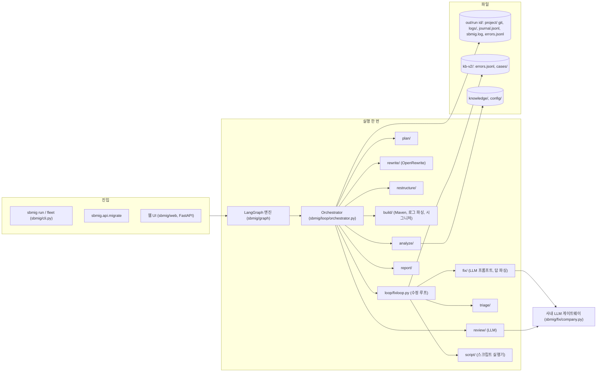
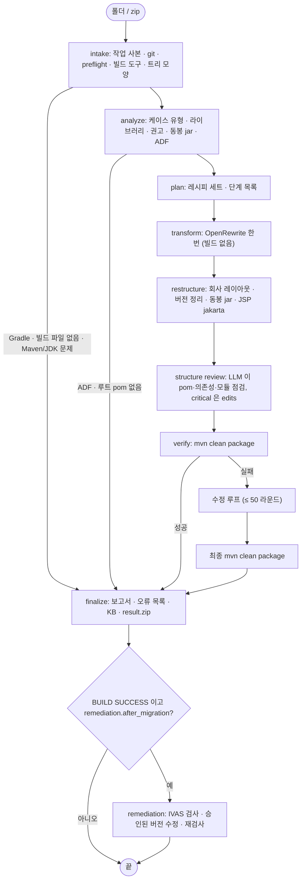
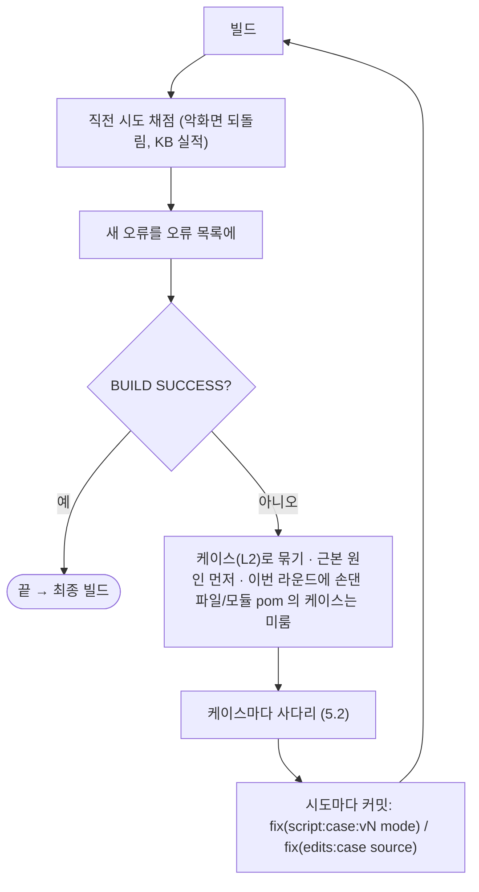
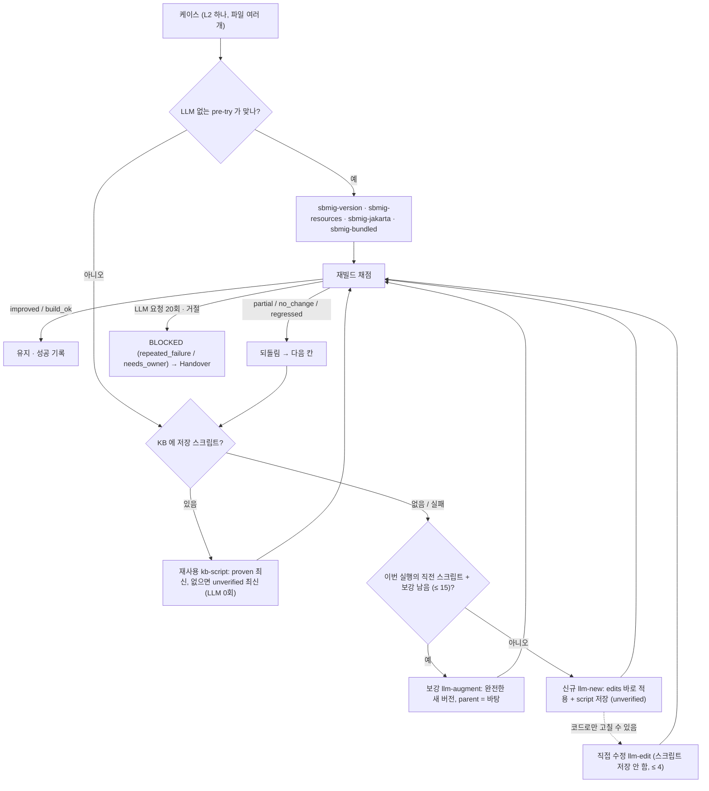
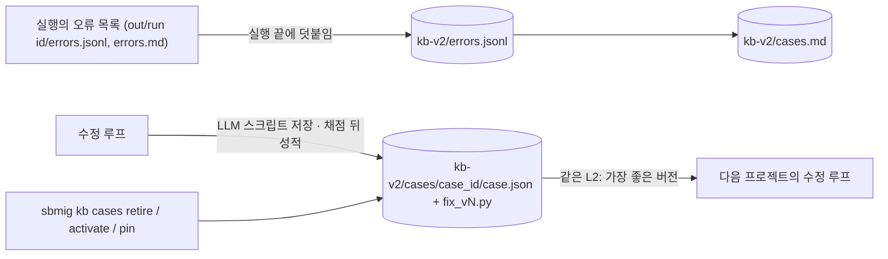
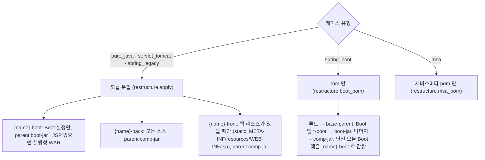
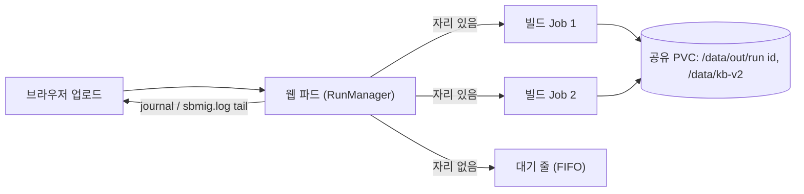

# migration agent — 상세 설계

이 문서는 사내 Maven 프로젝트를 JDK 21과 Spring Boot 4.1로 옮기는 마이그레이션 에이전트(`sbmig`)의 지금 설계를 흐름·노드 단위로 설명합니다.
식별자, 경로, 설정 키, journal 이벤트 이름은 코드 그대로 영어로 적습니다. 다이어그램은 Mermaid 로 이 파일 안에 있습니다.
담당자에게 보여 주는 16장짜리 흐름 덱은 같은 폴더의 `migration-agent.pptx`(만드는 법: `scripts/handbook/README.md`)입니다.

더 자세한 것은 주제별로 있습니다: 단계별 코드 위치·저널·플래그 `agent-doc/02-flow-and-nodes.md`, 케이스·스크립트·KB `agent-doc/04-cases-scripts-kb.md`,
회사 규칙과 재구성 `agent-doc/06-company-rules-restructure.md`, 배포 `deploy/README.md`, 계약 `docs/INTERFACES.md`, 결정 기록 `docs/v2/PLAN-v2.md`.

## 목차

1. [개요](#1-개요)
2. [아키텍처](#2-아키텍처)
3. [전체 흐름](#3-전체-흐름)
4. [노드별 설명](#4-노드별-설명)
5. [수정 루프](#5-수정-루프)
6. [지식베이스](#6-지식베이스)
7. [보고서와 Handover](#7-보고서와-handover)
8. [재구성 — 회사 레이아웃](#8-재구성--회사-레이아웃)
9. [실행 방식 — CLI, 웹, Job, 플릿](#9-실행-방식--cli-웹-job-플릿)
10. [취약점 조치](#10-취약점-조치)
11. [운영과 검증](#11-운영과-검증)

---

## 1. 개요

### 1.1 목적과 범위

- 입력: as-is 프로젝트 하나(폴더 또는 zip). 순수 Java, Spring 4/5, 서블릿 / Tomcat, Spring Boot 2/3, MSA(서비스 여러 개).
- 출력: JDK 21 + Spring Boot 4.1 로 옮기고 회사 레이아웃으로 재구성한 프로젝트, 보고서(`report.md` / `report.json`, Handover 가 맨 앞), `result.zip`, `changes.patch`.
- 범위: **패키징과 빌드 통과까지**(`mvn clean package -Dmaven.test.skip=true` → BUILD SUCCESS). 런타임 오류는 as-is 담당팀 몫, 테스트는 컴파일하지 않습니다.
- 운영 모델: 에이전트 하나가 ~500 개 프로젝트를 옮깁니다. 빌드 오류를 고친 스크립트는 케이스(L2 시그니처)마다 KB 에 남아 뒤의 프로젝트가 LLM 없이 다시 씁니다.

### 1.2 받는 트리

| 트리 | 처리 |
|---|---|
| Maven (루트 pom) | 그대로 |
| 루트 pom 없는 형제 pom / `APP/pom.xml` 이 `../DEV` 를 묶는 모양 | 접수에서 루트 aggregator 생성 |
| Ant (`build.xml` 만) | 접수에서 pom.xml 합성(`intake.ant_to_maven`), 좌표 모르는 jar 는 `system` 스코프 + Handover |
| Gradle, pom 도 build.xml 도 없는 트리 | 거부(exit 3). 담당팀 안내문은 읽기 전용 `sbmig inventory <dir>` |
| Oracle ADF(근거 계열 둘 이상) | 분석에서 멈춤(exit 3, "ADF 프로젝트라 변환이 불가능합니다") |
| 리액터가 아무것도 컴파일하지 않는 속 빈 모양 | 계속하지만 성공 아님(`hollow-reactor`, exit 2) |

### 1.3 지키는 규칙

1. **빌드 게이트**: 어떤 실행도 마지막 `mvn clean package` 시도와 미해결 오류 목록이 든 보고서 없이 끝나지 않습니다. 수정 시도는 모두 다시 빌드해 채점하고, 도움이 안 된 것은 되돌립니다.
2. 회사 고유 값은 설정·지식 YAML 에 있고 파이썬 코드에는 없습니다.
3. KB 는 파일입니다(DB 없음).
4. 플러그인 접점(`LLMRequest` / `LLMResponse`, `FixerLike.propose_script`, `sbmig.api.migrate`)은 바꾸지 않습니다.
5. 레시피 id 의 출처는 `knowledge/recipes/catalog.yml` 하나입니다.
6. 수정 스크립트는 `sbmig.script` 로만 돕니다: 정적 검사, `python -I` 자식 프로세스, 프로젝트 폴더로 제한된 도우미 API, 시간 제한.
7. 버전은 추측하지 않습니다: as-is 빌드, 회사 부모 체인, 저장소에서만 가져옵니다.

## 2. 아키텍처

- 실행 한 번 = `Orchestrator` 하나. 입력은 `out/<run id>/project/` 로 복사되고 git 저장소가 됩니다(브랜치 `sbmig/<run id>`, 첫 커밋 as-is 스냅숏). 단계마다 커밋하므로 `changes.patch` 는 as-is 와 마지막 커밋의 차이입니다.
- 무거운 객체는 오케스트레이터가 들고, 그래프 상태에는 작은 JSON 값만 둡니다. `loop.engine: inline` 은 같은 순서를 그래프 없이 돌며 결과가 같습니다(테스트로 보장).
- LLM 은 두 곳에서만 부릅니다: 구조 검토와 수정 루프. 계획은 규칙 기반입니다(`plan.advisor` 기본 `none`).

## 3. 전체 흐름

LangGraph 노드는 `intake` → `analyze` → `plan` → `phase`(단계 묶음마다 반복: transform, restructure(재구성 + 검토), verify) → `finalize` → `remediation` → END 입니다.
멈춤(`--stop-after`, 웹의 Stop)이나 중단은 곧바로 `finalize` 로 갑니다. Stop 은 노드 사이에서만 반영되고, 진행 중인 Maven·LLM 호출은 끊지 않습니다.

MSA 는 공유 라이브러리 루트 먼저, 그다음 서비스마다 `transform.rewrite@<x>` → `restructure.msa_pom` → `restructure.review` → `verify.build` 입니다(루트 aggregator 가 없으면 서비스마다 verify).

## 4. 노드별 설명

### 4.1 intake

- `build.setup_command`(있으면) → preflight(Maven 실행, `mvn -v` 의 Java 가 21, 사내 부모 좌표가 채워졌는지) → 빌드 도구 판별(Maven / Ant 합성 / 거부).
- 트리 모양: 떠도는 pom 복사본(IDE 출력 폴더의 모듈 사본) 무시, 루트 pom 없으면 aggregator 생성, 리액터에 두 번 닿는 모듈 제거, 배포 전송 빌드 확장(wagon) 제거, 사내 부모 체인의 빌드 확장 점검.
- as-is effective dependencyManagement 캡처 → `logs/effective-depmgmt.json`(나중에 버전 이어받기와 Handover 의 "바뀐 버전").
- 멈춤(exit 3): `mvn-not-found`, `jdk-not-21`, `unsupported-build-tool:<도구>`, `ear-without-modules`.

### 4.2 analyze

- 모든 pom(Maven 호출 없이), 소스, web.xml, JSP, 트리 안 jar 를 읽어 `ProjectProfile` 을 만듭니다: 케이스 유형(`pure_java` | `servlet_tomcat` | `spring_legacy` | `spring_boot` | `msa`), Java·Spring·Boot 버전, 라이브러리, 외부 설정 키, 동봉 jar.
- EOL 라이브러리 권고(`knowledge/libraries/advisories.yml`)는 **안내만** 합니다: 수정 프롬프트의 힌트와 Handover. 차단 정책은 없습니다.
- 멈춤: ADF 근거 계열 둘 이상(`intake.adf_policy: stop`), 루트 pom 없고 MSA 아님. 계속하지만 성공 아님: `hollow-reactor`.

### 4.3 plan

규칙 기반으로 레시피 세트와 단계 id 를 정합니다(`sbmig/plan/planner.py`). 레시피 세트:

| 세트 | 누구에게 |
|---|---|
| `jdk21` (`UpgradeToJava21`) | 모두 |
| `jakarta` (`JavaxMigrationToJakarta`) | `spring_legacy`, `servlet_tomcat`; Java EE javax 를 쓰는 `pure_java` |
| `spring_framework_7` | `spring_legacy` |
| `spring_security_7` (6.0 … 7.0 체인) | spring-security 를 쓰는 `spring_legacy` |
| `spring_batch_6`, `hibernate_7` | 그 라이브러리를 쓰는 `spring_legacy` |
| `servlet_jakarta_10` | `servlet_tomcat` 등 서블릿 프로젝트 |
| `spring_boot_4` (`UpgradeSpringBoot_4_0` + `SpringBootProperties_4_1`) | `spring_boot` |

단계: `transform.rewrite` → `restructure.apply` | `restructure.boot_pom` | `restructure.pom_only` | `restructure.msa_pom` → `restructure.review` → `verify.build`.
`transform.compile` 은 `plan.compile_after_rewrite: true` 일 때만 생깁니다(기본 false — 재구성 전 빌드는 as-is 클래스패스라 의미가 없음).

### 4.4 transform

계획한 레시피 전부를 rewrite-maven-plugin **한 번**에 돌립니다(as-is 클래스패스, 중간 빌드 없음, 레시피 BOM 3.37.0). JSP 는 파싱하지 않습니다.
실패해도 멈추지 않습니다 — 빌드가 진짜 문제를 보여 줍니다. 커밋 `rewrite: transform.rewrite`.

### 4.5 restructure

`Restructurer.apply` 가 모드별 작업(디렉터리 이동, 루트 → aggregator, 부모 교체, 필수·선택 아티팩트, boot 모듈과 Application 생성, web.xml 등록)을 하고, 모든 pom 을 정리합니다:
필터링되는 바이너리의 `nonFilteredFileExtensions` → as-is 버전 이어 적기 → 부모 체인이 관리하는 버전 지우기 → 체인을 덮는 버전 속성 지우기 → 참조 없는 버전 속성 지우기 → 동봉 jar 연결 → JSP javax → jakarta.
실패하면 `restructure-failed`(나머지 재구성은 건너뛰고 빌드는 돎, 성공 아님). 규칙은 §8.

### 4.6 structure review

LLM 이 재구성된 pom 전부와 재구성 메모, 부모 체인 사실, 인코딩·필터링 리소스 사실을 회사 규칙에 비춰 봅니다. 이슈마다 `critical` 또는 `warning`.

- critical → LLM 답의 `<edits>` 를 적용(`review.fix_critical`; 스크립트는 받지 않음, `review.ask_script: false`). `review.invariant_check` 가 재구성 불변식(예: 떠도는 pom 사본을 모듈로 등록하지 않기)을 다시 검사해 어긴 편집은 되돌리고 한 번 다시 묻습니다. 성공하면 커밋 `review: fix critical structure issues (<n>)`.
- warning → 보고서 "Structure review" 절과 오류 목록의 note 항목. 검토 재료에 없는 버전을 말한 이슈는 적용하지 않습니다.
- 실행을 멈추지 않습니다. 판정은 `SBMIG-RESULT … review=<verdict>`.

### 4.7 verify

`mvn clean package -Dmaven.test.skip=true`. 실패하면 수정 루프(§5), 루프가 돌았으면 최종 빌드를 **반드시** 한 번 더 합니다.
Windows `target/` 잠금은 기다렸다 다시(`build.file_lock_retries`), 로컬 저장소 부정 캐시는 `-U` 로 한 번 더.

### 4.8 finalize

LLM 사용량·비용, 성공 판정(계획한 최종 빌드 전부 성공 + `restructure-failed` / `hollow-reactor` / 중단 없음), 미해결·차단 목록, 오류 목록과 KB 기록, 보고서 쓰기, 그다음 `changes.patch` / `result.zip`(KB 와 보고서가 먼저).
마지막 줄 `SBMIG-RESULT run=… exit=… build=… unresolved=… blocked=… llm=… attn=… review=…`. 종료 코드: 0 성공, 2 차단·미해결·성공 아님, 3 중단.

## 5. 수정 루프

### 5.1 라운드 한 바퀴

- 끝나는 조건은 언제나 빌드 뒤: 성공, 라운드 소진(`loop.phases.verify.max_iterations` 50), 손댈 케이스 없음, 차단만 남음, 시간 초과(`loop.max_total_minutes`).
- 순서: parent → pom → 의존성 → 플러그인 해석 → … → 컴파일(리액터 순서) 순, 같은 순위면 `package does not exist` 같은 근본 원인 먼저.
- 정체(같은 오류 집합)·진동(이전 빌드로 돌아감)이 반복되면 더 센 모델(`llm.escalation_model`)로, 계속되면 `oscillation` 으로 차단.

### 5.2 케이스당 사다리

| pre-try | 언제 | 하는 일 |
|---|---|---|
| `sbmig-version` | 의존성 버전 누락 | 새 부모 체인이 관리 → 버전 없음; as-is 빌드의 버전; 방금 추가된 것만 저장소 최신 릴리스 |
| `sbmig-resources` | 필터링되는 바이너리에서 리소스 플러그인 실패 | `nonFilteredFileExtensions` 에 확장자 추가 |
| `sbmig-jakarta` | javax 라이브러리이고 저장소에서 jakarta 빌드를 확인 | 의존성 선언 교체(상위 메이저면 Handover ⚠) |
| `sbmig-bundled` | 잃은 패키지를 트리 안 동봉 jar 가 제공 | 좌표가 저장소에 있으면 의존성, 없으면 `lib/` + `system` 스코프 |

- 한도: 케이스마다 실행당 LLM 요청 20회(`script.max_llm_tries_per_case`), 그중 보강 15회(`script.max_augments_per_case`), 직접 수정 4회(`script.max_edit_tries_per_case`), 거절 1회(`script.max_declines_per_case`). 세 번째 요청부터 더 센 모델.
- 거절이 sbmig 가 확인한 사실(저장소에 jakarta 빌드가 있음, 동봉 jar 가 그 패키지를 줌, 프로젝트 코드로 대체하는 노트가 있음)과 모순이면 받지 않고 사실과 함께 다시 묻습니다.
- "프로젝트 밖" 원인(외부 javax API, 없는 아티팩트, 맞지 않는 플러그인)은 `loop.blocked_policy` 가 정한 횟수만 시도합니다.

### 5.3 채점

| 결과 | 조건 | 뒤처리 |
|---|---|---|
| `build_ok` / `improved` | 빌드 성공 / 대상 오류가 전부 사라지고 빌드가 그 단계까지 감 | 유지, KB 성공 |
| `partial` | 일부만 사라짐, 손댄 파일에 새 오류 없음 | 다음 시도 전에 되돌림 |
| `no_change` | 그대로 | 되돌림, KB 실패 |
| `regressed` → `reverted` | 손댄 파일에 새 오류, 오류 수 1.5배 초과, pom 수정 뒤 구조적 오류 | 되돌림 |
| `inconclusive` | 빌드가 판정을 못 함(타임아웃 등) | 실적 없음 |
| `apply_failed` | 적용 실패 | 변경 버림 |

### 5.4 스크립트 계약

LLM 답: `<analysis>`(원인) `<solution>`(해결) `<edits>`(바로 적용할 편집, JSON) `<script>`(`def fix(p)`, 다른 프로젝트에서도 쓸 재사용 스크립트) 또는 `<no_script>`(이유).
스크립트는 정적 검사(허용 import 만, `open`/`exec`/`eval` 금지) → `python -I` 자식 프로세스 → 도우미 API `p`(프로젝트 폴더 안 파일 읽기·쓰기, pom 편집기, `p.errors`) → 시간 제한·프로세스 트리 종료로 돕니다.
`ok` 직후 한 번 더 돌려 또 바뀌면 재사용하지 않습니다(`non_idempotent`). API 전체: `agent-doc/04-cases-scripts-kb.md` §7.

## 6. 지식베이스

- 케이스 = L2 시그니처(`종류|분류|핵심 심볼`, 경로·줄·버전·모듈 이름 없음), 폴더 이름 = `sha1(L2)` 앞 10자.
- 스크립트 상태: `unverified`(저장) → `proven`(만든 프로젝트가 아닌 곳에서 재사용으로 해결) → `retired`(사람).
- 모든 쓰기는 `<kb>/.lock` 아래(웹 파드·빌드 파드 여러 개가 같은 KB 를 씀). 테스트와 데모는 `out/` 아래 KB 만 씁니다.
- 파일·키·필드 전체: `docs/kb-map/`(현업용 데이터 지도), `docs/v2/PLAN-v2.1.md` §3.3–§3.4.

## 7. 보고서와 Handover

`report.md` 절 순서: 머리 표(Result, `SBMIG-RESULT` 줄, Case, As-is, To-be, LLM, Flags, Blocked, Structure review) → **인수인계**(운영자 확인 필요 → Ant pom 합성 → 교체된 버전 → 주의 라이브러리 → 이제부터 할 일) → ADF sizing → Error list → Fixes by case → Structure review → Bundled jars → Blocked → javax API jars → Manual follow-ups → Flags → What we changed → LLM usage and cost → Notes → Outputs.
문구 언어는 `report.language`(en | ko). Handover 는 as-is 담당팀이 할 일(⚠ 이어 적은 버전, 컴파일은 되는 EOL 라이브러리, 설정할 속성, Nexus 에 올릴 동봉 jar, 차단 항목)을 맨 앞에 모읍니다.

## 8. 재구성 — 회사 레이아웃

- 루트 pom 은 사내 `base-parent`(`artifacts.parent`)를 상속하는 aggregator 이고, 필수 아티팩트 2개는 모든 루트 pom 에(`artifacts.mandatory_target: root`), 선택 아티팩트는 이미 쓸 때만 맞추거나 `when_present` 트리거로 추가합니다. `{name}` = 루트 artifactId.
- 버전: as-is 부모가 관리하던 버전은 as-is effective pom 에서 이어 적고(Handover ⚠), 새 부모 체인이 관리하는 버전은 지우고, 체인을 덮는 as-is 버전 속성은 지웁니다. 체인 사실은 effective-pom 캡처, 실패하면 저장소의 회사 부모 pom 에서 읽습니다.
- 동봉 jar(WEB-INF/lib 의 벤더 jar): 첫 빌드 전에 연결합니다(`layout.wire_bundled_jars`) — 좌표를 저장소가 주면 의존성, 아니면 `lib/` + `system`. 목표 체인이 관리하는 g:a 의 옛 jar 는 붙이지 않습니다.
- 예전 레이아웃(`module/boot-jar` + `module/comp-jar`)은 `layout.*` 로 남아 있습니다. 규칙 하나하나: `agent-doc/06-company-rules-restructure.md`.

## 9. 실행 방식 — CLI, 웹, Job, 플릿

| 방식 | 무엇 |
|---|---|
| `sbmig run <폴더 또는 zip> --config <회사 yml>` | 한 프로젝트 → `out/<run id>/` |
| `sbmig fleet run <manifest>` / `resume` / `status` | 여러 프로젝트를 하나씩, KB 하나 공유(개발·대량 시험용) |
| `sbmig serve` (in-process) | 웹 UI: zip 업로드 → 실행을 이 프로세스에서, 한 번에 하나(나머지는 `queued`), SSE 로 `node` / `journal` / `log` / `report` 이벤트 |
| `sbmig serve` + `SBMIG_WEB_MODE=k8s-job` | 웹 파드가 업로드마다 빌드 **Job** 을 만듦. 동시에 `SBMIG_JOB_MAX_PARALLEL` 개(매니페스트 3), 나머지는 올린 순서로 대기. 자리 k ≥ 2 는 자기 Maven 로컬 저장소. 공유 PVC 의 실행 폴더로만 만남(`control/state.json`, `job-status.json`) |

Main ↔ Worker 의 파일·종료 코드·멈춤·복구 약속: `docs/v2/JOB-RUN-STATE-CONTRACT-KO.md`. 매니페스트와 운영: `deploy/README.md`.

## 10. 취약점 조치

이관이 BUILD SUCCESS 로 끝나고 `remediation.after_migration` 이 켜져 있으면, 마지막 노드 `remediation` 이 같은 빌드 파드 안에서 별도 그래프를 부릅니다:
IVAS 로 이관된 프로젝트를 검사하고, 승인된 취약 라이브러리의 **버전 글자만** 고쳐 다시 빌드·재검사합니다. 결과는 `<실행 폴더>/remediation/` 에 남고 이관의 판정·종료 코드는 바꾸지 않습니다(`SBMIG-RESULT … remediation=<상태>`).
승인을 기다리면 파드가 끝나고, 재개는 새 빌드 파드로 이어 갑니다. 노드·상태·API·설정: `agent-doc/11-remediations.md`.

## 11. 운영과 검증

- 설정: `config/default.yml` ← 회사 `config/artifacts.yml` ← `--config` 로 더 준 파일 ← 환경 변수 `SBMIG_<SECTION>__<KEY>`. LLM 키는 환경 / `.env` 에서만(`LLM_API_KEY`).
- LLM: provider `company`(`requests.post` 한 번, `sbmig/fix/company.py`), 사내 GPT agent 게이트웨이는 `llm.gateway: agent`. 새 게이트웨이에서는 `sbmig llm-probe` 먼저.
- 로그: 실행마다 `sbmig.log`(DEBUG, 줄마다 `[단계]`), `journal.jsonl`(이벤트 한 줄씩), LLM 기록 `llm.record_dir`.
- 검증: 오프라인 테스트 `python -m pytest -m "not integration"`, 실제 Maven e2e `scripts/e2e.sh`(픽스처마다 재생 LLM 답, `fixtures/projects/README.md`), 문서 검사 `tests/docs/`.
