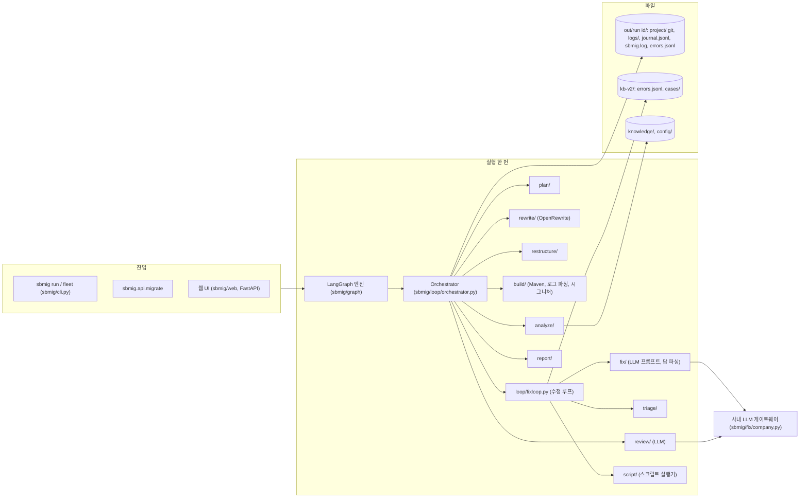
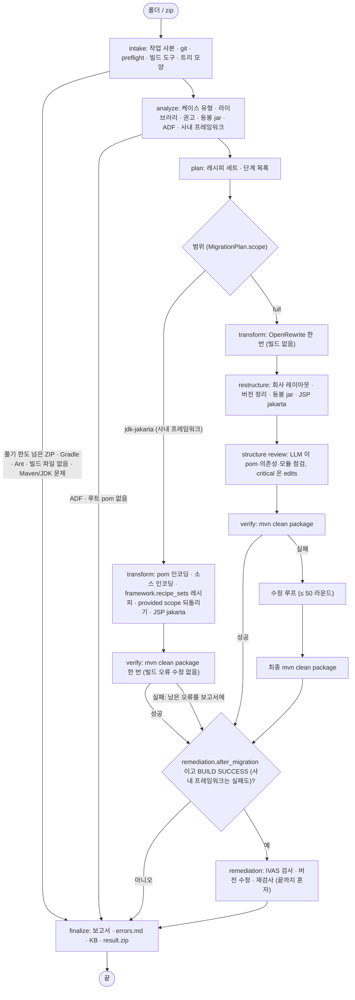
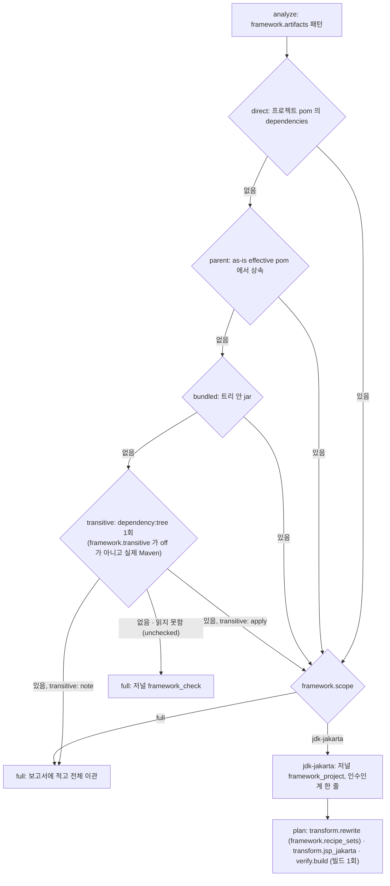
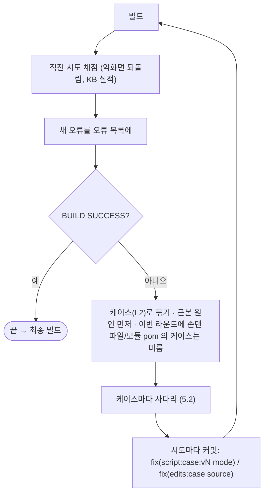
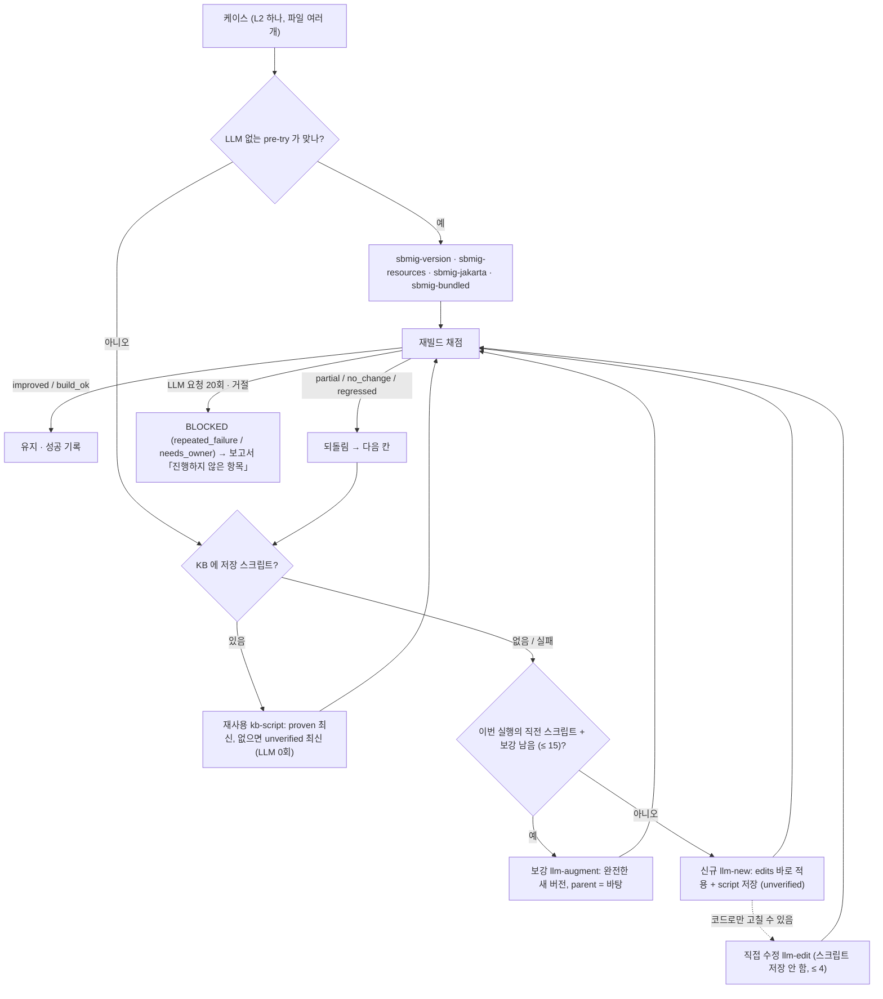
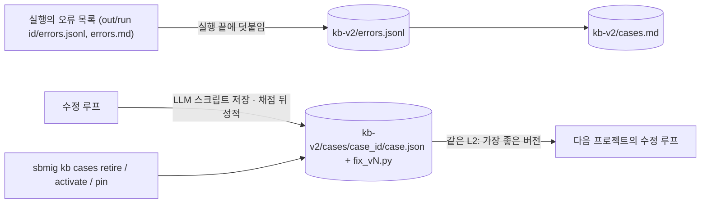
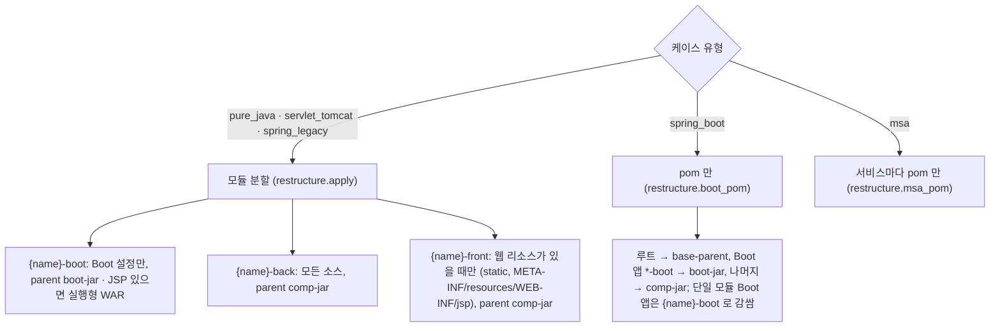
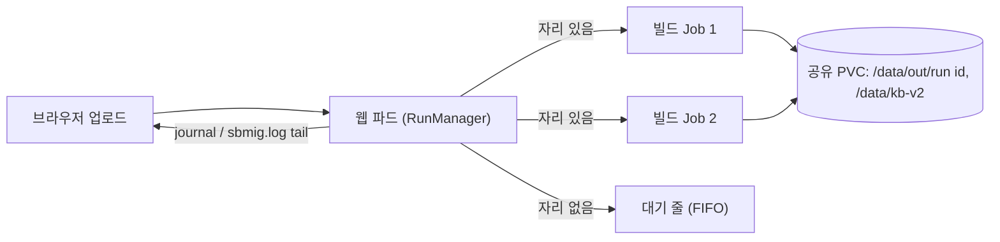

# migration agent — 상세 설계

이 문서는 사내 Maven 프로젝트를 JDK 21과 Spring Boot 4.1로 옮기는 마이그레이션 에이전트(`sbmig`)의 지금 설계를 흐름·노드 단위로 설명합니다.
식별자, 경로, 설정 키, journal 이벤트 이름은 코드 그대로 영어로 적습니다. 다이어그램은 Mermaid 로 이 파일 안에 있습니다.
담당자에게 보여 주는 16장짜리 흐름 덱은 같은 폴더의 `migration-agent.pptx`(만드는 법: `scripts/handbook/README.md`)입니다.

더 자세한 것은 주제별로 있습니다: 단계별 코드 위치·저널·플래그 `agent-doc/02-flow-and-nodes.md`, 케이스·스크립트·KB `agent-doc/04-cases-scripts-kb.md`,
회사 규칙과 재구성 `agent-doc/06-company-rules-restructure.md`, 배포 `deploy/README.md`, 계약 `docs/INTERFACES.md`, 결정 기록 `docs/v2/PLAN-v2.md`.

## 목차

1. [개요](#1-개요)
2. [아키텍처](#2-아키텍처)
3. [전체 흐름](#3-전체-흐름)
4. [노드별 설명](#4-노드별-설명)
5. [수정 루프](#5-수정-루프)
6. [지식베이스](#6-지식베이스)
7. [보고서](#7-보고서)
8. [재구성 — 회사 레이아웃](#8-재구성--회사-레이아웃)
9. [실행 방식 — CLI, 웹, Job, 플릿](#9-실행-방식--cli-웹-job-플릿)
10. [취약점 조치](#10-취약점-조치)
11. [운영과 검증](#11-운영과-검증)

---

## 1. 개요

### 1.1 목적과 범위

- 입력: as-is 프로젝트 하나(폴더 또는 zip). 순수 Java, Spring 4/5, 서블릿 / Tomcat, Spring Boot 2/3, MSA(서비스 여러 개).
- 출력: JDK 21 + Spring Boot 4.1 로 옮기고 회사 레이아웃으로 재구성한 프로젝트, 보고서(`report.md` / `report.json`: 요청 담당자가 읽는 안내서), `result.zip`, `changes.patch`.
- 범위: **패키징과 빌드 통과까지**(`mvn clean package -Dmaven.test.skip=true` → BUILD SUCCESS). 런타임 오류는 as-is 담당팀 몫, 테스트는 컴파일하지 않습니다.
- 운영 모델: 에이전트 하나가 ~500 개 프로젝트를 옮깁니다. 빌드 오류를 고친 스크립트는 케이스(L2 시그니처)마다 KB 에 남아 뒤의 프로젝트가 LLM 없이 다시 씁니다.

### 1.2 받는 트리

| 트리 | 처리 |
|---|---|
| Maven (루트 pom) | 그대로 |
| 루트 pom 없는 형제 pom / `APP/pom.xml` 이 `../DEV` 를 묶는 모양 | 접수에서 루트 aggregator 생성 |
| Ant (`build.xml` 만) | 받지 않음(exit 3, `unsupported-build-tool:ant`). 안내 문구 "Maven 변환 후 신청 부탁드립니다."(`intake.ant_message`). `intake.ant_to_maven: true` 면 접수에서 pom.xml 을 합성하고 진행(좌표 모르는 jar 는 `system` 스코프 + Handover) |
| Gradle, pom 도 build.xml 도 없는 트리 | 거부(exit 3). 담당팀 안내문은 읽기 전용 `sbmig inventory <dir>` |
| Oracle ADF(근거 계열 둘 이상) | 분석에서 멈춤(exit 3, "ADF 프로젝트라 변환이 불가능합니다") |
| 리액터가 아무것도 컴파일하지 않는 속 빈 모양 | 계속하지만 성공 아님(`hollow-reactor`, exit 2) |
| 풀면 너무 큰 ZIP(`intake.max_unpacked_mb` / `intake.max_entry_mb` / `intake.max_compression_ratio`) | 아무것도 풀지 않고 거부(exit 3, `run aborted: ZIP refused: …`) |

### 1.3 지키는 규칙

1. **빌드 게이트**: 어떤 실행도 마지막 `mvn clean package` 시도와 미해결 오류 목록이 든 보고서 없이 끝나지 않습니다. 수정 시도는 모두 다시 빌드해 채점하고, 도움이 안 된 것은 되돌립니다.
2. 회사 고유 값은 설정·지식 YAML 에 있고 파이썬 코드에는 없습니다.
3. KB 는 파일입니다(DB 없음).
4. 플러그인 접점(`LLMRequest` / `LLMResponse`, `FixerLike.propose_script`, `sbmig.api.migrate`)은 바꾸지 않습니다.
5. 레시피 id 의 출처는 `knowledge/recipes/catalog.yml` 하나입니다.
6. 수정 스크립트는 `sbmig.script` 로만 돕니다: 정적 검사, `python -I` 자식 프로세스, 프로젝트 폴더로 제한된 도우미 API, 시간 제한.
7. 버전은 추측하지 않습니다: as-is 빌드, 회사 부모 체인, 저장소에서만 가져옵니다.

## 2. 아키텍처

- 실행 한 번 = `Orchestrator` 하나. 입력은 `out/<run id>/project/` 로 복사되고 git 저장소가 됩니다(브랜치 `sbmig/<run id>`, 첫 커밋 as-is 스냅숏). 단계마다 커밋하므로 `changes.patch` 는 as-is 와 마지막 커밋의 차이입니다.
- 무거운 객체는 오케스트레이터가 들고, 그래프 상태에는 작은 JSON 값만 둡니다. `loop.engine: inline` 은 같은 순서를 그래프 없이 돌며 결과가 같습니다(테스트로 보장).
- LLM 은 두 곳에서만 부릅니다: 구조 검토와 수정 루프. 계획은 규칙 기반입니다(`plan.advisor` 기본 `none`).

## 3. 전체 흐름

LangGraph 노드는 `intake` → `analyze` → `plan` → `phase`(단계 묶음마다 반복: transform, restructure(재구성 + 검토), verify) → `finalize` → `remediation` → END 입니다. 그래프의 `finalize` 노드는 멈춤 표시만 정리하고, 보고서 · KB 기록 · `changes.patch` · `result.zip` 은 그래프가 끝난 뒤, 곧 취약점 조치가 끝난 뒤에 씁니다. 그래서 이관 보고서에 취약점 조치 요약 절이 들어갑니다.
위 그림은 실행 방식 `full`(기본, 전체 진행)입니다. 실행 방식 `remediation`(취약점 해결)은 `intake` → `remediation` → `finalize` 만 지나갑니다: 프로젝트를 고치지 않는 접수(작업 사본, preflight, 빌드 도구 판별과 거부), 올린 그대로의 프로젝트에 대한 취약점 조치, 짧은 보고서. 이관 단계·LLM·KB 는 쓰지 않습니다(10절).
멈춤(`--stop-after`, 웹의 Stop)이나 중단은 곧바로 `finalize` 로 갑니다. Stop 은 노드 사이에서만 반영되고, 진행 중인 Maven·LLM 호출은 끊지 않습니다.
마지막 단계 묶음 뒤의 멈춤 요청은 이렇게 처리합니다(`Orchestrator.late_stop`, 두 엔진 같음): 계획한 최종 빌드에 결과가 없으면 중단, 수정 루프가 요청으로 나왔으면 중단(트리가 루프의 마지막 빌드 뒤 그대로면 최종 빌드를 다시 하지 않고 그 빌드가 최종 빌드), 최종 빌드가 모두 끝난 뒤에 온 요청은 무시하고 실행을 그대로 끝냅니다(저널 `stop_request`).

사내 프레임워크 프로젝트는 계획의 범위가 `jdk-jakarta` 라서 재구성과 구조 검토를 건너뛰고 변환에서 곧바로 검증으로 갑니다. 빌드는 한 번만 하고 수정 루프는 돌지 않습니다(`framework.fix_loop: true` 일 때만 위 그림의 수정 루프로 갑니다, 4.9절).

MSA 는 공유 라이브러리 루트 먼저, 그다음 서비스마다 `transform.rewrite@<x>` → `restructure.msa_pom` → `restructure.review` → `verify.build` 입니다(루트 aggregator 가 없으면 서비스마다 verify).

## 4. 노드별 설명

### 4.1 intake

- `build.setup_command`(있으면) → preflight(Maven 실행, `mvn -v` 의 Java 가 21, 사내 부모 좌표가 채워졌는지) → 빌드 도구 판별(Maven 통과 / Ant 는 `intake.ant_message` 로 거부, `intake.ant_to_maven: true` 면 pom 합성 / Gradle·빌드 파일 없음 거부).
- 트리 모양: 떠도는 pom 복사본(IDE 출력 폴더의 모듈 사본) 무시, 루트 pom 없으면 aggregator 생성, 리액터에 두 번 닿는 모듈 제거, 배포 전송 빌드 확장(wagon) 제거, 사내 부모 체인의 빌드 확장 점검.
- as-is effective dependencyManagement 캡처 → `logs/effective-depmgmt.json`(나중에 버전 이어받기와 보고서 「전환 내용」의 의존성 버전 표).
- 멈춤(exit 3): 올린 ZIP 이 풀기 한도(`intake.max_unpacked_mb` 4096, `intake.max_entry_mb` 1024, `intake.max_compression_ratio` 200)를 넘음(아무것도 풀지 않음, `run aborted: ZIP refused: …`, 저널 `intake_refused`, preflight 전), `mvn-not-found`, `jdk-not-21`, `unsupported-build-tool:<도구>`, `ear-without-modules`.

### 4.2 analyze

- 모든 pom(Maven 호출 없이), 소스, web.xml, JSP, 트리 안 jar 를 읽어 `ProjectProfile` 을 만듭니다: 케이스 유형(`pure_java` | `servlet_tomcat` | `spring_legacy` | `spring_boot` | `msa`), Java·Spring·Boot 버전, 라이브러리, 외부 설정 키, 동봉 jar.
- EOL 라이브러리 권고(`knowledge/libraries/advisories.yml`)는 **안내만** 합니다: 수정 프롬프트의 힌트와 보고서 「확인해 주세요」의 항목. 차단 정책은 없습니다.
- 멈춤: ADF 근거 계열 둘 이상(`intake.adf_policy: stop`), 루트 pom 없고 MSA 아님. 계속하지만 성공 아님: `hollow-reactor`(모듈의 빌드 디렉터리는 프로젝트 안 부모 체인에서 물려받은 값까지 봅니다).
- 사내 프레임워크 검사가 아무것도 찾지 못했는데 부모 pom 과 의존성 트리를 둘 다 읽지 못했으면 플래그 `framework-unchecked` 와 인수인계 한 줄을 남기고 전체 범위로 계속합니다.

### 4.3 plan

규칙 기반으로 레시피 세트와 단계 id 를 정합니다(`sbmig/plan/planner.py`). 레시피 세트:

| 세트 | 누구에게 |
|---|---|
| `jdk21` (`UpgradeToJava21`) | 모두 |
| `jakarta` (`JavaxMigrationToJakarta`) | `spring_legacy`, `servlet_tomcat`; Java EE javax 를 쓰는 `pure_java` |
| `spring_framework_7` | `spring_legacy` |
| `spring_security_7` (6.0 … 7.0 체인) | spring-security 를 쓰는 `spring_legacy` |
| `spring_batch_6`, `hibernate_7` | 그 라이브러리를 쓰는 `spring_legacy` |
| `servlet_jakarta_10` | `servlet_tomcat` 등 서블릿 프로젝트 |
| `spring_boot_4` (`UpgradeSpringBoot_4_0` + `SpringBootProperties_4_1`) | `spring_boot` |
| `hystrix_resilience4j` (사내 레시피) | Hystrix 를 쓰는 프로젝트. `@HystrixCommand` 를 Resilience4j `@CircuitBreaker` 로, starter 를 `spring-cloud-starter-circuitbreaker-resilience4j` 로 바꿉니다 |

Boot 4 상위 레시피는 Springfox 를 springdoc 으로, `spring-cloud-starter-sleuth` 를 Micrometer Tracing 으로 바꿉니다. Hystrix 는 OpenRewrite 에 교체 레시피가 없어 사내 레시피로 바꾸며, `HystrixCommand` 를 상속한 코드처럼 레시피가 못 바꾸는 부분은 빌드 오류로 드러나 수정 루프가 옮깁니다.

단계: `transform.rewrite` → `restructure.apply` | `restructure.boot_pom` | `restructure.pom_only` | `restructure.msa_pom` → `restructure.review` → `verify.build`.
`transform.compile` 은 `plan.compile_after_rewrite: true` 일 때만 생깁니다(기본 false — 재구성 전 빌드는 as-is 클래스패스라 의미가 없음).

### 4.4 transform

계획한 레시피 전부를 rewrite-maven-plugin **한 번**에 돌립니다(as-is 클래스패스, 중간 빌드 없음, 레시피 BOM 3.37.0). JSP 는 파싱하지 않습니다.
실패해도 멈추지 않습니다 — 빌드가 진짜 문제를 보여 줍니다. 커밋 `rewrite: transform.rewrite`.

그 전에, XML 선언과 실제 바이트가 다른 pom(UTF-8 선언이나 선언 없이 한글을 MS949·EUC-KR로 저장한 pom)을 맞춥니다. Maven은 이런 pom을 그대로 빌드하지만 OpenRewrite는 파싱하지 못해 레시피 전체가 0개 파일로 실패하고, `MS949`처럼 선언해도 EUC-KR로 못 쓰는 음절은 대체 문자로 덮어씁니다(rewrite-maven-plugin 6.46.1로 잼). 그래서 `src/` 밖의 프로젝트 pom 가운데 바이트가 엄격한 EUC-KR이면 선언만 `EUC-KR`로 바꾸고, 그렇지 않으면 UTF-8로 다시 저장합니다. 한글 내용은 바뀌지 않고, BOM이 있는 파일, 이미 맞는 pom, 올바른 XML이 아닌 것, latin-1이나 shift_jis로만 설명되는 바이트는 건드리지 않습니다(`layout.legacy_context.correct_pom_encoding`, 기본 켬; 커밋 `transform: pom encodings corrected`, 저널 `pom_encodings`, 플래그 `pom-encoding-corrected`, 인수인계 한 줄 「자동 변환 전에 pom 파일의 글자 인코딩을 바로잡았습니다. …」). 두 범위 모두 같습니다.

레시피 실행이 실패하면(실행을 멈추게 하는 원인이 아닐 때) 그 사실을 남깁니다: 플래그 `rewrite-failed`(결과 줄 `attn=`의 맨 앞), 저널 `rewrite_failed {step, sets, reason}`, 인수인계 첫 줄(적용하지 못한 레시피 세트와 원인), 한국어 안내서의 앞 문장과 「확인해 주세요」 첫 항목 「자동 변환 실패」. 보통 실행은 빌드가 판정하고, 변환만 하는 사내 프레임워크 실행은 빌드가 통과해도 성공이 아닙니다(4.9절).

### 4.5 restructure

`Restructurer.apply` 가 모드별 작업(디렉터리 이동, 루트 → aggregator, 부모 교체, 필수·선택 아티팩트, boot 모듈과 Application 생성, web.xml 등록)을 하고, 모든 pom 을 정리합니다:
필터링되는 바이너리의 `nonFilteredFileExtensions` → as-is 버전 이어 적기 → 부모 체인이 관리하는 버전 지우기 → 체인을 덮는 버전 속성 지우기 → 참조 없는 버전 속성 지우기 → 동봉 jar 연결 → JSP javax → jakarta.
실패하면 트리를 단계 전 커밋으로 되돌리고(저널 `restructure_reset`) `restructure-failed`(나머지 재구성은 건너뛰고 빌드는 돎, 성공 아님). 규칙은 §8.

### 4.6 structure review

LLM 이 재구성된 pom 전부와 재구성 메모, 부모 체인 사실, 인코딩·필터링 리소스 사실을 회사 규칙에 비춰 봅니다. 이슈마다 `critical` 또는 `warning`.

- critical → LLM 답의 `<edits>` 를 적용(`review.fix_critical`; 스크립트는 받지 않음, `review.ask_script: false`). `review.invariant_check` 가 재구성 불변식(예: 떠도는 pom 사본을 모듈로 등록하지 않기)을 다시 검사해 어긴 편집은 되돌리고 한 번 다시 묻습니다. 성공하면 커밋 `review: fix critical structure issues (<n>)`.
- warning → 보고서 「확인해 주세요」의 항목과 `errors.md` 의 note 항목. 검토 재료에 없는 버전을 말한 이슈는 적용하지 않습니다.
- 답을 읽지 못하면(JSON 조각만 읽힘, 토큰 한도에서 잘림) 짧게 답하라고 한 번 다시 묻고, 두 번 다 못 읽으면 판정 `failed` 입니다. 첫 이슈만 남긴 검토는 만들지 않습니다.
- 실행을 멈추지 않습니다. 판정은 `SBMIG-RESULT … review=<verdict>`.

### 4.7 verify

`mvn clean package -Dmaven.test.skip=true`. 실패하면 수정 루프(§5), 루프가 돌았으면 최종 빌드를 **반드시** 한 번 더 합니다(루프가 멈춤 요청으로 나왔고 트리가 그대로면 루프의 마지막 빌드가 최종 빌드). MSA 의 `report.final_build` 는 실패한 첫 최종 빌드입니다. 사내 프레임워크 프로젝트는 기본으로 수정 루프 없이 이 빌드 한 번이 결과입니다(4.9절).
Windows `target/` 잠금은 기다렸다 다시(`build.file_lock_retries`), 로컬 저장소 부정 캐시는 `-U` 로 한 번 더. 저장소에 jar만 있고 pom이 없는 라이브러리 때문에 한 저장소가 pom 요청에 전송 오류(닫힌 망의 Maven Central 프록시가 내는 502 등)를 내 Maven이 멈추면, jar는 받을 수 있고 pom은 어디에도 없다는 것을 확인한 경우에만 로컬 저장소에 최소 pom(좌표와 `packaging` jar, sbmig가 썼다는 주석)을 쓰고 같은 Maven 명령을 한 번 더 실행합니다(`build.pomless_stub`, 실행당 `build.pomless_stub_max` 20개까지). sbmig의 의존성 해석 Maven 호출 전부에 걸리고, 프로젝트 파일은 바꾸지 않으며 LLM도 부르지 않습니다. 저널 `pomless_stub` / `pomless_check`, 플래그 `pomless-library`, 인수인계 한 줄(저장소에 진짜 pom을 올리는 것이 오래 갈 해결)이 남습니다. 재시도 순서는 HTTP 차단(재시도 없음) → 파일 잠금 → 최소 pom → `-U`(최소 pom을 쓴 뒤에는 건너뜀)이고, OpenRewrite·effective-pom 캡처·`dependency:tree`·클래스패스 캡처·`plan/jarcheck.py`·취약점 조치의 Maven 호출에도 걸립니다(`rewrite/versions.py`는 빼고). 쓰기 전에 pom은 GET, jar는 HEAD로 묻습니다. 앞선 실행이 만든 최소 pom을 쓴 실행도 마무리에서 알아보고 같은 플래그와 줄을 남깁니다(저널 `pomless_stub_used`). 취약점 해결만 하는 실행은 저널과 로그에만 남깁니다. 파일 위치와 지우는 법은 `deploy/README.md` §3.

### 4.8 finalize

LLM 사용량·비용, 성공 판정(계획한 최종 빌드 전부 성공 + `restructure-failed` / `hollow-reactor` / 중단 없음 + 변환만 하는 실행이면 `rewrite-failed` 없음), 미해결·차단 목록, 오류 목록과 KB 기록, 보고서 쓰기, 그다음 `changes.patch` / `result.zip`(KB 와 보고서가 먼저), 끝으로 웹 화면 「코드 변경」에 쓰는 기록 `codediff/`(마지막 커밋에 있는 경로만, 바뀐 파일이 없는 실행은 기록을 쓰지 않음 — 저널 `code_diff_skipped`).
마지막 줄 `SBMIG-RESULT run=… exit=… build=… unresolved=… blocked=… llm=… attn=… review=…`. 종료 코드: 0 성공, 2 차단·미해결·성공 아님, 3 중단.

### 4.9 사내 프레임워크 프로젝트 (범위 `jdk-jakarta`)

사내 프레임워크 아티팩트(`framework.artifacts`, 회사 yml 에만 적는 좌표, 예 `com.example.fw:example-fw-core`)를 쓰는 프로젝트는 회사 레이아웃과
Spring Boot 4 로 옮기지 않습니다. JDK 21 과 jakarta 만 올리고 빌드를 한 번 해서 결과를 알린 뒤 변환한 트리를 내려줍니다. 빌드 오류는 고치지 않습니다(사전 시도, 저장된 스크립트, LLM 호출 모두 없음).
사내 프레임워크와 사내 라이브러리가 얽힌 오류는 LLM 이 풀기 어렵고 담당자가 손대야 하는 경우가 많기 때문입니다. 취약점 조치는 빌드가 통과해도 실패해도 이어집니다(오픈소스 라이브러리 검사이므로).
부모 pom, 모듈 구조, Spring 라인, 프레임워크 버전은 그대로입니다. 패턴이 비어 있으면 검사하지 않습니다.

- 레시피: `framework.recipe_sets`(기본 `jdk21`, `jakarta`). 기본 jakarta 세트는 서블릿 API 를 서블릿 5.0 기준으로 올리므로, Tomcat 10.1 이상에 올릴 프로젝트는 `servlet_jakarta_10` 을 더합니다(회사가 정할 스위치).
- 레시피 전에 MS949·EUC-KR 소스 모듈의 pom 에 `project.build.sourceEncoding` 을 적습니다. JDK 18부터 javac 기본 인코딩이 UTF-8 이라 선언이 없으면 JDK 21 에서 컴파일되지 않고, OpenRewrite 도 읽지 못하는 파일은 건너뛰어(`rewrite_parse_problems`) javax import 가 남기 때문입니다(커밋 `transform: source encodings written`, 저널 `source_encodings`, 스위치 `layout.legacy_context.write_source_encoding`). 유지하는 부모가 다른 값을 정했으면 부모 값을 두고 Handover 한 줄을 남깁니다.
- 레시피가 compile 로 바꾼 as-is `provided` scope 는 변환 직후 되돌립니다(커밋 `transform: as-is provided scopes restored`, 저널 `scopes_restored`).
- 커밋 순서: (고친 pom이 있으면 `transform: pom encodings corrected` →) `transform: source encodings written` → `rewrite: transform.rewrite` → `transform: as-is provided scopes restored` → `transform: JSP javax → jakarta`. 두 정정은 보고서 「코드 수정 내역」의 자동 변환 줄과 `errors.md` 에 `transform` 단계의 pom 정정으로 나옵니다.
- 부모 pom 을 회사 부모로 맞추지 않습니다. 저장소가 부모 pom 을 주지 않으면 LLM 없이 `aborted:parent-not-found` 로 멈춥니다.
- 빌드: `verify.build` 마다 한 번 빌드합니다. 남은 오류는 보고서에서 「해결하지 못한 오류」가 아니라 「변환 뒤 남은 빌드 오류」로 나오고(자동으로 고치지 않았다는 앞 문장, 「확인해 주세요」 첫 줄이 이 절을 가리킴), 인수인계에 고치지 않았다는 한 줄이 붙습니다. 통과하면 exit 0, 실패하면 exit 2 이고 `result.zip` 은 변환한 트리입니다. 남은 오류는 프로젝트 담당자와 프레임워크 담당자가 봅니다.
- 취약점 조치: 빌드가 통과하면 보통 조치이고, 실패해도 이어서 돕니다(`remediation.after_failed_build: framework`, 기본. `never` 면 통과한 실행만). 실패한 빌드 뒤의 조치는 기준 빌드의 실패를 견디며(`RemediationState.baseline_tolerated`, 저널 `remediation_baseline_failed` `tolerated: true`), 후보 빌드는 기준 빌드에 있던 오류로만 실패해야 하고(같은 빌드 대상, 같은 실패 모듈, 모든 오류가 기준 빌드의 것, `maven.compare_with_baseline`), 새 오류가 생기면 `FAILED`(`candidate_build_failed`, `baseline_build_failed`)입니다. 버전을 바꿨으면 빌드로 확인한 변경이 없으므로 `SUCCEEDED` 가 아니라 `INCOMPLETE`(첫 사유 `baseline_build_failed`, 요약 `baseline_tolerated: true`, 결과 줄 `exit=2 … remediation=INCOMPLETE`)로 끝나고, 다른 사유가 없으면 화면은 「조치함 · 빌드 미확인」, 이관 보고서는 「조치했지만 빌드로 확인하지 못했습니다」라고 씁니다. 빌드 오류를 고친 뒤 바뀐 버전으로 한 번 빌드해야 합니다. 바꾼 버전이 없거나 수정본이 빌드되면 보통 조치처럼 끝납니다. 기준 빌드가 시간 초과였으면 견디지 않습니다. 이관은 실패 그대로입니다.
- 설정 두 가지: `framework.fix_loop`(기본 `false`, `true` 면 아래 수정 루프가 돕니다)와 `framework.name`(화면과 보고서에 보일 이름, 기본 `""`). 이름이 비어 있으면 프로젝트에서 찾은 아티팩트, 그다음 설정한 패턴의 artifactId 에서 끝의 역할 낱말(`core`, `framework`, `fw`, `starter`, `parent`, `bom`, `boot`, `common`, `base`, `api`)을 떼고 첫 글자를 대문자로 바꿔 만듭니다(`example-fw-core` → `Example`). 만든 이름이 틀리면 회사 `config/artifacts.yml` 에 `framework.name` 한 줄을 넣고 이미지를 다시 빌드합니다. 실제 이름은 회사 이름이라 이 저장소에는 적지 않습니다.
- 수정 루프(`framework.fix_loop: true` 일 때만): 버전 사실은 프로젝트 자기 부모 체인에서 오고 Boot BOM 은 쓰지 않습니다. 프레임워크 선언·버전이나 `<parent>` 를 바꾼 시도는 되돌립니다(저널 `framework_guard`; 버전의 `${…}` 는 프로젝트 안 부모 체인으로 풀어 비교하므로 루트 pom 의 속성을 바꾼 것도 잡습니다). 프레임워크 자신이 javax 기준이면 LLM 없이 `external_javax_api` 로 차단하고 담당자에게 jakarta 빌드를 요청하라고 적습니다.
- 결과: `SBMIG-RESULT … scope=jdk-jakarta`(수정 루프가 꺼져 있으면 `llm=0`). 자동 변환이 실패했으면 빌드가 통과해도 성공이 아닙니다: `exit=2 build=ok … attn=rewrite-failed`, 머리 표 「❌ 변환 실패 (빌드는 통과)」, 프레임워크 절은 한 일에서 변환을 빼고 「**JDK 21과 Jakarta 변환이 실패해 아무것도 변환되지 않았습니다.**」라고 알리며, 취약점 조치는 그래도 이어집니다. 사람이 이 실행을 만나는 곳마다 이름을 넣은 문장 `<이름> 프레임워크는 JDK 21, Jakarta만 적용합니다.`(이름이 없으면 `사내 프레임워크 프로젝트는 JDK 21, Jakarta만 적용합니다.`)를 강조해서 보여 줍니다. 이런 프로젝트가 덜 받는다는 것을 모르기 쉽기 때문입니다. 보고서는 머리 표 바로 아래 `## <이름> 프레임워크 프로젝트` 절이 이 문장(굵게)으로 시작하고 한 일과 하지 않은 일을 적습니다. 화면은 실행 카드와 결과 카드에 강조한 안내 상자를 띄우고, 서버 설정에 프레임워크 아티팩트가 있으면 올리기 카드에도 늘 보여 줍니다. 단계 줄의 재구성과 구조 검토는 `하지 않음` 입니다. 저널 `framework_project` 와 `plan` 에는 `name`, `fix_loop` 가 붙습니다.
- 사내 그룹: 프레임워크와 그것이 가져오는 라이브러리는 사내 그룹 `framework` 몫이라 제안하지 않습니다.

진단과 고칠 자리: `agent-doc/13-framework-projects.md`.

## 5. 수정 루프

### 5.1 라운드 한 바퀴

- 끝나는 조건은 언제나 빌드 뒤: 성공, 라운드 소진(`loop.phases.verify.max_iterations` 50), 손댈 케이스 없음, 차단만 남음, 시간 초과(`loop.max_total_minutes`), 멈춤 요청.
- 루프가 끝나면 케이스마다 마지막으로 적용한 시도가 `no_change` / `inconclusive` 일 때 최종 빌드 전에 되돌립니다(저널 `script_rollback` 의 `where: "loop end"`). 도움이 안 된 시도는 결과물에 넣지 않습니다. `partial` 은 남깁니다.
- 순서: parent → pom → 의존성 → 플러그인 해석 → … → 컴파일(리액터 순서) 순, 같은 순위면 `package does not exist` 같은 근본 원인 먼저.
- 정체(같은 오류 집합)·진동(이전 빌드로 돌아감)이 반복되면 더 센 모델(`llm.escalation_model`)로, 계속되면 `oscillation` 으로 차단.

### 5.2 케이스당 사다리

| pre-try | 언제 | 하는 일 |
|---|---|---|
| `sbmig-version` | 의존성 버전 누락 | 새 부모 체인이 관리 → 버전 없음; as-is 빌드의 버전; 방금 추가된 것만 저장소 최신 릴리스 |
| `sbmig-resources` | 필터링되는 바이너리에서 리소스 플러그인 실패 | `nonFilteredFileExtensions` 에 확장자 추가 |
| `sbmig-jakarta` | javax 라이브러리이고 저장소에서 jakarta 빌드를 확인 | 의존성 선언 교체(상위 메이저면 보고서 「운영자 확인」에 ⚠) |
| `sbmig-bundled` | 잃은 패키지를 트리 안 동봉 jar 가 제공 | 좌표가 저장소에 있으면 의존성, 없으면 `lib/` + `system` 스코프. 저장소가 답하지 않으면 붙이지도, 없다고 하지도 않음 |

- 한도: 케이스마다 실행당 LLM 요청 20회(`script.max_llm_tries_per_case`), 그중 보강 15회(`script.max_augments_per_case`), 직접 수정 4회(`script.max_edit_tries_per_case`), 거절 1회(`script.max_declines_per_case`). 세 번째 요청부터 더 센 모델.
- 거절이 sbmig 가 확인한 사실(저장소에 jakarta 빌드가 있음, 동봉 jar 가 그 패키지를 줌, 프로젝트 코드로 대체하는 노트가 있음)과 모순이면 받지 않고 사실과 함께 다시 묻습니다.
- "프로젝트 밖" 원인(외부 javax API, 없는 아티팩트, 맞지 않는 플러그인)은 `loop.blocked_policy` 가 정한 횟수만 시도합니다.
- 저장소가 답하지 않은 해결 오류(시간 초과, 연결 거부, 5xx 등)는 "없음" 이 아니라 `repository_unreachable` 입니다. LLM 에 묻지 않고(`loop.blocked_policy.repository_unreachable: 0`) 저장 스크립트 재사용보다 먼저 정해, 네트워크가 돌아와 빌드가 통과해도 어떤 스크립트에도 실적을 주지 않습니다.
- 토큰 교환 실패는 LLM 장애로 세고(쉼, `llm_unavailable`), 토큰 한도에서 잘려 `<script>` / `<edits>` 가 닫히지 않은 답은 쓰지도 저장하지도 않습니다(짧은 답을 다시 청함).

### 5.3 채점

| 결과 | 조건 | 뒤처리 |
|---|---|---|
| `build_ok` / `improved` | 빌드 성공 / 대상 오류가 전부 사라지고 빌드가 그 단계까지 감 | 유지, KB 성공 |
| `partial` | 일부만 사라짐, 손댄 파일에 새 오류 없음 | 다음 시도 전에 되돌림(케이스의 마지막 시도면 남김) |
| `no_change` | 그대로 | 되돌림(다음 시도 전, 또는 루프 끝), KB 실패 |
| `regressed` → `reverted` | 손댄 파일에 새 오류, 오류 수 1.5배 초과, pom 수정 뒤 구조적 오류 | 되돌림 |
| `inconclusive` | 빌드가 판정을 못 함(타임아웃 등) | 실적 없음, 케이스의 마지막 시도면 루프 끝에 되돌림 |
| `apply_failed` | 적용 실패 | 변경 버림 |

### 5.4 스크립트 계약

LLM 답: `<analysis>`(원인) `<solution>`(해결) `<edits>`(바로 적용할 편집, JSON) `<script>`(`def fix(p)`, 다른 프로젝트에서도 쓸 재사용 스크립트) 또는 `<no_script>`(이유).
스크립트는 정적 검사(허용 import 만, `open`/`exec`/`eval` 금지) → `python -I` 자식 프로세스 → 도우미 API `p`(프로젝트 폴더 안 파일 읽기·쓰기, pom 편집기, `p.errors`) → 시간 제한·프로세스 트리 종료로 돕니다.
`ok` 직후 한 번 더 돌려 또 바뀌면 재사용하지 않습니다(`non_idempotent`). API 전체: `agent-doc/04-cases-scripts-kb.md` §7.

## 6. 지식베이스

- 케이스 = L2 시그니처(`종류|분류|핵심 심볼`, 경로·줄·버전·모듈 이름 없음), 폴더 이름 = `sha1(L2)` 앞 10자.
- 스크립트 상태: `unverified`(저장) → `proven`(만든 프로젝트가 아닌 곳에서 재사용으로 해결) → `retired`(사람).
- 모든 쓰기는 `<kb>/.lock` 아래(웹 파드·빌드 파드 여러 개가 같은 KB 를 씀). 테스트와 데모는 `out/` 아래 KB 만 씁니다.
- `case.json` 의 모르는 필드는 최상위든 스크립트 버전·실행 기록 안이든 다시 저장해도 남습니다. `sbmig kb import` 는 스크립트를 가져온 파일 이름과 상관없이 케이스 폴더의 `fix_v<N>.py` 로 씁니다.
- 파일·키·필드 전체: `docs/kb-map/`(현업용 데이터 지도), `docs/v2/PLAN-v2.1.md` §3.3–§3.4.

## 7. 보고서

`report.md` 는 마이그레이션을 요청한 담당자에게 주는 안내서입니다. 무엇을 어떻게 바꿨는지와 전환 후 확인할 것을 순서대로 적습니다(`report.language: ko`, 회사 설정).

| 절 | 내용 |
|---|---|
| 머리 표 | 결과, `SBMIG-RESULT` 줄, 전환 후, 실행 ID, 시작 / 종료, 플래그. 중단된 실행의 결과는 빌드가 하나도 없을 때만 "빌드까지 진행하지 못했습니다", 빌드가 있었으면 "실행 중단 (마지막 빌드는 통과했습니다 / 통과하지 않았습니다)" |
| 전환 내용 | Java · Spring Boot · 부모 pom 의 변경 전과 후, 의존성 버전 표(⚠ = 새 부모 pom 에 버전이 없어 기존 버전을 유지한 의존성), 추가 · 제거한 의존성 |
| 확인해 주세요 | 담당 팀이 확인할 일을 번호 목록 하나로. 지원이 끝난 라이브러리 안내(대체할 라이브러리, 설명, 할 일, 문서)가 먼저 나옵니다 |
| 코드 수정 내역 | 자동 변환(OpenRewrite, 재구성)은 요약만, 그 뒤 빌드 오류를 해결하려고 고친 파일은 파일마다 설명 · 수정 이유 · 최종 diff 하나 |
| 해결하지 못한 오류 | 최종 빌드에 남은 오류만(파일 · 줄 · 오류). 해결된 오류는 보고서에 싣지 않습니다. 수정 루프 없는 사내 프레임워크 실행은 「변환 뒤 남은 빌드 오류」 |
| 진행하지 않은 항목 | 프로젝트 안에서 해결할 수 없어 손대지 않은 것 |
| 그 밖의 절 | 해당할 때만: 운영자 확인(메이저 업그레이드), Ant pom 합성, ADF, 포함된 jar, javax API jar, 외부 설정 값, 취약점 조치 |
| 참고 | 접어 둔 블록: 실행 정보, LLM 사용량과 비용, 산출물, 진단용 기록 |

- 오류 하나하나의 기록(시도, diff, 로그)은 `errors.md` / `errors.jsonl` 에, 전체 변경은 `changes.patch` 에 있습니다.
- 코드 수정 내역의 diff 는 자동 변환 직후 커밋과 최종 결과를 비교한 것입니다. 같은 파일을 여러 번 고쳐도 한 건으로 나옵니다.
- `report.language: en` 은 개발 · 진단용 구성입니다(Handover → Error list → Fixes by case → Structure review → … → Notes → Outputs).

## 8. 재구성 — 회사 레이아웃

- 루트 pom 은 사내 `base-parent`(`artifacts.parent`)를 상속하는 aggregator 이고, 필수 아티팩트 2개는 모든 루트 pom 에(`artifacts.mandatory_target: root`), 선택 아티팩트는 이미 쓸 때만 맞추거나 `when_present` 트리거로 추가합니다. `{name}` = 루트 artifactId.
- 버전: as-is 부모가 관리하던 버전은 as-is effective pom 에서 이어 적고(Handover ⚠), 새 부모 체인이 관리하는 버전은 지우고, 체인을 덮는 as-is 버전 속성은 지웁니다. 체인 사실은 effective-pom 캡처, 실패하면 저장소의 회사 부모 pom 에서 읽고, 관리 버전은 회사 부모마다 따로 둬 pom 마다 자기 부모의 것으로 판단합니다(루트 → base-parent, 모듈 → 역할 부모). pom 이 아닌 텍스트 파일(필터링 리소스 등)이 `${이름}` / `@이름@` 으로 쓰는 속성은 지우지 않습니다.
- 동봉 jar(WEB-INF/lib 의 벤더 jar): 첫 빌드 전에 연결합니다(`layout.wire_bundled_jars`) — 좌표를 저장소가 주면 의존성, 아니면 `lib/` + `system`. 저장소가 답하지 않으면 그 jar 는 건드리지 않습니다("repository unreadable"). 목표 체인이 관리하는 g:a 의 옛 jar 는 붙이지 않습니다.
- 예전 레이아웃(`module/boot-jar` + `module/comp-jar`)은 `layout.*` 로 남아 있습니다. 규칙 하나하나: `agent-doc/06-company-rules-restructure.md`.

## 9. 실행 방식 — CLI, 웹, Job, 플릿

| 방식 | 무엇 |
|---|---|
| `sbmig run <폴더 또는 zip> --config <회사 yml>` | 한 프로젝트 → `out/<run id>/`. `--flow remediation` 이면 이관 없이 취약점 조치만(10절) |
| `sbmig fleet run <manifest>` / `resume` / `status` | 여러 프로젝트를 하나씩, KB 하나 공유(개발·대량 시험용) |
| `sbmig serve` (in-process) | 웹 UI: 「프로젝트명」(필수, 영문·숫자·`_`·`-` 30자까지, 첫 글자는 영문이나 숫자; 화면과 서버가 같은 규칙으로 검사하고 파일과 맞는 이름이 있어야 시작 버튼이 눌림; 실행 폴더가 `<프로젝트명>-YYYYmmdd-HHMMSS-<hex 6>`, 실행 카드와 「지난 실행」은 프로젝트명을 먼저, 올린 파일 이름을 옆에) + zip 업로드(진행 방식 전체 진행 / 취약점 해결, `POST /api/runs?name=…&project=…&flow=`) → 실행을 이 프로세스에서, 한 번에 하나(나머지는 `queued`), SSE 로 `node` / `journal` / `log` / `report` 이벤트. 「지난 실행」은 최근 3일 안에 등록한 실행만 보이고(`GET /api/runs?days=3`; 대기·실행 중, 조치 대기, 열어 둔 실행은 늘 보임; 「최근 3일 내에 등록한 프로젝트만 보입니다.」, 「이전 실행 보기」로 전체, 지우는 것 없음), 사람이 멈춘 실행(`user_stop`)은 빨강이 아닌 주황으로 「중단되었습니다」, 엔진이 받지 못한 실행도 주황으로 「처리할 수 없습니다」(목록 「처리 불가」)이고, 빨강은 서버 쪽 문제(「실행 오류」)에만 씁니다 |
| `sbmig serve` + `SBMIG_WEB_MODE=k8s-job` | 웹 파드가 업로드마다 빌드 **Job** 을 만듦. 동시에 `SBMIG_JOB_MAX_PARALLEL` 개(매니페스트 3), 나머지는 올린 순서로 대기. 자리 k ≥ 2 는 자기 Maven 로컬 저장소. 공유 PVC 의 실행 폴더로만 만남(`control/state.json`, `job-status.json`) |

웹 화면의 결과 카드에는 「코드 변경」 줄이 있고, 「코드 변경 보기」를 누르면 큰 대화상자가 열립니다. 변환된 프로젝트의 파일을 최종 경로 기준으로, 원래 파일과 비교해 왼쪽 목록에서 고른 파일 하나씩 보여 줍니다. 이미지·스크립트·스타일 같은 정적 파일은 내용을 보여 주지 않고 옮긴 위치와 상태만 보여 줍니다. 재구성으로 위치가 바뀐 파일은 「원래 위치」를 함께 보여 주고, 폴더가 어디로 옮겨졌는지는 「폴더 구조가 바뀌었습니다」 표로 묶어 보여 줍니다. 바뀐 줄의 위아래 줄은 기본으로 10줄이 보이고 더 펼칠 수 있습니다. 화면은 실행 폴더의 `codediff/`(마무리에서 `sbmig/report/codediff.py` 가 씀)와 `result.zip` 만 읽습니다(`sbmig/web/codediff.py`). 웹 파드는 git 을 실행하지 않습니다.

- 다른 웹 사이트의 페이지가 보낸 요청(GET / HEAD / OPTIONS 가 아니고 `Sec-Fetch-Site: cross-site` 이거나 `Origin` 호스트가 다름)은 토큰 검사보다 먼저 403 으로 거절합니다.
- 업로드는 본문을 받기 전에 출력 볼륨 여유를 봅니다(`fleet.min_free_gb` 5 GB 미만이면 HTTP 507). 오래된 실행 폴더를 지우는 것은 없습니다(`sbmig clean` 은 손으로, 끝난 실행의 사본·업로드만).
- 빌드 식별값 `sbmig version`(`0.1.0+<12자>`)과 설정 파일 digest 는 Job 을 만드는 웹 파드가 `control/state.json` 에 적고, 빌드 파드가 다르면 돌지 않습니다(exit 3, 화면 「웹 파드와 빌드 파드가 서로 다른 이미지로 …」). 이미지를 올린 뒤에는 웹 파드를 재시작하고, 그사이 올린 프로젝트는 다시 올립니다.

Main ↔ Worker 의 파일·종료 코드·멈춤·복구 약속: `docs/v2/JOB-RUN-STATE-CONTRACT-KO.md`. 매니페스트와 운영: `deploy/README.md`.

## 10. 취약점 조치

이관이 BUILD SUCCESS 로 끝나고(수정 루프 없는 사내 프레임워크 프로젝트는 빌드가 실패해도, 4.9절) `remediation.after_migration` 이 켜져 있으면, 마지막 노드 `remediation` 이 같은 빌드 파드 안에서 별도 그래프를 부릅니다:
IVAS 로 이관된 프로젝트를 검사하고, 취약 라이브러리의 **버전 글자만** 고쳐(간접 의존성은 `dependencyManagement` 항목 하나를 추가) 다시 빌드·재검사합니다. IVAS 가 프로젝트 안의 파일(정적 파일, pom 밖의 jar)에서 찾은 취약점은 고치지 않고 조치 보고서의 「프로젝트 파일에서 찾은 취약점」에만 싣습니다(개수와 판정에 넣지 않음, `remediation.file_components: report`; `count` 면 판정에 넣음). 결과는 `<실행 폴더>/remediation/` 에 남고 이관의 판정·종료 코드는 바꾸지 않습니다(`SBMIG-RESULT … remediation=<상태>`).
조치는 누구에게도 묻지 않고 변경을 적용하며 같은 파드에서 끝까지 진행합니다. 메이저 버전 변경과 추가한 항목은 조치 보고서의 「주의」 열과 「해야 할 일」에 표시합니다. IVAS 업로드 확인이 필요하거나 멈춘 조치는 새 빌드 파드에서 이어 갑니다. 「조치 완료」와 「해결된 취약점」은 완전한 최종 검사에서 사라진 취약점만 셉니다. 잘못된 버전이 들어가지 않도록, 여러 라이브러리가 함께 쓰는 버전 property, 패치 힌트가 없는 다른 메이저, 날짜로 번호를 매긴 옛 버전, 이미 패치 힌트를 만족하는 버전, 꺼진 프로필에만 있는 선언, 두 번 선언된 의존성은 바꾸지 않고 담당 팀 몫으로 남깁니다. 모든 조치는 `remediation/remediation.log` 를 남깁니다. 노드·상태·API·설정: `agent-doc/11-remediations.md`.

이미 이관된 프로젝트를 다시 점검할 때는 실행 방식 `remediation` 으로 조치만 돌립니다: `sbmig run <zip|폴더> --flow remediation`, 웹 `POST /api/runs?…&project=<프로젝트명>&flow=remediation`, 화면의 **취약점 해결**. 이관 단계·LLM·KB 를 쓰지 않고, 올린 프로젝트를 그대로 빌드해 검사·조치·재검사합니다(파일은 같은 `<실행 폴더>/remediation/`). `remediation.after_migration` · `remediation.trusted_projects` 는 묻지 않습니다. 결과 줄은 `SBMIG-RESULT … flow=remediation … remediation=<상태>`, 종료 코드 0 = SUCCEEDED, 2 = 그 밖의 저장 상태, 3 = 시작 못 함(접수 거절, IVAS 값·Maven 준비가 없으면 `remediation:not-ready`). Job 모드에서도 같은 대기 줄·자리에서 도는 보통 실행입니다.

## 11. 운영과 검증

- 설정: `config/default.yml` ← 회사 `config/artifacts.yml` ← `--config` 로 더 준 파일 ← 환경 변수 `SBMIG_<SECTION>__<KEY>` ← 명령줄 옵션(`--settings`, `--java-home` …)과 플릿 매니페스트의 프로젝트별 값(바꾼 값마다 INFO 한 줄). LLM 키는 환경 / `.env` 에서만(`LLM_API_KEY`).
- LLM: provider `company`(`requests.post` 한 번, `sbmig/fix/company.py`), 사내 GPT agent 게이트웨이는 `llm.gateway: agent`. 새 게이트웨이에서는 `sbmig llm-probe` 먼저.
- 로그: 실행마다 `sbmig.log`(DEBUG, 줄마다 `[단계]`), `journal.jsonl`(이벤트 한 줄씩), LLM 기록 `llm.record_dir`.
- 검증: 오프라인 테스트 `python -m pytest -m "not integration"`, 실제 Maven e2e `scripts/e2e.sh`(픽스처마다 재생 LLM 답, `fixtures/projects/README.md`), 문서 검사 `tests/docs/`.
