# migration agent — 상세 설계

이 문서는 사내 Maven 프로젝트를 JDK 21과 Spring Boot 4.1로 옮기는 마이그레이션 에이전트(`sbmig`)의 설계를 설명합니다.
2026-10-23 시점의 코드를 기준으로 씁니다.
식별자, 경로, 설정 키, journal 이벤트 이름은 코드 그대로 영어로 적습니다.
각 Mermaid 다이어그램 아래에는 같은 그림의 PNG(`diagrams/<이름>.png`)를 붙였습니다.
Mermaid를 그리지 못하는 위키에서는 PNG를 보면 됩니다.
다이어그램 원본(`.mmd`)도 `diagrams/`에 있습니다.

## 목차

1. [개요](#1-개요)
2. [아키텍처](#2-아키텍처)
3. [파이프라인 플로우](#3-파이프라인-플로우)
4. [LangGraph 노드 그래프](#4-langgraph-노드-그래프)
5. [빌드-수정 루프](#5-빌드-수정-루프)
6. [트리아지 사다리](#6-트리아지-사다리)
7. [LLM 수정 호출](#7-llm-수정-호출)
8. [Blocked와 Handover](#8-blocked와-handover)
9. [재구성 — 회사 레이아웃](#9-재구성--회사-레이아웃)
10. [지식과 학습](#10-지식과-학습)
11. [플릿](#11-플릿)
12. [운영](#12-운영)
13. [검증](#13-검증)

---

## 1. 개요

### 1.1 목적

에이전트는 as-is Maven 프로젝트(디렉터리 또는 zip)를 받아 JDK 21, Spring Boot 4.1.0, Spring Framework 7 위에서 빌드되는 상태로 바꿉니다.
완료 기준은 하나입니다.
`mvn clean package`가 `BUILD SUCCESS`를 내야 합니다(빌드 게이트).
기계적인 변환은 OpenRewrite 레시피와 결정적 핸들러가 맡습니다.
LLM은 그 둘이 처리하지 못한 컴파일 오류 묶음에만 불립니다.
LLM이 "끝났다"고 말해도 완료로 보지 않습니다.
완료 여부는 오케스트레이터가 실제 Maven 빌드 결과로만 판정합니다.

### 1.2 범위

| 항목 | 범위 안 | 범위 밖 |
|---|---|---|
| 빌드 | JDK 21 컴파일, jakarta 전환, Boot 4.1 / Framework 7 API 전환, 사내 parent와 모듈 구조, 패키징 | — |
| 런타임 | 실행 시 필요한 값은 `__SET_ME__` 자리표시자와 Handover로 넘김 | 런타임 오류, 기능 검증(as-is 소유 팀) |
| 테스트 | — | 테스트 컴파일과 실행 모두. 회사 설정은 `build.skip_test_compile: true`로 모든 빌드에 `-Dmaven.test.skip=true`를 붙이고 플래그 `tests-not-compiled`와 후속 조치를 남깁니다 |
| EOL 라이브러리 | 빌드가 되는 데까지 진행하고 Handover로 안내 | 빌드를 막는 정책(`block`)은 없습니다. advisory 정책은 `guide`와 `recipe`뿐입니다 |

### 1.3 지원 케이스

`sbmig/analyze/classifier.py`가 `ProjectProfile.case_type`을 정합니다.
케이스는 이후의 레시피 세트와 재구성 모드를 결정합니다.

| case_type | 판정 근거 | spring 단계 레시피 | 재구성 |
|---|---|---|---|
| `pure_java` | 소스는 있으나 Spring / 서블릿 없음 | Java EE `javax.*` import가 있을 때만 jakarta, JUnit 4가 있으면 JUnit 4→5 | `layout`: `{name}-boot` + `{name}-back` |
| `spring_legacy` | Boot 없는 Spring Framework 4/5 | jakarta + Framework 7(+ Spring Security가 있으면 Security 7) | `layout`, XML 빈 설정은 `@ImportResource` |
| `spring_boot` | Boot 2.x / 3.x (MSA 포함) | Boot 4.0 umbrella + 4.1 properties + 4.1 버전 고정 + Jackson 3 쌍 레시피 | `boot_pom`: 디렉터리 유지, pom만. MSA는 `msa_pom` |
| `servlet_tomcat` | `HttpServlet` / web.xml / war, Spring 없음 | `com.company.migrate.ServletToJakartaAndBoot` | `layout`, JSP가 있으면 boot 모듈은 WAR |

MSA는 코드에서 별도 값 `msa`로 판정됩니다.
서비스마다 같은 parent, mandatory, optional 규칙을 적용하고 디렉터리 구조는 그대로 둡니다.

### 1.4 인테이크 규칙

- Maven 프로젝트만 받습니다.
- Gradle, Ant, 빌드 파일이 없는 트리는 Maven을 한 번도 부르기 전에 거절합니다(플래그 `unsupported-build-tool:<gradle|ant|none>`, 종료 코드 3).
- pom이 없는 Tomcat webapp 트리도 거절합니다.
- `sbmig inventory <dir|zip>`는 그런 트리를 읽기만 하는 분석기입니다. JSP, 소스, `WEB-INF/lib` jar(`knowledge/libraries/jar_names.yml`로 좌표 추정)를 정리한 `inventory.md` / `inventory.json`을 씁니다. 거절 안내에 첨부할 설명용이며 마이그레이션은 하지 않습니다.
- 플릿에서는 거절된 프로젝트를 `skipped`로 표시하고 다시 실행하지 않습니다.

### 1.5 불변식

| # | 불변식 | 코드에서 지키는 곳 |
|---|---|---|
| 1 | 빌드 게이트: phase는 `BUILD SUCCESS`일 때만 완료. 실행은 마지막 `mvn clean package` 시도와 미해결 오류 목록이 담긴 보고서 없이 끝나지 않음 | 계획에 항상 `verify.build`, `loop.always_final_verify`, `_run_guard`의 `_final_build_after_abort` |
| 2 | 회사 특성은 설정과 지식 YAML에 둠 | `config/*.yml`, `knowledge/**`, `sbmig/triage/handlers/*.yml` |
| 3 | KB는 파일 기반(데이터베이스 없음) | `sbmig/kb/store.py` (원자적 temp 파일 + `os.replace`) |
| 4 | 플러그인 seam 고정: `LLMRequest` / `LLMResponse`, `FixerLike`, `sbmig.api.migrate(...)` | `sbmig/core/interfaces.py`, `sbmig/llm/adapter.py`, `sbmig/api.py` |
| 5 | 레시피 id의 단일 출처는 `knowledge/recipes/catalog.yml`(34개). recipe BOM 3.37.0 고정 | `sbmig recipes check`, 스냅샷 테스트 |
| 6 | 테스트와 데모는 `out/` 아래에만 씀(로컬 e2e KB는 `out/e2e/kb`) | `scripts/e2e.sh`, 테스트 픽스처 |

의도된 중단(Maven 없음, Maven 프로젝트 아님, 사내 parent 해석 불가)에서는 최종 빌드를 하지 않습니다.
같은 이유로 실패할 것이 확실하기 때문입니다.
보고서는 이때도 씁니다.

---

## 2. 아키텍처

### 2.1 컴포넌트

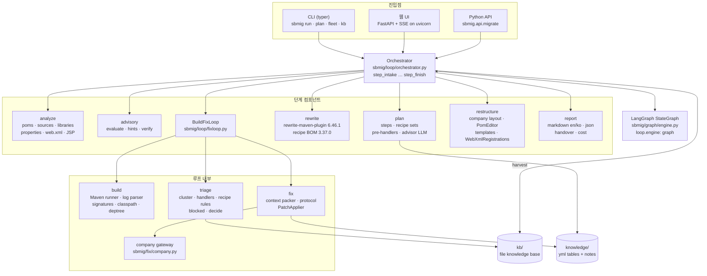

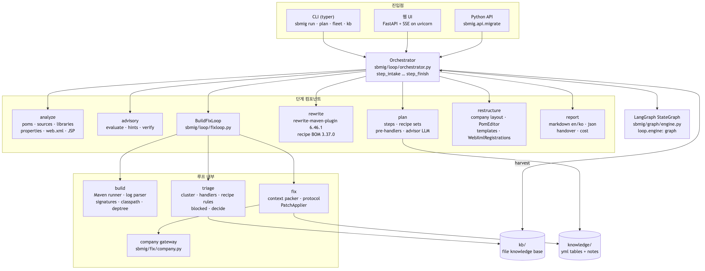

*PNG: `diagrams/architecture.png` · 원본: `diagrams/architecture.mmd`*

진입점은 세 가지입니다.
CLI(`sbmig/cli.py`, typer), 웹 UI(`sbmig/web/app.py`, FastAPI on uvicorn), Python API(`sbmig.api.migrate`)입니다.
셋 모두 `Orchestrator`를 만들어 같은 경로로 실행합니다.
`loop.engine: graph`(기본값)이면 오케스트레이터는 LangGraph `StateGraph`로 단계를 진행합니다.
`inline`은 같은 `step_*` 메서드를 순서대로 부르는 엔진이며 보고서는 테스트로 동일함을 확인합니다.

| 패키지 | 책임 | 주요 모듈 |
|---|---|---|
| `sbmig/core` | 계약: 모델, 설정, 인터페이스, 작업 공간(git), 진단 | `models.py`, `config.py`, `interfaces.py`, `workspace.py`, `diag.py` |
| `sbmig/analyze` | pom 그래프, 소스 스캔, 라이브러리, 외부화 설정, web.xml, JSP, 케이스 판정, 빌드 도구 판별, inventory | `analyzer.py`, `pom_parser.py`, `source_scanner.py`, `libraries.py`, `properties.py`, `webxml.py`, `jsp.py`, `classifier.py`, `build_tool.py`, `webapp_inventory.py` |
| `sbmig/advisory` | EOL / 비관리 라이브러리 판정, 수정 힌트, 최종 트리 검증 | `evaluate.py`, `hints.py`, `verify.py` |
| `sbmig/plan` | 규칙 기반 계획, 레시피 카탈로그, 선제 핸들러 선택, jar 검증 | `planner.py`, `catalog.py`, `pre_handlers.py`, `jarcheck.py` |
| `sbmig/rewrite` | OpenRewrite 실행(레시피 YAML 합성, BOM 버전 해석) | `runner.py`, `compose.py`, `versions.py` |
| `sbmig/build` | Maven 실행, 로그 파서, 시그니처, effective pom, classpath, dependency tree | `mvn.py`, `runner.py`, `log_parser.py`, `signatures.py`, `effective.py`, `classpath.py`, `deptree.py` |
| `sbmig/triage` | 클러스터링, 핸들러 26개, 반응형 레시피 규칙, blocked 분류, 결정 엔진 | `cluster.py`, `handlers/`, `rules.py`, `recipe_rules.yml`, `blocked.py`, `decide.py` |
| `sbmig/fix` | LLM 클라이언트, 회사 게이트웨이, 컨텍스트 패커, 응답 프로토콜, 패치 적용 | `company.py`, `client.py`, `fixer.py`, `context.py`, `protocol.py`, `apply.py`, `prompts/` |
| `sbmig/loop` | 오케스트레이터, 빌드-수정 루프, 예산, 실행 전체 blocked 레지스트리 | `orchestrator.py`, `fixloop.py`, `budget.py`, `blocked_registry.py` |
| `sbmig/graph` | LangGraph 엔진 | `engine.py` |
| `sbmig/restructure` | 회사 레이아웃, pom 편집(lxml, 서식 보존), 템플릿, web.xml 등록 클래스 | `restructurer.py`, `pom_editor.py`, `webxml_registrations.py`, `templates/` |
| `sbmig/report` | `report.md`(en / ko), `report.json`, Handover, 비용, inventory 보고서 | `markdown.py`, `writer.py`, `handover.py`, `cost.py`, `i18n.py`, `inventory.py` |
| `sbmig/kb` | 파일 KB: 사례, 인덱스, 레시피 후보 / 활성, harvest, 라벨, ledger | `store.py`, `harvest.py`, `labels.py`, `ledger.py`, `recipes.py` |
| `sbmig/fleet` | 매니페스트, 순차 실행, 상태, 요약 | `manifest.py`, `runner.py`, `summary.py` |
| `sbmig/web` | FastAPI 앱, 실행 관리자(한 번에 하나), 정적 페이지 | `app.py`, `runs.py`, `static/index.html` |
| `sbmig/llm` | 플러그인 어댑터(tier 1 `llm.plugin`) | `adapter.py`, `registry.py` |

### 2.2 데이터 저장소

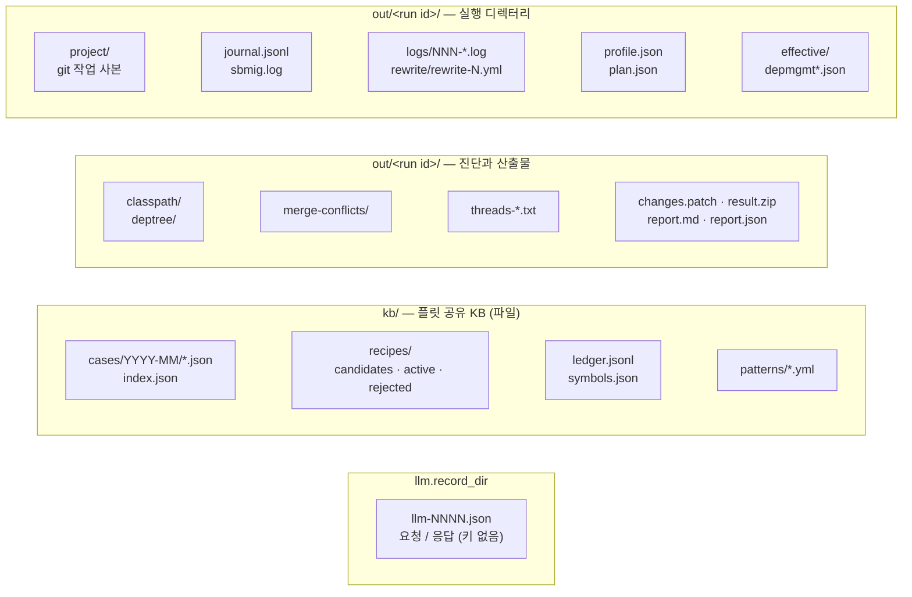

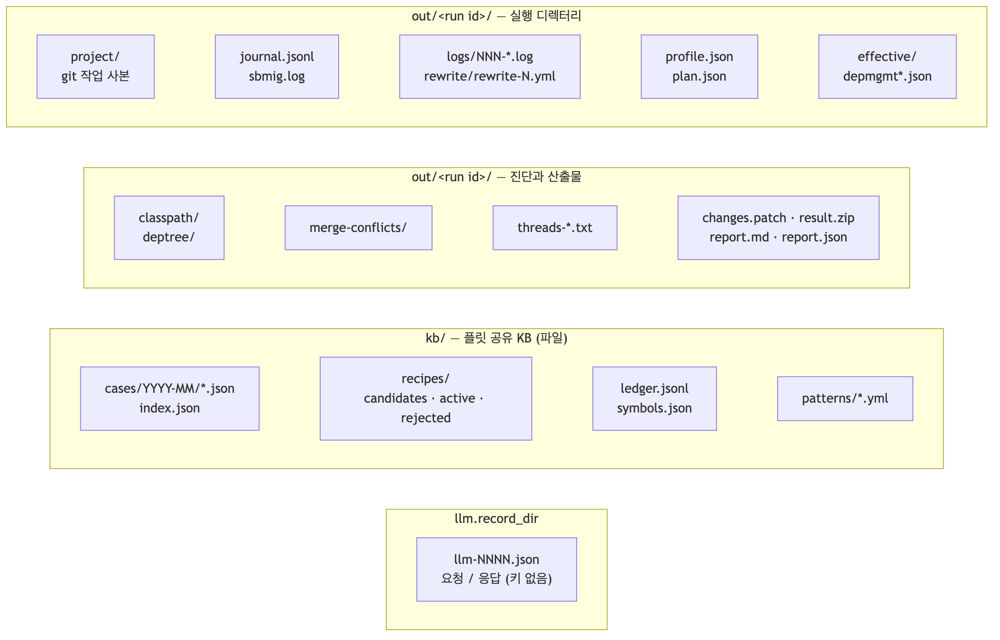

*PNG: `diagrams/data-stores.png` · 원본: `diagrams/data-stores.mmd`*

| 위치 | 내용 | 수명 |
|---|---|---|
| `out/<run id>/project/` | 작업 사본. 입력 원본은 수정하지 않습니다. 단계마다 git 커밋이 쌓입니다 | 실행 |
| `out/<run id>/journal.jsonl` | 이벤트 한 줄씩(`ts`, `run_id`, `event` + 필드). 마지막 줄은 항상 `report` | 실행 |
| `out/<run id>/sbmig.log` | DEBUG 로그. 키는 기록하지 않습니다 | 실행 |
| `out/<run id>/logs/NNN-<label>.log` | Maven / OpenRewrite 호출마다 하나. 첫 두 줄이 `# cwd:`, `# cmd:` | 실행 |
| `out/<run id>/profile.json`, `plan.json` | 분석 결과, 계획 | 실행 |
| `out/<run id>/effective/` | as-is / 재구성 후 effective dependencyManagement | 실행 |
| `out/<run id>/classpath/`, `deptree/` | blocked 원인 추적용 classpath, javax API 인벤토리용 dependency tree | 실행 |
| `out/<run id>/merge-conflicts/` | 멀티 모듈 merge에서 버려진 사본 | 실행 |
| `out/<run id>/changes.patch`, `result.zip` | as-is 스냅샷부터의 diff, 마이그레이션된 프로젝트 | 실행 |
| `out/<run id>/report.md`, `report.json` | 보고서 | 실행 |
| `kb/` | 사례, 인덱스, 레시피(candidates / active / rejected), 패턴, `ledger.jsonl`, `symbols.json` | 플릿 전체 |
| `llm.record_dir` | LLM 요청 / 응답 기록 `llm-NNNN.json` | 운영자 지정 |

---

## 3. 파이프라인 플로우

### 3.1 전체 흐름

한 번의 실행은 phase 순서 intake → analyze → plan → jdk21 → spring → restructure → verify → report를 따릅니다.
그림은 두 장으로 나눴습니다.

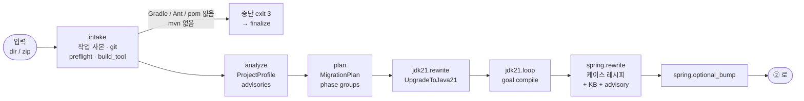

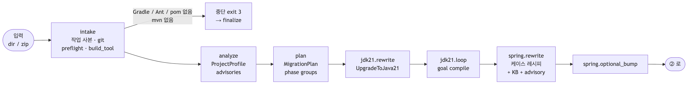

*PNG: `diagrams/pipeline-1.png` · 원본: `diagrams/pipeline-1.mmd`*

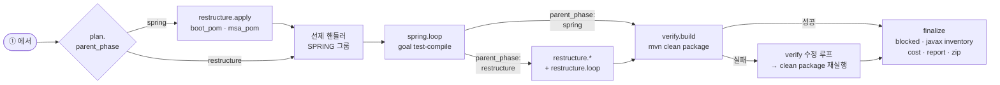

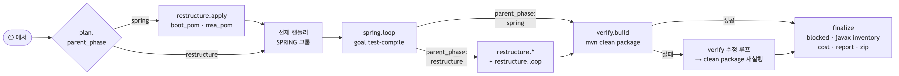

*PNG: `diagrams/pipeline-2.png` · 원본: `diagrams/pipeline-2.mmd`*

`plan.parent_phase`가 흐름의 모양을 바꿉니다.

| 값 | 스텝 순서 | phase group |
|---|---|---|
| `restructure`(코드 기본값) | `jdk21.rewrite` → `jdk21.loop` → `spring.rewrite` → `spring.optional_bump` → `spring.loop` → `restructure.*` → `restructure.loop` → `verify.build` | jdk21, spring, restructure, verify |
| `spring`(회사 설정) | `jdk21.rewrite` → `jdk21.loop` → `spring.rewrite` → `spring.optional_bump` → `restructure.*` → `spring.loop` → `verify.build` | jdk21, spring, verify |

회사 설정이 `spring`을 쓰는 이유는 두 가지입니다.
spring 레시피는 타입 정보가 붙는 as-is 클래스패스 위에서 먼저 돕니다.
그 직후 사내 parent 체인을 붙이므로 spring 수정 루프가 실제 운영 parent 위에서 오류를 고칩니다.
사내 parent를 해석할 수 없으면 루프에 시간을 쓰기 전에 실패합니다.
이 설정에서는 restructure 루프가 없으므로 최종 `clean package`가 실행 중 첫 `package` 빌드가 됩니다.
그래서 verify 단계에 마지막 수정 루프가 있습니다(§3.10).

MSA는 서비스(그리고 공유 라이브러리 루트)마다 jdk21 / spring 체인을 따로 만듭니다.
스텝 id에 `@<service>`가 붙고, 라이브러리 루트가 먼저 옵니다.
루트 aggregator가 없으면 `verify.build@<service>`가 서비스마다 생깁니다.

### 3.2 노드: intake

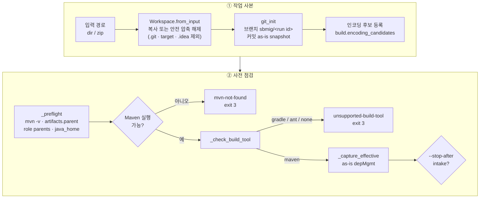

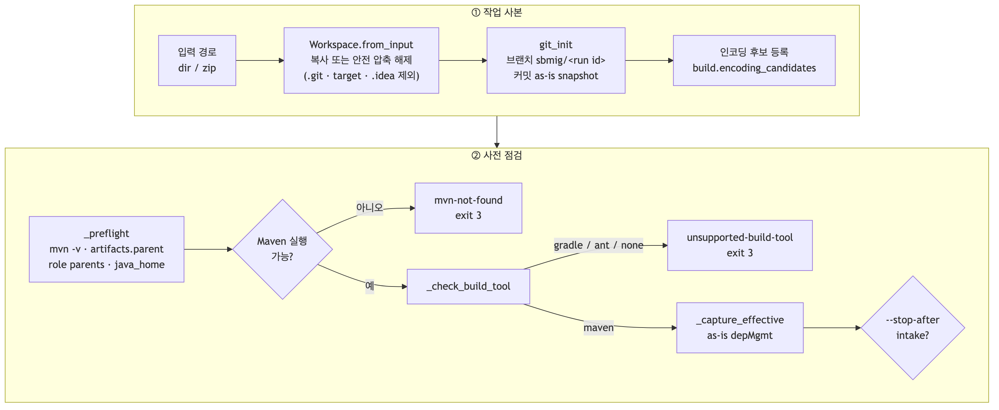

*PNG: `diagrams/node-intake.png` · 원본: `diagrams/node-intake.mmd`*

| 항목 | 내용 |
|---|---|
| 입력 | `sbmig run`의 위치 인자(디렉터리 또는 zip), `--out`, 선택 `--run-id` |
| 출력 | `project/`(git, 브랜치 `sbmig/<run id>`, 첫 커밋 `sbmig: as-is snapshot`), `effective/depmgmt.json` |
| journal 이벤트 | `intake`, `graph_node`, `preflight`, `build_tool`, `effective_pom`, `effective_depmgmt`, `stop_after` |
| 관련 설정 키 | `build.mvn`, `build.java_home`, `build.settings_file`, `build.encoding_candidates`, `artifacts.parent`, `artifacts.boot_parent`, `artifacts.comp_parent` |
| 실패 시 | Maven 실행 불가 → 플래그 `mvn-not-found`, 중단(exit 3). Gradle / Ant / 빌드 없음 → `unsupported-build-tool:<tool>`, 중단(exit 3). effective pom 캡처 실패 → 경고만 남기고 계속 |

zip은 안전하게 압축을 풀고(`_safe_extract`), UTF-8 플래그 없는 zip의 파일 이름은 cp437 → cp949로 다시 해석합니다.
`.git`, `target`, `.idea`, `*.iml`, `.DS_Store`, `__MACOSX`는 복사하지 않습니다.
`artifacts.parent`의 groupId에 `CHANGE`가 들어 있으면 미설정으로 보고 후속 조치를 남깁니다.

### 3.3 노드: analyze

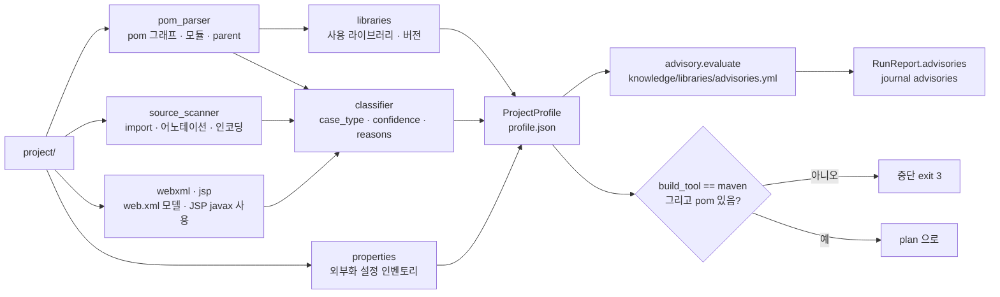

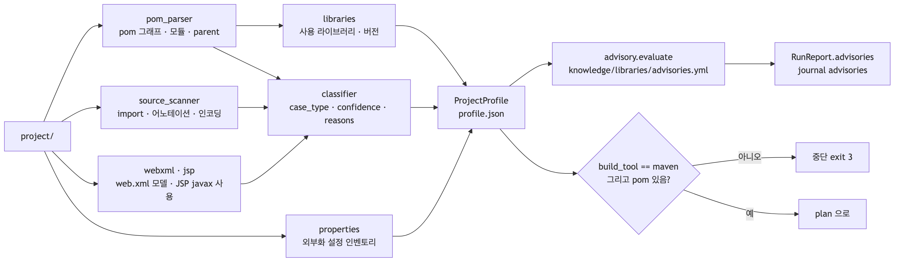

*PNG: `diagrams/node-analyze.png` · 원본: `diagrams/node-analyze.mmd`*

| 항목 | 내용 |
|---|---|
| 입력 | `project/`, 설정 |
| 출력 | `profile.json`(`ProjectProfile`: 케이스, 신뢰도, 근거, Java / Spring / Boot 버전, 라이브러리, MSA 서비스, 사용 중인 optional 아티팩트, 외부화 설정 인벤토리, web.xml 모델, 경고), `RunReport.advisories` |
| journal 이벤트 | `graph_node`, `analyze`(`case_type`, `poms`, `build_tool`, `java`, `spring_boot`, `properties_external`), `advisories` |
| 관련 설정 키 | `advisories.enabled`, `advisories.file`, `advisories.extra_files`, `advisories.policy_overrides`, `externalized.*` |
| 실패 시 | `build_tool != maven` 또는 pom 0개 → 중단(exit 3). advisory 패키지 오류 → 빈 목록으로 계속 |

판정은 결정적입니다.
같은 프로젝트와 같은 설정이면 같은 계획이 나옵니다.
`sbmig analyze <프로젝트> --config …`로 실행 없이 같은 결과를 볼 수 있습니다.

### 3.4 노드: plan

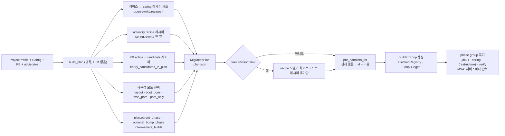

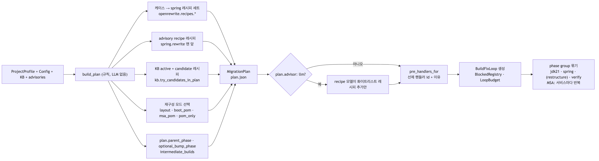

*PNG: `diagrams/node-plan.png` · 원본: `diagrams/node-plan.mmd`*

| 항목 | 내용 |
|---|---|
| 입력 | profile, 설정, KB(활성 / 후보 레시피), advisory 판정 |
| 출력 | `plan.json`(`MigrationPlan`: 스텝, 노트, case_type, fingerprint), 선제 핸들러 목록, 실행 전체에서 공유하는 `BuildFixLoop`(BlockedRegistry, `LoopBudget`), phase group |
| journal 이벤트 | `graph_node`, `advisories_planned`, `plan_advice`, `plan`(`steps`, `pre_handlers`, `notes`) |
| 관련 설정 키 | `plan.parent_phase`, `plan.optional_bump_phase`, `plan.intermediate_builds`, `plan.advisor`, `openrewrite.recipes.*`, `kb.use_active_recipes`, `kb.try_candidates_in_plan`, `loop.phases.<phase>.enabled`, `loop.always_final_verify`, `layout.boot_as_is` |
| 실패 시 | 실패 경로 없음. 빈 계획이면 앞 단계에서 이미 중단 |

`plan.advisor: llm`일 때만 recipe 모델이 계획을 검토합니다.
그때도 화이트리스트 안의 레시피를 추가만 할 수 있습니다.
기본값은 `none`입니다.
`followup:`으로 시작하는 노트는 보고서의 "Manual follow-ups"로 옮겨집니다.

| 스텝 id | StepKind | 하는 일 |
|---|---|---|
| `jdk21.rewrite` | `openrewrite` | `org.openrewrite.java.migrate.UpgradeToJava21` |
| `jdk21.loop` | `build_fix_loop` | `mvn compile` 수정 루프(3 라운드) |
| `spring.rewrite` | `openrewrite` | 케이스별 레시피 + KB 레시피 + advisory 레시피(맨 앞) |
| `spring.optional_bump` | `restructure`(mode `optional_bump`) | 사용 중인 사내 optional 아티팩트 버전 상향 |
| `spring.loop` | `build_fix_loop` | `mvn test-compile` 수정 루프(6 라운드) |
| `restructure.apply` | `restructure`(mode `layout`) | 회사 레이아웃 분리 + parent + mandatory / optional |
| `restructure.boot_pom` | `msa_pom`(mode `boot_pom`) | Boot as-is: pom만 |
| `restructure.msa_pom` | `msa_pom` | MSA: 서비스 루트 pom만 |
| `restructure.pom_only` | `msa_pom`(`pom_only`) | 소스 없는 pom 프로젝트 |
| `restructure.loop` | `build_fix_loop` | `mvn package` 수정 루프(6 라운드, `parent_phase: restructure`일 때만) |
| `verify.build` | `build` | `mvn clean package`, 실패 시 `package` 수정 루프(3 라운드) 후 재실행 |

### 3.5 노드: rewrite 스텝 (`jdk21.rewrite`, `spring.rewrite`)

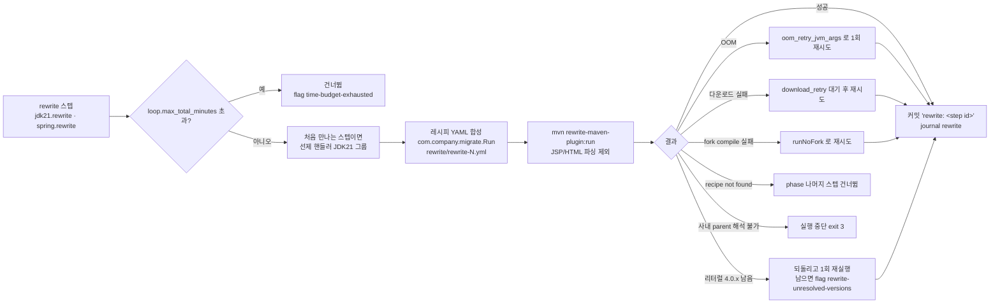

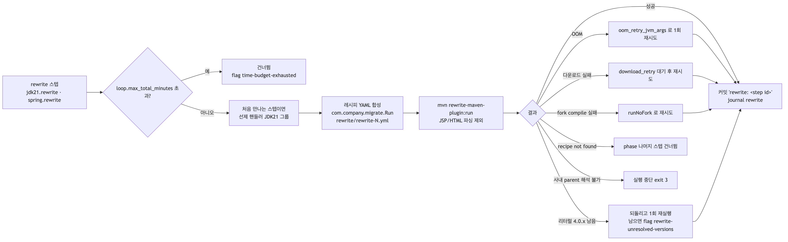

*PNG: `diagrams/node-rewrite.png` · 원본: `diagrams/node-rewrite.mmd`*

| 항목 | 내용 |
|---|---|
| 입력 | 스텝의 레시피 id 목록, `knowledge/recipes/base/*.yml`, KB 레시피 YAML |
| 출력 | `rewrite/rewrite-N.yml`, `rewrite/artifact-versions.json`, `logs/NNN-rewrite-<step id>.log`, 커밋 `rewrite: <step id>` |
| journal 이벤트 | `step_start`, `rewrite`(러너와 오케스트레이터가 한 줄씩), `rewrite_oom_retry(_result)`, `rewrite_download_retry(_result)`, `rewrite_unresolved_versions`, `rewrite_parse_problems`, `step_end` |
| 관련 설정 키 | `openrewrite.plugin_version`(6.46.1), `openrewrite.recipe_bom_version`(3.37.0), `openrewrite.recipes.*`, `openrewrite.timeout_minutes`, `openrewrite.jvm_args`, `openrewrite.download_retry`, `openrewrite.exclusions`, `loop.max_total_minutes` |
| 실패 시 | 레시피 id 없음 → 그 phase의 나머지 스텝 건너뜀. 사내 parent 해석 불가 → 실행 중단(exit 3). 그 밖 → 노트와 `rewrite` 종류 오류를 남기고 계속(다음 빌드가 실제 문제를 보여 줌). 시간 예산 초과 → 건너뜀, 플래그 `time-budget-exhausted` |

리라이트가 parent 교체보다 먼저인 이유가 있습니다.
OpenRewrite는 as-is 클래스패스로 타입을 붙여야 `javax.*`나 Boot 2/3 클래스를 매칭합니다.
parent를 먼저 바꾸면 `ChangeType` 계열 레시피가 아무것도 하지 않습니다.
레시피가 메타데이터를 못 받아 `4.0.x` 같은 리터럴 버전을 남기면 되돌리고 한 번 다시 돌립니다(X8).

### 3.6 노드: 선제 핸들러

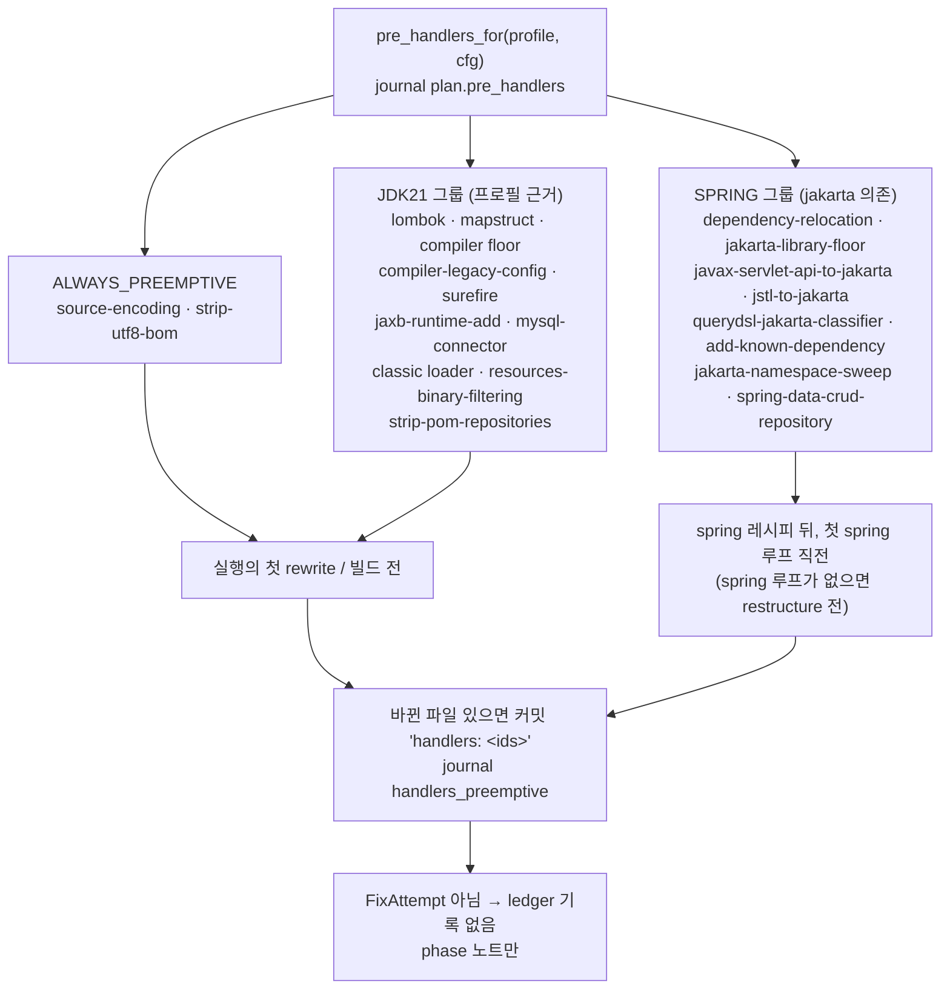

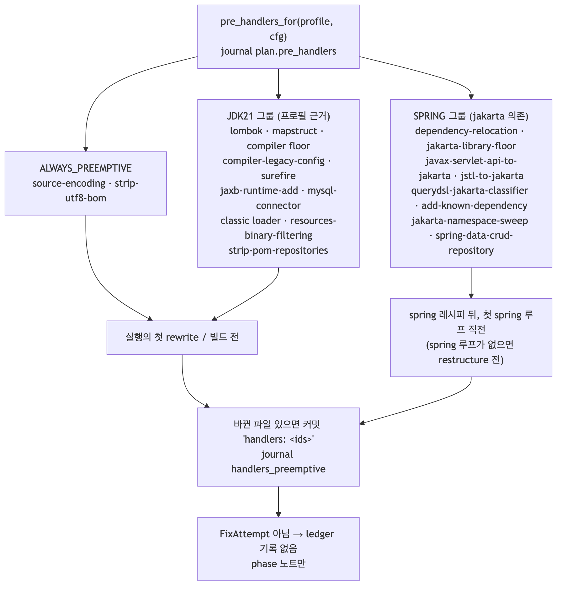

*PNG: `diagrams/node-preemptive.png` · 원본: `diagrams/node-preemptive.mmd`*

| 항목 | 내용 |
|---|---|
| 입력 | `pre_handlers_for(profile, cfg)`가 고른 (id, 이유) 목록 + `ALWAYS_PREEMPTIVE` |
| 출력 | 커밋 `handlers: <ids>`(바뀐 파일이 있을 때), phase 노트 `handlers pre-emptive (before the first build): …` |
| journal 이벤트 | `handlers_preemptive`(`why`, `requested`, `changed`, `files`, `commit`), `handler_failed` |
| 관련 설정 키 | `build.source_encoding_policy`, `build.pom_repositories`, `knowledge/libraries/jakarta_libraries.yml`, `sbmig/triage/handlers/*.yml` |
| 실패 시 | 핸들러별 실패는 `handler_failed`를 남기고 그 핸들러의 변경만 버림. 실행은 계속 |

선제 실행은 한 실행에서 한 번만 돕니다.
`FixAttempt`가 아니므로 ledger에 기록되지 않습니다.
SPRING 그룹을 기다리게 하는 이유는 jakarta 레시피 전에 servlet-api 등을 jakarta로 바꾸면 레시피가 타입을 인식하지 못하고 jdk21 빌드가 깨지기 때문입니다.

### 3.7 노드: `spring.optional_bump`

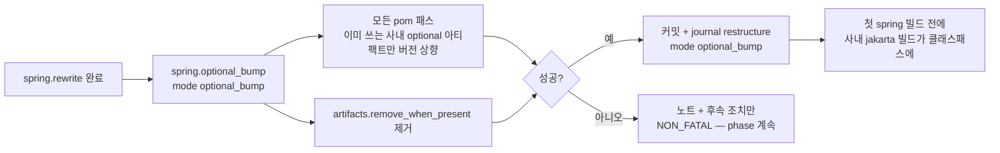

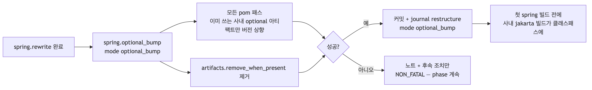

*PNG: `diagrams/node-optional-bump.png` · 원본: `diagrams/node-optional-bump.mmd`*

| 항목 | 내용 |
|---|---|
| 입력 | `artifacts.optional`(8개), `artifacts.remove_when_present` |
| 출력 | 모든 프로젝트 pom의 optional 버전 상향, 지정 아티팩트 제거, 커밋 |
| journal 이벤트 | `step_start`, `restructure`(`mode: optional_bump`), `step_end` |
| 관련 설정 키 | `plan.optional_bump_phase`(`spring`), `artifacts.optional`, `artifacts.optional_version_policy`, `artifacts.remove_when_present` |
| 실패 시 | 치명적이지 않음(`NON_FATAL_RESTRUCTURE_MODES`). 노트와 후속 조치("bump the in-house optional artifacts by hand")만 남기고 phase 계속 |

이 스텝은 이미 쓰는 optional만 올립니다.
파일 이동이나 parent 변경은 하지 않습니다.
멱등이므로 나중의 재구성 스텝은 올릴 것이 없다고 보고합니다.

### 3.8 노드: build-fix loop 스텝 (`jdk21.loop`, `spring.loop`, `restructure.loop`)

루프 내부는 §5에서 설명합니다.

| 항목 | 내용 |
|---|---|
| 입력 | phase, goal, `max_iterations`, 실행 공유 `BuildFixLoop` |
| 출력 | `logs/NNN-build-<phase>-N.log`, 시도마다 커밋(`fix(handler:<id>)`, `fix(kb-patch:…)`, `fix(llm): <cluster> <model>`), `PhaseResult` |
| journal 이벤트 | `loop_start`, `build`, `triage`, `decision`, `attempt`, `attempt_scored`, `revert`, `stall`, `oscillation`, `reround`, `only_blocked`, `blocked`, `recipe_batch`, `llm_call`, `llm_fix`, `llm_cooldown`, `llm_unavailable`, `test_compile_fallback`, `tests_fallback`, `classpath`, `loop_end`, 그리고 phase 끝의 `phase_end`, `kb_credit` / `kb_credit_skipped`, `harvest` |
| 관련 설정 키 | `loop.phases.<phase>.goal / max_iterations / enabled`, `loop.max_llm_calls`, `loop.max_total_minutes`, `loop.stall_limit`, `loop.max_clusters_per_iteration`, `loop.blocked_policy`, `loop.max_llm_attempts_per_cluster`, `loop.revert_on_regression`, `loop.regression_ratio`, `loop.oscillation_window`, `build.skip_tests`, `build.skip_test_compile`, `build.allow_skip_*_fallback` |
| 실패 시 | phase `ok=False`로 표시하고 다음 phase로 진행. 사내 parent 해석 불가 → `aborted:parent-not-found`, `run_aborted`, 실행 중단(exit 3) |

phase group이 끝나면(verify 제외) 두 가지를 합니다.
계획 레시피 중 실제로 파일을 바꾼 KB 레시피에 그 phase의 빌드 결과를 점수로 줍니다(`kb_credit`).
빌드가 없던 phase나 의존성 해석만으로 실패한 phase는 점수를 주지 않습니다(`kb_credit_skipped`).
이어서 harvest를 합니다(§10).

### 3.9 노드: 재구성 스텝 (`restructure.apply` / `boot_pom` / `msa_pom` / `pom_only`)

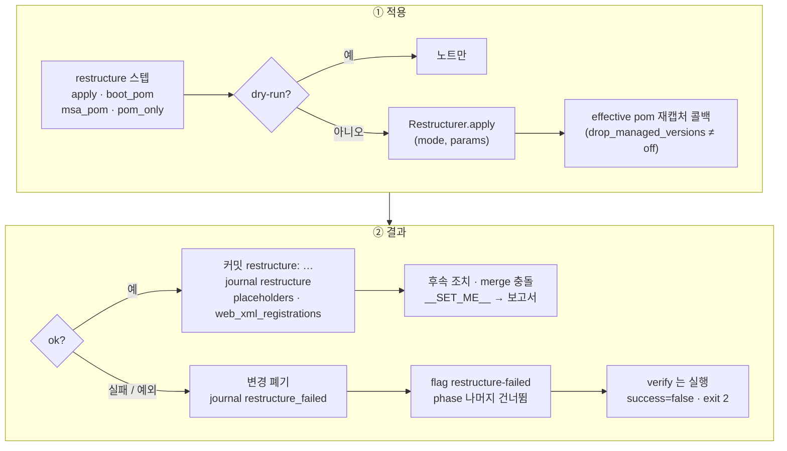


*PNG: `diagrams/node-restructure.png` · 원본: `diagrams/node-restructure.mmd`*

| 항목 | 내용 |
|---|---|
| 입력 | profile, 모드, `params`(재구성 후 effective pom 캡처 콜백) |
| 출력 | 모듈 디렉터리와 pom, 생성 클래스(`Application`, `WebXmlRegistrations`), `application.properties` 자리표시자, `effective/depmgmt-after-restructure.json`, `merge-conflicts/`, 여러 개의 커밋 |
| journal 이벤트 | `step_start`, `effective_pom`, `effective_depmgmt_after`, `web_xml_registrations`, `placeholders`(`files`, `keys`), `restructure`(`mode`, `ok`, `commit`, `changed_files`, `moved`, `generated`, `mandatory_added`, `optional_bumped`, `merged_modules`, `kept_boot_module`, `merge_conflicts`, `error`), `restructure_failed`, `step_end` |
| 관련 설정 키 | `layout.*`, `artifacts.*`, `externalized.*`, `layout.drop_managed_versions`, `layout.web_xml_registrations` |
| 실패 시 | 미커밋 변경 폐기, 플래그 `restructure-failed`, phase 나머지 스텝 건너뜀. verify는 실행. 그 빌드가 성공해도 `success=false`(exit 2) |

레이아웃 규칙은 §9에 있습니다.

### 3.10 노드: `verify.build`와 마지막 수정 루프

```mermaid
flowchart TB
  subgraph a["① 최종 빌드"]
    direction LR
    A["verify.build"] --> B{"dry-run?"}
    B -->|예| S["건너뜀 (노트)"]
    B -->|아니오| C["테스트 플래그 반영<br/>-Dmaven.test.skip=true<br/>또는 -DskipTests"] --> D["mvn clean package"]
    D -->|BUILD SUCCESS| OK["final_build<br/>journal verify"]
  end
  subgraph b["② 실패하면 마지막 수정 루프"]
    direction LR
    E{"풀 수 있는<br/>클러스터?"} -->|없음| F["루프 없이 종료<br/>unresolved 보고"]
    E -->|있음| G["verify 루프<br/>goal package · 3 라운드"] --> H["repeated_failure · oscillation 해제<br/>+ verify_extra_llm_attempts 2<br/>escalation 모델"] --> J["mvn clean package 재실행<br/>journal verify_loop_end"]
  end
  a -->|"빌드 실패"| b
```

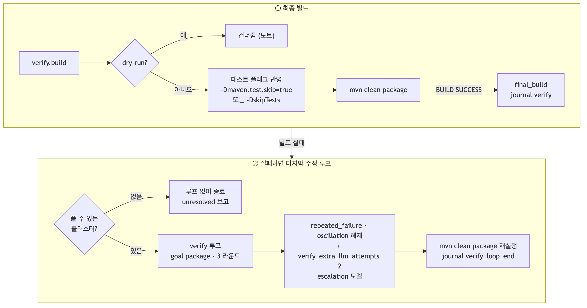

*PNG: `diagrams/node-verify.png` · 원본: `diagrams/node-verify.mmd`*

| 항목 | 내용 |
|---|---|
| 입력 | 앞 phase의 테스트 대체 플래그(`test-compile-skipped`, `tests-skipped`), `build.skip_test_compile` |
| 출력 | `logs/NNN-build-verify.log`(MSA는 `build-verify-<service>`), `RunReport.final_build` |
| journal 이벤트 | `step_start`, `build`, `verify`(`ok`, `errors`, `log`, `skip_test_compile`, `skip_tests`), `verify_loop_start`(`errors`, `releasable`), `blocked_released`, `verify_loop_end`(`build_ok`, `attempts`, `released`), `step_end` |
| 관련 설정 키 | `loop.phases.verify`(goal `package`, 3 라운드), `loop.verify_extra_llm_attempts`(2), `loop.always_final_verify`, `llm.escalation_model` |
| 실패 시 | 결과가 그대로 실행 결과. 풀 수 있는 클러스터가 없으면 루프 없이 끝나고 unresolved로 보고 |

최종 빌드가 실패하면 마지막 수정 루프가 한 번 돕니다.
앞 단계에서 `repeated_failure` / `oscillation`으로 blocked된 클러스터가 이 루프의 빌드에 다시 나타나면 풀어 줍니다.
풀린 클러스터는 클러스터당 LLM 시도 상한에 `loop.verify_extra_llm_attempts`만큼 더 받습니다.
`LLM_ESCALATION_MODEL`이 있으면 정체 여부와 상관없이 그 모델로 묻습니다.
정책 blocked(javax API, 아티팩트 없음 등)와 예산 blocked는 풀지 않습니다.
루프가 끝나면 `mvn clean package`를 다시 돌립니다(노트 `final build repeated after the fix loop`).
끄려면 `loop.phases.verify.max_iterations: 0`으로 둡니다.

### 3.11 노드: finalize

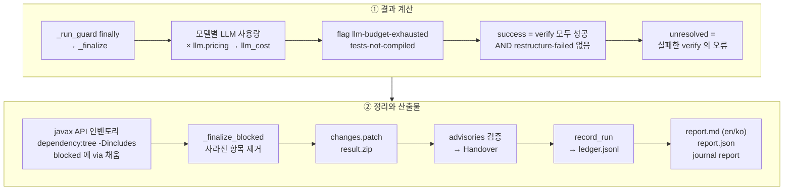

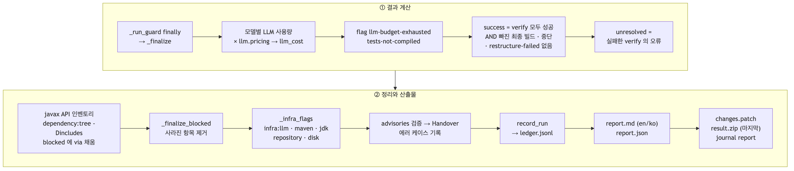

*PNG: `diagrams/node-finalize.png` · 원본: `diagrams/node-finalize.mmd`*

| 항목 | 내용 |
|---|---|
| 입력 | `RunReport`, verify 결과, BlockedRegistry, 시도별 LLM 사용량 |
| 출력 | `changes.patch`, `result.zip`(dry-run 제외), `report.md`, `report.json`, ledger 줄, `deptree/` |
| journal 이벤트 | `graph_node`(`finalize`), `deptree`, `javax_api_inventory`(`jars`, `via`), `blocked_resolved`, `advisories_verified`, `handover`(`changes`, `carried_over`, `from_here`), `report`(`success`, `flags`, `unresolved`, `blocked`, `llm_calls`, `outputs`) |
| 관련 설정 키 | `report.formats`, `report.language`(en / ko), `report.zip_result`, `report.include_diff`, `report.javax_api_inventory`, `llm.pricing`, `llm.pricing_currency`, `advisories.report_carried_over` |
| 실패 시 | 단계별 오류는 경고와 플래그(`blocked-finalize-failed: …`, `report-failed: …`)로 남기고 다음 단계를 계속. `_finalize`는 `_run_guard`의 `finally`에서 항상 돕니다 |

`success`는 verify 빌드가 하나 이상 있었고 모두 성공했으며 `restructure-failed` 플래그가 없을 때 참입니다.
`result.zip`과 `changes.patch`는 보고서보다 먼저 만들어지므로 zip에는 보고서가 들어가지 않습니다.
javax API 인벤토리는 spring 단계가 돌았고 dry-run이 아닐 때만 실행합니다.

### 3.12 실행 결과와 종료 코드

| 종료 코드 | 조건 |
|---|---|
| 0 | 최종 `mvn clean package` 성공, blocked 없음 |
| 2 | 끝까지 실행했으나 blocked / unresolved 있음, 또는 `restructure-failed`, dry-run, stop-after |
| 3 | 중단: Maven 없음, Maven 프로젝트 아님(Gradle / Ant / pom 없음), 사내 parent 해석 불가, 내부 오류, 웹 중단 |

advisory와 carried-over 고정은 종료 코드를 바꾸지 않습니다.

---

## 4. LangGraph 노드 그래프

### 4.1 그래프

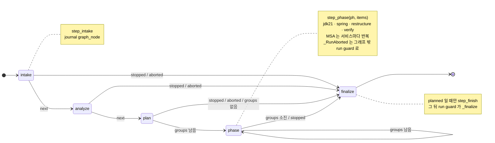

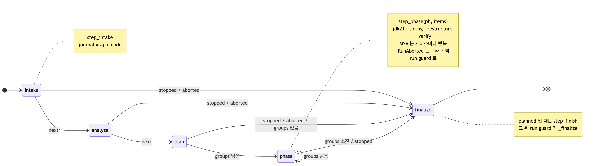

*PNG: `diagrams/langgraph.png` · 원본: `diagrams/langgraph.mmd`*

`sbmig/graph/engine.py`의 `build_graph(orch)`가 `StateGraph(MigrationState)`를 만듭니다.
노드는 `intake`, `analyze`, `plan`, `phase`, `finalize` 다섯 개입니다.
각 노드는 오케스트레이터의 `step_*` 메서드 하나를 부릅니다.
`phase` 노드는 남은 phase group이 있는 동안 자기 자신으로 돌아갑니다.
MSA는 서비스마다 jdk21 / spring 그룹이 반복되므로 `RECURSION_LIMIT = 1000`을 씁니다.
노드는 예외를 처리하지 않습니다.
`_RunAborted`, `MissingComponentError` 등은 그래프 밖 오케스트레이터의 run guard로 올라갑니다.

| 노드 | 부르는 메서드 | 다음 노드 |
|---|---|---|
| `intake` | `step_intake` | `analyze`, 또는 stopped / aborted면 `finalize` |
| `analyze` | `step_analyze` | `plan`, 또는 `finalize` |
| `plan` | `step_plan` → phase group 목록 | 그룹이 있으면 `phase`, 아니면 `finalize` |
| `phase` | `step_phase(report, ph, items, stop_after)` | 그룹이 남으면 `phase`, 아니면 `finalize` |
| `finalize` | 계획이 있었으면 `step_finish` | `END` (그 뒤 run guard가 `_finalize`) |

### 4.2 상태

그래프 상태에는 JSON으로 직렬화할 수 있는 작은 값만 둡니다.
무거운 객체(`RunReport`, `PlanStep` 묶음, `BuildFixLoop`)는 오케스트레이터와 노드 함수가 닫아 둔 holder에 있습니다.

| 필드 | 뜻 |
|---|---|
| `run_id` | 실행 id |
| `stop_after` | `--stop-after` 값(phase 이름) 또는 None |
| `dry_run` | dry-run 여부 |
| `phases` | 남은 phase group 이름(MSA는 반복) |
| `phase` | 방금 실행한 phase group |
| `aborted` | intake / analyze의 중단 사유. phase 중단은 예외로 처리 |
| `stopped` | `stop_after`에 도달 |
| `summary` | UI용 요약(`case_type`, phase별 `ok` / `build_ok` / `remaining_errors`, `llm_calls`, `blocked`, `unresolved`) |

### 4.3 stop-after

`parse_stop_after`는 CLI, 웹, API가 함께 씁니다.
값은 `report` 이전의 phase 이름입니다.
지정한 phase 뒤의 그룹은 실행하지 않고 journal `phase_skipped`를 남깁니다.
플래그는 `stopped-after-<phase>`이고 종료 코드는 2입니다.

### 4.4 웹 스트림

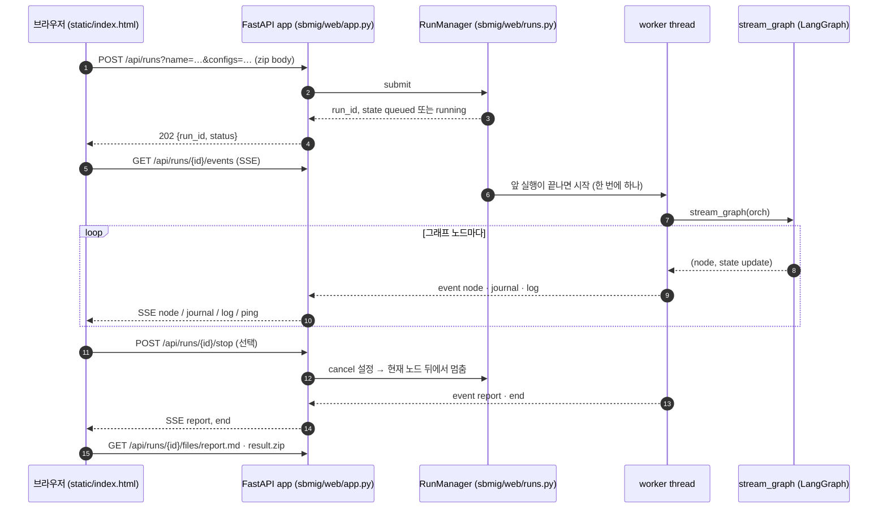

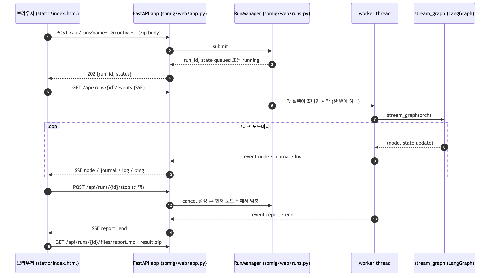

*PNG: `diagrams/web-stream.png` · 원본: `diagrams/web-stream.mmd`*

| SSE 이벤트 | 내용 |
|---|---|
| `status` | 실행 상태(`queued` / `running` / `finished`) |
| `node` | 그래프 노드 하나가 끝날 때의 상태 갱신 |
| `journal` | `journal.jsonl`의 새 줄 |
| `log` | 그 실행의 로그 줄(스레드 필터로 분리) |
| `report` | 최종 보고서 요약 |
| `error`, `ping`, `end` | 오류, 연결 유지, 스트림 종료 |

웹 실행은 한 번에 하나만 돕니다.
KB가 공유 파일이기 때문입니다.
뒤에 올린 업로드는 `queued` 상태로 기다립니다.
중단(`POST /api/runs/{id}/stop`)은 그래프 노드 사이에서만 효과가 있습니다.
verify 전에 멈추면 최종 빌드 없이 중단되고, 보고서가 그 사실을 적습니다.
verify 뒤에 멈추면 실행은 정상적으로 끝납니다.
서버 종료(`RunManager.shutdown()`) 때는 SSE 스트림을 닫고 살아 있는 Maven 자식 프로세스를 레지스트리로 찾아 종료합니다.

---

## 5. 빌드-수정 루프

### 5.1 루프 한 바퀴

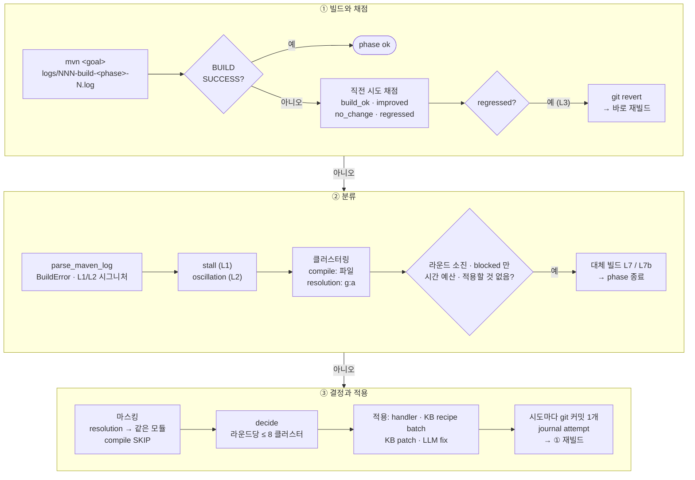

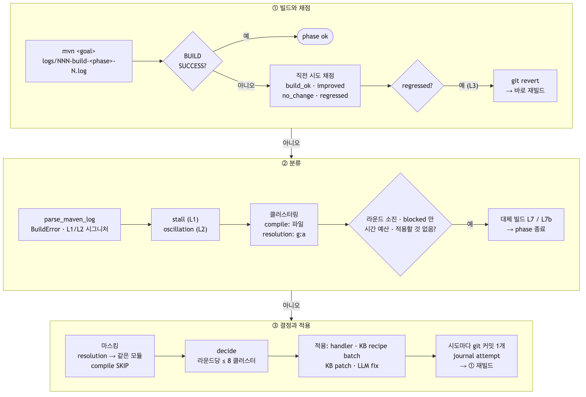

*PNG: `diagrams/fix-loop.png` · 원본: `diagrams/fix-loop.mmd`*

`BuildFixLoop`(`sbmig/loop/fixloop.py`)는 phase마다 같은 객체를 씁니다.
한 바퀴는 빌드 → 채점 → 파싱 → 클러스터링 → 결정 → 적용 → 커밋입니다.
모든 판정은 빌드 직후에만 합니다.
적용한 변경은 반드시 다음 라운드의 실제 빌드로 채점합니다.
`max_iterations`는 수정 라운드 수이므로 빌드는 최대 "라운드 수 + 1"번입니다.

| phase | goal | 수정 라운드 |
|---|---|---|
| `jdk21` | `compile` | 3 |
| `spring` | `test-compile` | 6 |
| `restructure` | `package` | 6 |
| `verify` | `clean package` 실패 시 `package` 루프 | 3 |

### 5.2 로그에서 클러스터까지

| 단계 | 동작 | 코드 |
|---|---|---|
| 파싱 | Maven `-B` 출력을 한 번 훑는 상태 기계. 모듈과 goal 문맥, 경로 정규화, 중복 병합, javac 연속 줄(`symbol:`, `location:`, `required:`, `found:`) 결합. 이해하지 못한 실패는 `UNKNOWN` 오류 하나 | `sbmig/build/log_parser.py` |
| 시그니처 | L1 = `kind|메시지 분류|심볼|위치 유형`, L2 = `kind|메시지 분류|이름`. 경로, 줄 번호, 버전, 16진 주소, 프로젝트 FQCN은 지움. 사내 groupId와 `build.external_package_prefixes`는 라이브러리로 취급 | `sbmig/build/signatures.py` |
| 클러스터 | `compile` / `test_compile`: 파일(모르면 모듈). resolution 종류와 아티팩트가 있는 `pom_invalid`: `g:a`. 그 밖: 모듈. id는 `<kind>:<sha1 8자리>` | `sbmig/triage/cluster.py` |
| 우선순위 | `parent_resolution` 10, `pom_invalid` 15, `dependency_resolution` 20, `plugin_resolution` 25, `enforcer` 30, `rewrite` 35, `compile` 50 + 리액터 순서, `test_compile` 80 + 리액터 순서, `plugin_execution` 90, `test_failure` 95, `unknown` 99 | 같음 |
| 마스킹 | resolution 클러스터가 있으면 같은 모듈의 compile 클러스터는 이번 라운드 `SKIP`. 가린 쪽이 blocked / escalate되면 같은 라운드에서 다시 처리 | `plan_iteration` |

클러스터가 파일 단위이므로 라이브러리 메서드 하나가 바뀌어 10개 파일이 깨지면 첫 프로젝트에서는 LLM 호출도 10번입니다.
첫 성공 수정이 `method-rename` 라벨과 `ChangeMethodName` 후보를 남기므로 다음 phase와 다음 프로젝트에서는 레시피가 한 번에 처리합니다.

### 5.3 채점

| 결과 | 조건 |
|---|---|
| `build_ok` | 다음 빌드가 성공 |
| `improved` | 시도한 클러스터의 시그니처가 다음 빌드에서 사라짐 |
| `no_change` | 사라지지 않았지만 회귀도 아님 |
| `regressed` | 시도가 건드린 파일에 새 오류, 해결 없이 전체 오류가 `loop.regression_ratio`(1.5)배 초과, pom 수정 뒤 `pom_invalid` / `parent_resolution` / `plugin_resolution` 새로 등장 |
| `reverted` | 회귀해서 되돌림(`loop.revert_on_regression`) |

### 5.4 루프 안전장치

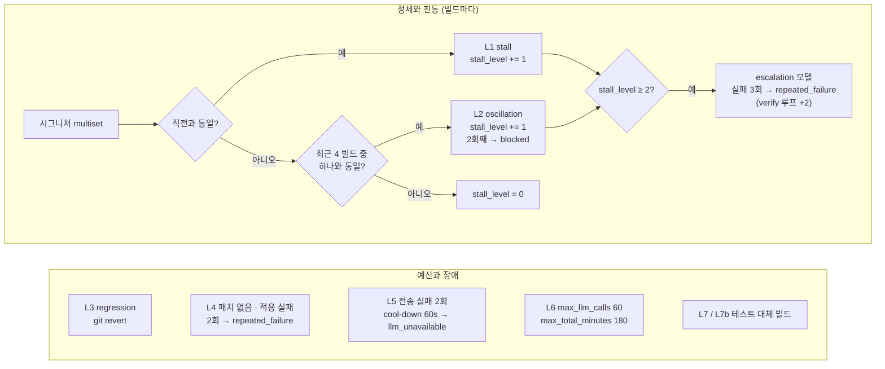

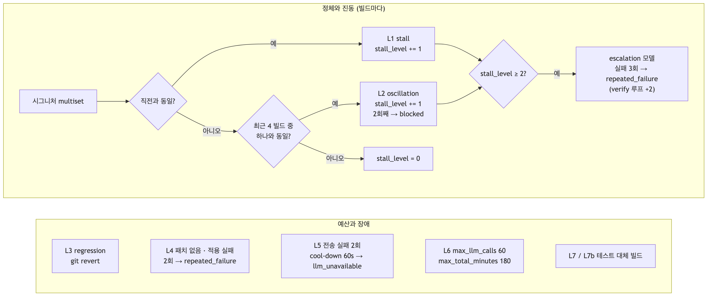

*PNG: `diagrams/loop-safety.png` · 원본: `diagrams/loop-safety.mmd`*

| id | 상황 | 동작 | 기록 |
|---|---|---|---|
| L1 | stall: 시그니처 multiset이 직전 빌드와 같음 | `stall_level += 1`. `loop.stall_limit`(2) 이상이면 escalation 모델 요청 | journal `stall` |
| L2 | oscillation: 최근 `loop.oscillation_window`(4) 빌드 중 하나와 같음 | stall로 취급. 2회째면 관련 클러스터를 `oscillation`으로 blocked | journal `oscillation` |
| L3 | regression | 시도를 git으로 되돌리고 클러스터 처리 없이 바로 재빌드 | journal `revert` |
| L4 | 패치 없음, 프로토콜 위반, 적용 실패 | `loop.max_llm_attempts_per_cluster`(2)회 쓸모없는 답 → `repeated_failure` | 시도 outcome `apply_failed` |
| L5 | LLM 전송 실패 2회 연속 | 실행에서 한 번 `llm.cooldown_seconds`(60) 쉬고 재시도. 다시 연속 실패면 `llm_unavailable`. 핸들러와 레시피는 계속 동작 | 플래그 `llm-cooldown`, `llm-unavailable` |
| L6 | 예산: `loop.max_llm_calls`(60), `loop.max_total_minutes`(180), `loop.max_clusters_per_iteration`(8) | 남은 클러스터 `budget_exhausted`로 blocked. 시간 초과면 rewrite / 루프를 건너뛰고 verify와 보고서만 | 플래그 `llm-budget-exhausted`, `time-budget-exhausted` |
| L7 | 남은 오류가 전부 `test_compile` | `-Dmaven.test.skip=true`로 재빌드. verify도 같은 옵션 | 플래그 `test-compile-skipped` |
| L7b | 남은 오류가 전부 런타임 `test_failure` | `-DskipTests`로 재빌드 | 플래그 `tests-skipped` |
| L10 | 재구성 스텝 실패 / 예외 | 변경 폐기, phase 나머지 건너뜀, verify는 실행 | 플래그 `restructure-failed` |
| L12 | 최종 verify 실패 | verify 수정 루프 + `clean package` 재실행 | journal `verify_loop_start` / `verify_loop_end` |

LLM이 적용할 것을 하나도 내놓지 못하면 트리가 바뀌지 않았으므로 재빌드하지 않습니다.
같은 빌드 결과로 다음 라운드를 진행합니다(journal `reround`).
LLM 호출 예산은 `fixer.propose` 한 번마다 `max(1, proposal.llm_usage.calls)`만큼 줄어듭니다.
KB harvest의 레시피 후보 호출도 `_BudgetedLLM`을 통해 같은 예산에서 차감됩니다.

### 5.5 마일스톤과 워치독

루프는 단계를 지날 때마다 마일스톤을 갱신합니다.
워치독 스레드는 `WATCHDOG_S`(30초)마다 깨어납니다.
`WATCHDOG_QUIET_S`(60초) 넘게 마일스톤이 바뀌지 않으면 `sbmig.log`에 경고 줄을 씁니다.
`WATCHDOG_DUMP_S`(300초)가 넘으면 실행 디렉터리에 `threads-<timestamp>.txt` 스레드 덤프를 씁니다.
Maven 실행과 LLM 호출도 각자 heartbeat 줄을 남깁니다.

### 5.6 모델 역할

| 역할 | 모델 | 쓰이는 곳 |
|---|---|---|
| `fix` | `llm.model` (`LLM_MODEL`) | 기본 수정 |
| `fix_escalation` | `llm.escalation_model` (`LLM_ESCALATION_MODEL`, 비면 fix 모델) | `stall_level ≥ loop.stall_limit`, verify 수정 루프 |
| recipe | `llm.recipe_model` (`LLM_RECIPE_MODEL`, 비면 fix 모델) | 플랜 조언, KB 레시피 후보 |

---

## 6. 트리아지 사다리

### 6.1 결정 순서

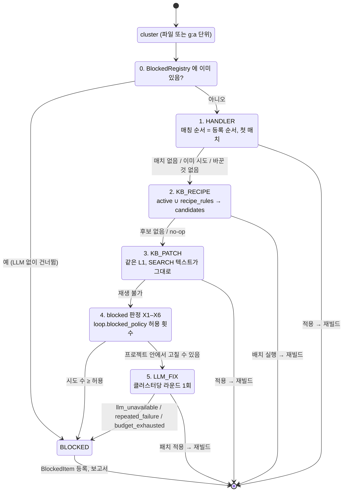

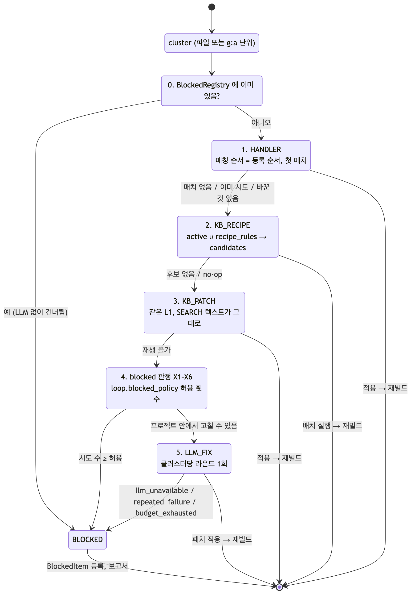

*PNG: `diagrams/triage-ladder.png` · 원본: `diagrams/triage-ladder.mmd`*

`sbmig/triage/decide.py`의 결정은 위에서부터 내려가며 처음 해당하는 단계에서 끝납니다.

```
run-wide blocked registry → HANDLER > KB_RECIPE > KB_PATCH > blocked check (cfg.loop.blocked_policy) > LLM_FIX
→ BLOCKED(repeated_failure | budget_exhausted | llm_unavailable)
```

| 단계 | 조건 | 결과 |
|---|---|---|
| 0. 레지스트리 | 같은 실행의 앞 phase에서 이미 blocked(키 = L1 시그니처 + `src/…` 아래 경로) | LLM 없이 건너뜀. 일부만 blocked면 나머지 오류로 클러스터를 줄여 계속 |
| 1. HANDLER | `kinds`, `triggers`(정규식), `applicable()`(프로필)이 맞는 첫 핸들러. KB 패턴의 `handler_ids`도 후보. 같은 클러스터에서 실패한 핸들러는 제외 | 결정적 수정 |
| 2. KB_RECIPE | active KB 레시피(시그니처 일치) ∪ 반응형 규칙(`sbmig/triage/recipe_rules.yml`, 6개). 없으면 후보 레시피. 같은 라운드의 레시피는 `rewrite:runNoFork` 한 번으로 묶어 실행 | 레시피 배치 |
| 3. KB_PATCH | 같은 L1 사례가 있고 그 SEARCH 텍스트가 지금 파일에 그대로 있음 | LLM 없이 패치 재생 |
| 4. blocked 판정 | `classify_blocked`가 X1–X6 중 하나로 판정하고, 실패한 LLM 시도 수 ≥ `loop.blocked_policy[reason]` | BLOCKED |
| 5. LLM_FIX | 위 어디에도 해당하지 않음. 클러스터당 라운드 1회 | LLM 수정 |
| 최종 BLOCKED | LLM unavailable / 쓸모없는 답 2회 / 해결 못한 시도 `max(max_llm_attempts_per_cluster, stall_limit + 1)`(기본 3, verify 루프는 +2) / 호출 예산 소진 | `llm_unavailable`, `repeated_failure`, `budget_exhausted` |

결정적 선택지가 아무것도 바꾸지 못하면(`apply_failed`) 그 선택지를 "시도함"으로 표시하고 같은 클러스터에 대해 다음 단계로 바로 넘어갑니다.
한 클러스터당 최대 6번까지 다시 결정합니다.

### 6.2 핸들러 26개

`HandlerRegistry.default().ids()` 순서가 반응형 매칭 우선순위입니다.

| 묶음 | 핸들러(등록 순서) | 선제 실행 |
|---|---|---|
| 인코딩 | `source-encoding`(E1), `strip-utf8-bom`(E2) | 항상 |
| 빌드 규칙 / pom 버전 | `carry-over-managed-version`(E6), `enforcer-relax`(E4), `remove-werror`(E5), `systempath-relocate`(E7), `missing-dependency-version` | 반응형만 |
| 레시피 빈틈(소스) | `jakarta-namespace-sweep`(E13), `spring-data-crud-repository`(E14) | SPRING 그룹 |
| 좌표 재배치 / jakarta | `mysql-connector-relocation`, `javax-servlet-api-to-jakarta`, `jstl-to-jakarta`(E11), `dependency-relocation`, `jakarta-library-floor`, `querydsl-jakarta-classifier` | mysql은 JDK21 그룹, 나머지는 SPRING 그룹 |
| 누락 의존성 | `jaxb-runtime-add`, `add-known-dependency` | jaxb는 JDK21 그룹, add-known은 SPRING 그룹 |
| 프로세서 / 플러그인 하한 | `lombok-version-floor`, `mapstruct-version-floor`, `maven-compiler-plugin-floor`, `compiler-legacy-config`(E10), `surefire-plugin-floor`, `remove-classic-loader-implementation` | JDK21 그룹(프로필 근거) |
| 리소스 / 저장소 | `resources-binary-filtering`(E12), `strip-pom-repositories`(X9, `build.pom_repositories: remove`일 때만) | JDK21 그룹(프로필 근거) |
| 자리표시 | `test-compile-skip` | 자동 매칭 없음(L7은 루프가 직접 수행) |

선제 기준과 실제 목표 버전은 다릅니다.
예를 들어 lombok은 1.18.30 미만이면 손대고 1.18.38 이상으로 올립니다.
mapstruct는 1.6.0 / 1.6.3, maven-compiler-plugin은 3.13.0 / 3.14.0, surefire는 3.0.0 / 3.5.3입니다.

### 6.3 jakarta 관련 처리

| 처리 | 언제 | 무엇을 |
|---|---|---|
| `JavaxMigrationToJakarta` 레시피 | `spring.rewrite`, 반응형 규칙 `javax-ee-to-jakarta`(spring / restructure phase만) | 타입이 붙은 javax EE 참조 |
| `jakarta-namespace-sweep` | 선제(as-is에 javax EE import나 javax를 쓰는 JSP가 있을 때), 반응형(`package javax.X does not exist`, `cannot be converted to` 등) | 레시피가 남긴 Java 소스의 `javax.*` EE 참조(문자열 리터럴 밖)와 JSP / 태그 파일의 page import, 스크립틀릿, `jsp:useBean`. 표 `sbmig/triage/handlers/jakarta_packages.yml`(30개). 플래그 `jakarta-leftovers-renamed`, `jsp-javax-renamed` |
| `spring-data-crud-repository` | 선제(Spring Data / JPA 사용), 반응형(`findAll(no arguments)`, `save|findById…`) | `PagingAndSortingRepository`만 상속하는 리포지토리에 `ListCrudRepository<T, ID>` 추가. 플래그 `spring-data-crud-restored` |
| `jakarta-library-floor` | 선제(pom이 `jakarta_libraries.yml`의 라이브러리를 jakarta 이전 버전으로 선언), 반응형(X1의 `via_direct`가 표에 있음) | 표의 버전으로 상향, 옛 좌표면 이전, 항목에 `classifier`가 있으면 붙임. 플래그 `jakarta-library-bumped` |
| `dependency-relocation` | 선제(pom에 직접 선언된 javax API 행, spring 레시피 뒤), 반응형(표의 옛 아티팩트가 오류에 나옴) | `sbmig/triage/handlers/relocations.yml`(44개): javax → jakarta API, `hibernate` → `org.hibernate.orm`, Boot 4 starter 이름 등 |
| `add-known-dependency` | 반응형(`package X does not exist`, `cannot access`, `class file for … not found`, `cannot find symbol`) | `known_packages.yml`(56개)의 아티팩트를 모듈 pom에 추가. parent가 관리하면 버전 생략. JUnit 4 잔재(`org.junit.experimental` 등)는 `junit:junit` test |

---

## 7. LLM 수정 호출

### 7.1 호출 순서

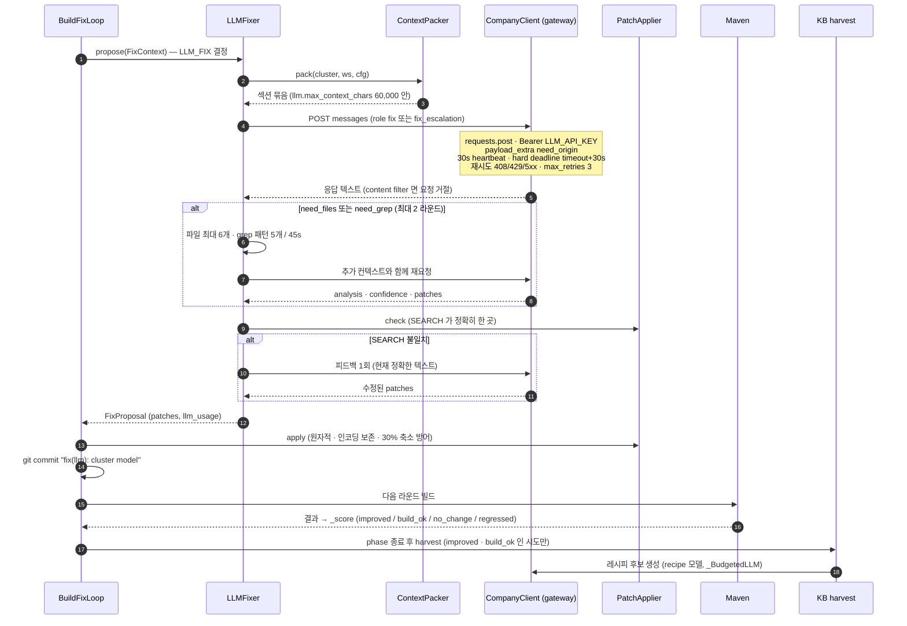

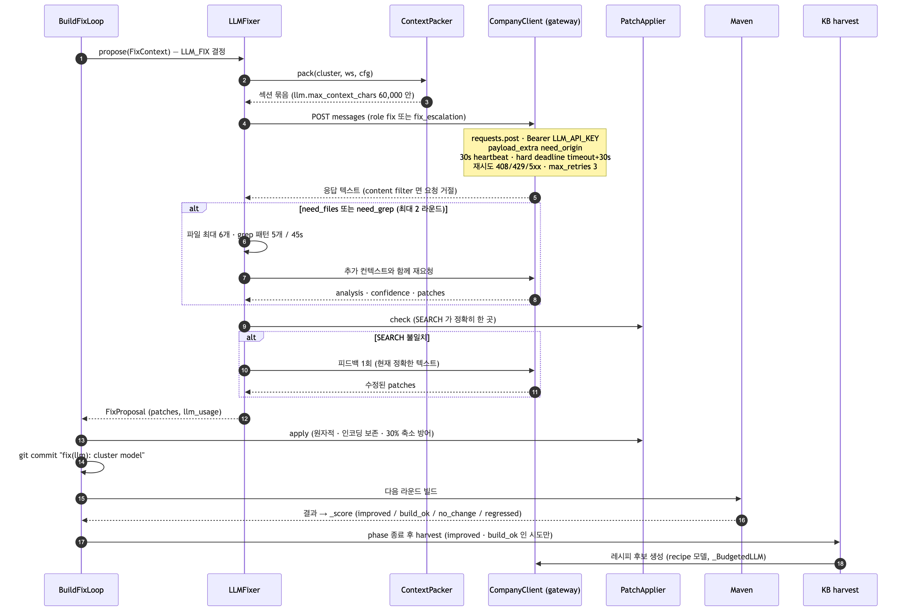

*PNG: `diagrams/llm-fix.png` · 원본: `diagrams/llm-fix.mmd`*

`LLMFixer.propose`(`sbmig/fix/fixer.py`)가 한 클러스터의 수정 제안을 만듭니다.
시스템 프롬프트는 `sbmig/fix/prompts/system_v1.md`, 사용자 프롬프트 템플릿은 `user_v1.md.j2`입니다(`llm.prompt_version: v1`).
시스템 프롬프트의 핵심 제약은 다음과 같습니다.
최소한의 기계적 수정만 합니다.
동작을 유지하고 로직, 테스트를 지우거나 주석 처리하지 않습니다.
새 서드파티 의존성을 추가하지 않습니다.
루트 `<parent>`를 바꾸거나 Java / Boot 버전을 내리지 않습니다.
보지 않은 코드는 `<need_files>` / `<need_grep>`으로 요청합니다.
끝났는지는 오케스트레이터가 빌드로 정합니다.

### 7.2 컨텍스트 패킹

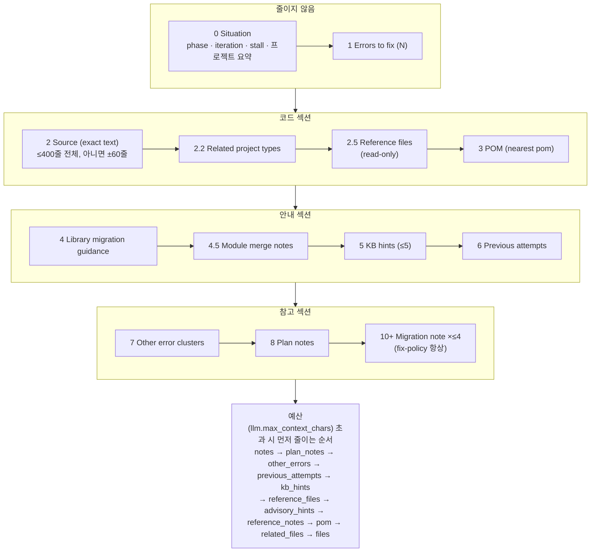

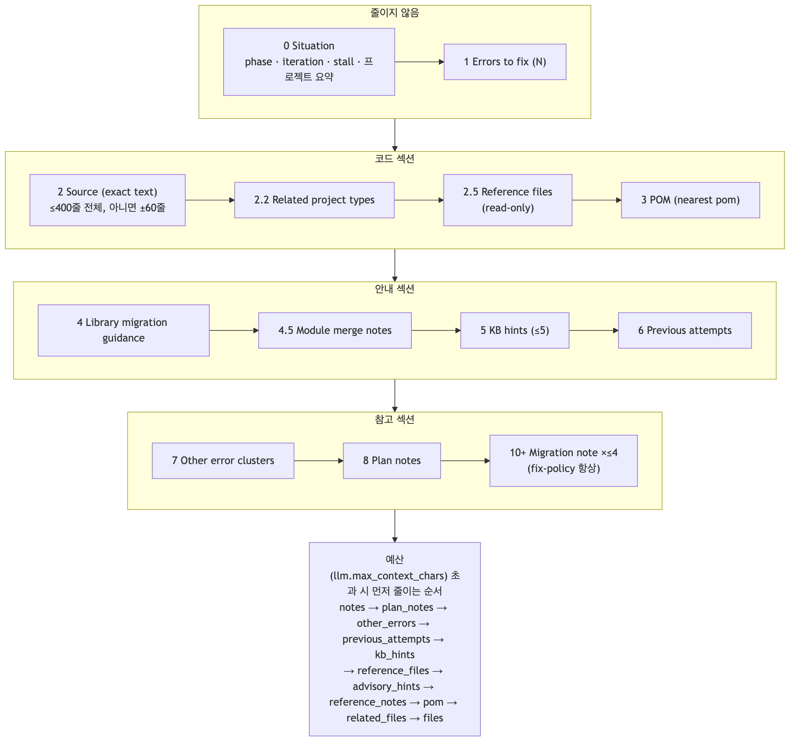

*PNG: `diagrams/context-packing.png` · 원본: `diagrams/context-packing.mmd`*

`ContextPacker.pack`(`sbmig/fix/context.py`)이 섹션을 만들고 `llm.max_context_chars`(60,000자) 안에 맞춥니다.

| 순서 | 섹션 | 내용 |
|---|---|---|
| 0 | Situation | phase, 반복, stall 수준, 프로젝트 요약(`case=… java=… boot=… libs=…`, 목표 JDK 21 / Boot 4.1), 클러스터 id / 종류 / 모듈 / 파일 |
| 1 | Errors to fix | 클러스터의 오류 전체(원문 포함) |
| 2 | Source | 오류 파일. 400줄 이하면 전체, 아니면 오류 줄 ±60줄 |
| 2.2 | Related project types | 오류에 이름이 나온 프로젝트 타입(최대 3개) |
| 2.5 | Reference files | merge에서 버려진 사본(읽기 전용, 패치 대상 아님) |
| 3 | POM | 가장 가까운 pom(250줄 이하면 전체) |
| 4 | Library migration guidance | advisory 힌트와 `## fix-loop: <library>` 노트 |
| 4.5 | Module merge notes | first-wins 병합 안내 |
| 5 | Knowledge-base hints | 비슷한 사례, `symbols.json`의 "symbol X was fixed in N projects by Y"(최대 `kb.max_hints` 5) |
| 6 | Previous attempts | 이 클러스터의 이전 시도(반복하지 말 것) |
| 7 | Other error clusters | 다른 클러스터 한 줄씩 |
| 8 | Plan notes | 계획 노트 |
| 10+ | Migration note | `knowledge/notes/index.yml`의 키워드 점수 상위 4개. `fix-policy.md`는 항상 포함 |

예산을 넘으면 `TRUNCATE_ORDER` 순서로 줄이거나 뺍니다.
`notes → plan_notes → other_errors → previous_attempts → kb_hints → reference_files → advisory_hints → reference_notes → pom → related_files → files` 순서입니다.
Situation과 Errors는 줄이지 않습니다.
줄인 섹션 이름은 프롬프트 끝과 로그의 `truncated …`에 나옵니다.

### 7.3 회사 게이트웨이

`CompanyClient`(`sbmig/fix/company.py`)는 `requests.post`를 그대로 씁니다.

| 항목 | 값 |
|---|---|
| 요청 | `POST $LLM_BASE_URL`, 헤더 `Authorization: Bearer $LLM_API_KEY`, JSON `{model, messages, **llm.payload_extra}`. 기본 `payload_extra`는 `need_origin: true` |
| 생성 파라미터 | 보내지 않음(게이트웨이 소유) |
| 응답 | `choices[0].message.content`, `content`, `response`, `data.content` 등 자동 탐지, 또는 `LLM_RESPONSE_PATH`. `usage`가 있으면 토큰 수 기록 |
| 재시도 | 상태 408, 409, 425, 429, 500, 502, 503, 504, 520, 522, 524, 529에 `llm.max_retries`(3)까지. `Retry-After` 존중 |
| heartbeat | 응답이 없는 동안 30초마다 "still in flight" 줄 |
| hard deadline | `timeout + 30`초를 넘기면 호출을 버리고 전송 실패로 처리(재시도 → cool-down → unavailable) |
| content filter | `finish_reason=content_filter` 등은 요청 거절로 분류. 장애로 세지 않음 |
| 키 | 환경(`.env` 또는 셸)에서만 읽음. 로그와 기록에는 남기지 않음 |

플러그인 seam도 있습니다.
tier 1 `llm.plugin`(`--llm-plugin mypkg.adapter:make_adapter`)은 채팅 완성 함수만 바꿉니다.
tier 2 `fix.plugin`(`--fix-plugin mypkg.agent:make_fixer`)은 `FixerLike`를 구현한 사내 에이전트로 fixer 전체를 바꿉니다.

### 7.4 응답 프로토콜

```
<analysis>왜 실패하는지, 무엇을 바꾸는지 1–5줄</analysis>
<confidence>0.0–1.0</confidence>
<patches>
=== MODIFY relative/path/File.java
<<<<<<< SEARCH
기존 텍스트 그대로 (파일에서 정확히 한 곳)
=======
바꿀 텍스트
>>>>>>> REPLACE
=== CREATE relative/path/New.java
=== DELETE relative/path/Old.java
=== RENAME old/path -> new/path
</patches>
```

패치 대신 `<need_files>` / `<need_grep>`으로 컨텍스트를 요청할 수 있습니다.
라운드는 `llm.max_context_rounds`(2)까지입니다.
라운드마다 파일은 최대 6개이고, 300줄을 넘는 파일은 앞 200줄과 뒤 80줄만 줍니다.
`<need_grep>`은 패턴 5개, 파일 3,000개, 파일당 512 KB, 45초, 결과 40줄로 제한합니다.

### 7.5 적용과 학습

| 단계 | 동작 |
|---|---|
| 검사 | SEARCH가 정확히 한 번 맞는지 확인. 아니면 공백을 정규화해 한 번 더 찾음 |
| 피드백 | 실패한 블록이 있으면 현재 정확한 텍스트를 보여 주고 1회 재요청 |
| 적용 | 파일 단위로 원자적으로 적용. 개행과 원래 인코딩 보존. 원래 크기의 30% 미만만 남기는 쓰기는 거부(120자 미만 파일 제외). 참조 사본을 겨냥한 패치는 버림 |
| 커밋 | `fix(llm): <cluster> <model>`. 바뀐 파일이 없으면 `apply_failed` |
| 채점 | 다음 빌드에서 `_score`(§5.3) |
| harvest | phase 끝에 `improved` / `build_ok`인 LLM 시도만 KB 사례로 저장(§10) |
| 비용 | 시도별 사용량 + 예산 카운터 + 플랜 조언 호출을 모델별로 합산 → `llm.pricing`(백만 토큰당 input / output / cached input) × 사용량 = `report.llm_cost`. 가격이 없는 모델은 목록에만 올리고 추정하지 않음 |

---

## 8. Blocked와 Handover

### 8.1 blocked 분류

```mermaid
flowchart TD
  C["클러스터의 오류들"] --> K{"오류 모양"}
  K -->|"javax ↔ jakarta 불일치<br/>required/found · override · class file not found"| X1["X1 external_javax_api<br/>허용 LLM 0"]
  K -->|"라이브러리 소유 심볼이 사라짐<br/>(java. / spring / lombok 제외)"| X2["X2 external_api_incompatible<br/>허용 LLM 1"]
  K -->|"Could not find artifact<br/>could not be resolved"| X3["X3 artifact_not_found<br/>허용 LLM 0"]
  K -->|parent_resolution| X4["X4 parent_not_found<br/>사내 parent 면 실행 중단"]
  K -->|"plugin_execution + major version<br/>NoSuchMethodError · IllegalAccessError"| X5["X5 plugin_incompatible<br/>허용 LLM 1"]
  K -->|"protobuf · jaxb2 · openapi-generator<br/>.kt · .groovy · .scala"| X6["X6 unsupported_source<br/>허용 LLM 0"]
  K -->|"cannot find symbol · package javax.x does not exist<br/>소유 클래스가 프로젝트 클래스"| FIX["blocked 아님<br/>프로젝트 안에서 고칠 수 있음"]
  X1 --> REG["BlockedRegistry (실행 전체, 키 = L1 + src/ 경로)"]
  X2 --> REG
  X3 --> REG
  X5 --> REG
  X6 --> REG
  REG --> ATT["_register_blocked<br/>owner class → jar → GAV<br/>dependency:build-classpath"]
  ATT --> RPT["보고서 Blocked 표 · ledger"]
```

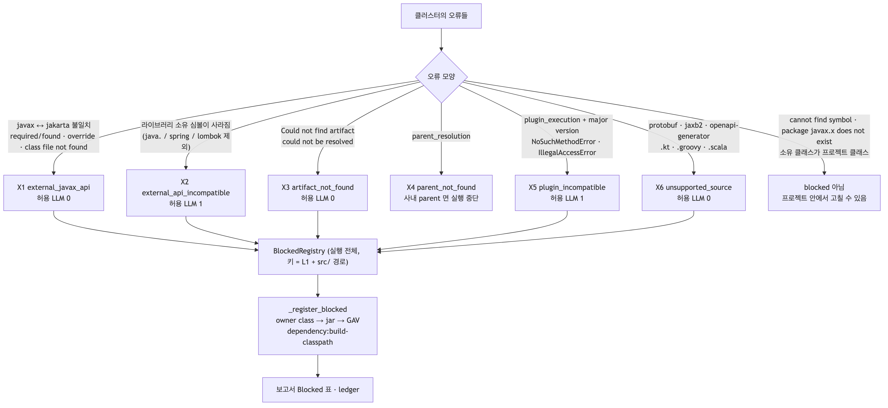

*PNG: `diagrams/blocked-classify.png` · 원본: `diagrams/blocked-classify.mmd`*

`classify_blocked`(`sbmig/triage/blocked.py`)는 "프로젝트 안에서 고칠 수 없다"를 보수적으로 판정합니다.
애매하면 blocked로 보지 않습니다.

| id | 판정 근거 | `BlockReason` | 허용 LLM 시도(`loop.blocked_policy`) |
|---|---|---|---|
| X1 | javax와 jakarta가 엇갈리는 `cannot be converted to`, `required:` / `found:`, 후보가 javax를 받는 `no suitable method`, `does not override abstract method m(javax…)`, `class file for javax.X not found` | `external_javax_api` | 0 |
| X2 | `cannot find symbol` / `cannot be applied`의 소유 클래스가 라이브러리 클래스(마이그레이션 대상 API 아님) | `external_api_incompatible` | 1 |
| X3 | resolution 오류 + `Could not find artifact` / `could not be resolved` / `Failure to find` | `artifact_not_found` | 0 |
| X4 | `parent_resolution`. 설정된 사내 parent면 실행 중단 | `parent_not_found` | 0 |
| X5 | `plugin_execution` + `Unsupported class file major version`, `NoSuchMethodError`, `IllegalAccessError … com.sun.tools.javac`, `InaccessibleObjectException` | `plugin_incompatible` | 1 |
| X6 | 코드 생성 플러그인(protobuf, jaxb2, openapi-generator, kotlin, gmavenplus, scala) 실패, `.kt` / `.groovy` / `.scala` 오류 | `unsupported_source` | 0 |
| — | 소스 인코딩 판별 불가 | `encoding` | 0 |

`cannot find symbol`이나 `package javax.x does not exist`는 X1이 아닙니다.
소유 클래스가 프로젝트 클래스이거나, 프로젝트 소스가 아직 그 javax 패키지를 import하는 경우도 X1이 아닙니다.
이 경우는 jakarta 레시피나 `jakarta-namespace-sweep`이 고칠 수 있습니다.

루프가 정하는 blocked 사유도 있습니다.
`repeated_failure`, `budget_exhausted`, `llm_unavailable`, `oscillation`입니다.

blocked가 아닌 외부 문제도 따로 다룹니다.
X7은 advisory 레시피가 라이브러리를 제거한 경우이고, Handover가 안내합니다.
X8은 레시피 실행 중 다운로드 실패이며 재시도와 리터럴 버전 재실행으로 처리합니다.
X9는 pom에 선언된 저장소에 접속할 수 없는 경우이며 `build.settings_file`의 미러 또는 `strip-pom-repositories`로 처리합니다.

### 8.2 BlockedRegistry

`BlockedRegistry`(`sbmig/loop/blocked_registry.py`)는 실행 하나에 하나이며 모든 phase의 루프가 공유합니다.
키는 L1 시그니처이고 compile 오류에는 `src/…` 아래 경로를 붙입니다.
재구성으로 파일이 `{name}-back/src/...`로 옮겨져도 키가 유지됩니다.
최종 빌드가 성공하면 더 이상 나타나지 않는 항목을 지웁니다(journal `blocked_resolved`).
verify 수정 루프는 `repeated_failure` / `oscillation` 항목만 풉니다(journal `blocked_released`).

### 8.3 X1 원인 추적과 제안

```mermaid
flowchart TB
  subgraph a["① 원인 추적"]
    direction LR
    A["X1 / X2 blocked<br/>owner class → jar → GAV<br/>(dependency:build-classpath)"] --> B{"jar 가 javax<br/>API jar 자체?"}
    B -->|아니오| S0["그 GAV 를 Jakarta<br/>릴리스로 올리라는 제안"]
    B -->|예| C["finalize: dependency:tree<br/>-Dincludes=javax API 패턴"] --> D["fill_via<br/>via · via_direct"]
  end
  subgraph b["② 제안 사다리"]
    direction LR
    E{"via_direct ∈<br/>jakarta_libraries.yml?"} -->|예| E1["표 버전으로 상향<br/>(jakarta-library-floor)"]
    E -->|아니오| F{"사내 그룹?"}
    F -->|예| F1["artifacts.optional 에 추가<br/>(Jakarta 빌드)"]
    F -->|아니오| G{"API jar 를 pom 이<br/>직접 선언?"}
    G -->|예| G1["선언 제거<br/>dependency-relocation"]
    G -->|아니오| H1["라이브러리 상향 · 교체<br/>경로 없으면 dependency:tree 안내"]
  end
  a --> b
  b --> R["report.json javax_api_jars · flag javax-api-on-classpath · ledger via"]
```

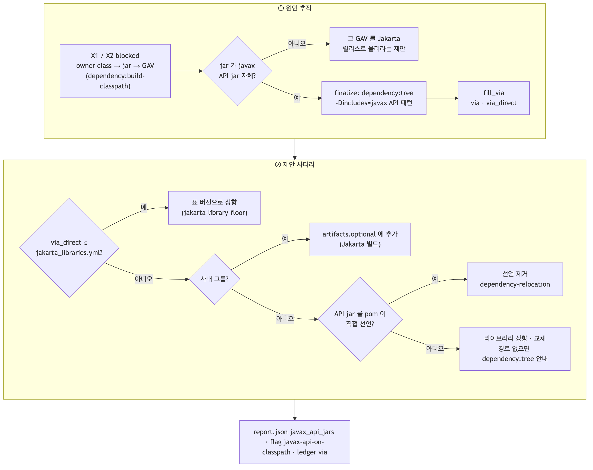

*PNG: `diagrams/blocked-x1.png` · 원본: `diagrams/blocked-x1.mmd`*

| 단계 | 동작 |
|---|---|
| 소유 클래스 → jar → GAV | `mvn dependency:build-classpath`로 클래스패스를 만들고(`classpath/`, journal `classpath`) 소유 클래스가 든 jar를 찾음 |
| API jar 자체인 경우 | 예: `jakarta.persistence.Query cannot be converted to javax.persistence.Query`면 타입의 jar `javax.persistence:javax.persistence-api`가 잡힘. 원인 라이브러리가 아니므로 finalize에서 경로를 찾음 |
| javax API 인벤토리 | 모듈마다 `mvn dependency:tree -Dincludes=<javax API 패턴>`(journal `deptree`). `report.json`의 `javax_api_jars`, journal `javax_api_inventory`, 플래그 `javax-api-on-classpath` |
| `fill_via` | blocked 항목에 `via`(루트 → … → API jar)와 `via_direct`(모듈의 직접 의존성)를 채우고 제안을 다시 씀 |
| 제안 1 | `via_direct`가 `knowledge/libraries/jakarta_libraries.yml`(44개)에 있으면 그 버전으로 상향(옛 좌표면 이전). pom에 선언돼 있으면 `jakarta-library-floor`가 직접 처리 |
| 제안 2 | 사내 그룹(parent / mandatory / optional의 groupId)이면 Jakarta 빌드가 필요하므로 `artifacts.optional`에 추가 |
| 제안 3 | 그 밖의 라이브러리는 Jakarta 릴리스로 상향 또는 교체 |
| 제안 4 | API jar 자체가 pom에 선언돼 있으면 제거(선제 `dependency-relocation`) |
| 제안 5 | 경로를 못 찾으면 그 모듈에서 `mvn dependency:tree -Dincludes=<API jar>`를 돌리라고 안내 |

ledger 노트에는 `via: a → b → c`가 남습니다.
그 아티팩트가 `artifacts.optional`에 있으면 "optional bump 뒤에도 blocked라면 그 버전 자체가 javax이므로 라이브러리 담당자에게 Jakarta 빌드를 요청하라"고 안내합니다.

### 8.4 보고서와 Handover

```mermaid
flowchart TB
  subgraph a["① 맨 앞: 요약과 Handover"]
    direction LR
    T["요약 표<br/>Result · Case · LLM · Flags<br/>Blocked 수 · javax jars 수"] --> H1["Handover<br/>### Versions replaced<br/>⚠ carried over"] --> H2["### Libraries needing<br/>your attention"] --> H3["Merge conflicts"] --> H4["### Properties to set<br/>before running"] --> H5["### From here on,<br/>your team"]
  end
  subgraph b["② 행동할 것"]
    direction LR
    BL["## Blocked — needs human /<br/>library action"] --> JX["## javax API jars<br/>still on the classpath"] --> UN["## Unresolved errors"] --> MF["## Manual follow-ups<br/>## Flags"]
  end
  subgraph c["③ 기록"]
    direction LR
    WC["## What we changed<br/>## Phases"] --> FA["## Fix attempts<br/>## Escalated clusters"] --> CO["## LLM usage and cost"] --> REST["## Knowledge base<br/>## Notes · ## Outputs"]
  end
  a --> b --> c
```

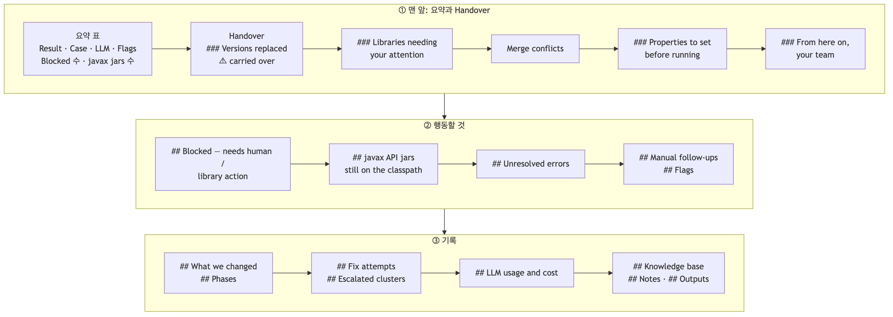

*PNG: `diagrams/report-handover.png` · 원본: `diagrams/report-handover.mmd`*

| 절 | 내용 |
|---|---|
| 요약 표 | Result(`✅ BUILD SUCCESS` / `❌ NOT BUILDING`), Case, As-is, Run id, 시간, LLM 호출, Flags, Blocked 수, javax API jar 수 |
| Handover → Versions replaced | parent / Java / Boot 전후, 버전이 바뀐 의존성 / BOM / 플러그인 / 속성(이유: parent swap, recipe, optional bump, mandatory, `advisory:<id>`), ⚠ carried over, Added / Removed |
| Handover → Libraries needing your attention | advisory마다 상태, 정책, 한 일, 결과(`replaced` / `still-present` / `unknown`), 다음 할 일 |
| Handover → Merge conflicts | merge first-wins로 버려진 파일(`merge-conflicts/`) |
| Handover → Properties to set before running | 코드가 읽지만 패키지에 없는 키, 읽는 위치, 쓴 자리표시자, 공급 방법 |
| Handover → From here on, your team | 번호 매긴 할 일 목록 |
| Blocked — needs human / library action | blocked 항목마다 사유, 아티팩트 / 소유 클래스, required vs found, 파일, 제안, 시도 횟수 |
| javax API jars still on the classpath | 남은 javax API jar와 끌어오는 직접 의존성 |
| Unresolved errors | blocked를 뺀 나머지 오류(파일별) |
| Manual follow-ups, Flags | 후속 조치(web.xml, JSP, XML 빈, 건너뛴 테스트, 저장소 미러 등), 플래그 |
| What we changed, Phases, Fix attempts, Escalated clusters | 변경 요약, phase별 결과, 시도별 결정과 커밋 |
| LLM usage and cost | 모델별 호출, 토큰, 비용(`llm.pricing`, 통화 `llm.pricing_currency`) |
| Knowledge base, Notes, Outputs | 이번 실행의 KB 사례 / 후보 / 승격, 노트, 산출물 경로 |

`report.language: ko`면 `report.md`를 한국어로 씁니다.
식별자, 경로, Maven 메시지, 루프 노트는 영어로 남깁니다.
`report.json`은 언어 설정과 무관합니다.

carried over는 일반 규칙입니다.
옛 parent / BOM이 관리하던 버전을 새 parent와 Boot 4.1 BOM이 관리하지 않으면 parent 교체에서 버전을 잃습니다(E6).
에이전트는 as-is effective 버전으로 명시 고정하고(`carry-over-managed-version`) Handover에 ⚠로 표시합니다.
소유 팀이 그 버전이 JDK 21 / Boot 4.1에서 동작하는지 확인해야 합니다.

---

## 9. 재구성 — 회사 레이아웃

### 9.1 모드 선택

```mermaid
flowchart TD
  A["ProjectProfile"] --> C{"MSA 서비스 발견?"}
  C -->|예| M["restructure.msa_pom<br/>mode msa_pom — 서비스 루트 pom 만"]
  C -->|아니오| D{"Java 소스 0개, pom 있음?"}
  D -->|예| P["restructure.pom_only<br/>mode msa_pom + pom_only"]
  D -->|아니오| E{"case == spring_boot AND<br/>layout.boot_as_is == in-place?"}
  E -->|예| BP["restructure.boot_pom<br/>mode boot_pom — 디렉터리 유지"]
  E -->|아니오| L["restructure.apply<br/>mode layout — boot / back / front"]
  BP --> W{"단일 모듈?"}
  W -->|예| WR["{name}-boot 로 감싸기"]
  W -->|아니오| IP["*-boot + Boot 앱 pom → boot_parent<br/>나머지 모듈 → comp_parent"]
  L --> MM{"as-is 멀티 모듈?"}
  MM -->|"예, multi_module_policy: merge"| MG["모든 모듈 → {name}-back<br/>first-wins, merge-conflicts/"]
  MM -->|아니오| SG["_single: src → {name}-back"]
  M --> Q["plan.parent_phase 위치에서 실행"]
  P --> Q
  WR --> Q
  IP --> Q
  MG --> Q
  SG --> Q
```

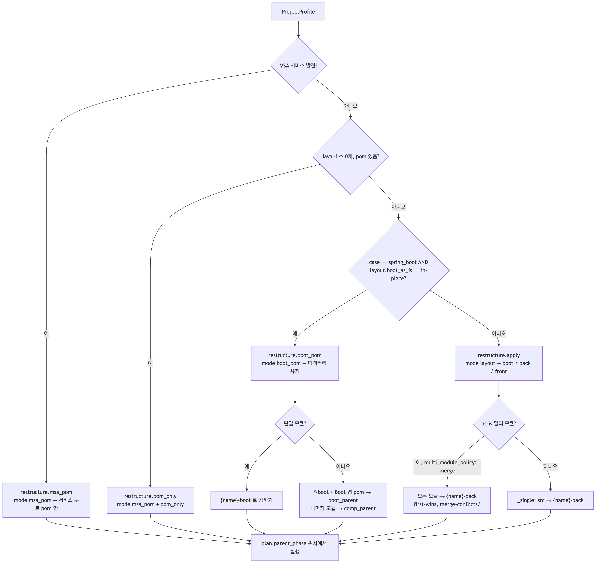

*PNG: `diagrams/restructure-mode.png` · 원본: `diagrams/restructure-mode.mmd`*

| 프로젝트 | 스텝 | 모드 | 디렉터리 이동 |
|---|---|---|---|
| `pure_java` | `restructure.apply` | `layout` | `{name}-boot` / `{name}-back` |
| `spring_legacy` | `restructure.apply` | `layout` | boot / back / (웹 리소스가 있으면) front |
| `servlet_tomcat` | `restructure.apply` | `layout` | boot / back / front, JSP면 boot는 WAR |
| `spring_boot` + `layout.boot_as_is: in-place`(기본) | `restructure.boot_pom` | `boot_pom` | 없음. 단일 모듈이면 `{name}-boot`로 감싸기만 |
| `spring_boot` + `layout.boot_as_is: layout` | `restructure.apply` | `layout` | 다른 케이스처럼 분리 |
| MSA | `restructure.msa_pom` | `msa_pom` | 없음. 서비스 루트 pom만 |
| 소스 없는 pom 프로젝트 | `restructure.pom_only` | `msa_pom` | 없음 |

모든 모드는 공통으로 optional 상향과 `remove_when_present` 제거를 모든 pom에 적용합니다.
이미 재구성된 프로젝트(루트가 `pom`이고 boot / back 모듈이 있음)는 이동 없이 parent 버전 정렬, 역할 parent 정렬, pom 패스만 합니다.

### 9.2 목표 구조

```mermaid
flowchart TD
  ROOT["루트 pom.xml<br/>packaging pom · parent = base-parent (artifacts.parent)<br/>mandatory 2개 선언 (mandatory_target: root)"]
  ROOT --> BACK["{name}-back<br/>parent comp-jar (artifacts.comp_parent)<br/>모든 as-is 소스 (컨트롤러 포함) · as-is 의존성"]
  ROOT --> FRONT["{name}-front (웹 리소스가 있을 때만)<br/>parent comp-jar<br/>static → src/main/resources/static<br/>JSP → META-INF/resources/WEB-INF/jsp"]
  ROOT --> BOOT["{name}-boot<br/>parent boot-jar (artifacts.boot_parent)<br/>JSP 있으면 WAR (외장 Tomcat), 아니면 실행 jar"]
  BOOT --> APP["생성 Application<br/>@SpringBootApplication<br/>@ServletComponentScan (서블릿 케이스 · @WebServlet)<br/>@ImportResource legacy-config/*.xml"]
  BOOT --> WX["WebXmlRegistrations (web.xml 에서 생성)<br/>Servlet / Filter / Listener RegistrationBean<br/>ErrorPageRegistrar"]
  BOOT --> PROPS["application.properties<br/>__SET_ME__ placeholders<br/>spring.mvc.view.prefix / suffix<br/>server.servlet.session.timeout"]
  BOOT --> RES["boot 리소스<br/>application*, logback*, banner.txt<br/>asis-webinf/ (Boot 가 읽지 않음)"]
  BOOT -.->|의존| BACK
  BOOT -.->|의존| FRONT
```

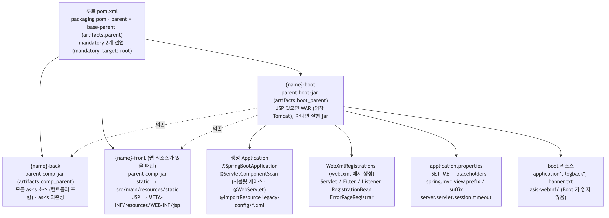

*PNG: `diagrams/company-layout.png` · 원본: `diagrams/company-layout.mmd`*

| 대상 | 규칙 | 설정 |
|---|---|---|
| 루트 pom | packaging `pom`, parent = 사내 base-parent, `<modules>` 나열, mandatory 2개를 루트에 선언 | `artifacts.parent`, `artifacts.mandatory`, `artifacts.mandatory_target: root` |
| `{name}` | 루트 pom의 artifactId | `layout.project_name`으로 덮어쓰기 |
| `{name}-boot` | Boot 설정만: `@SpringBootApplication`, `application*`, 로깅 설정, banner, `@SpringBootTest`, `SpringBootServletInitializer` 하위 클래스, 가져온 XML 설정. parent boot-jar | `layout.boot_module`, `artifacts.boot_parent`, `layout.split_policy: minimal` |
| `{name}-back` | 컨트롤러를 포함한 모든 as-is 소스와 의존성. parent comp-jar | `layout.comp_module`, `artifacts.comp_parent` |
| `{name}-front` | 웹 리소스가 있을 때만. 정적 파일 → `src/main/resources/static`, JSP → `src/main/resources/META-INF/resources/WEB-INF/jsp`(Servlet 3 jar 리소스). parent comp-jar | `layout.front_module`, `layout.front_static_dir`, `layout.front_jsp_dir` |
| boot 패키징 | JSP가 있으면 외장 Tomcat용 `war`, 아니면 실행 jar | `layout.jsp_boot_packaging: war` |
| starter | `pure_java` → `spring-boot-starter`, `servlet_tomcat` / `spring_legacy` → `spring-boot-starter-webmvc`, `spring_boot` → as-is 유지 | `layout.starter_by_case` |
| 사내 아티팩트 | 모두 한 버전 라인(4.0.0). optional 8개는 이미 쓸 때만 상향 | `artifacts.*.version`, `artifacts.optional` |

boot 모듈에 생성되는 것은 다음과 같습니다.

| 생성물 | 조건 | 내용 |
|---|---|---|
| `Application` | `@SpringBootApplication` 클래스가 없을 때 | 기본 패키지를 모르면 `com.company.app`. 같은 이름이 있으면 `BootApplication`. 서블릿 케이스나 `@WebServlet` / `@WebFilter` 클래스가 있으면 `@ServletComponentScan`(`layout.add_servlet_component_scan`). XML 빈 설정은 `legacy-config/`로 복사하고 `@ImportResource`(`layout.import_xml_bean_configs`) |
| `WebXmlRegistrations` | `layout.web_xml_registrations: generate`(기본)이고 web.xml이 있을 때 | 첫 web.xml의 서블릿 / 필터 / 리스너 / 오류 페이지를 `ServletRegistrationBean` / `FilterRegistrationBean`(dispatcher types, `setOrder`) / `ServletListenerRegistrationBean` / `ErrorPageRegistrar` 빈으로. `server.servlet.session.timeout`. Boot가 직접 등록하는 클래스(`knowledge/config/web_xml_rules.yml`의 skip 14개: `DispatcherServlet`, `ContextLoaderListener`, `CharacterEncodingFilter` …)는 제외하고 후속 조치로. 어노테이션이 붙은 클래스는 `@ServletComponentScan`에 맡김. jsp-file 서블릿, welcome file, MIME 매핑, security constraint는 후속 조치. 플래그 `web-xml-registered`, journal `web_xml_registrations` (W1) |
| `application.properties` 블록 | 외부화 키가 있을 때(`externalized.write_placeholders`) | `# --- sbmig externalized-config` 블록에 `__SET_ME__`. JNDI `jdbc/*` → `spring.datasource.*`, web.xml context-param → `server.servlet.context-parameters.*`(as-is 값), `System.getProperty` 전용 키는 쓰지 않고 Handover에만. 재실행 시 블록만 교체 |
| JSP 뷰 속성 | JSP가 front로 옮겨지고 as-is 설정이 뷰 prefix / suffix를 쓸 때 | `spring.mvc.view.prefix` / `suffix`. 이미 설정돼 있으면 그대로 둠 |
| `asis-webinf/` | JSP가 아닌 WEB-INF 파일 | boot 리소스 아래 보관(Boot가 읽지 않음) |

### 9.3 Spring Boot as-is와 MSA

`boot_pom` 모드는 디렉터리를 그대로 둡니다.
루트는 base-parent로 바꿉니다.
이름이 `layout.boot_module_pattern`(`*-boot`)에 맞고 pom이 Boot 앱인 모듈은 boot-jar parent를 받습니다.
나머지 모듈은 comp-jar parent를 받습니다.
단일 모듈 Boot 앱은 `{name}-boot`로 감쌉니다.
예전 사내 도구로 한 번 이관되어 옛 역할 parent를 쓰는 프로젝트도 설정된 parent 버전으로 옮깁니다.
MSA(`msa_pom`)는 서비스 루트, 라이브러리 루트, top aggregator의 pom만 바꿉니다(`layout.msa_parent_policy: per-service-root`).

### 9.4 멀티 모듈 merge

`layout.multi_module_policy: merge`(기본)는 as-is 멀티 모듈(MSA 아님)의 모든 모듈과 루트 `src/`를 `{name}-back`으로 합칩니다.
`boot_module` 이름에 맞는 as-is 모듈은 boot 모듈로 유지합니다.
같은 경로의 파일이 여러 모듈에 있으면 `<modules>` 순서의 첫 모듈이 이깁니다(`layout.merge_collision: first-wins`).
버려진 사본은 `<run dir>/merge-conflicts/`에 두고 Handover "Merge conflicts"에 적습니다.
restructure 루프의 LLM은 그 사본을 읽기 전용 참조로 받습니다.
`META-INF/services/*`, `spring.factories`, `*.imports` 같은 레지스트리는 합집합으로 합칩니다.
`merge_collision: fail`이면 충돌을 재구성 오류로 처리합니다.
`wrap`은 모듈을 그대로 두고 boot 모듈만 추가합니다.

### 9.5 관리 버전 정리와 역할 parent

parent를 붙인 뒤 effective pom을 다시 캡처합니다(`effective/depmgmt-after-restructure.json`).
`layout.drop_managed_versions: gte`면 새 parent 체인이 같거나 더 새 버전으로 관리하는 명시 `<version>`을 지웁니다.
mandatory / optional / parent 아티팩트와 system 스코프 의존성은 건드리지 않습니다.
역할 parent(`artifacts.boot_parent`, `artifacts.comp_parent`)는 모듈 위치로 정합니다.

---

## 10. 지식과 학습

### 10.1 지식 표와 쓰는 곳

```mermaid
flowchart LR
  subgraph p["계획과 레시피"]
    direction LR
    CAT["recipes/catalog.yml<br/>34 recipe ids"] --> PLAN["planner<br/>sbmig recipes check"]
    RR["triage/recipe_rules.yml<br/>6 rules"] --> KBR["KB_RECIPE 결정"]
    ADV["libraries/advisories.yml<br/>64 (guide 59 · recipe 5)"] --> AN["analyze · plan · hints<br/>verify · Handover"]
  end
  subgraph h["결정적 핸들러"]
    direction LR
    JL["jakarta_libraries.yml 44"] --> H1["jakarta-library-floor<br/>X1 제안"]
    REL["relocations.yml 44"] --> H2["dependency-relocation"]
    VER["versions.yml 51 + 3"] --> H3["missing-dependency-version<br/>carry-over-managed-version"]
    KP["known_packages.yml 56"] --> H4["add-known-dependency"]
    JP["jakarta_packages.yml 30"] --> H5["jakarta-namespace-sweep"]
  end
  subgraph o["재구성 · LLM · 인벤토리"]
    direction LR
    WX["web_xml_rules.yml 14"] --> RS["WebXmlRegistrations"]
    EXT["externalized.yml"] --> PH["__SET_ME__ placeholders"]
    NT["notes 16 + index.yml"] --> CTX["ContextPacker (≤4)"]
    JN["jar_names.yml 91"] --> INV["sbmig inventory"]
  end
  p ~~~ h ~~~ o
```

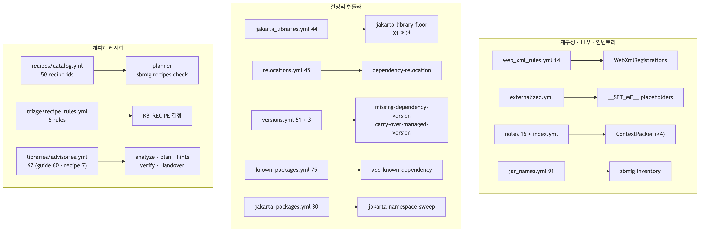

*PNG: `diagrams/knowledge-usage.png` · 원본: `diagrams/knowledge-usage.mmd`*

| 파일 | 항목 수 | 쓰는 곳 |
|---|---|---|
| `knowledge/recipes/catalog.yml` | 레시피 34 | 레시피 id의 단일 출처. planner, `sbmig recipes list / show / sets / check`(`--jars`로 jar 안의 id 검증) |
| `knowledge/recipes/base/*.yml` | 프로젝트 레시피(`spring-boot-41-version.yml`, `hystrix-to-resilience4j.yml`) | rewrite 합성 |
| `sbmig/triage/recipe_rules.yml` | 반응형 규칙 6 | KB_RECIPE: `javax-ee-to-jakarta`, `javax-xml-bind`, `junit4-to-junit5`, `mockbean-spybean`, `spring-security-config`, `boot4-modularized-autoconfigure` |
| `knowledge/libraries/advisories.yml` | advisory 64(guide 59, recipe 5) | analyze 판정, plan 레시피(recipe 정책), 수정 힌트, 최종 트리 검증, Handover, ledger(`resolution=advisory`). 회사 추가는 `advisories.extra_files` |
| `knowledge/libraries/jakarta_libraries.yml` | 라이브러리 44(옛 좌표, classifier 포함) | `jakarta-library-floor`, X1 제안 |
| `sbmig/triage/handlers/relocations.yml` | 재배치 44 | `dependency-relocation` |
| `sbmig/triage/handlers/versions.yml` | 버전 51, 플러그인 3 | `missing-dependency-version`, `carry-over-managed-version` 하한 |
| `sbmig/triage/handlers/known_packages.yml` | 패키지 56 | `add-known-dependency` |
| `sbmig/triage/handlers/jakarta_packages.yml` | 패키지 30 | `jakarta-namespace-sweep` |
| `knowledge/config/web_xml_rules.yml` | skip 14 | `WebXmlRegistrations` |
| `knowledge/config/externalized.yml` | JNDI / context-param / system property 규칙 | 외부화 설정 자리표시자 |
| `knowledge/libraries/jar_names.yml` | jar 91 | `sbmig inventory` |
| `knowledge/notes/*.md` + `index.yml` | 노트 16 | 컨텍스트 패커(키워드 점수 상위 4개, `fix-policy.md`는 항상). `## fix-loop: <library>` 절은 advisory 힌트로 들어감 |

### 10.2 KB 학습 루프

```mermaid
flowchart TB
  subgraph a["① harvest (phase 종료)"]
    direction LR
    A["LLM fix → 다음 빌드<br/>improved / build_ok"] --> B["harvest_phase"] --> C["KB case<br/>kb/cases/YYYY-MM<br/>(경로 · 비밀값 정제)"]
    B --> D["FixLabel (결정적)<br/>import-rename · method-rename …"]
    B --> I["symbols.json<br/>ledger.jsonl"]
  end
  subgraph b["② 레시피 후보"]
    direction LR
    E{"기계적 · 1:1?"} -->|예| F["후보 컴파일 (LLM 없음)<br/>ChangeType · ChangeMethodName<br/>AddDependency …"]
    E -->|아니오| G["recipe 모델 후보<br/>_BudgetedLLM · 화이트리스트 검증"]
    F --> H["recipes/candidates/"]
    G --> H
  end
  subgraph c["③ 다음 프로젝트에서 검증과 승격"]
    direction LR
    J["plan 의 spring.rewrite 에서 실행<br/>kb.try_candidates_in_plan"] --> K{"phase 빌드 성공?<br/>(해석 실패만이면 점수 없음)"}
    K -->|예| M{"서로 다른 프로젝트 2곳 성공<br/>실패 0?"}
    M -->|예| N["recipes/active/<br/>모든 계획에 포함 → LLM 0회"]
    K -->|아니오| R["실패 기록<br/>sbmig kb reject / promote"]
  end
  a --> b --> c
```

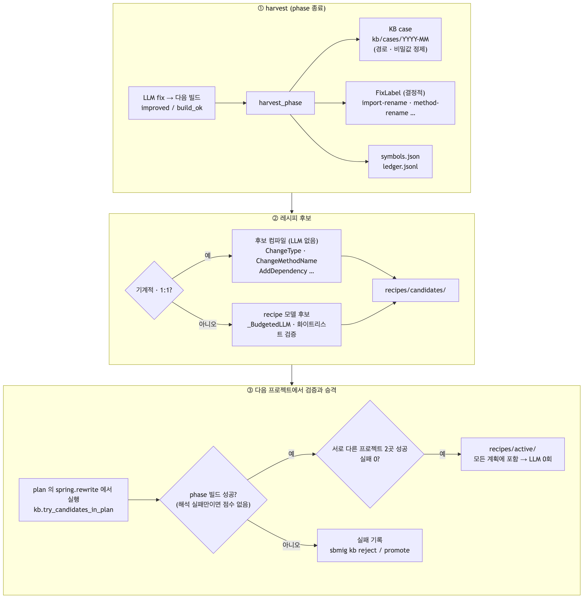

*PNG: `diagrams/kb-learning.png` · 원본: `diagrams/kb-learning.mmd`*

| 산출물 | 위치 | 내용 |
|---|---|---|
| 사례 | `kb/cases/YYYY-MM/<case-id>.json` | 경로와 비밀값을 정제한 수정 사례. 같은 사례면 재사용 횟수만 증가 |
| 인덱스 | `kb/index.json` | L1 / L2 시그니처 → 사례, 시그니처 → 레시피 |
| 수정 라벨 | 사례와 ledger | `import-rename`, `type-rename`, `package-rename`, `annotation-replace`, `method-rename`, `method-signature-adapt`, `override-signature`, `dependency-add / -remove / -replace / -version`, `plugin-version`, `pom-property`, `spring-property-rename`, `config-value`, `remove-code`, `add-code`, `generic-rewrite` |
| 레시피 후보 | `kb/recipes/candidates/` | 기계적 라벨은 LLM 없이 컴파일(`ChangeType`, `ChangePackage`, `ChangeMethodName`, `AddDependency`, `ChangeDependency`, `RemoveDependency`, `UpgradeDependencyVersion`, `UpgradePluginVersion`, `ChangePropertyValue`, `ChangeSpringPropertyKey`). 그 밖은 recipe 모델에 요청하고 화이트리스트로 검증(`sbmig/kb/recipes.py`) |
| 활성 레시피 | `kb/recipes/active/` | 서로 다른 `kb.auto_promote_after_projects`(2)개 프로젝트에서 성공하고 실패가 없으면 자동 승격. `sbmig kb promote` / `reject`로 수동 관리 |
| ledger | `kb/ledger.jsonl` | 시도, 계획 레시피, blocked, unresolved, advisory마다 한 줄(`ResolutionRecord`) |
| 심볼 인덱스 | `kb/symbols.json` | 오류 심볼 → 어떻게, 몇 개 프로젝트에서, 어떤 사례 / 레시피로 고쳤는지. 다음 LLM 프롬프트의 힌트 |

증거 없는 결과는 점수에 반영하지 않습니다.
빌드가 없던 phase, 의존성 해석만으로 실패한 phase는 레시피에 점수를 주지 않습니다.
최종 빌드 없이 멈춘 실행은 `unresolved` ledger 줄을 쓰지 않습니다.
LLM의 자기 평가는 쓰지 않고 다음 빌드에서 확인된 시도만 harvest합니다.
`method-rename`은 바뀐 파일의 import로 소유 FQCN을 해석할 수 있을 때만 `ChangeMethodName`으로 컴파일됩니다.

`sbmig kb learning`은 ledger를 읽어 세 가지를 보여 줍니다.
레시피나 핸들러로 만들어야 할 심볼(LLM이 2번 이상 고쳤는데 레시피가 없음), 아직 LLM이 고치는 목록, 여러 프로젝트를 막는 아티팩트입니다.

---

## 11. 플릿

```mermaid
sequenceDiagram
  autonumber
  participant O as 운영자
  participant F as sbmig fleet run
  participant S as fleet/state.json
  participant R as Orchestrator (프로젝트 하나)
  participant K as kb/ (공유)
  O->>F: manifest (dir · txt · yml · csv) + --config
  F->>S: 이전 상태 읽기 (resume 규칙)
  loop 프로젝트마다 순차 (병렬 없음)
    F->>R: run(project, configs + overrides)
    alt Gradle / Ant / pom 없음
      R-->>F: exit 3, unsupported-build-tool
      F->>S: skipped (재시도 안 함)
    else Maven 프로젝트
      R->>K: KB 매치 · active / candidate 레시피 사용
      R->>K: harvest · ledger · symbols
      R-->>F: report.json (exit, llm_calls, llm_cost, blocked)
      F->>S: FleetProjectResult 원자적 갱신
    end
    F->>F: summary.md / .csv / .json 다시 쓰기
  end
  F->>F: learning.md (배운 것 · 여러 프로젝트를 막는 아티팩트)
  F-->>O: exit 0 / 2 / 3
```

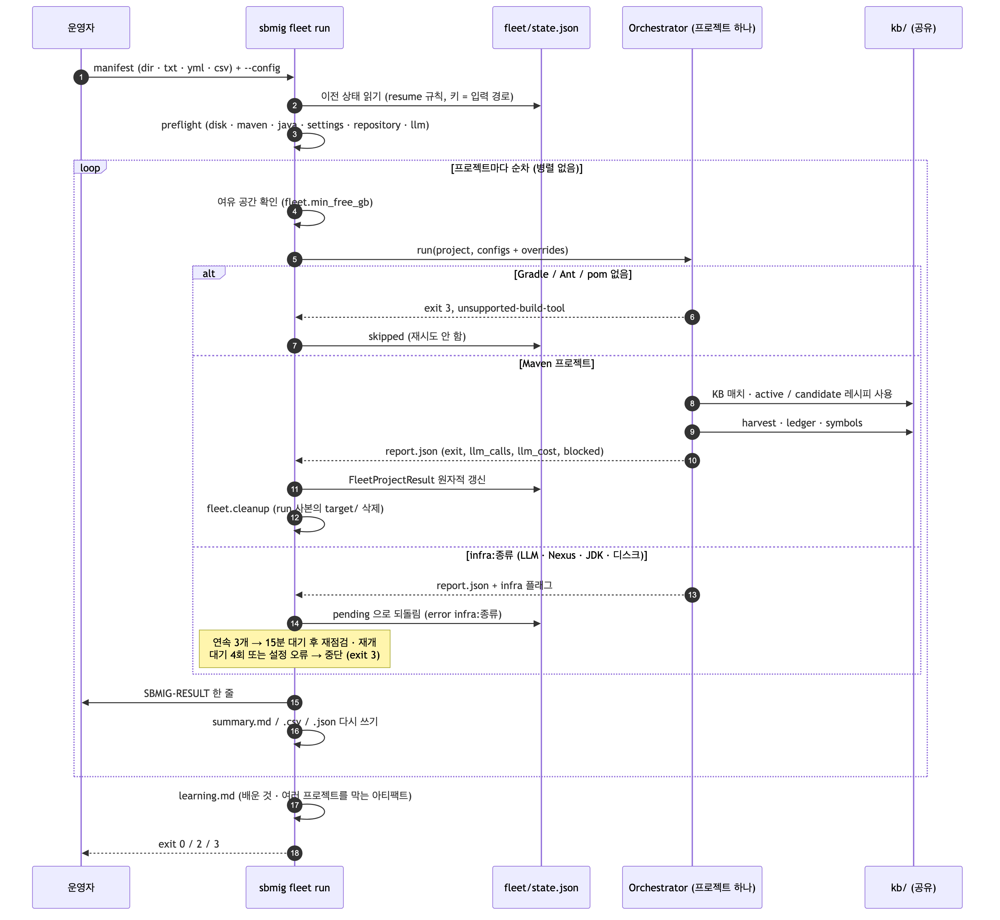

*PNG: `diagrams/fleet.png` · 원본: `diagrams/fleet.mmd`*

한 에이전트가 약 500개 프로젝트를 엄격히 순차로 마이그레이션합니다.
병렬 실행은 없습니다.
각 프로젝트의 수정이 KB에 harvest된 뒤 다음 프로젝트가 시작합니다.

| 항목 | 내용 |
|---|---|
| 명령 | `sbmig fleet run <manifest> --config … --out out/fleet`, `sbmig fleet status`, `sbmig fleet resume [--retry-failed]` |
| 매니페스트 | 디렉터리(`*.zip`과 `pom.xml`이 있는 하위 디렉터리), `.txt`, `.yml`(`name`, `input`, `configs`, `overrides`, `tags`), `.csv` |
| KB | 항상 플릿 공유(`kb.dir`은 프로젝트별로 덮어쓸 수 없음) |
| 상태 | `<out>/fleet/state.json`: 프로젝트마다 `FleetProjectResult`. 매 프로젝트 뒤 원자적으로 다시 씀 |
| 요약 | `<out>/fleet/summary.md` / `.csv` / `.json`. 열: `#`, `name`, `case`, `status`, `exit`, `duration_s`, `llm_calls`, `llm_cost`, `blocked`, `unresolved`, `advisories`, `carried_over`, `kb_used` 등. 합계 줄에 LLM 호출과 비용 |
| 학습 보고서 | `<out>/fleet/learning.md`: 레시피로 만들 심볼, 아직 LLM이 고치는 것, 여러 프로젝트를 막는 아티팩트(라이브러리 담당자에게 넘길 표), advisory 통계 |
| 재개 규칙 | `success`는 다시 돌리지 않음. `incomplete` / `aborted`는 `--retry-failed`일 때만(새 run id `…-r2`). intake에서 거절된 프로젝트는 `skipped`로 남고 재시도하지 않음. `running`으로 남은 프로젝트는 다시 돌림 |
| 종료 코드 | 0 전부 성공, 2 일부 미완료 / skipped, 3 `--stop-on-abort`로 멈춤 |

---

## 12. 운영

### 12.1 설정 계층

```mermaid
flowchart LR
  E0[".env 파일<br/>LLM_BASE_URL · LLM_API_KEY · LLM_MODEL …<br/>(셸 변수가 우선)"] --> E1["config/default.yml"]
  E1 --> E2["--config a.yml b.yml …<br/>(회사 artifacts.yml 등, 순서대로 deep merge)"]
  E2 --> E3["CLI / API overrides<br/>(--llm-plugin, --stop-after 등)"]
  E3 --> E4["SBMIG_* 환경 변수<br/>SBMIG_LLM__MODEL (__ = 중첩)"]
  E4 --> E5["${VAR:-default} 확장"]
  E5 --> CFG["Config (pydantic)"]
```

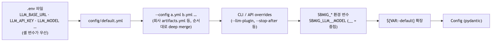

*PNG: `diagrams/config-layering.png` · 원본: `diagrams/config-layering.mmd`*

`load_config`는 다음 순서로 합칩니다.
먼저 `.env` 파일을 환경에 읽어 들입니다(셸에 이미 있는 변수가 이깁니다).
그다음 `config/default.yml`, `--config`로 준 yml(순서대로 deep merge), CLI / API overrides, `SBMIG_*` 환경 변수(`__`는 중첩, 예: `SBMIG_LLM__MODEL`)를 적용합니다.
마지막으로 `${VAR:-default}`를 확장합니다.
키는 yml에 쓰지 않고 환경에서만 읽습니다.

### 12.2 주요 설정 키

| 키 | 기본값 | 의미 |
|---|---|---|
| `plan.parent_phase` | `restructure`(회사 설정 `spring`) | parent / 레이아웃 적용 시점 |
| `plan.optional_bump_phase` | `spring` | optional 상향 시점 |
| `plan.intermediate_builds` | `true` | `false`면 `jdk21.loop` 생략 |
| `plan.advisor` | `none` | `llm`이면 recipe 모델이 화이트리스트 레시피 추가 |
| `loop.phases.<phase>` | jdk21 compile 3 / spring test-compile 6 / restructure package 6 / verify package 3 | goal과 수정 라운드 |
| `loop.max_llm_calls` | 60 | 실행당 LLM 호출 상한 |
| `loop.max_total_minutes` | 180 | 실행 시간 상한 |
| `loop.stall_limit` | 2 | escalation 시작 stall 수준 |
| `loop.max_llm_attempts_per_cluster` | 2 | 쓸모없는 답 허용 횟수 |
| `loop.verify_extra_llm_attempts` | 2 | verify 루프에서 풀린 클러스터의 추가 시도 |
| `loop.blocked_policy.*` | javax 0, API 1, artifact 0, parent 0, plugin 1, source 0, encoding 0 | blocked 전 LLM 허용 횟수 |
| `build.skip_tests` | `true` | 모든 빌드에 `-DskipTests` |
| `build.skip_test_compile` | `false`(회사 설정 `true`) | 모든 빌드에 `-Dmaven.test.skip=true`, 플래그 `tests-not-compiled` |
| `build.settings_file` | `null` | 사내 Nexus `settings.xml`(pom 저장소용 catch-all 미러) |
| `build.java_home` | `null` | JDK 21 경로(고정 권장) |
| `build.source_encoding_policy` | `set-property` | `convert-utf8`이면 소스를 UTF-8로 변환 |
| `build.pom_repositories` | `keep` | `remove`면 `strip-pom-repositories` |
| `llm.provider` | `company` | `company`, `openai_compatible`, `anthropic`, `fake`, `plugin` |
| `llm.model` / `escalation_model` / `recipe_model` | `LLM_MODEL` / `LLM_ESCALATION_MODEL` / `LLM_RECIPE_MODEL` | 역할별 모델 |
| `llm.payload_extra` | `{need_origin: true}` | 게이트웨이 JSON에 추가할 필드 |
| `llm.timeout_seconds`, `llm.max_retries`, `llm.cooldown_seconds` | 180, 3, 60 | 호출 시간, 재시도, cool-down |
| `llm.max_context_chars`, `llm.max_context_rounds` | 60000, 2 | 프롬프트 예산, 컨텍스트 라운드 |
| `llm.pricing` | `gpt-5.6-terra`, `gpt-6-luna` 단가 | 비용 계산 |
| `report.language` | `en`(회사 설정 `ko`) | `report.md` 언어 |
| `report.javax_api_inventory` | `true` | finalize의 dependency tree 인벤토리 |
| `layout.boot_as_is` | `in-place` | Boot as-is 처리 |
| `layout.multi_module_policy` / `merge_collision` | `merge` / `first-wins` | 멀티 모듈 처리 |
| `layout.drop_managed_versions` | `gte` | 관리 버전 정리 |
| `layout.web_xml_registrations` | `generate` | web.xml → `WebXmlRegistrations` (`followup`이면 노트만) |
| `kb.dir`, `kb.auto_promote_after_projects`, `kb.try_candidates_in_plan` | `kb`, 2, `true` | KB 위치, 승격 기준, 후보 실행 |

### 12.3 CLI

| 명령 | 용도 |
|---|---|
| `sbmig run <dir|zip> --config …` | 마이그레이션 한 번(`--stop-after`, `--dry-run`, `--llm-plugin`, `--fix-plugin`, `--log-file`) |
| `sbmig analyze`, `sbmig plan` | 변경 없이 프로필 / 계획 출력 |
| `sbmig inventory <dir|zip>` | pom 없는 webapp 트리의 읽기 전용 설명 |
| `sbmig llm-probe [--bare] [--model] [--payload-extra] [--no-system]` | 요청 하나를 보내 정확한 요청, 프록시, 응답을 출력 |
| `sbmig recipes list / show / sets / check [--jars]` | 레시피 카탈로그 확인 |
| `sbmig advisories list / show / check` | advisory 파일 확인 |
| `sbmig kb stats / list / show / match / promote / reject / ledger / symbols / learning / export / import / reindex / validate` | KB 관리 |
| `sbmig fleet run / status / resume` | 플릿 |
| `sbmig serve [--graceful-timeout]` | 웹 UI |
| `sbmig parse-log`, `sbmig build`, `sbmig rewrite` | 디버깅 도구 |

### 12.4 로그와 journal

| 질문 | 볼 곳 |
|---|---|
| 지금 어느 단계인가 | `sbmig.log` 끝, journal의 마지막 `phase_start` / `step_start`, 웹 UI 그래프 줄 |
| 왜 이 스텝인가 | `plan.json`의 `notes`, `sbmig plan` 출력 |
| 빌드가 왜 실패했나 | journal `build`의 `log` 경로, `sbmig parse-log <로그>` |
| LLM이 몇 번 불렸고 얼마인가 | 보고서 요약 표와 "LLM usage and cost", journal `loop_end`의 `llm_calls_used` |
| 실행이 성공인가 | journal 마지막 `report` 줄의 `success`와 `flags`, 종료 코드 |
| 멈춘 것 같다 | 워치독 줄, `threads-*.txt`, 웹 `GET /api/threads` |

journal 마지막 줄이 `report`가 아니면 프로세스가 강제 종료된 것입니다.
`llm.record_dir`을 지정하면 LLM 요청 / 응답이 `llm-NNNN.json`으로 남습니다(키 없음).

### 12.5 웹 UI

`sbmig serve --port 8765` 또는 `uvicorn sbmig.web.app:app`으로 띄웁니다.

| 경로 | 동작 |
|---|---|
| `GET /` | 페이지(`static/index.html`) |
| `GET /api/configs` | 선택할 수 있는 `config/*.yml` |
| `GET /api/runs`, `GET /api/runs/{id}` | 실행 목록과 상태 |
| `POST /api/runs?name=…&configs=…[&stop_after=…][&llm_provider=…]` | zip 업로드 → 202, `queued` 또는 `running` |
| `GET /api/runs/{id}/events` | SSE 스트림(`status`, `node`, `error`, `journal`, `log`, `report`, `ping`, `end`) |
| `POST /api/runs/{id}/stop` | 현재 그래프 노드 뒤에서 멈춤 |
| `GET /api/runs/{id}/files/{name}` | `report.md`, `report.json`, `result.zip`, `sbmig.log`, `journal.jsonl`, `changes.patch`, `plan.json`, `profile.json` |
| `GET /api/threads` | 스레드 덤프(응답 + 파일) |

### 12.6 Windows

| 주제 | 동작 |
|---|---|
| 콘솔 코드 페이지 | git과 Maven 출력은 에이전트가 UTF-8로 직접 디코딩. `changes.patch`는 git diff 원본 바이트(MS949 소스는 패치에서도 MS949) |
| 타임아웃 종료 | Maven 타임아웃(`build.timeout_minutes`) 시 `taskkill /PID <pid> /T /F`로 프로세스 트리 전체 종료 |
| git | 비대화형, 타임아웃 적용 |
| 스레드 덤프 | SIGUSR1이 없으므로 워치독 자동 덤프(300초)와 `curl.exe http://127.0.0.1:8765/api/threads` |
| `mvn.cmd` | Maven 실행 파일을 Windows 이름으로 해석 |

---

## 13. 검증

| 항목 | 내용 |
|---|---|
| 오프라인 테스트 | `python -m pytest -m "not integration"` → 1,632개 수집(약 3분). Python만 필요 |
| 통합 테스트 | `python -m pytest -q -m integration`: 실제 mvn + OpenRewrite(JDK 21, 네트워크 필요) |
| e2e | `scripts/e2e.sh [--only boot2,msa]` → `out/e2e/summary.md`. 픽스처마다 `expected.json`과 비교. `JAVA21_HOME`, Maven, Maven Central 필요 |
| KB 데모 | `scripts/demo-kb/run.sh`: 1회차 LLM 수정 → harvest → 2회차는 KB 레시피로 LLM 0회 |
| 플릿 데모 | `scripts/fleet-demo.sh`: 여러 픽스처를 새 KB로 순차 실행 |
| 문서 동기화 | `tests/docs/test_handbook.py`가 핸드북의 경로, 설정 키, CLI 이름을 코드와 대조 |

픽스처는 27개입니다(`fixtures/projects/*/expected.json`).

| 케이스 | 픽스처 |
|---|---|
| `spring_boot` (13) | `boot2`, `boot2-cloud-legacy`, `boot2-hystrix-command`, `boot2-javax-lib`, `boot2-javax-lib-optional`, `boot2-method-rename`, `boot2-qlrm-javax`, `boot2-rewrite-excluded`, `boot3`, `company-boot-single`, `legacy-role-parents`, `multi-module-conflict`, `multi-module-merge` |
| `pure_java` (5) | `enforcer-java8-werror`, `euckr-legacy`, `java6-legacy`, `missing-artifact`, `pure-java` |
| `spring_legacy` (4) | `company-spring5-web`, `legacy-external-config`, `legacy-ibatis`, `spring5-xml` |
| `servlet_tomcat` (3) | `company-servlet-jsp`, `servlet-tomcat`, `servlet-webxml-legacy` |
| `msa` (2) | `msa`, `msa-shared-lib` |

회사 레이아웃 픽스처(`legacy-role-parents`, `company-boot-single`, `company-spring5-web`, `company-servlet-jsp`, `servlet-webxml-legacy`)는 각자의 `sbmig.e2e.yml`로 회사 레이아웃을 씁니다.
나머지 픽스처는 `config/artifacts.local-e2e.yml`의 `module/boot-jar` + `module/comp-jar` 레이아웃으로 고정되어 있습니다.
로컬 e2e는 사내 좌표 대신 공개 대체물(`spring-boot-starter-parent` 4.1.0 등)을 씁니다.
실제 사내 좌표는 `config/artifacts.example.yml`의 자리표시자를 회사에서 채워 씁니다.

| 시나리오 | 픽스처 |
|---|---|
| X1 javax 라이브러리 / optional 경로 / 서드파티(X1b) | `boot2-javax-lib`, `boot2-javax-lib-optional`, `boot2-qlrm-javax` |
| X2 메서드 이름 변경 학습 | `boot2-method-rename` |
| X3 아티팩트 없음 | `missing-artifact` |
| E1 / E4 / E5 / S8 레거시 빌드 | `euckr-legacy`, `enforcer-java8-werror`, `java6-legacy` |
| E13 / E14 레시피 빈틈 | `boot2-rewrite-excluded` |
| advisory(springfox, sleuth, hystrix, iBATIS) | `boot2-cloud-legacy`, `boot2-hystrix-command`, `legacy-ibatis` |
| 외부화 설정 | `legacy-external-config` |
| merge / 충돌 | `multi-module-merge`, `multi-module-conflict` |
| W1 web.xml 등록 | `servlet-webxml-legacy` |
