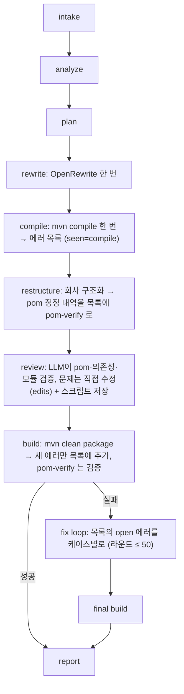
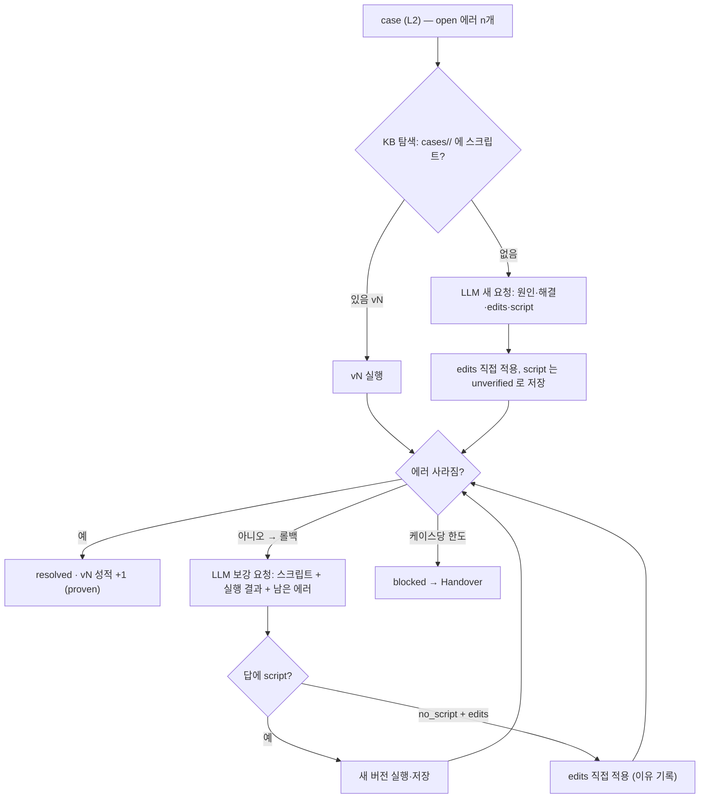

# sbmig v2.1 — "추적되는 로그, 에러 목록 하나, LLM이 직접 고친다"

브랜치 `flow-v2`, 2026-10-27 시작. v2(`docs/v2/PLAN-v2.md`)를 회사에서 처음 돌려 본 현업의 피드백을 반영합니다.

## 1. 현업 피드백 (원문 요약)

1. 로그가 추적이 안 된다. `sbmig.log`의 각 줄이 분석기·레시피 선정·OpenRewrite·구조화 중 어느 단계인지 대괄호로 보이게.
2. OpenRewrite를 다 돌린 뒤 **compile을 한 번** 돌리고, 나온 에러 목록을 전부 보관.
3. 구조화하면서 고친 pom 내역도 에러 목록에 넣고 상태만 `pom verify`로. 그 뒤 빌드에서 기존 에러는 두고 **새 에러만** 목록에 추가, 루프는 이 목록을 해결.
4. LLM 답에 **원인 · 해결 방법 · 수정 · 스크립트**. 같은 케이스가 있었으면 먼저 그 스크립트를 실행하고, 실패하면 보강을 요청. 코드로 안 되면 이유를 적고 **직접 수정**.
5. 수정 루프 **라운드(빌드) 50회**.
6. 파일을 너무 많이 남긴다. 쓸모없는 건 남기지 말 것. KB도 "에러 로그를 쭉 적재하는" 단순한 구조로.
7. "첫 프로젝트인데 KB match가 떴다" — 탐색 **결과**가 로그에 없어서 생긴 오해. 탐색 결과(저장본 없음 / 있음 vN)를 반드시 적는다.
8. "코드 수정분이 로깅에 없다" — 적용한 diff를 로그와 에러 목록에 남긴다.

## 2. 결정 (2026-10-27, 사용자)

| 항목 | 결정 |
|---|---|
| 구조 점검 | 유지. LLM이 pom·의존성·모듈을 검증하고 문제가 있으면 **직접 수정**(`<edits>`). 스크립트도 받아 KB에 저장 |
| KB | `kb-v2/errors.jsonl` 하나(에러 내용 + LLM 답변 + 어떻게 고쳤는지 + 결과) + `kb-v2/cases/<case_id>/`(스크립트 파일, `case.json`). 카탈로그·뷰·audit·quarantine·reviews·fix_attempts·meta.json 삭제. 연관 키는 `case_id`(L2) · `run_id` · 에러 id · 스크립트 버전만 |
| 답변 형식 | `<analysis>`(원인) `<solution>`(해결 방법) `<edits>`(수정, JSON) `<script>`(스크립트) [`<no_script>`(코드로 안 되는 이유)] |
| 순서 | KB 탐색 → 저장 스크립트 실행 → 실패하면 보강 요청 → 코드로 안 되면 이유 + 직접 수정 → 처음 보는 케이스는 직접 수정 + 스크립트 저장 |
| 한도 | 빌드 라운드 50회. LLM 호출 수 제한 없음(`loop.max_llm_calls: 0`). 케이스당 저장본 1 + LLM 3회는 유지 |
| 게이트웨이 | tool calling 없음(messages만) → 수정은 답변 형식으로 받아 sbmig가 적용 |

## 3. 흐름



### 3.1 수정 루프 (케이스 하나)



- 라운드마다 빌드 1회. 채점·롤백은 round 10 규칙 그대로(improved / partial / no_change / regressed → 되돌림 / inconclusive).
- 같은 라운드에서 pom 을 고친 뒤의 같은 모듈 케이스는 다음 빌드까지 미룸(v2 step 4).
- 저장 스크립트 상태: `unverified`(처음 저장) → `proven`(다른 프로젝트에서 재사용 성공) → `retired`(사람). 재사용 순서: proven 최신 → unverified 최신.

### 3.2 로그 (`sbmig.log`, 콘솔 동일)

`시각 레벨 [단계] 메시지`. 단계: `intake` `analyze` `plan` `rewrite` `compile` `restructure` `review` `build` `fix r3` `fix r3 7a52b1cea8`(라운드 + 케이스) `kb` `report` `fleet`.

```
10:12:03 INFO  [compile] mvn compile: 23 error(s) → 목록에 23건 (seen=compile)
10:12:40 INFO  [restructure] module/comp-jar/pom.xml: parent → base-parent 4.0.0 (pom-verify #24)
10:13:10 INFO  [review] 3 pom, 2 module; LLM 판정: issues (critical 1, warning 2)
10:13:11 INFO  [review] 수정: module/comp-jar/pom.xml (+1 −1) — project.build.sourceEncoding=MS949 … diff 4 lines
10:14:00 INFO  [build] mvn clean package: 25 error(s), 새 에러 2건 추가, pom-verify 1건 resolved
10:14:00 INFO  [fix r1] 25 open → 10 case(s); 순서: package_does_not_exist 먼저
10:14:00 INFO  [fix r1 7a52b1cea8] 4 error(s) in 2 file(s): package jakarta.xml.bind does not exist
10:14:00 INFO  [fix r1 7a52b1cea8] KB 탐색: 저장된 스크립트 없음 (처음 보는 케이스) → LLM 에 새 수정 요청
10:14:21 INFO  [fix r1 7a52b1cea8] LLM 답변 (21s): 원인 … / 해결 … / edits 1 / script 있음
10:14:21 INFO  [fix r1 7a52b1cea8] 적용(edits): module/comp-jar/pom.xml (+6 −0), 커밋 a1b2c3d
10:14:21 DEBUG [fix r1 7a52b1cea8] diff:
+    <dependency> … 
10:14:21 INFO  [fix r1 7a52b1cea8] 스크립트 v1 저장 (unverified) → cases/7a52b1cea8/fix_v1.py
10:15:00 INFO  [fix r2] build 2: 2 error(s); resolved 23 (case 7a52b1cea8 4/4, …), open 2
```

### 3.3 에러 목록 (실행 디렉터리 `errors.jsonl`, 사람용 `errors.md`; 실행 끝에 KB `errors.jsonl` 에 추가)

한 줄 = 에러 한 건(또는 pom-verify 한 건). 필드는 `sbmig/core/models.py` `ErrorEntry` / `FixTry` 가 전부입니다:
id, run_id, project, case_id, l2, kind, file, line, module, message, raw(≤ 600자), seen(`compile` | `restructure` |
`review` | `build` | `fix r3`), status(`open` | `pom-verify` | `resolved` | `blocked` | `unresolved` | `note`), tries[
n, round, source(`kb-script` | `llm-new` | `llm-augment` | `llm-edit` | `review`), script_version, analysis, solution,
no_script_reason, applied(`script` | `edits` | `none`), files, diff, commit, result, note, llm_calls, seconds ],
resolved(`r3 try 2` | `build` | `review`), script(`cases/<id>/fix_v2.py`), note.

### 3.4 KB (`kb-v2/`)

```text
kb-v2/
├── errors.jsonl                 모든 실행의 에러 (3.3 과 같은 레코드)
├── cases.md                     케이스 표 (실행마다 다시 씀): case_id · 이름 · 프로젝트 수 · 스크립트 버전/상태 · 마지막 결과
└── cases/<case_id>/
    ├── case.json                case_id, l2, name, projects, scripts[version, file, status, successes, failures, projects, created_by], last_analysis, last_solution
    ├── fix_v1.py
    └── fix_v2.py
```
없어지는 것: `catalog/`, `views/`, `audit.jsonl`, `quarantine.jsonl`, `reviews.jsonl`, `fix_attempts.jsonl`, `scripts/*/meta.json`, `index.json`. 남는 것: `.lock`(순차 실행이라도 웹·플릿이 같은 KB 를 쓰므로), 비밀값 가림.

### 3.5 실행 디렉터리

남김: `errors.jsonl`, `errors.md`, `report.md`, `report.json`, `sbmig.log`, `changes.patch`, `journal.jsonl`(웹 스트림), `plan.json`, `profile.json`, `logs/`(mvn · rewrite 로그), `result.zip`, `project/`.
없앰: `error_cases.csv`, `error_cases.jsonl`, `fix_attempts.jsonl`, `deptree/`, `rewrite/`(로그는 `logs/` 로), `effective/`(구조화가 쓰고 지움).

### 3.6 LLM 답변 계약 (수정 루프 · 구조 점검 공통)

```text
<analysis>왜 깨졌나 (원인)</analysis>
<solution>어떻게 고치나 (해결 방법, 사람이 읽을 한 문단)</solution>
<edits>
[{"op": "replace", "path": "module/comp-jar/pom.xml", "old": "…", "new": "…"},
 {"op": "write", "path": "…", "content": "…"}, {"op": "create", …}, {"op": "delete", "path": "…"},
 {"op": "pom", "path": "pom.xml", "add_dependency": {"group_id": "…", "artifact_id": "…", "version": null}}]
</edits>
<script>
def fix(p): …            # 같은 케이스를 다른 프로젝트에서 고칠 재사용 스크립트 (helper API p)
</script>
```
- `<edits>` 는 sbmig 가 같은 helper API(`sbmig.script`) 로 즉시 적용(프로젝트 폴더 안, 경로 검사, 동일 guard) — "LLM 이 직접 수정".
- `<script>` 가 없으면 `<no_script>이유</no_script>` 를 쓴다(코드로 해결이 안 되는 이유). 보강 요청에서 스크립트 대신 edits 로 답해도 같다.
- `<need_files>` / `<need_grep>` 라운드는 그대로.

## 4. 작업 (에이전트, 디렉터리 분리)

| 담당 | 범위 |
|---|---|
| PM | 이 플랜, 계약(`ErrorEntry`, `FixTry`, `CaseInfo`, `FixAnswer`/`Edit`, 로그 단계 컨텍스트, 설정), 통합·e2e·커밋 |
| E1 에러 목록·KB | `sbmig/errors/`(새 패키지: 실행 목록 + KB 적재 + cases 폴더 + `errors.md`/`cases.md` 뷰 + `sbmig kb` CLI 축소) — `sbmig/kb/`, `sbmig/loop/error_tracker.py` 대체, 관련 테스트 |
| E2 흐름·루프 | 오케스트레이터(compile 단계, pom-verify, 새 에러 병합, 점검 결과 반영), fixloop(사다리: 탐색 → 저장본 → 보강 → 직접 수정, 로그 줄, 단계 컨텍스트), triage/scripts, graph, plan(compile 단계), 테스트 |
| E3 LLM 답변·점검 | `sbmig/fix`(새 형식 파서·프롬프트, edits → 스크립트 합성 적용), `sbmig/script`(edits 적용 API), `sbmig/review`(검증 + 직접 수정), 테스트 |
| E4 로그·리포트·파일 | `sbmig/core/diag.py` 단계 컨텍스트 + 포맷, `sbmig/cli.py`·웹 로그 설정, `sbmig/report`(errors 기반 슬림 리포트), 실행 디렉터리 파일 축소(`workspace`, `build`, `rewrite` 출력 경로), 플릿 요약, 테스트 |

## 5. 상태

| 단계 | 상태 |
|---|---|
| 계약 | 진행 중 (2026-10-27) |
| E1–E4 | 대기 |
| 통합 · e2e · 문서 | 대기 (핸드북·설계 문서는 사용자가 요청할 때) |
