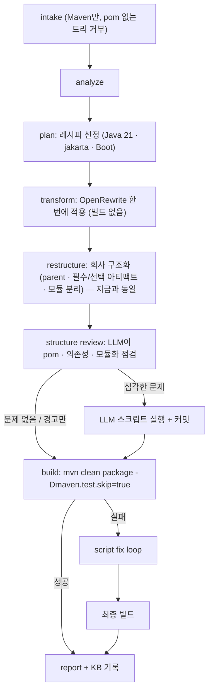
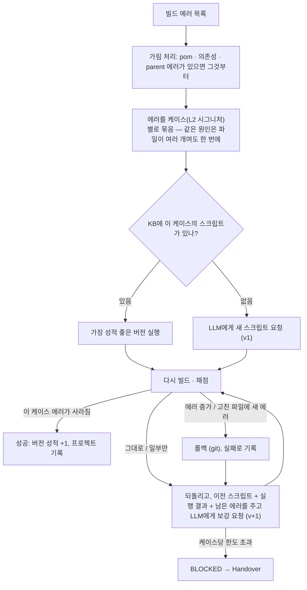
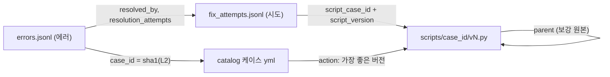

# sbmig v2 — "변환 먼저, 고치는 건 LLM 스크립트로" 흐름 플랜

브랜치: `flow-v2` (2026-10-26 시작). 안정 버전: 태그 `company-v1` (= 그 시점의 `main`, 회사에서 돌리던 흐름).
v2는 이 브랜치에서 흐름 자체를 교체합니다(현업 결정). `main`과 KB를 섞지 않도록 v2의 기본 KB 폴더는 `kb-v2/`입니다.

## 1. 현업 요청 (원문 요약)

1. intake → 분석 → 레시피 선정.
2. OpenRewrite를 한 번에 전부 적용. **중간 컴파일 검증 없음.**
3. 그 뒤 구조화(모듈화)는 지금처럼 Boot / Spring / Java 판단에 따라 진행.
4. pom 파일, 의존성, 모듈화가 제대로 됐는지 **LLM에게 확인**받고 빌드.
5. 빌드 성공 → 리포트. 실패 → 에러 목록을 만들어 하나씩 고침. 에러가 늘거나 새 에러가 생기면 **롤백**, 기존처럼 기록. **고치는 건 무조건 LLM.**
6. LLM은 고칠 때 **파이썬 코드 뭉치**(수정 스크립트)를 주고, 그것을 케이스처럼 쌓는다.
7. 같은 문제(같은 케이스)가 전에 있었으면 **이전 케이스의 코드를 먼저 실행**해 보고, 실패하면 그 코드를 **보강**해서 해결.
8. 최종적으로 테스트 스킵으로 패키징까지 완료.

## 2. 결정 사항 (2026-10-26, 사용자 확인)

| 항목 | 결정 |
|---|---|
| OpenRewrite 레시피 | **Java 21, javax→jakarta, Spring Boot 레시피만**: `UpgradeToJava21`, `JavaxMigrationToJakarta`, Boot 프로젝트에 `UpgradeSpringBoot_4_0` + `SpringBootProperties_4_1`. Spring Framework 7 / Security 체인, 우리가 만든 프로젝트 레시피, 라이브러리 레시피, KB 레시피, JUnit 5 레시피는 돌리지 않음 ("레시피가 무엇을 바꿀지 모르니 넣지 않는다") |
| 결정적 핸들러 (32개) | 선제 / 반응 모두 **흐름에서 뺌**. 그 부분은 빌드 에러로 모여 LLM 스크립트가 해결 |
| 구조 점검 결과 | **심각한 문제만** LLM 스크립트로 고치고 빌드. 나머지는 기록(리포트, KB)만 |
| 스크립트 안전 | **제한 API만**: 별도 프로세스, 시간 제한, 프로젝트 폴더 안 파일만 읽고 쓰는 도우미 API, 허용된 import만, subprocess·네트워크·eval 금지(실행 전 코드 검사) |
| 어드바이저리 (EOL 라이브러리 67개) | 레시피는 더하지 않고 **LLM 힌트와 Handover로만** |
| 방식 | 브랜치에서 흐름 자체를 교체. 회사 레이아웃·구조화 규칙(`layout.*`, parent / 필수 / 선택 아티팩트)은 그대로 |

## 3. v2 흐름



### 3.1 Script fix loop (한 바퀴)



- **롤백 기준**은 지금과 같습니다: 스크립트가 고친 파일에 새 에러가 생기거나, 전체 에러가 1.5배를 넘게 늘면 되돌립니다. 한 에러를 고치면 javac가 다음 단계의 에러를 보여 주는 경우가 흔해서, "어딘가에 새 에러가 보였다"만으로는 되돌리지 않습니다. 판정할 수 없는 빌드(타임아웃 등)는 `inconclusive`로 둡니다(round 10 규칙).
- **케이스 = L2 시그니처** (지금의 케이스 카탈로그 키). 지금은 에러를 파일별로 묶어 같은 원인이 N개 파일에 있으면 LLM을 N번 불렀지만, v2는 케이스별로 묶어 스크립트 하나가 모든 파일을 고칩니다.
- 케이스당 시도 한도(예: 기존 스크립트 1번 + 보강 3번)를 넘으면 BLOCKED로 Handover에 남깁니다.

### 3.2 수정 스크립트 계약

LLM 답변 형식:

```text
<analysis>무엇이 왜 깨졌고 어떻게 고치는지 (KB에 그대로 기록)</analysis>
<script>
# sbmig-fix
def fix(p):
    for path in p.files("**/*.java"):
        text = p.read(path)
        new = text.replace("javax.annotation.PostConstruct", "jakarta.annotation.PostConstruct")
        if new != text:
            p.write(path, new)
            p.log(f"{path}: PostConstruct import")
</script>
```

도우미 API `p` (프로젝트 폴더 밖은 거부, `.git`·빌드 출력 제외):

| API | 하는 일 |
|---|---|
| `p.errors` | 이 케이스의 에러 목록 (file, line, message, symbol, signature) |
| `p.files(glob)` | 프로젝트 기준 상대 경로 목록 |
| `p.read(path)` / `p.write(path, text)` / `p.exists(path)` | 파일 읽기 / 쓰기(인코딩·줄바꿈 유지) / 존재 확인 |
| `p.replace(path, old, new)` / `p.sub(path, pattern, repl)` | 문자열 / 정규식 치환, 바뀐 개수 반환 |
| `p.create(path, text)` / `p.delete(path)` / `p.move(src, dst)` | 파일 만들기 / 지우기 / 옮기기 |
| `p.pom(path)` | pom 편집: `add_dependency`, `remove_dependency`, `set_dependency_version`, `add_exclusion`, `set_property`, `remove_property`, `set_plugin_version`, `save()` |
| `p.log(msg)` | 실행 로그 (KB에 기록) |

허용 import: `re`, `json`, `textwrap`, `fnmatch`, `posixpath`, `itertools`, `collections`, `functools`, `string`, `math`. 금지: `open`, `exec`, `eval`, `compile`, `__import__`, `os`, `sys`, `subprocess`, `socket`, `pathlib`, `importlib`, 밑줄 두 개로 시작하는 속성 접근. 실행: `python -I` 별도 프로세스, 시간 제한(기본 60초), 결과(JSON: 바뀐 파일, 로그, 예외)를 돌려받고, 실제 변경은 git diff로 기록합니다. 완벽한 격리는 아니지만(파이썬 수준 검사), 실수로 프로젝트 밖을 건드리거나 외부와 통신하는 코드는 실행 전에 막습니다.

### 3.3 구조 점검 (structure review)

- 입력: 구조화 뒤의 모든 pom(길면 자름), 모듈 배치와 packaging, 구조화 메모, 회사 규칙(`artifacts.parent` / `boot_parent` / `comp_parent`, 필수·선택 아티팩트, 레이아웃 규칙), 케이스 유형.
- 출력(JSON): `verdict` (ok / issues), `issues[]` (`severity` critical / warning, `file`, `problem`, `fix_hint`), 심각한 문제가 있으면 `script` (위 계약과 같음).
- 심각한 문제 → 스크립트 실행 → 커밋(되돌릴 수 있게) → 빌드. 경고 → 리포트 "구조 점검" 절과 KB `kb-v2/reviews.jsonl`.

### 3.4 KB (v2)

| 파일 | v2에서 |
|---|---|
| `errors.jsonl`, `fix_attempts.jsonl` | 유지. 시도에 `script_case_id`, `script_version`, `script_parent`, `script_log` 추가. `fix_method`에 `script` (새 스크립트) / `script_reuse` (기존 버전 재실행) / `script_augment` (보강) |
| `catalog/` 케이스 | 유지 (케이스 = L2). `action.kind`에 `script` 추가: 성적이 가장 좋은 버전 |
| **`scripts/<case_id>/v<N>.py` + `v<N>.meta.json`** | **새로**: 케이스별 스크립트 버전. meta = 케이스·L2, 버전, 부모 버전(보강 원본), 만든 실행·프로젝트·모델, LLM 분석, 성공·실패 횟수, 성공한 프로젝트들, 마지막 결과 |
| `reviews.jsonl` | **새로**: 구조 점검 결과 (실행마다 1줄) |
| `audit.jsonl`, `quarantine.jsonl`, 잠금, 비밀값 가림 | 유지 |
| `recipes/`, `cases/`(SEARCH/REPLACE 패치), `patterns/`, `symbols.json`, `index.json`, `ledger.jsonl`, `error_hints.json` | v2 흐름에서 쓰지 않음 → 2단계(정리)에서 제거 여부 결정. 과거 성공·실패 힌트는 스크립트 이력이 대신함 |

정리(4단계) 뒤의 KB는 이렇게 단순해집니다. 케이스 하나에 스크립트 버전들이 붙는 구조라서, 현업이 볼 연결 키가 `run_id` · 에러 id · 시도 id · L2(`case_id`) · 스크립트 버전 다섯 개로 줄어듭니다(지금은 KB 케이스 id, 레시피 id, 에러 심볼 인덱스까지 열 개 남짓).

```text
kb-v2/
├── errors.jsonl                       빌드 에러 1건 = 1줄 (어떤 스크립트 버전으로 고쳤나 포함)
├── fix_attempts.jsonl                 시도 1건 = 1줄 (실행한 스크립트 버전, 실행 로그, git diff, LLM 분석)
├── reviews.jsonl                      구조 점검 1건 = 1줄
├── catalog/<종류>/<분류>/<심볼>--<case_id>.yml   케이스 = L2 (human 블록, 근거, 가장 좋은 스크립트 버전)
├── scripts/<case_id>/v1.py, v1.meta.json, v2.py, v2.meta.json …   케이스별 수정 스크립트와 보강 계보
├── views/cases.md, cases.csv          사람이 보는 표
└── audit.jsonl, quarantine.jsonl, .lock
```



### 3.5 흐름에서 빠지는 것

- 단계별 빌드·수정 루프(jdk21 / spring / restructure), 중간 빌드
- 결정적 핸들러 32개(선제·반응), 반응형 레시피 규칙(`recipe_rules.yml`)
- 레시피 세트: Spring Framework 7, Security 6→7 체인, 프로젝트 레시피(`knowledge/recipes/base/*`), 라이브러리 레시피, JUnit 5, `RemovalsServletJakarta10`
- KB 레시피 후보·승격, SEARCH/REPLACE 패치 재생, 학습 치환(`case-replace`)
- 어드바이저리의 레시피 정책 (힌트와 Handover만 남김)
- LLM의 SEARCH/REPLACE 답변 형식 (스크립트 형식으로 교체)

남는 것: intake, 분석기, 구조화(restructure) 전체, 빌드 실행·로그 파싱·시그니처, 에러 추적기, 롤백·채점(round 10), 리포트·Handover, 플릿·웹·CLI, LLM 게이트웨이 클라이언트, KB 무결성(잠금·가림·스키마 버전).

## 4. 작업 순서

| 단계 | 내용 | 담당 | 끝났다는 기준 |
|---|---|---|---|
| 0 | 브랜치·태그, 이 플랜, 공통 계약: 모델(`ScriptMeta`, 시도·에러 기록의 스크립트 필드, `CaseActionKind` `script`, `FixMethod` 추가), 설정(`script.*`, `review.*`, v2 기본값), 인터페이스 | PM | 계약 테스트 통과 |
| 1a | 스크립트 실행기: 도우미 API, 코드 검사, 별도 프로세스 실행, 경로·시간 제한 | 에이전트 S | 단위 테스트(탈출 시도, 금지 import, 시간 초과, pom 편집) |
| 1b | 스크립트 KB: 버전 저장·선택·성적·보강 계보, 카탈로그 `script` 동작, CLI `sbmig kb scripts list/show` | 에이전트 K | 단위 테스트, 잠금·가림 적용 |
| 1c | 흐름 교체: 플래너(변환 한 번 → 구조화 → 점검 → 빌드), 케이스(L2)별 묶음, 스크립트 결정 사다리(재사용 → 보강 → 새로), 채점·롤백 연결, 핸들러·레시피·패치 경로 제거, 프롬프트(새 스크립트 / 보강) | 에이전트 L | 루프 단위 테스트 |
| 1d | 구조 점검 단계: 입력 조립, 프롬프트, 결과 기록, 심각 → 스크립트, 리포트 절 | 에이전트 R | 단위 테스트 |
| 2 | 통합: 재생(replay) LLM 답을 스크립트 형식으로 만든 v2 e2e 픽스처 (pure-java, boot2, spring5-xml, servlet-tomcat, msa, company-boot-single, company-spring5-web, java6-legacy, 실패 후 보강 시나리오 1개) | PM | 실제 Maven e2e 통과 |
| 3 | 문서: 핸드북(흐름·운영), INTERFACES, KB 지도(스크립트 저장소 추가), 이 플랜의 상태표 | PM / 문서 에이전트 | 문서 테스트 통과 |
| 4 | 정리: 흐름에서 빠진 코드와 그 테스트 제거(핸들러, 레시피 후보, 패치 재생 등) | PM | 전체 테스트 통과 |
| 5 | 회사 시험: 실제 프로젝트 몇 개로 LLM 호출 수·시간·성공률 비교 (`company-v1` 대비) | 사용자 | 결과 공유 |

## 5. 위험과 대응

| 위험 | 대응 |
|---|---|
| 첫 빌드 에러가 매우 많음 (중간 빌드·핸들러가 없으므로) | 가림 순서(pom·의존성 먼저), 케이스별 묶음으로 LLM 호출 수 축소, 루프 한도 상향(`loop.phases.verify.max_iterations`, `loop.max_llm_calls`), 같은 회사 프로젝트를 돌릴수록 스크립트 재사용으로 감소 |
| 초기 프로젝트의 LLM 비용·시간 증가 | 리포트의 LLM 비용 절 그대로 사용, 플릿에서 프로젝트별 비교 |
| LLM 스크립트가 엉뚱한 파일을 넓게 바꿈 | 케이스 에러가 있는 파일을 우선 범위로 안내, 채점·롤백, 바뀐 파일 수가 비정상적으로 많으면 경고 기록 |
| 파이썬 수준 격리의 한계 | 코드 검사 + 별도 프로세스 + 경로 검사 + 시간 제한. 회사 PC 계정 권한 이상은 못 막음을 문서에 명시 |
| Spring Framework 7 / Security 레시피가 빠져 Boot 아닌 Spring 프로젝트의 에러가 많음 | 현업 결정. 어드바이저리 힌트로 보완, 회사 시험에서 수치로 확인 |

## 6. 상태

| 단계 | 상태 |
|---|---|
| 0 | 완료 (2026-10-26): 모델·설정·인터페이스, v2 기본값, 계약 테스트 `tests/core/test_v2_contracts.py`, `docs/INTERFACES.md` "v2 — flow-v2" |
| 1a–1d | 완료 (2026-10-26): S 실행기 `sbmig/script/`, K 스크립트 KB `sbmig/kb/scripts.py` + 카탈로그 `script` 동작 + `sbmig kb scripts …`, F `LLMFixer.propose_script` + 프롬프트, R `sbmig/review/` + 리포트 "구조 점검", P v2 플래너, L 케이스별 스크립트 루프 + 오케스트레이터. 오프라인 테스트 2,465개 통과 |
| 2–5 | 대기 |
